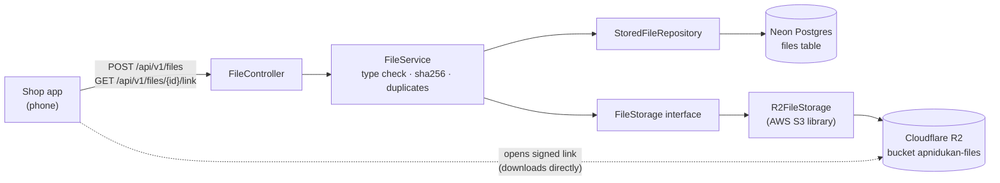
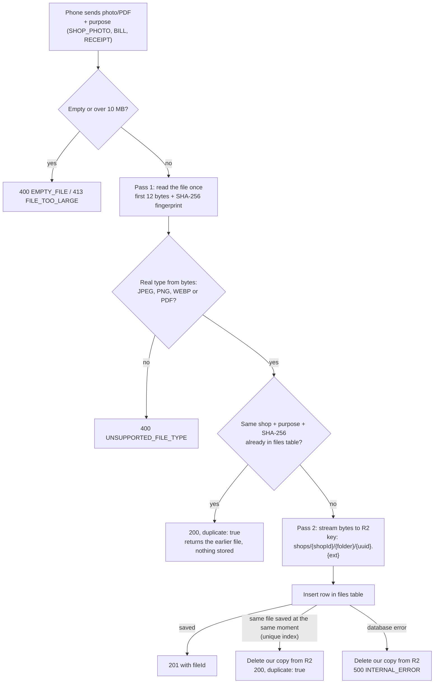
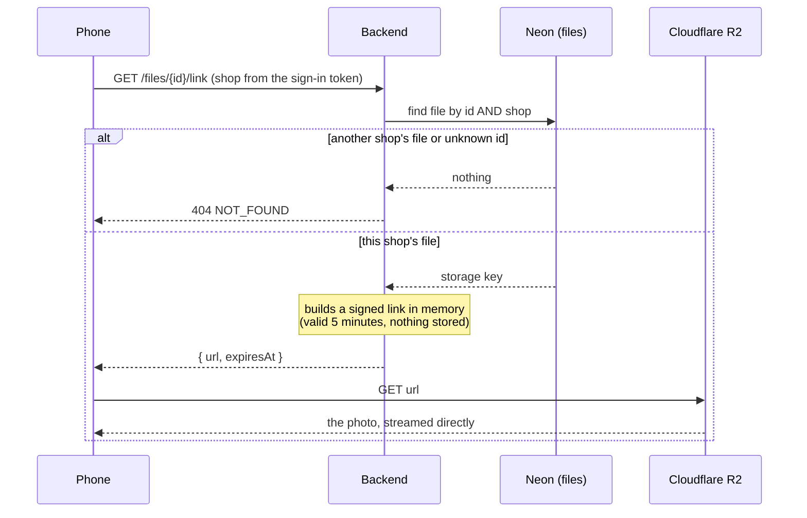
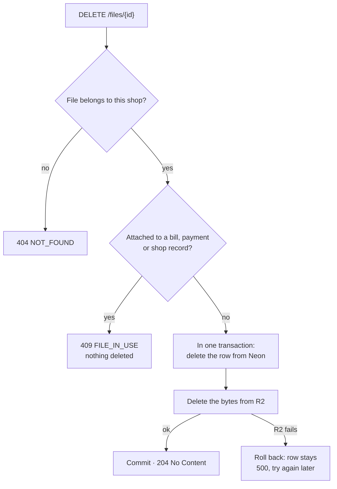
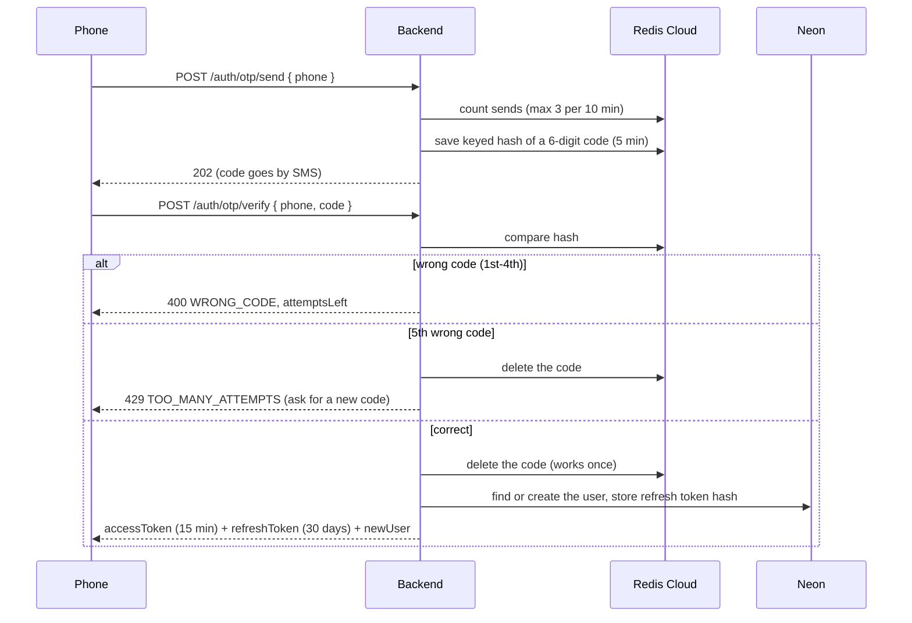
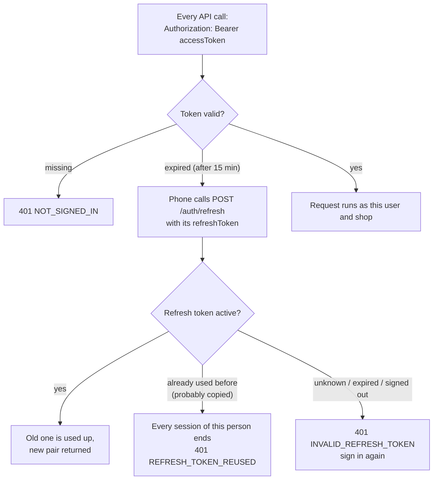

# Apni Dukan – backend

All the backend functionality of Apni Dukan: Spring Boot 4.1 · Java 21 · Neon Postgres · Flyway · Cloudflare R2 · Redis Cloud

Design: see the "Apni Dukan – Low-Level Design (Shop App MVP)" doc.

## What's built so far

| Module | Status |
| --- | --- |
| `common` | Error format, security (JWT check, CORS), current user/shop, clock |
| `auth` | Sign-in with phone OTP, tokens (refresh, sign-out), email verification, account recovery |
| `files` | Upload photos and PDFs to R2, duplicate detection, 5-minute signed links, delete (Neon + R2) |

## How file handling works

Photos and PDFs live in **Cloudflare R2**. **Neon Postgres** keeps one small row per file (`files` table).
The phone never gets the R2 keys: it receives short-lived signed links instead.

### Where things live



### Upload: `POST /api/v1/files`



### View or download: `GET /api/v1/files/{id}/link`



### Delete: `DELETE /api/v1/files/{id}`



## How sign-in works

No passwords and no Google sign-in. The phone number is the account; an email is optional and only used for recovery.
One-time codes live in **Redis Cloud** (never in Postgres); accounts and refresh tokens live in **Neon**.

### Sign in with phone OTP



### Staying signed in



`POST /auth/logout` ends one session. Admin pages (`/api/v1/admin/**`) need an admin account.

### Limits (against guessing and SMS abuse)

| What | Limit |
| --- | --- |
| Tries per code | 5 (the 5th wrong one destroys the code). Every try is counted before checking, so parallel guesses don't get extra tries |
| Codes per phone or email, per network | 3 per 10 minutes, 10 per day (20 per day from all networks together) |
| Wrong codes per phone or email, per network | 10 per day (50 from all networks together), then `429 LOCKED_FOR_TODAY` |
| Per network (IP; IPv6 counted per /64) | 10 code requests and 30 code checks per hour |
| Email codes per account | 10 per day |
| All SMS together | `SMS_DAILY_LIMIT` per day (default 500), then `503 SMS_PAUSED` |
| JSON request body | 64 KB (only `POST /api/v1/files` may be larger, up to 10 MB) |

Limits count per phone **and** network, so a stranger guessing your number from their own network locks only
themselves. Every 429 carries a `Retry-After` header (seconds to wait).

"Signed out everywhere" (recovery, or a copied refresh token) takes effect at once: every access token carries a
session number, and older numbers are refused on their next call. A swapped refresh token coming back within
60 seconds counts as the app retrying (a reply lost on a weak network); later than that it counts as copied.
Only a refresh token that was already swapped
coming back counts as copied; an old device retrying a signed-out token just gets "sign in again".

### Endpoints (`/api/v1/auth`)

| Call | What it does |
| --- | --- |
| `POST /otp/send` `{phone}` | Sends a code. `+91` and a leading `0` are fine. 429 after 3 codes in 10 minutes |
| `POST /otp/verify` `{phone, code}` | Signs in (creates the account the first time) |
| `POST /refresh` `{refreshToken}` | New token pair |
| `POST /logout` `{refreshToken}` | Ends this session, 204 |
| `GET /me` | The signed-in person |
| `POST /email/send-code` `{email, phoneCode?}` | Sends a 6-digit code to the email (10 min). Replacing an already verified email also needs `phoneCode` |
| `POST /email/change-phone-code` | Sends a code to your own phone, needed to replace a verified email. The old email is told after the change |
| `POST /email/verify` `{email, code}` | Marks the email verified |
| `POST /recover/start` | Lost phone: code to the verified email. New email: code to the phone |
| `POST /recover/complete` | Moves the account to the new phone or email and ends every old session |

## Run it on your laptop

1. **Install:** JDK 21 (IntelliJ can download it). IntelliJ's bundled Maven is enough.
2. **Settings:** every `${...}` name in `src/main/resources/application.properties` needs a value.
   Put them in IntelliJ: Run → Edit Configurations → `ApniDukanApplication` → Environment variables
   (or in a `.env` file in this folder; it's ignored by Git).
   - `DB_URL`, `DB_URL_DIRECT`, `DB_USER`, `DB_PASSWORD` from Neon (use the `dev` branch).
     The pooled URL has `-pooler` in the host; the direct one doesn't.
   - `R2_ENDPOINT`, `R2_BUCKET`, `R2_ACCESS_KEY`, `R2_SECRET_KEY` from Cloudflare R2.
   - `REDIS_URL` from Redis Cloud, like `rediss://default:<password>@<host>:<port>`
     (`rediss` with two s = TLS; use `redis://` only if your database has TLS off).
   - `JWT_SECRET`: a long random value, at least 32 characters
     (for example the output of `openssl rand -base64 48`). Changing it signs everyone out.
   - `MSG91_AUTH_KEY` and `MSG91_OTP_TEMPLATE_ID`: the same values as in the OMR project. OTPs are sent as
     real SMS through MSG91 with that template until Apni Dukan has its own DLT registration.
     Later: `SMS_ACCOUNT_MOVED_ENABLED=true` with `MSG91_ACCOUNT_MOVED_TEMPLATE_ID`, the template for
     "your account was moved to a new number ending ##ENDING##" (sent to the old phone after account recovery).
     Off by default until that DLT template exists; required on the real server.
     `SMS_PROVIDER=log` prints SMS in the console instead (only if you choose it, e.g. out of MSG91 credit).
   - `MAIL_USERNAME` (your Gmail address) and `MAIL_PASSWORD` (its 16-letter app password), the same as in
     Vidyavriti. Email codes are sent through Gmail SMTP. `MAIL_ENABLED=false` prints them in the console instead.
   - Optional: `CORS_ALLOWED_ORIGINS`
     (default `http://localhost:5173`, the shop app's dev server; separate several with commas).
   - On the real server only: `APP_PRODUCTION=true`. The app then refuses to start if codes would be printed in
     the log or CORS allows localhost. Optional `SMS_DAILY_LIMIT` (default 500).
   Never commit real values.
3. **Run:** open this folder in IntelliJ, wait for Maven to download, then press ▶ next to `main` in
   `ApniDukanApplication.java`. On first start, Flyway creates the tables (`V1__create_files.sql`, `V2__create_users_and_refresh_tokens.sql`).
4. **Tests:** `mvn test` (or right-click `src/test/java` → Run tests). They start their own Postgres, Redis and S3 stand-in in Docker (Testcontainers),
   so Docker must be running; they never touch Neon, Redis Cloud or R2.

## Try it

**Sign in** (the code arrives by SMS through MSG91)

```bash
curl -X POST http://localhost:8080/api/v1/auth/otp/send \
  -H "Content-Type: application/json" -d '{"phone":"9876543210"}'

curl -X POST http://localhost:8080/api/v1/auth/otp/verify \
  -H "Content-Type: application/json" -d '{"phone":"9876543210","code":"<code from SMS>"}'
```

Copy `accessToken` from the reply and send it on every other call:

```bash
curl http://localhost:8080/api/v1/auth/me -H "Authorization: Bearer <accessToken>"
```

**Files** need a shop. Until shop registration is built (next module), a signed-in person without a shop
gets `403 SHOP_REQUIRED`; the integration tests cover the file calls meanwhile.

```bash
# Upload a bill photo: 201 with the file id; the same file again returns 200 and "duplicate": true
curl -X POST http://localhost:8080/api/v1/files -H "Authorization: Bearer <accessToken>" \
  -F "purpose=BILL" -F "file=@/path/to/bill.jpg"

# Link to view it for 5 minutes (add ?download=true to save instead)
curl "http://localhost:8080/api/v1/files/<id>/link" -H "Authorization: Bearer <accessToken>"

# Delete it from Neon and R2: 204, or 409 FILE_IN_USE if attached to a bill, payment or shop record
curl -X DELETE "http://localhost:8080/api/v1/files/<id>" -H "Authorization: Bearer <accessToken>"
```

`purpose` is one of `SHOP_PHOTO`, `BILL`, `RECEIPT`. Accepted types: JPEG, PNG, WEBP, PDF (checked from the
file's bytes, not its name), up to 10 MB. Another shop's file returns `404`.

## Before going live (checklist)

- **Real caller IPs:** behind Cloudflare + Railway, set the trusted proxy ranges
  (`server.tomcat.remoteip.trusted-proxies`) or read `CF-Connecting-IP`, and check one request's logged IP
  against your phone's. Otherwise all users may share one IP and hit the per-network limits together.
- **Redis Cloud:** set the eviction policy to `noeviction`, so limits and session numbers are never dropped
  under memory pressure.
- **Captcha** (Cloudflare Turnstile) on the sign-in screen, plus an alert well before `SMS_DAILY_LIMIT`.
- `APP_PRODUCTION=true`, own DLT templates, `SMS_ACCOUNT_MOVED_ENABLED=true`, a mail provider with `MAIL_FROM`.

## Errors

Every error looks like `{"code": "UNSUPPORTED_FILE_TYPE", "message": "...", "details": {}}`.
Sign-in errors use the same shape: `401 NOT_SIGNED_IN`, `401 TOKEN_EXPIRED`, `401 INVALID_TOKEN`, `403 FORBIDDEN`.

## Database changes

Only through new Flyway files in `src/main/resources/db/migration` (`V3__...`, `V4__...`).
Never edit a migration that has already run. Hibernate is set to `validate`.
