# Clozest – backend

All the backend functionality of Clozest: Spring Boot 4.1 · Java 21 · Neon Postgres · Flyway · Cloudflare R2 · Redis Cloud

Design: see the "Apni Dukan – Low-Level Design (Shop App MVP)" doc.

## What's built so far

| Module | Status |
| --- | --- |
| `common` | Error format, security (JWT check, CORS), current user/shop, clock |
| `auth` | Sign-in with phone OTP, tokens (refresh, sign-out), email verification, account recovery; admin roles (one super admin, admins), the admin website's email step, and OTP test mode |
| `files` | Upload photos and PDFs to R2, duplicate detection, 5-minute signed links, delete (Neon + R2) |
| `shops` | Registration (details, GPS pin, a kirana's GSTIN/Udyam, kirana or salon, owner and shop photos, a salon's video and trade licence (checked automatically with AI), Submit for visit), field-team pages (dashboard, lists, what changed since approval, decisions with a checklist and notes, timeline), My shop, owner/helper/barber roles, closing a shop for good or handing it over to someone else, history of every change |
| `salon` | Salon setup (services from a catalog with a come-back reminder each, the salon's opening hours, barbers with optional sign-in and photo, weekly hours inside the salon's, booking settings), online booking, walk-ins, start code, no-show and strikes, earlier-slot alerts, breaks, leave, closed days, pause, the automatic end, ratings, the salon list's cards, the rating request and come-back reminder after a visit |
| `kirana` | The kirana's own counter (on `main` with the salons, switched off on the server until kirana launches: see "Kirana switch"): products and stock with a reason for every change, walk-in bills paid in cash, to the shop's own UPI QR or on its khata, the khata book of regular customers, cancelling a bill, the day's totals, and the shop's UPI ID (needed before Submit for visit); stock from photos of distributors' bills and scans, unknown barcodes linked in one tap, counter suggestions and paper bills (round 3) |
| `places` | A customer's saved places (Home, Work, others, up to 10) and their address search: where the customer app looks for salons besides the phone's GPS point |
| `notifications` | Messages queued with the change they report, written in each reader's language (`users.language`; English for none), sent by a job with retries as Web Push (browser notifications) and Firebase Cloud Messaging (the Android apps), and as SMS for each message type whose template id is set; an in-app message list per app with unread counts |

## How file handling works

Photos and PDFs live in **Cloudflare R2**. **Neon Postgres** keeps one small row per file (`files` table).
The phone never gets the R2 keys: it receives short-lived signed links instead.

### Where things live

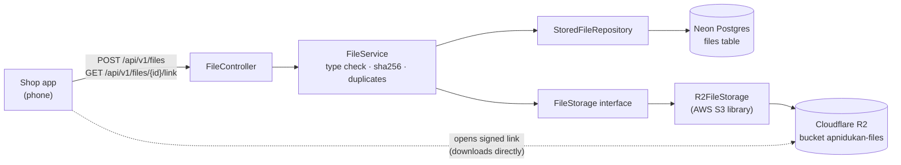

### Upload: `POST /api/v1/files`

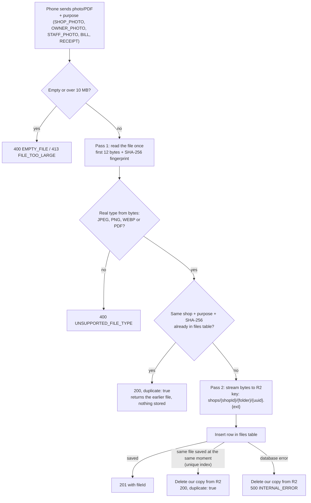

### View or download: `GET /api/v1/files/{id}/link`

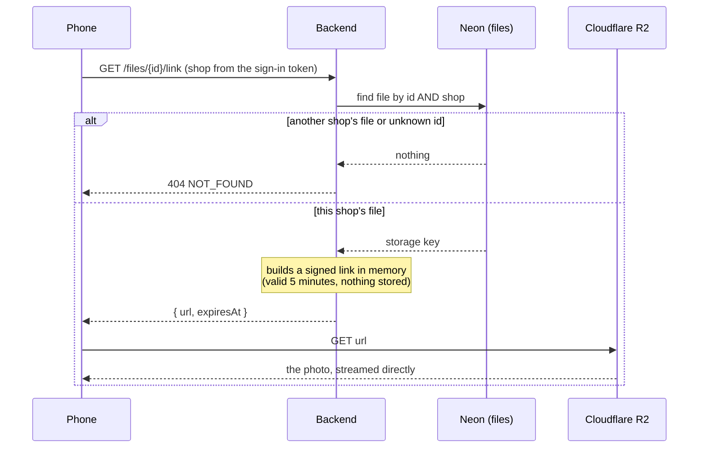

### Delete: `DELETE /api/v1/files/{id}`

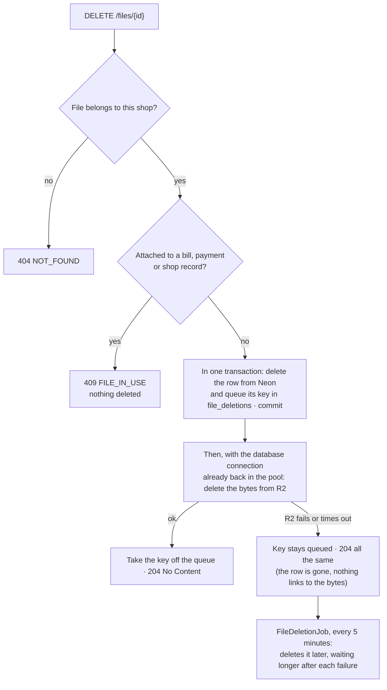

No object is ever left behind for good: its key is queued (`file_deletions`, V19) in the same transaction as its row
goes, and taken off only when R2 confirms. Bytes stored for an upload whose row then couldn't be saved are queued the
same way. `FileDeletionJob` (one server at a time) retries queued keys 100 at a time, at most 2,000 a run, waiting 1,
2, 4 ... minutes after each failure (at most 6 hours) and never giving up; from the 5th failure each one is logged as an
ERROR "R2 still refuses to delete ..." with its key (point an alert at it). Every R2 call is bounded: 5 s per try
(`R2_ATTEMPT_TIMEOUT`), 15 s in all with the library's retries (`R2_CALL_TIMEOUT`); an upload (up to 10 MB) has its
own limit, 60 s per try and 120 s in all (`R2_UPLOAD_TIMEOUT`).

### The salon video: `POST /api/v1/files/video-uploads`

Salon registration needs a short video of the salon (15–45 s, up to 100 MB) for the field team; customers never see
it. A kirana needs none (and can't send one: 409 `NOT_A_SALON`). It is far too big to pass through the backend, so the
phone sends it **straight to R2**, to a staging key that is never the kept video:

```mermaid
sequenceDiagram
    participant P as Partner app (owner)
    participant B as Backend
    participant R as R2
    P->>B: POST /files/video-uploads {sizeBytes, contentType, durationSeconds (or null)}
    B->>B: salon owner only · 15–45 s (±1; null: not checked) · ≤ 100 MB · MP4/MOV/WebM · 5 a day (one at a time per shop)
    B->>B: video_uploads row · staging key queued in file_deletions, due 60 min after the link (45 min after it runs out), never taken off
    B-->>P: 201 {uploadId, uploadUrl (15 min, staging key), expiresAt, expiresInSeconds}
    P->>R: PUT uploadUrl (Content-Type as given) with a progress bar
    P->>B: POST /files/video-uploads/{id}/complete (within 45 min of the link)
    B->>R: HEAD staging (size must match)
    B->>R: copy staging → a new key of its own (queued first, due in 24 h)
    B->>R: HEAD + first 64 bytes of the copy (size; video ftyp brand / EBML)
    B->>B: files row (SHOP_VIDEO)
    B-->>P: 201 {id, purpose: SHOP_VIDEO, ...} (200 the same file again)
    P->>B: PUT /shops/me/video {version, fileId} · the copy is taken off the deletion queue
```

- **Answers:** `start`: 201; 400 `VALIDATION_FAILED` (`durationSeconds`), 400 `UNSUPPORTED_FILE_TYPE`, 413
  `FILE_TOO_LARGE`, 403 `OWNER_ONLY` (helpers, barbers), 409 `NOT_A_SALON`, 429 `TOO_MANY_UPLOADS` (5 links a shop a
  day; starts at the same moment are counted one after the other under an advisory lock). `complete`: 404
  `UPLOAD_NOT_FOUND`, 409 `UPLOAD_NOT_FINISHED` (nothing stored yet: send it again), 409 `UPLOAD_EXPIRED` (more than
  45 minutes after the link: start again), 409 `UPLOAD_GONE` (completed, then replaced, or purged unused after a day), 400
  `UPLOAD_SIZE_MISMATCH` or `UNSUPPORTED_FILE_TYPE` (a photo or sound file in the same box family, e.g. HEIC, AVIF,
  M4A, is refused). `PUT /shops/me/video`: 400 `fileId` unless it is this shop's SHOP_VIDEO, 409 `UPLOAD_GONE` once it was purged; a salon's owner only;
  like a new photo, a new video on a live salon sends it back to the field team ("Salon video" in its changes).
- **What is kept is what was checked:** the link writes only the staging key; the kept video is a copy made inside R2
  and checked after copying, under a key no link can write. A PUT to the same link after "complete" changes nothing
  kept and is deleted with the staging key. **R2's check of the signed Content-Length isn't relied on**: the size is
  checked on the staging object and on the copy.
- **Nothing is left behind:** the staging key is deleted 60 minutes after the link was given (45 minutes after the
  link ran out, so after the 45-minute window to complete); a completed video not set on the shop within 24 hours is
  deleted together with its files row (then setting it, or completing its upload again, answers 409 `UPLOAD_GONE`
  "This video expired. Upload it again."); a video replaced by a new one loses its row in the same transaction and its bytes
  are queued for deletion due now (a refused save, e.g. 409 `SHOP_CHANGED`, changes nothing). All by
  `FileDeletionJob`, which also forgets upload rows older than 7 days. It claims due keys with `FOR UPDATE SKIP
  LOCKED` (pushed later while it works on them), and `PUT /shops/me/video` locks the video's queue row before taking
  it off: a save and a purge at the same moment never both win (the save waits, then answers `UPLOAD_GONE`; or the
  job skips the row the save holds). A key whose files row is still used is taken off the queue, never deleted. A `POST /files` with purpose `SHOP_VIDEO` is
  refused (videos only come through the link).
- **Who sees it:** the owner (`GET /files/{id}/link`, `shopVideoFileId` in `GET /shops/me`; a helper gets 403
  `OWNER_ONLY` for the video's link and delete) and the field team (`videoUrl` on `GET /admin/shops/{id}` only, not in
  lists). Never in the customer app's answers.
- **Submit:** `POST /shops/me/submit` for a salon answers 409 `PHOTOS_REQUIRED` with `shopVideoFileId: "add a short
  video of the salon"` until it is set. Shops already approved before this version aren't asked for one.
- **Approval doesn't check for a video (intended):** `POST /admin/shops/{id}/approve` and `/reinstate` don't require
  it, so a salon submitted before this version (already `PENDING_VISIT`), or suspended and reinstated, is approved
  without one; the field team sees "No video yet". Only submitting needs it.
- **Migrations:** V26 (table and column, its foreign key `NOT VALID`), V27 (index, built concurrently), V28 (validates
  the foreign key, as V23 did).

**One-time setup in Cloudflare (needed before the video step works):** the phone's browser PUTs to R2 from the partner
app's address, so the bucket needs a CORS rule. Cloudflare dashboard → R2 → the bucket (`R2_BUCKET`) → Settings →
CORS Policy → Add, with the partner app's addresses (the same as in `CORS_ALLOWED_ORIGINS`; the admin website only
plays videos, which needs no CORS):

```json
[
  {
    "AllowedOrigins": ["https://partner.example.com"],
    "AllowedMethods": ["PUT", "GET", "HEAD"],
    "AllowedHeaders": ["Content-Type", "Content-Length"],
    "ExposeHeaders": ["ETag"],
    "MaxAgeSeconds": 3600
  }
]
```

The apps' Content-Security-Policy must also allow the R2 address: `connect-src` (partner, the PUT) and `media-src`
(partner preview and admin player), as `img-src` already does for photos.

## How sign-in works

No passwords and no Google sign-in. The phone number is the account; an email is optional and only used for recovery.
One-time codes live in **Redis Cloud** (never in Postgres); accounts and refresh tokens live in **Neon**.

### Sign in with phone OTP

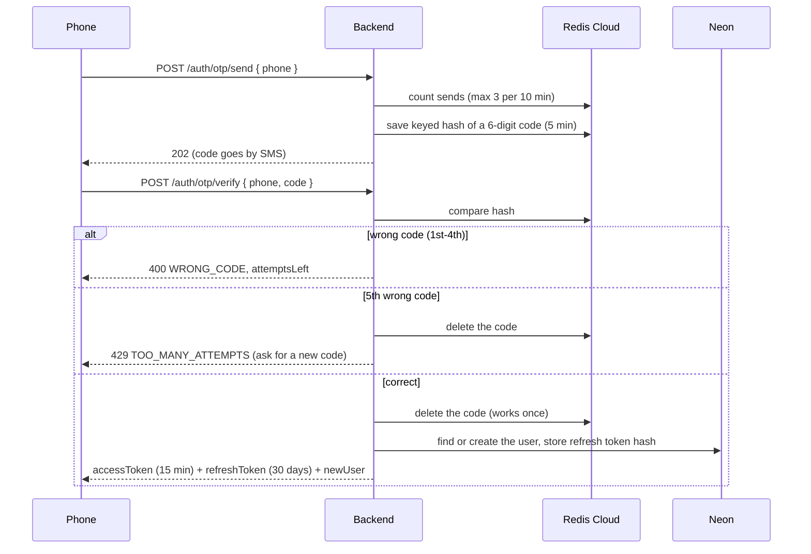

### Staying signed in

"Sign out everywhere" and account recovery also forget every browser registered for notifications, so a lost
phone stops getting booking messages (with their start codes) too. If Redis is down: new tokens are still issued
(signing in and refreshing keep working), and a sign-out everywhere still answers 204 (done in the database;
access tokens in use run out within 15 minutes).

Every signed-in request checks whether its person signed out everywhere after the token was made (a number per
person in Redis, `SessionRevocations`). Each copy of the backend remembers that number up to 5 s
(`SIGN_OUT_CHECK_CACHE_SECONDS`, 0 to 60; 0 = ask Redis every time), for at most 100,000 people, so a busy person's
requests don't each ask Redis. Redis keeps the real number, so with any number of copies: the copy that signed
the person out refuses the old tokens at once, every other copy within those 5 s. A remembered number only rises.

Codes: when SMS is paused (daily cap), asking for a new code is refused before anything changes, so the code
already sent keeps working. Recovery checks both codes before using either up, so a typo in one keeps the other.

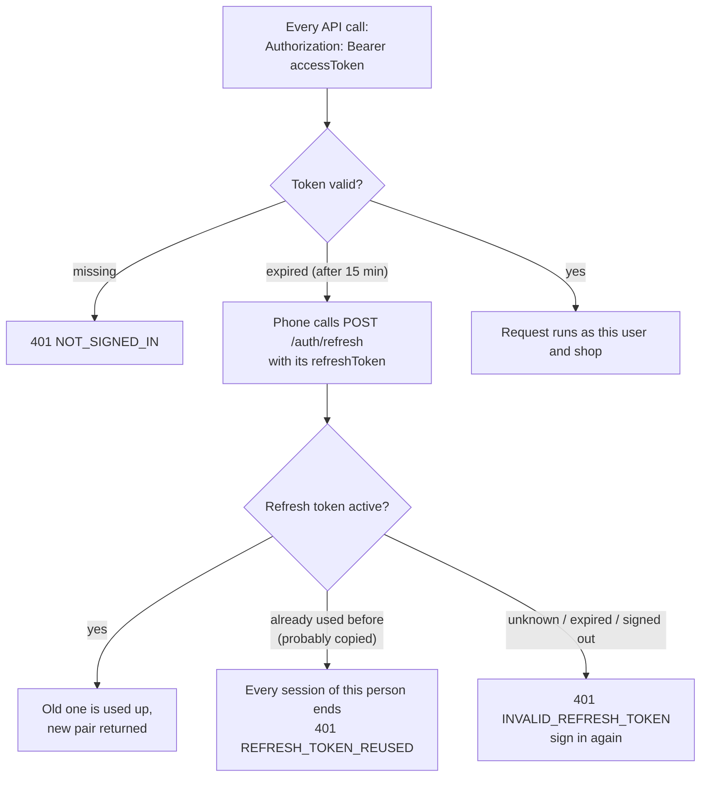

`POST /auth/logout` ends one session. Admin pages (`/api/v1/admin/**`) need an admin account.

### Limits (against guessing and SMS abuse)

| What | Limit |
| --- | --- |
| Tries per code | 5 (the 5th wrong one destroys the code). Every try is counted before checking, so parallel guesses don't get extra tries |
| Codes per phone or email, per network | 3 per 10 minutes, 10 per day |
| Wrong codes per phone or email, per network | 10 per day, then that network gets `429 LOCKED_FOR_TODAY` (the guesser's own network only) |
| Over all networks together (per phone or email) | Past 20 codes or 50 wrong codes in a day, a network that never gave a right code for that number waits between tries: 1 minute, then 2, 4 … up to 60 (`429 TRY_LATER` with `Retry-After`). No 24-hour lock for everyone any more. A network that gave a right code within 30 days (the owner's home or phone network) keeps its own allowance. Guessing stays bounded: about 70 wrong codes a day over every network |
| Per network (IP; IPv6 counted per /64) | IPv4 address: 200 code requests and 600 code checks per hour (`IP_SENDS_PER_HOUR`, `IP_VERIFIES_PER_HOUR`); high, because mobile operators put thousands of phones behind one IPv4 address. IPv6 /64 (one phone or home): 20 and 60 (`IPV6_SENDS_PER_HOUR`, `IPV6_VERIFIES_PER_HOUR`). The IP is the caller's real one, from the header set in `CLIENT_IP_HEADER` (see the checklist); a header value that is not an IP address is ignored and the connection's own address used |
| Robot check | Sign-in and recovery codes need a Cloudflare Turnstile token (`captchaToken`) once `TURNSTILE_SECRET_KEY` is set (400 `CAPTCHA_REQUIRED` / `CAPTCHA_FAILED`). If Cloudflare doesn't answer, the code is sent anyway; the limits still hold |
| Email codes per account | 10 per day |
| All code SMS together (the SMS budget) | `SMS_DAILY_LIMIT` per day (default 50,000) and `SMS_HOURLY_LIMIT` per hour (default 10,000). From 80% of the day's budget, or once the hour's cap is reached, only people who signed in within the last 30 days (and signed-in people asking for a delete or email-change code) still get codes; a number without a recent sign-in gets `503 SMS_PAUSED` with `Retry-After`. Everyone stops only when the whole daily budget is used. Alerts: a WARN "80% of the daily SMS limit used" (once a day), an ERROR "SMS for new numbers paused" (once an hour while it lasts), an ERROR "Daily SMS limit ... reached" (once a day). Only SMS that go out count, so refused numbers never use the budget up. See "SMS budget" below |
| JSON request body | 64 KB (only `POST /api/v1/files` may be larger, up to 10 MB) |

Limits count per phone **and** network, so a stranger guessing your number from their own network locks only
themselves; over many networks they only slow their own next tries down, never yours. Every 429 carries a `Retry-After` header (seconds to wait).

**SMS budget (why it scales).** One global daily number used to stop sign-in for everyone the day real traffic grew
past it. Now the daily budget is a setting to raise with growth, an hourly cap stops a burst from eating the day in an
hour, and near either limit the people already using the app (an account that signed in within 30 days: a refresh
token made then) keep getting codes while new or made-up numbers wait. Recovery codes go to a new phone and never
look this up. The trade-off: only while the budget is nearly used, whether a code is sent tells the caller whether that
number signed in within 30 days; the per-network and per-phone limits still apply. Point alerts at the three log lines
above; when they fire on real traffic, raise `SMS_DAILY_LIMIT` / `SMS_HOURLY_LIMIT`.

"Signed out everywhere" (recovery, or a copied refresh token) takes effect at once: every access token carries a
session number, and older numbers are refused on their next call.

**Refresh grace.** A swapped refresh token coming back within 30 seconds of its swap
(`app.auth.refresh-grace-seconds` / `REFRESH_GRACE_SECONDS`; 0 = off), while the token it was swapped for has never
been used, gets a new pair, and that unused token stops working ("sign in again" if it ever turns up, never an
alarm): the app reloaded or lost the reply while its refresh was on the way and never saved the new pair. Otherwise
the rule is as before: a swapped token coming back within 60 seconds (after its successor was used, or 30 to 60 s
after the swap) counts as the app retrying and gets 401 `INVALID_REFRESH_TOKEN` ("sign in again" on that device only);
later than 60 seconds it counts as copied: every session ends (401 `REFRESH_TOKEN_REUSED`). An expired token, or a
test account whose test mode ended, never gets a grace pair. The grace may be set from 0 to 60 seconds (the app
refuses to start otherwise), and swap times are the database's clock, so servers with different clocks agree.

The trade-off, precisely: someone who stole the old token can swap it for a pair of their own only within those 30
seconds after the real phone's swap, and only while the real phone hasn't used its new token since. The token they
replace is marked `GRACE_REPLACED`: a phone that really reloaded never saved it, so it never sends it; if the real
phone sends it after the grace (it did save it, so the old token was someone else's), every session is signed out,
the thief's too (once per token, like any copy). Within the grace it is only "sign in again". Two refreshes
with the same token at the same moment (from two devices, or two tabs without the apps' shared lock) run one after
the other on the person's row: the first gets the pair, the second 409 `TRY_AGAIN` (the apps keep the session and use
the token saved by the first); the chain never forks into two live tokens. The apps need no change: they already
refresh one at a time across tabs, save the new pair, sign out only on 401/403/400, and keep the session on 409.
Swapped tokens are kept 30 days (the refresh lifetime), so a copy is caught even if a thief kept refreshing along a
chain of tokens and the owner's phone comes back days later (see Housekeeping). Session numbers in Redis
(`session-gen:{user}`) expire 31 days after their last change, so Redis doesn't keep one key per person forever.
They never go back: ending all sessions sets the number to the larger of "current + 1" and Redis's clock in
milliseconds, so a key that expired and starts again can't leave an older token alive.
Only a refresh token that was already swapped
coming back counts as copied; an old device retrying a signed-out token just gets "sign in again".

### Endpoints (`/api/v1/auth`)

| Call | What it does |
| --- | --- |
| `POST /otp/send` `{phone, captchaToken}` | Sends a code. `+91` and a leading `0` are fine. 429 after 3 codes in 10 minutes |
| `POST /otp/verify` `{phone, code}` | Signs in (creates the account the first time) |
| `POST /refresh` `{refreshToken}` | New token pair |
| `POST /logout` `{refreshToken}` | Ends this session, 204 |
| `POST /logout-all` | Signs out every device at once, this one too (204) |
| `GET /me` · `PATCH /me {name?, language?}` | The signed-in person (with `language`: `"hi"` or null) · set your name (salons see it on bookings) and/or the language your messages are written in (see "Messages in the reader's language") |
| `POST /me/delete-code` · `POST /me/delete {code}` | Delete your account: a code to your own phone, then 204. 409 `SHOP_OWNER` for a shop owner: close the shop (`POST /shops/me/close`) or hand it over (`POST /shops/me/handover`) first. See below |
| `POST /email/send-code` `{email, phoneCode?}` | Sends a 6-digit code to the email (10 min). Replacing an already verified email also needs `phoneCode` |
| `POST /email/change-phone-code` | Sends a code to your own phone, needed to replace a verified email. The old email is told after the change |
| `POST /email/verify` `{email, code}` | Marks the email verified |
| `POST /recover/start` `{email, newPhone, captchaToken}` | Lost phone: a code to the verified email and one to the new phone |
| `POST /recover/complete` | Both codes right: moves the account to the new phone and ends every old session |
| `POST /admin-code/send` | Admins only (the admin website's second step): a 6-digit code to your verified email, for this device's sign-in (10 min). 202; 403 `NOT_AN_ADMIN`; 409 `EMAIL_REQUIRED`; 401 `SIGN_IN_AGAIN`; 429 past 20 a day; 503 `EMAIL_FAILED`. See "The admin website's email step" |
| `POST /admin-code/verify` `{code}` | That code right: this device's sign-in gets admin access for 12 hours, across refreshes. 200 `{accessToken, accessExpiresAt, user}` (keep your refresh token). 400 `WRONG_CODE` / `CODE_EXPIRED`, 429, 403 `NOT_AN_ADMIN` |
| `POST /me/phone/send-code` `{newPhone}` | Signed in, changing the number: a code to the new number and a second code, to the verified email or (without one) to the number the account has now. 200 `{secondCodeTo: EMAIL\|PHONE, sentTo}` (masked). 400 `INVALID_PHONE`, `SAME_PHONE`; 403 `ADMIN_PHONE`; 409 `PHONE_IN_USE`, `TEST_ACCOUNT`, `TEST_PHONE`; 429 `TOO_MANY_CODES` after 5 tries a day per account |
| `POST /me/phone` `{newPhone, phoneCode, secondCode, device}` | Both codes right: the same account moves to the new number, every other device is signed out, this one gets new tokens (200 as `otp/verify`). 400 `SEND_CODES_AGAIN` (the account's email changed since), the code errors, 409 `PHONE_IN_USE` (taken meanwhile) |

### The admin website's email step

An admin's phone number alone used to open the admin website: whoever got their SIM (a SIM swap, a stolen phone) got
everything a field agent or super admin can do. Now an admin who signs in with the phone code is signed in to their
own account as usual, but **has no admin access** (`/api/v1/admin/**` answers 403) until they also type a code sent to
their **verified email**, on that device:

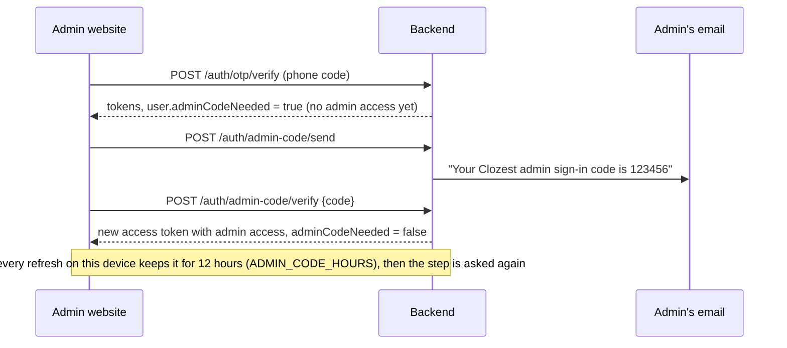

- **Per device:** the code is tied to the device's sign-in (the session in the token, `sid`), and admin access is kept
  per sign-in in `admin_sessions` (V86). A code asked for on the owner's laptop doesn't work on a thief's phone, and
  passing the step on one device gives nothing to another.
- **12 hours** (`app.auth.admin-code-hours`, `ADMIN_CODE_HOURS`, 1 to 24): from the moment the code was typed. After
  that, the next refresh gives a token without admin access and `adminCodeNeeded: true`, and the website asks again.
- **Who:** only admins (`admin_role` ADMIN or SUPER_ADMIN, read from the database at every sign-in and refresh).
  Removed from the team: no admin access at the next refresh, as before. Customers, salon owners and staff never see it.
- **No verified email:** 409 `EMAIL_REQUIRED` (the admin website already asks for the email at the first sign-in).
- **An admin's email is the team's:** an admin can confirm the email a super admin put on the Team page, never swap in
  another themselves (`/auth/email/send-code` and `/verify` answer 403 `ADMIN_EMAIL`). Otherwise a stolen SIM alone
  would pass the step: change the email with a code sent to the phone, then receive the admin code there. A super
  admin changes an admin's email on the Team page (which signs them out everywhere, as before).
- **Taken off the team and added back:** a pass from before they rejoined (`users.admin_since`) no longer counts.
- **A device that signed out** can't use a leftover access token to pass the step (401 `SIGN_IN_AGAIN`).
- **Limits:** 20 codes a day per admin, the usual per-network limits, 5 tries per code.
- `adminCodeNeeded` is in `user` of every token answer and in `GET /auth/me`. The partner and customer apps ignore it.

### Changing the phone number (signed in)

The customer and partner apps both have it (Profile / More → Mobile → Change). It works like recovery, but signed in:

1. `POST /me/phone/send-code`. Refused first: the same number; an admin (changed on the Team page, whose edits carry
   a version); a test account (it can't become someone's real account this way); a number on the test list. Then
   the try is counted (5 a day per account, `tryHit`, so parallel calls can't pass it), and only then a number that
   already has an account is refused: at most 5 numbers a day can be asked about. The code to the new number and the
   second code are each bound to this account and that new number (another account's code, or the code sent for
   another number, doesn't work). The second code goes to the verified email, or, without one, by SMS to the
   account's current number, so a borrowed phone with the app open can't move the account alone.
2. `POST /me/phone`: both codes are checked first. Then, under the user row's lock, everything is checked again (the
   refusals above, the number still free, the second code still the right kind: an email verified meanwhile answers
   `SEND_CODES_AGAIN`). The number is set; shop invitations and hand-over requests waiting for the old number are
   cancelled, so its next holder never sees them and the shops never see the new number (they can ask again; also
   one from the person's own shop to the new number: `PhoneChangeListener`, `ShopPhoneChange`);
   every refresh token is revoked, access tokens stop at once (Redis) and devices stop getting messages
   (`SignOutEverywhereListener`; the app registers this device again); salons' screens showing the customer's number
   are told first (`PersonDetailsListener`). The codes are used up last, in the same transaction, so a refusal or a
   failure on the way keeps them for another try. It is the same account: bookings, a shop, ratings and history all
   stay. Afterwards the old number gets an SMS ("moved to a number ending …", not under the daily SMS cap, when
   `app.sms.account-moved.enabled` is on) and the email a notice. The old number can sign up again later as a new
   account.

### Finishing sign-up

The app asks, in this order: phone → OTP (`otp/verify`, `newUser: true` the first time) → email → its code
(`/email/send-code`, `/email/verify`; the email is how a lost phone number is recovered) → "What should we call you?"
(`PATCH /me {name}`). `GET /me` shows `emailVerified` and `name`, so the app can resume where the person stopped.
Until the email is verified and the name set, booking a salon and registering a shop answer
**403 `PROFILE_INCOMPLETE`** with `details.missing` (`["email", "name"]`, `["name"]`, ...); browsing works without
them. A barber linked by the owner needs nothing: his account is the owner's doing, and he signs in with the phone.

### Deleting an account

Refused with 409 while online booking is blocked (`BOOKING_BLOCKED`, `details.until`) or when a booking starts
within the hour or is in progress (`BOOKING_SOON`): deleting and signing up again with the same phone must not be a
way round a block or a late-cancel strike.

One account works across every part of the app (kirana, salon, ...), so deleting it never deletes rows other
records point at. Instead, in one transaction: each module closes what is still open for the person
(`AccountDeletionListener`: upcoming salon bookings are cancelled with no strike and the salon is told "a customer
deleted their account", a barber's sign-in is unlinked, walk-in access goes,
waiting messages are cancelled and the text of all their messages emptied, devices forgotten), a helper or
barber leaves their shop, every device is signed out and its device label cleared, and the `users` row loses its
phone, name and email (`deleted_at` is set). Past bookings, strikes and shop records stay, showing no name. A
booking or move waiting behind the deletion, or a token from before it, is refused (401). Messages to a salon about earlier
bookings (sent, or still waiting to go out) keep the name the salon saw then. The same phone can later sign up as a new
account. A module added later (kirana orders) plugs in its own `AccountDeletionListener` to cancel its open items.

## How shops work

A person registers one shop (for now) and becomes its **OWNER**; the owner adds helpers by phone.
Every shop gets a plain number as its code (1001, 1002, ...), given out by the database.

```mermaid
sequenceDiagram
    participant P as Phone
    participant B as Backend
    participant D as Neon
    P->>B: POST /shops {name, owner, address, pincode, lat/lng, GSTIN?, Udyam?}
    B->>D: shop (DRAFT, next code) + membership (OWNER)
    B-->>P: 201 shop
    P->>B: POST /auth/refresh
    B-->>P: new access token carrying shop + role
    P->>B: PATCH /shops/me {version, changed fields}
    alt version matches
        B->>D: save; Envers adds this new version to shops_aud, with who changed it
        B-->>P: 200 shop (version + 1)
    else someone saved in between
        B-->>P: 409 SHOP_CHANGED (reload and retry)
    end
```

| Call | What it does |
| --- | --- |
| `POST /api/v1/shops` | Registers your shop as `DRAFT`, you as owner. 409 `ALREADY_HAS_SHOP` if you have one. Then refresh your token |
| `POST /api/v1/shops/geocode` | Someone without a shop (registration comes before the shop exists) or a shop's owner; a helper or barber gets 403 `OWNER_ONLY`. `{addressLine, area, city, pincode}` (the same limits as `POST /shops`) → 200 `{latitude, longitude, precision: EXACT\|STREET\|AREA, formattedAddress}` for the pin the owner then drags onto the door. 404 `ADDRESS_NOT_FOUND`, 429 `TRY_LATER` (20 searches an hour, 10 new addresses a day, each), 503 `GEOCODING_OFF` (no `GOOGLE_GEOCODING_KEY`), 503 `GEOCODING_UNAVAILABLE`. See "Finding the salon from its address" |
| `POST /api/v1/shops/reverse-geocode` | The same people and limits as `/geocode` (one budget for both). `{latitude, longitude}` (inside India, else 400 `VALIDATION_FAILED`) → 200 `{addressLine, area, city, pincode, formattedAddress}`, `""` for any part Google didn't give, so the app can fill the form's empty fields from the GPS point. 404 `ADDRESS_NOT_FOUND`; 403, 429 and 503 as for `/geocode` |
| `GET /api/v1/shops/me` | Your shop, its status and your role (`myRole`). 404 `NO_SHOP` if none |
| `PATCH /api/v1/shops/me` | Owner only (403 `OWNER_ONLY`). Send `version` and only the fields to change; `""` removes a kirana's GSTIN/Udyam (a salon has none: they are ignored). A salon's new name, owner, address, area or pincode checks its trade licence again (`licenceCheck` PENDING) |
| `PUT /api/v1/shops/me/photos` | Owner. `{version, ownerPhotoFileId?, shopPhotoFileId?}`: ids of photos uploaded to `POST /files` with purpose `OWNER_PHOTO` / `SHOP_PHOTO` |
| `GET /api/v1/shops/me/members` | Owner. Everyone in the shop: name, phone, role (OWNER, HELPER, BARBER), joined |
| `POST /api/v1/shops/me/helpers` · `DELETE /api/v1/shops/me/helpers/{userId}` | Owner. `{phone}`: **invites** a helper (see "Helpers and barbers join by invitation"). 202 `{message, invite: {id, phone, role, staffId, createdAt, expiresAt}}`, the same `message` for any number; no account is made, nobody joins until they accept. 409 `TOO_MANY_HELPERS` (helpers + waiting helper invitations reach 10), 409 `ALREADY_A_MEMBER` (already in this shop), 429 `TOO_MANY_REQUESTS` after 20 invitations a day, 400 `VALIDATION_FAILED` (`details.phone`: your own number). Remove: membership and walk-in access go, their sessions end at once. A salon's helper sees every barber, starts (also without code), cancels, reassigns and adds breaks; in a kirana the helper's billing and stock rights come with the kirana work |
| `GET /api/v1/shops/me/invites` · `DELETE /api/v1/shops/me/invites/{id}` | Owner. The shop's invitations still waiting (helpers and barbers), by the phone typed, never a name: `[{id, phone, role, staffId, createdAt, expiresAt}]`. `DELETE`: cancel one (204; 404 `INVITE_NOT_FOUND` for another shop's) |
| `GET /api/v1/me/invites` · `POST /api/v1/me/invites/{id}/accept` · `.../decline` | Anyone signed in: invitations waiting for their phone, `[{id, shopId, shopCode, shopName, type, area, city, role, createdAt, expiresAt}]`. Accept: 200 with the shop (`myRole` HELPER or BARBER), then `POST /auth/refresh`. Decline: 204 (the owner is told). 404 `INVITE_NOT_FOUND` (not for your phone), 409 `INVITE_GONE` with `details.status` (`ACCEPTED`, `DECLINED`, `CANCELLED`, `EXPIRED`, `CLOSED`, `CHANGED`, `STAFF_CHANGED`), 409 `ALREADY_IN_A_SHOP` (leave your shop first), 409 `TOO_MANY_HELPERS` |
| `POST /api/v1/shops/me/leave` | A helper or barber leaves the shop (204), e.g. a phone added without asking. A barber's profile, hours and bookings stay with the salon; only his sign-in goes. 409 `OWNER_CANT_LEAVE` |
| `PUT /api/v1/shops/me/registration-document` | The owner (403 `OWNER_ONLY`): the shop's document, **optional**, added, replaced or removed at any time. A salon's **trade licence** (`type: "TRADE_LICENCE"`); a kirana's **trade licence or Shops and Establishments certificate** (`"TRADE_LICENCE"` or `"SHOPS_ESTABLISHMENT"`). Any other `type`: 400 `VALIDATION_FAILED` naming `type`. `{version, type, fileId}`, `fileId` a `POST /files` upload with purpose `REG_DOC` (a photo, cleaned like the others, or a PDF kept as it came; only the owner uploads, opens or deletes it). 200 with the shop: `registrationDocType`, `registrationDocFileId`, `licenceCheck` (`PENDING` now), `licenceCheckReason`, `licenceValidUntil`, `registrationDocCheckedAt` (the owner's only). Checked automatically (see "The trade licence, checked automatically" below; a kirana's rules in "A kirana's documents"); the shop's status doesn't change (an approved one stays live). The same file again: nothing changes, unless its check FAILED (then it is checked again). 400 `VALIDATION_FAILED` naming `fileId`, 409 `SHOP_CHANGED` |
| `DELETE /api/v1/shops/me/registration-document?version=` | The owner removes it (a salon's or a kirana's): no "Licensed" badge; the status doesn't change; the upload stays for him to delete. 409 `SHOP_CHANGED` |
| `GET /api/v1/admin/shops/licence-ai-usage` | Super admins: the licence checks' AI this credit period (reads, cost of the budget), whether Anthropic refuses our account, whether the key is set and who the alerts reach. See "Credit alerts for the licence checks" |
| `POST /api/v1/admin/shops/{id}/registration-document/recheck` · `GET /api/v1/admin/shops/licences-to-follow-up` | Send the licence for checking again; the super admins' list of licences not accepted or waiting long. See "The trade licence, checked automatically" |
| `POST /api/v1/admin/shops/{id}/registration-document/remove` | `{version, reason}`: a wrong or someone else's licence comes off; the owner gets `SHOP_DOCUMENT_REMOVED` with the reason; a note on the timeline. Any status but CLOSED; a field agent only for a business assigned to them. 409 `NO_DOCUMENT`, `SHOP_CHANGED`, `WRONG_STATUS`. (No one marks a licence as checked: the automatic check decides) |
| `PUT /api/v1/shops/me/type` | Owner (403 `OWNER_ONLY`). `{version, type: KIRANA\|SALON}`: the kind of shop picked by mistake, changed **while registering** (DRAFT, never approved; a registration sent back counts). Name, owner, address, pin, photos and video stay. The document stays and is **checked again for the new kind** (a kirana's trade licence must be a grocery or general store's); a Shops and Establishments certificate, a kirana's only, comes off a shop becoming a salon (its upload released: a salon has no screen for it). A salon's services and hours, and a kirana's UPI ID, food answer and GSTIN (a salon never shows one), stay stored and are used again if it changes back. A `NOTE` on the field team's timeline ("Owner changed it from kirana to salon while registering"). The same type again: 200, nothing changes. 409 `WRONG_STATUS` (submitted, or ever approved), 409 `HAS_BARBERS` (a barber has his own sign-in here, or is invited: a kirana has no barbers), 409 `HAS_COUNTER_DATA` (a kirana sent back after its visit that already has bills, products, khata customers, helpers or a helper invitation waiting stays a kirana: a salon would hide them), 409 `SHOP_CHANGED`, 429 `TOO_MANY_REQUESTS` past 10 changes a day, 400 naming `type`. A barber invitation sent at the same moment as a change to kirana is refused (409 `NOT_A_SALON`, read again under the members' lock). Access to the salon and kirana screens follows at once (read from the database on every call, never from the token) |
| `POST /api/v1/shops/me/submit` | Owner. `{version}`: DRAFT → PENDING_VISIT. 409 `PHOTOS_REQUIRED` until both photos and the shop's video (a salon's and a kirana's) are set; then 409 `REGISTRATION_INCOMPLETE` with `details` naming what is still missing: for a salon each of `services` (at least one active) and `hours` (the opening hours); for a kirana each of `upiId` (`PUT /kirana/settings/upi-id`), `sellsFood` (the answer to "do you sell any food items?", `PUT /kirana/settings/sells-food`) and, when it sells food, `fssai` (its FSSAI licence, `PUT /kirana/online/fssai`: one still being checked will do, a refused or expired one won't; the message says which). The registration document is optional |
| `POST /api/v1/shops/me/close` | Owner. `{version, reason?}` (reason 2–200 characters, for the field team): closes the shop for good, see "Closing a shop or handing it over". 200 with the shop (`status: CLOSED`). 409 `SHOP_CHANGED` for a stale version, 403 `OWNER_ONLY` |
| `POST /api/v1/shops/me/handover` · `GET` · `DELETE` | Owner. `{phone, version}`: asks the person with that phone to take the shop over. 202 `{message, handover: {id, phone, createdAt, expiresAt}}`, the same `message` for any number. 409 `HANDOVER_PENDING` while one waits, 429 `TOO_MANY_REQUESTS` after 5 a day, 400 `INVALID_PHONE` / `VALIDATION_FAILED` (`details.phone`: your own number). `GET`: the waiting one (404 `NO_HANDOVER`). `DELETE`: cancel it (204, also when none waits) |
| `GET /api/v1/me/handover` · `POST /api/v1/me/handover/{id}/accept` · `.../decline` | Anyone signed in: requests waiting for their phone, `[{id, shopId, shopCode, shopName, type, area, city, ownerName, createdAt, expiresAt}]`. Accept: 200 with the shop (`myRole: OWNER`), then `POST /auth/refresh`. Decline: 204. 404 `HANDOVER_NOT_FOUND` (not for your phone), 409 `HANDOVER_GONE` with `details.status` (`ACCEPTED`, `DECLINED`, `CANCELLED`, `EXPIRED`, `CLOSED`, `OWNER_CHANGED`), 409 `ALREADY_IN_A_SHOP` (you work in another shop: leave it first), 403 `PROFILE_INCOMPLETE` |
| `GET /api/v1/admin/shops?type=&group=` | Field team (admins) only, else 403. A group's shops with links to both photos (see "The admin website"). The older `?status=` form is gone: without `type` and `group`, 400 `VALIDATION_FAILED` |
| `POST /api/v1/admin/shops/{id}/approve` | Field team. `{version, note?}` from the page they checked: PENDING_VISIT → APPROVED after the visit (customers can find it from now on), or a live shop's re-check done (stays APPROVED, `recheckSince` cleared, new bookings open again, the owner gets `SHOP_RECHECKED`). 409 `SHOP_CHANGED` if the owner changed something since (reload, check, approve), 409 `WRONG_STATUS` from another status or when nothing waits for a check |
| `POST /api/v1/admin/shops/{id}/reject` | Field team. `{version, reason, note?, checklist?}`: the visit didn't pass but can be fixed, PENDING_VISIT → DRAFT. The owner sees `statusReason`, fixes it and submits again. Bookings already made stay (suspend to cancel them). A live shop's re-check: 409 `WRONG_STATUS` (ask the owner to fix instead) |
| `POST /api/v1/admin/shops/{id}/ask-to-fix` | Field team. The same body: a live shop's re-check needs a fix. It stays as it is (live) and keeps its place in the queue; the owner sees `statusReason` and gets `SHOP_FIX_ASKED`; his next change answers it. Timeline `FIX_ASKED`. 409 `WRONG_STATUS` for anything else |
| `PATCH /api/v1/admin/shops/{id}/address` | Field team. `{version, addressLine, area, city, pincode, latitude, longitude}` (the owner's limits): the verified address or pin changed by them (any status but CLOSED; a field agent only for a business assigned to them, never their own). No re-check; a timeline note with the old and new address; the owner gets `SHOP_ADDRESS_CHANGED`; pending booking messages get the new address; a waiting business whose pincode changed goes by the assignment rule. 409 `SHOP_CHANGED` / `WRONG_STATUS` |
| `POST /api/v1/admin/shops/{id}/suspend` | Field team. `{version, reason, note?, checklist?}`: APPROVED or PENDING_VISIT (e.g. found shut at its visit) → SUSPENDED, off the app at once (no booking can be made). A salon's upcoming online bookings are cancelled within seconds by the background job (`SalonClosingJob`, as for a closing; a suspension reinstated before it is done stops it, the rest stay) and each customer is told ("isn't taking online bookings for now"; the field team's reason goes only to the owner). The salon can still run its own day (walk-ins) |
| `POST /api/v1/admin/shops/{id}/reinstate` | Field team. `{version, note?}`: SUSPENDED → PENDING_VISIT, back in the visit list; live again only once approved after a new check (so nothing changed while suspended goes live unchecked). Cancelled bookings stay cancelled |

The owner gets a message for each field-team decision (approved, sent back, suspended, reinstated).

### Finding the salon from its address

At registration the owner may not be standing in the salon, so the phone's GPS would put the pin at home. "Find my
salon on the map" sends the typed address to `POST /shops/geocode`; the backend asks Google's Geocoding API (classic
v3 endpoint) and answers where it is, and the app drops the pin there for the owner to drag onto the door. GPS stays
the other way, and the field team checks the pin on its visit either way.

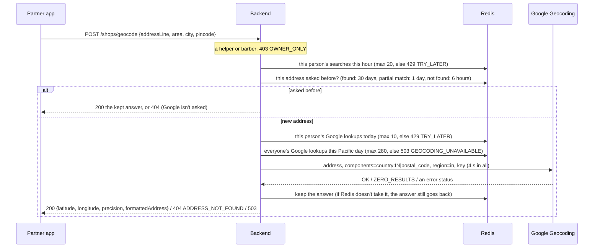

- **Precision:** Google's `location_type` becomes `EXACT` (ROOFTOP: the building), `STREET` (RANGE_INTERPOLATED) or
  `AREA` (GEOMETRIC_CENTER, APPROXIMATE); a `partial_match` (Google matched only part of the address) is always `AREA`. Indian addresses are often only found to the street or area, which is why
  the owner always drags the pin; the app says so for STREET and AREA.
- **Errors:** ZERO_RESULTS, or a result outside India, is 404 `ADDRESS_NOT_FOUND`. Any other Google status
  (OVER_QUERY_LIMIT, REQUEST_DENIED, ...), a non-200 answer, an unreadable answer, a timeout (2 s to connect, 4 s for
  the whole answer, headers and body, no retries) or no network is 503 `GEOCODING_UNAVAILABLE` ("use your location").
- **Who:** someone registering (no shop yet) or a shop's owner. Helpers and barbers get 403 `OWNER_ONLY`. Customers
  setting a saved place search through their own endpoints (see "Customers' saved places"), with the same limits.
- **Cost guard:** at most 280 calls to Google a day for the whole backend, under the 300 a day set as the quota in
  Google Cloud (Google's free allowance is 10,000 a month). Customers' saved places may use at most 100 of them
  between all customers (`geocode-day-customers:` counter), so owners registering keep at least 180 from the
  customer app's searches. (Someone registering can't be told apart from a customer, so an account calling
  `/shops/geocode` directly counts as registering; the per-person limits still hold it to 10 lookups a day.) A search
  refused by a later cap gives back what it counted on the way (`RateLimiter.giveBack`), so a refusal never uses up a
  person's allowance. The day is Google's: it starts at midnight Pacific time
  (12:30 IST in summer, 13:30 IST in winter), the moment Google's own quota resets. Per person: 20 searches an hour
  and 10 calls to Google a day (only new addresses count, and not once everyone's day is used up), so one account
  can't use up everyone's day. Answers are
  kept in Redis by a hash of the tidied address: found 30 days, a partial match 1 day, not found 6 hours, so a repeat
  costs nothing. If Redis is down the search answers 503 `SERVICE_BUSY` before Google is called; only keeping an
  answer may fail (logged as a WARN), and the owner still gets the pin.
- **The key:** `GOOGLE_GEOCODING_KEY`, restricted in Google Cloud to the Geocoding API only. It goes only in the
  request URL to Google, which is never logged; logs carry Google's status word only, never the address or Google's
  `error_message`. Without the key the call answers 503 `GEOCODING_OFF` and the app hides the button.

**The other way round:** after "Use my location", the app asks `POST /shops/reverse-geocode` with the GPS point and
fills only the address fields the owner left empty. The backend asks Google with `latlng` (rounded to 4 decimals, about
11 m), `result_type=street_address|premise|route|sublocality|locality|postal_code`, `region=in` and `language=en`,
and maps the first result's `address_components`: `addressLine` = the building (premise, else street number) and the
street (route), `area` = sublocality_level_1, else sublocality, else neighborhood, `city` = locality, else the
district (administrative_area_level_2), `pincode` = the postal code only when it is a 6-digit Indian pincode. Answers
are kept by the rounded point, 30 days (nothing there: 6 hours). It shares everything with the forward search: who may
ask, the per-person limits and the day's Google cap, timeouts, key safety and the Redis rules.

### Customers' saved places

The customer app finds salons near the phone's GPS point, or near a saved place: Home, Work, or another with a name
of its own ("Gym", "Mom's place"), up to 10 a person, one Home and one Work. Each is set exactly like a salon's
address at registration: the four address fields, then a pin from the typed address (`POST /me/places/geocode`) or at
the phone's GPS point (`POST /me/places/reverse-geocode` fills the empty fields), which the customer drags onto the
building. Only the customer ever reads them; salons never see them, and deleting the account deletes them
(`PlacesAccountDeletion`).

| Call | Answer |
| --- | --- |
| `GET /api/v1/me/places` | Home, Work, then the others in the order saved: `[{id, kind: HOME\|WORK\|OTHER, name, addressLine, area, city, pincode, latitude, longitude, updatedAt}]` (`name` only for OTHER) |
| `POST /api/v1/me/places {kind, name?, addressLine, area, city, pincode, latitude, longitude}` | 201 the place. 400 `VALIDATION_FAILED` (OTHER needs a `name` of 2–30; addressLine 2–200, area 2–100, city 2–60, a 6-digit pincode, the pin in India); 409 `PLACE_KIND_TAKEN` (a Home or Work already: `details.placeId`); 409 `TOO_MANY_PLACES` (`details.max` 10) |
| `PUT /api/v1/me/places/{id}` (the whole place) | 200 the place; 404 `PLACE_NOT_FOUND` (not this person's, or deleted); 409 `PLACE_KIND_TAKEN`; 400 |
| `DELETE /api/v1/me/places/{id}` | 204, also when it was gone already |
| `POST /api/v1/me/places/geocode {addressLine, area, city, pincode}` | as `POST /shops/geocode` (same cache and per-person limits), for anyone signed in; 503 `GEOCODING_UNAVAILABLE` also once customers have used their 100 lookups of the day |
| `POST /api/v1/me/places/reverse-geocode {latitude, longitude}` | as `POST /shops/reverse-geocode`, with the same customer rules |

Text is cleaned like a shop's address (`TextCleaner`); the pin is kept to 6 decimals. Adds and changes of one person
take an advisory lock (`pg_advisory_xact_lock(7104, …)`), so two phones adding at once can't pass 10 or save two
Homes; the unique index on `(user_id, kind)` for Home and Work backs it up. The places module reaches the address
search through `common.context.AddressSearch` (implemented in shops by `CustomerAddressSearch`), so the modules stay
independent.

### Closing a shop or handing it over

An owner can't leave their shop or delete their account while they own it (409 `OWNER_CANT_LEAVE`, `SHOP_OWNER`).
They close it, or hand it over.

**Closing** (`POST /shops/me/close`): in one short transaction, the shop becomes **CLOSED** (customers can't find it and
no booking can be made from that moment), a hand-over and invitations waiting are cancelled, and everyone's membership
ends (all of them together: a few statements however many people): helpers and barbers as if
removed (walk-in access and a barber's sign-in go, their sessions end at once), and the owner's own. The owner keeps
their sessions and simply has no shop: `GET /shops/me` answers 404 `NO_SHOP`, they may register a new shop or delete
their account; the app calls `POST /auth/refresh`. Every online booking still to come is cancelled **in the background**
by `SalonClosingJob` (every 10 s, 500 a slice, each its own transaction, rows a customer holds at that moment skipped and
taken next round), and each customer is told ("The salon has closed."): a salon with 2,000 bookings ahead closes in
one short request and its customers are told within seconds. Everyone's salon messages are hidden from their lists at
once and deleted in slices by `SalonMessagePurgeJob` (see "Built for scale"). Asking again (a lost reply) answers the closed shop again. The
timeline gets `CLOSED` with the reason. **A closed shop is never opened again**: its owner registers a new one (a fresh
field visit, a new shop number). Its rows stay (bookings, history, timeline, photos), so customers' past bookings
and the field team's records still show it; the admin website lists it in the `CLOSED` group and no decision applies
to it (409 `WRONG_STATUS`).

**Handing over** (`POST /shops/me/handover {phone, version}`): the owner names a phone number. The answer is always
"If that number has a Clozest account, they'll see your request." (whether or not it has one), so this can't be used
to find out who uses Clozest; a shop may ask 5 times a day. The person with that phone sees it after signing in
(`GET /me/handover`; they also get a message in the partner app if they have an account), and accepts or declines. One
request waits per shop; it runs out after 7 days; the owner can cancel it. Accepting needs a verified email and a name
(as registering a shop does), and either no shop or a place in this shop (a helper or barber is promoted; a barber's
own sign-in on his barber profile goes, the profile, hours and bookings stay). On accept, in one transaction: **the old
owner leaves the shop** (as if removed: their sessions end, their salon messages go; they may then delete their account
or register a new shop) and the person becomes its OWNER; the timeline gets `HANDED_OVER` (it doesn't move the shop in
the field team's lists); both are told. The shop's details, photos, bookings and status stay as they are: the new owner
should check the owner's name and photo, and changing the photo sends the shop for a re-check as before.

### Helpers and barbers join by invitation

Nobody is added to a shop without saying yes. The owner names a phone: as a helper (`POST /shops/me/helpers`), or as
a barber's own sign-in (`PUT /salon/staff/{id}/login`, or `phone` when adding the barber). The answer is the same
whether or not that number has an account; no account is made and no name is shown, so it can't be used to look up
who a number belongs to, and nothing says whether the person already works in a shop (they learn that themselves
when they accept: 409 `ALREADY_IN_A_SHOP`). A shop invites at most 20 times a day; asking the same phone again answers
the invitation already waiting. The person sees it after signing in with that phone (`GET /me/invites`; a message in
the partner app if they already have an account) and accepts or declines; it runs out after 7 days. The owner sees
the waiting ones (`GET /shops/me/invites`) and cancels them; a barber's waiting one shows on his profile
(`invitedPhone`) and goes when he is unlinked, switched off or invited with another phone. Closing or handing over the
shop cancels them all. Helpers and barbers who joined before this version stay as they are.

Accepting takes the shop's row (shared), the person's membership, their account row, for a barber his profile (the
owner's unlink and switch-off take it first too, so a switched-off profile answers 409 `INVITE_GONE` /
`STAFF_CHANGED`), then the invitation: every step takes them in this order and can only wait for another.

**Races.** Every step takes the shop's row first (closing, asking, cancelling, accepting, declining), then the
person's membership, then their account row: they run one after the other. An accept and a close at the same moment:
one of them wins (the close answers 404 `NO_SHOP` after an accept; the accept 409 `HANDOVER_GONE` after a close). The
old owner deleting their account while someone accepts: refused (`SHOP_OWNER`) until the accept committed, then
allowed. A helper accepting while deleting their account: either the deletion is refused (`SHOP_OWNER`, they own it
now) or the accept is (401, or 409 `TRY_AGAIN` when the database broke a tie); the shop always has exactly one live
owner.

Rules: the GPS pin is required and must be inside India; pincode is 6 digits; a kirana's GSTIN is optional,
checked, and stored in capitals (a salon has none; no shop is asked for a Udyam number: anything sent is ignored, and an
old value is never shown); text is
trimmed. Unknown fields are refused with 400 `UNKNOWN_FIELD`, so nobody can send
`"status": "APPROVED"` for their own shop. Status moves DRAFT → (both photos, Submit) → PENDING_VISIT → (field team
visits and approves) → APPROVED; from any status the owner can close it for good (CLOSED). **Once approved, the
address and pin are the field team's to change** (409 `ADDRESS_LOCKED` for the owner; `PATCH /admin/shops/{id}/address`).
A new photo, salon video, or a kirana's GSTIN or Udyam number on an APPROVED shop puts it in the field team's **re-check** (V41): it
stays APPROVED, live and bookable (its helpers and barbers work as usual) and `recheckSince` (owner's
`GET /shops/me`) says since when it waits. The first change sets it; further changes while it waits keep its place in
the queue (the field team sees every change since the last check). The field team then approves it (`recheckSince`
back to null, the owner gets `SHOP_RECHECKED`), asks the owner to fix something (it stays as it is, the owner sees the
reason) or suspends it. A new name or owner's name needs no check. A new address (from the field team) rewrites the
pending booking reminders, so customers are sent to the new place. A photo that a shop or barber uses can't be deleted
(409 `FILE_IN_USE`).

A shop is a **kirana** or a **salon**: send `"type": "SALON"` when registering (left out = `KIRANA`); `GET /shops/me`
returns it. An owner who picked the wrong one changes it with `PUT /shops/me/type` **only while registering** (a draft
never approved, also one the field team sent back); once submitted, and for good once ever approved, it is locked.

## The admin website (`/api/v1/admin`)

For Clozest's own team. Everything here needs an admin's sign-in (the normal phone OTP); anyone else gets 403.
Who is an admin is read from the database on every call, so someone removed is refused at once even with a token
issued before.

**Roles** (`users.admin_role`) **and designations** (`users.admin_designation`, V30):

- `ADMIN` always has a designation; today the only one is `FIELD_AGENT`. A field agent covers a list of 6-digit
  pincodes (`admin_pincodes`) and sees and decides only the businesses assigned to them (see "Field agents and
  assignment" below). More designations may come later, each with its own allowed actions.
- `SUPER_ADMIN` has no designation and no pincodes, and does everything: every business, the team, assignments,
  support and OTP test mode. There may be several. The first is set by hand, once, in Neon:

```sql
UPDATE users SET admin_role = 'SUPER_ADMIN', admin = true WHERE phone = '9xxxxxxxxx';
```

(Sign in once first, so the account exists. `admin` is the old column, kept in step for a version still running
during a deploy.) After that, super admins add and change each other on the Team page. A super admin can't delete
their own account (409 `SUPER_ADMIN`): another super admin changes their role first.

| Endpoint | Notes |
| --- | --- |
| `GET /admin/me` | Who is signed in: `{userId, name, phone, adminRole, designation, testMode: {on, until}}` (`designation`: `FIELD_AGENT` for an admin, null for a super admin; the website shows a red banner while test mode is on) |
| `GET /admin/dashboard` | For `KIRANA` and `SALON`, how many shops are in each group: `FIRST_VISIT` (waiting, never approved), `RECHECK` (waiting, approved before: a live shop whose owner changed a photo, the video, GSTIN or Udyam, which stays APPROVED meanwhile; or a reinstated one), `SENT_BACK` (a draft sent back with a reason), `LIVE`, `SUSPENDED`, `CLOSED` (closed by its owner). A draft never submitted is in no group. Counted at most every 30 seconds (kept in Redis); a field-team decision shows at once, an owner's own step (submitting, a moved pin) within 30 seconds |
| `GET /admin/shops?type=&group=&q=&assignedTo=&unassigned=` | A field agent gets only the businesses assigned to them (`assignedTo` and `unassigned` are ignored for them); a super admin gets all, or one agent's (`assignedTo=<userId>`), or those waiting with no agent (`unassigned=true`; both: 400 `VALIDATION_FAILED`). Each has `assignedTo` (`{id, name}`, null when unassigned). A group's shops, longest in it first (`statusSince`: its latest timeline entry other than a note, so an owner fixing a typo doesn't move it), 50 a page (see "Pages" below), each with `group`, `ownerPhone` and `waitingForVisit` (true for the first visit and the re-check, also a live shop's: Approve is for these; Send back for `PENDING_VISIT`, Ask the owner to fix for a live re-check). `type` and `group` are required (400 `VALIDATION_FAILED`, `details` naming each missing one: `{"type": "is required"}`, `{"group": "is required"}`). `q`: the shop number exactly (`1042` or `#1042`, any length), the owner's phone in part (spaces, `+91` and dashes ignored; at least 3 digits), or the name or owner's name in part. A `q` of 1 or 2 characters that isn't a shop number is 400 `VALIDATION_FAILED` with `details: {"q": "type at least 3 letters"}`; a blank `q` is no search |
| `GET /admin/shops/{id}` | The shop; a salon's barbers and services; `changes` since the moment it was last approved (name, owner, address, area, city, pincode, pin with `pinMovedMetres`, GSTIN, Udyam, photos with the old photo links), so edits a live shop made without needing a visit show up too; the `timeline`, newest first, its first 50 entries, and `timelineNext` (`{afterAt, afterSeq}`, or null when there are no more) |
| `GET /admin/shops/{id}/timeline?afterAt=&afterSeq=` | The rest of the timeline, 50 a page: `{items: [...], next}` with the same entries as `timeline` and `next` like `timelineNext`. See "Pages" below |
| `POST /admin/shops/{id}/notes {note}` | A note only admins see (2–500 characters), 201 |
| own shops | An admin who works in a shop (owner, helper or barber) can't approve, send back, suspend, reinstate or write notes about it: 403 `OWN_SHOP` "You can't decide on a shop you belong to. Ask another admin." A super admin too. Checked after who may see it (a field agent: 404 for a business not assigned to them) |
| decisions | approve, reject (send back), suspend, reinstate as in "How shops work". The status is checked before the version: when another admin decided first, the answer is 409 `WRONG_STATUS` with `details.status`, not `SHOP_CHANGED`. Now with an optional `note` (admins only, up to 500 characters) and, for send back and suspend, an optional `checklist`: `NAME_BOARD_NOT_VISIBLE`, `OWNER_PHOTO_UNCLEAR`, `PIN_WRONG`, `ADDRESS_MISMATCH`, `GST_UDYAM_MISMATCH`, `SHOP_SHUT`, `OTHER`. The owner sees only the `reason` |
| `GET /admin/team` | Super admins only (403 `SUPER_ADMIN_ONLY` for a field agent, as for every Team, assignment, support and test-mode call). Super admins first, then by when they joined: `{userId, name, phone, email, emailVerified, adminRole, designation, pincodes, pendingVisits, since, version}` |
| `POST /admin/team {phone, email, name, role, designation, pincodes}` | Adds a member, 201 with the member. `role` `ADMIN` needs `designation` `FIELD_AGENT` and 1–300 pincodes (6 digits, not starting with 0; trimmed, each once); for `SUPER_ADMIN` both are ignored. A phone with no account gets one with this name and email; an existing account (a customer's) takes this name and email. Nothing is sent: they sign in with the phone's code, and the email is stored unverified, so they confirm it first thing (an old verified address is told it changed). Their open sessions end. 409 `ALREADY_ADMIN`, `TEST_PHONE` (a test number, or an account made in test mode), `TEST_EMAIL`, `EMAIL_IN_USE` (another account's verified email); 400 `VALIDATION_FAILED` with `details` per field (`phone`, `email`, `name`, `role`, `designation`, `pincodes`) |
| `PUT /admin/team/{userId} {version, phone, email, name, role, designation, pincodes}` | Changes anything about a member (a super admin too), with the `version` the Team page showed: 409 `MEMBER_CHANGED` if someone changed them since. A new phone or email signs them out everywhere (the email unverified again, the old verified address told); 409 `PHONE_IN_USE`, `EMAIL_IN_USE`, `TEST_PHONE`, `TEST_EMAIL`; 404 if they aren't on the team. Pincodes removed, or made a super admin: their waiting businesses go by the rule below. Logged as `ADMIN_EDITED` with what changed |
| `DELETE /admin/team/{userId}` | Removes a member (a super admin too, never yourself: 409 `CANT_REMOVE_YOURSELF`); their sessions end at once, their pincodes go, their waiting businesses go by the rule below |
| `GET /admin/team/coverage` | Every covered pincode with its agents: `[{pincode, agents: [{userId, name, phone}]}]` |
| `POST /admin/shops/{id}/assign {adminId}` | Super admins: a waiting business to this field agent (any pincode), 204; the same agent again changes nothing. 404; 409 `WRONG_STATUS` (not waiting); 400 `NOT_A_FIELD_AGENT`; 409 `OWN_SHOP` (that agent works there) |
| `POST /admin/assignments/move {fromAdminId, toAdminId}` | Super admins: every business waiting for one admin goes to a field agent (leave): `{moved, stayed}` (`stayed`: ones the new agent works in, left where they were). 400 `NOT_A_FIELD_AGENT`, `VALIDATION_FAILED` (the same person) |
| `GET` · `PUT {hours}` · `DELETE /admin/test-mode` | Super admin only. OTP test mode on for 1–8 hours (it switches itself off), or off now |
| `POST /admin/test-mode/phones {phone, label}` · `DELETE /admin/test-mode/phones/{phone}` | Super admin only. The test numbers. 409 `ADMIN_PHONE` (an admin's number), 409 `REAL_ACCOUNT` (a number that already has a real account), 409 `ALREADY_TEST_PHONE`. Removing one signs its test account out |
| `POST /admin/test-mode/emails {email, label}` · `DELETE /admin/test-mode/emails/{email}` | Super admin only. The test emails (stored trimmed and in lower case; `GET /admin/test-mode` lists them as `emails`, each with `inUse`). 409 `REAL_ACCOUNT_EMAIL` (already verified by a real account or an admin), 409 `ALREADY_TEST_EMAIL`. Removing one changes nothing else |

**Field agents and assignment.** A business that starts waiting for a visit (submitted; an approved one changed its
address, photos or video; reinstated) goes to the field agent covering its pincode with the fewest businesses waiting
(the longest on the team on a tie), never to someone who works in it; if nobody covers it, it is Unassigned and a super
admin assigns it. A waiting business that changes its pincode goes through the rule again when its agent doesn't cover
the new one. When an agent stops covering a pincode (removed from their list, made a super admin, taken off the team,
or their account deleted), their waiting businesses there go through the rule too. A super admin can assign any
waiting business to any field agent, or move all of one agent's to another. The assignment stays after the decision,
so an agent still sees the businesses they visited. A field agent sees only their own in the dashboard, the lists and
search; any other business answers 404 for the page, the timeline, notes and decisions; suspending and reinstating are
for super admins. Every assignment is logged (`shop_assignments`: from, to, by whom, why) and the new agent gets an
in-app message ("New visit for you").

Assignments and Team changes take one database lock first (`TeamLock`: exclusive for Team changes, shared for
assignments), then the rows, so a business is never given to an agent whose pincode is being taken away at that
moment, and the two never deadlock. A decision locks the business's row before checking who it is assigned to, so a
reassignment and a decision on the same business wait for each other.

**Known limits (decided):** a super admin can change anything about any member, so adding someone's existing
account and then changing its phone hands that account over; the old phone and verified email are always told (as
account recovery tells them), and every change is in `admin_events`. The last super admin can change their own role:
then one is set again by hand, as the first was. Removing a field agent with thousands of waiting businesses holds the
team lock while each is reassigned, so owners' submits and edits wait for it (seconds at that size); agents normally
have far fewer.

**OTP test mode.** The super admin adds test numbers and test emails; while test mode is on, those sign in and
verify with any 6-digit code, and no SMS or email is sent to them. Everything else always needs the real code.

- Test numbers: only a number nobody has signed in with can be added. The account its first test sign-in makes is
  a test account (`users.test_account`), and only such an account ever takes any code, never a real customer's, a
  shop's or an admin's. It stays signed in only while test mode is on for its number: switching it off, the time
  running out, or removing the number ends its sessions (refresh answers 401 `TEST_MODE_OFF`). If the number's real
  holder later signs in with the SMS code (or the account is recovered onto a real phone), it becomes a normal
  account for good, its email and name are cleared, and every tester still signed in to it is signed out.
- Test emails: an email already verified by a real account or an admin can't be added. Only a test account, with
  test mode on, verifies a listed email with any code; a real account or an admin verifying it gets the real code
  by email as usual. Verified emails stay unique (409 `EMAIL_IN_USE`), but a test account never blocks a real person:
  whoever proves with the real emailed code that the inbox is theirs takes the email, and the test account loses it.
  The any-code path never replaces an already verified email (403 `PHONE_CODE_REQUIRED`, as the normal change flow
  asks for the phone code first), is limited to 10 tries an hour per account (429), and is checked again inside the
  save (test mode off, the number or email removed, or the account claimed meanwhile: 400 `WRONG_CODE`, nothing
  stored); once that check passes it holds those rows until the save commits, so switching test mode off or
  removing the number or email waits for it. A test account never takes an email another account holds. No "email
  changed" notice is sent when a test account leaves a test email; a real account always gets one.
- Recovery ("lost phone") and account deletion always need the real codes.

For testing on the real deployment without SMS credit or real inboxes, switched on for a few hours at a time. Every
change (admins, test numbers, test emails, test mode on and off) is logged in `admin_events`.

**Timeline** (`shop_events`): sent for a visit (owner), changed after approval (owner), approved, sent back,
suspended, reinstated, note, closed (owner, with their reason), handed over (the new owner). A note and a hand-over
don't change `statusSince`. Shops registered before it existed have an empty timeline and count their waiting time
from registration. The photos a shop had when last approved can't be deleted while it waits for its re-check (409
`FILE_IN_USE`): the field team compares them with the new ones. "Last approved" is the history row where it became
APPROVED or where its last re-check was approved (`recheck_since` cleared).

## How salon setup works

A salon lists its services, its barbers, which services each barber does and when each one works. Online bookings
are worked out from exactly these. Anyone in the salon can read the setup; only the owner can change it.

| Call | What it does |
| --- | --- |
| `GET` / `POST /api/v1/salon/services` | List (by `sortOrder`, then name) / add: `name`, `durationMinutes` (5–480, steps of 5), `pricePaise`, `priceIsFrom`, `sortOrder`, `returnAfterDays` (0–180: days after a visit to remind the customer to come back for it, 0 = never; 14 when left out) |
| `POST /api/v1/salon/services/batch` | `{services: [...]}` (1–30, each as for one): all or none, 201 with them in the order sent; without `sortOrder` they go after the salon's services in that order (also for one added alone), so lists and cards show them as added, not alphabetically. The same name twice in the list: 400 `VALIDATION_FAILED` naming `services[i].name`; one an active service already has: 409 `SERVICE_NAME_TAKEN`; the limit counts them all (409 `TOO_MANY_SERVICES`) |
| `GET /api/v1/salon/service-catalog` | Anyone in the salon: the common services to tick at registration, `[{name, durationMinutes, returnAfterDays}]` (suggestions only; the owner sets the prices) |
| `GET` / `PUT /api/v1/salon/hours` | The salon's opening hours: `{version, days: [{weekday, open, close}]}`, a weekday left out is closed (its weekly off), `version` null while none are set. `PUT {version, days, trimStaffHours?}` (owner) replaces the week: one block a day on 15-minute steps, close after open (up to `"24:00"`), at least one day; 409 `HOURS_CHANGED` for a stale version. Barbers whose hours fall outside: 409 `STAFF_HOURS_OUTSIDE` with `details.staff [{staffId, name}]`, or with `trimStaffHours: true` their hours are cut to fit (409 `BOOKINGS_IN_THE_WAY`, nothing saved, if that would strand an upcoming booking). Festival holidays are closed days (`/salon/closures`) |
| `PATCH /api/v1/salon/services/{id}` | Edit, or `"active": false` to switch off (kept for old bookings). Send `version`; 409 `SERVICE_CHANGED` if stale |
| `GET` / `POST /api/v1/salon/staff` | Barbers with their `serviceIds`, `hours`, `loginPhone`, `photoFileId` / add one: `name`, and optionally `phone` to give him his own sign-in |
| `PATCH /api/v1/salon/staff/{id}` | Rename, or `"active": false` when a barber leaves (409 `STAFF_HAS_BOOKINGS` while he has upcoming ones; his sign-in is removed). Switching back on: 409
`BLOCK_CONFLICTS` if a leave of his runs into a closed day (remove it, switch him on, add it again around that day). Switched back on, his hours are cut to the salon's. Send `version`; 409 `STAFF_CHANGED` if stale. Switching off is the way to pause a contract barber who comes and goes |
| `POST /api/v1/salon/staff/me` | The owner also cuts hair: a barber profile for him, linked to his own sign-in at once (he stays the owner), doing every active service in the salon's opening hours, with its closed days. 201. 409 `ALREADY_A_BARBER`, 409 `TOO_MANY_STAFF` (he counts like any barber). His own profile keeps his sign-in while switched off (switch it on again; `ALREADY_A_BARBER` meanwhile) and lets go of it only when removed; `DELETE .../login` on it is 409 `OWNER_PROFILE`. Booking messages for his own chair follow the owner's SMS setting (`OWNER_BOOKING_SMS`), each message once. A barber who becomes the owner (hand-over) stays a barber; an owner who hands over leaves the salon like a barber who leaves (his profile loses the sign-in; the new owner switches it off or removes it) |
| `DELETE /api/v1/salon/staff/{id}` | The owner removes a barber for good (one who won't come back): switched off, his sign-in and any waiting invitation go, he leaves the list (`removed_at`) and can't be edited or switched on again (404); his past bookings keep his name. 204. 409 `STAFF_HAS_BOOKINGS` while he has upcoming ones |
| `PUT` / `DELETE /api/v1/salon/staff/{id}/login` | `{phone}`: his sign-in becomes a BARBER member of the salon (409 `ALREADY_IN_A_SHOP` if that phone works in a shop). Delete: membership and walk-in access go, his sessions end at once |
| `PUT /api/v1/salon/staff/{id}/photo` | Optional photo: `{fileId}` of a `STAFF_PHOTO` upload, or `{"fileId": null}` to remove |
| `PUT /api/v1/salon/staff/{id}/services` | `{"version": 3, "serviceIds": [...]}` replaces what he does; newly added ones must be active services of this salon. 409 `BOOKINGS_IN_THE_WAY` (listing them) if an upcoming booking of his uses a service he'd drop |
| `PUT /api/v1/salon/staff/{id}/hours` | `{"version": 3, "hours": [{"weekday": 1, "start": "10:00", "end": "14:00"}, ...]}` replaces his week. Once the salon has set its opening hours, every block must lie inside them (400 `VALIDATION_FAILED` naming `hours`: "… is outside the salon's hours (10:00-21:00)", "the salon is closed on Sundays"). 409 `BOOKINGS_IN_THE_WAY` (listing them) if an upcoming booking of his would fall outside the new hours: reassign or cancel it first |
| `GET` / `PATCH /api/v1/salon/settings` | Earliest booking (`minLeadMinutes`, default 30) and latest (`maxDaysAhead`, default 7). `version` is null until the first save |

**Database:** V4 runs `CREATE EXTENSION IF NOT EXISTS btree_gist` (needed by the no-overlap rule). Neon and the
Docker image used by the tests have it; on your own Postgres, the role running Flyway must be allowed to create it.

**Time:** every salon is in India (`Asia/Kolkata`, no daylight saving). Hours are `"HH:mm"` in salon time on
15-minute steps, `weekday` 1 = Monday ... 7 = Sunday, up to `"24:00"`; two blocks on one day make a split shift. They
are stored as minutes after midnight (10:00 = 600), so the database itself refuses overlapping blocks
(`ex_staff_hours_no_overlap`). Exact moments are stored in UTC and returned with their offset.

**Safety:** every call checks in the database that you belong to a salon (404 `NO_SHOP`, 409 `NOT_A_SALON`) and,
for changes, that you are its owner (403 `OWNER_ONLY`). Services and barbers are always looked up together with your
salon, so another salon's ids give 404; the database's keys also refuse linking a barber to another salon's service.
Changing a barber's services or hours raises his `version`, and both calls need the version you last read: two edits
from the same old screen run one after the other (row lock) and the second gets 409 `STAFF_CHANGED` instead of
silently replacing the first.

**Limits and errors:** up to 100 active services and 50 active barbers per salon (switched-off ones don't count):
409 `TOO_MANY_SERVICES` / `TOO_MANY_STAFF`, also when switching one back on. Two active services can't share a name,
capitals ignored: 409 `SERVICE_NAME_TAKEN`. Another salon's ids: 404 `SERVICE_NOT_FOUND` / `STAFF_NOT_FOUND`; in
`serviceIds` of `PUT .../services`, another salon's or a switched-off service is 400 `VALIDATION_FAILED` naming
`serviceIds`. A stale settings save is 409 `SETTINGS_CHANGED`. The limits are a guard against runaway lists, not
exact: two adds at the very same moment could both pass at 99.
Separately, one request carries at most 200 `serviceIds` and 50 blocks of `hours` (more is 400 `VALIDATION_FAILED`).

## Ratings, the salon list's cards and the messages after a visit

**Ratings.** A customer rates a completed online booking (a walk-in has no customer account), and may change it until
14 days after the visit (`rateUntil` on the booking; null otherwise). `POST /api/v1/bookings/{id}/rating
{stars 1-5, tags?, comment?}` returns the booking with `rating {stars, tags, comment, ratedAt, updatedAt}`. Tags:
`ON_TIME`, `CLEAN`, `FRIENDLY`, `SKILLED`, `GOOD_VALUE`. The comment (up to 300 characters) is for the salon only.
409 `NOT_RATEABLE` before the visit is done, 409 `RATING_CLOSED` after 14 days, 409 `OWN_SALON` for someone working
in that salon (owner, helper or barber booking it from a customer account), 404 for someone else's booking. Each
salon's running totals (`salon_rating_totals`) move in the same transaction, so lists never count ratings. Customers
see the average from 5 ratings on (`average: null` before: the app shows "New"); the salon sees it from the first.
`GET /api/v1/salon/ratings?afterAt=&afterId=` (owner and helpers; 403 `NOT_ALLOWED` for barbers): 30 a page, newest
first, the first page with the `summary`. A deleted account's comments go; its stars stay in the totals.

**The salon list's cards.** Each salon in `GET /salons` also carries `addressLine`, `rating {count, average, tags: []}`,
`topServices` (its first 3 services a barber does, with prices), `serviceCount`, `today` (its hours today, null when
closed or not set), `openNow` (null when no hours are set), `closedToday` (weekly off, a closed day, or no working barber has hours that day) and
`registered` (its trade licence passed the automatic check and is still valid today: the card says "Licensed"; no
badge otherwise; the name stays for older apps). One more
query per page however many salons (`SalonCardStore`). The salon's page (`GET /salons/{id}`) shows the salon's own
hours (a salon without any yet: from its barbers, as before), `closedDates` within its booking window and its
`rating` with the tags customers ticked most.

**After a visit** (`VisitFollowUpJob`, every minute; rows in `visit_follow_ups`, written in the same statement that
completes the booking, by the automatic end or Finish):

| Message | When | Not sent if | Opens |
| --- | --- | --- | --- |
| `BOOKING_RATE_VISIT` "How was your visit?" | 10 minutes after the end; only between 9:00 and 21:00 (a visit ending later: the next morning) | rated already (rating takes it off the queue); the customer works in the salon; over a day late (the job was down) | `/bookings/{id}?rate=1` |
| `BOOKING_COME_BACK` "Time for your next Haircut?" | 10:00 India time, the shortest `returnAfterDays` of the visit's services (0s left out) after the visit's day; only between 9:00 and 21:00. Names and picks only the services due on the day it was scheduled for (all of them if the owner lengthened an interval since, so it isn't lost), at most 5 (the link fits `notification_jobs.url`) | the customer switched these off, has a booking coming up, completed another online booking since, the salon isn't live, or it offers none of those services any more | `/salons/{salonId}?services=a,b` |

Both are push and in-app messages of the customer app (`BOOKING_` types), never SMS unless a template is set for the
type. `GET` / `PUT /api/v1/me/salon-preferences {comeBackReminders?, salonOffers?}` (either or both; neither: 400): each
on until switched off.

## Salon offers

A discount the owner publishes whenever he likes (nothing is automatic, and there is no limit on how often): 5 to 50%
off all the salon's services or some, from a first to a last day (India dates, at most 90 days ahead) and, if he
likes, only from one time to another each day (15-minute steps). Bookings that **start** inside it are priced with it
(`SalonOffer.price`: each covered service, to the rupee, half up, never below ₹1); the booking keeps that price
(`appointment_services.list_price_paise` and `offer_id`), whatever happens to the offer later. A **move** prices the
booking again for its new time, from the prices it was booked at before any offer: the offer there if one applies,
the price without one if not (so an offer's days and hours can't be carried to any time by moving). A walk-in is
priced the same way at the minute it starts: inside the offer's days and hours, the offer price. Publishing or ending an offer takes the shop's row
against bookings (like a pause): a booking in progress finishes first, and one after it sees the change.

| Call | Who | What |
| --- | --- | --- |
| `GET /api/v1/salon/offers` | owner, helpers (403 `NOT_ALLOWED` for barbers) | every running or coming offer first (so each can be ended), then the newest ended ones, up to 100 in all: `{offer, state RUNNING/UPCOMING/ENDED, createdAt, endedAt, notified, bookings}` |
| `POST /api/v1/salon/offers/preview` | owner | `{percentOff, serviceIds (empty: all), startsOn, endsOn, from?, until?}` → `{services [{serviceId, name, pricePaise, offerPricePaise, priceIsFrom}], customers}` after every check below |
| `POST /api/v1/salon/offers` | owner | the same body → 201, and the message goes at once (see below) |
| `POST /api/v1/salon/offers/{id}/end` | owner | ends it now: new bookings at the normal price; messages still waiting aren't sent. 409 `OFFER_OVER` if it already ended; 404 `OFFER_NOT_FOUND` |
| `PUT /api/v1/salons/{id}/offer-messages {on}` | a customer | stops (or allows again) one salon's offer messages |

Checks, in order: the request's own limits (400 `VALIDATION_FAILED`: `percentOff` 5–50, both dates, up to 100
services); the salon is live (409 `SALON_NOT_LIVE`); the times (`from`/`until` both or neither, on 15-minute steps,
`until` after `from`) and the dates (first day today or later, last day on or after it and at most 90 days ahead) (400
naming the field); the salon has services (409 `NO_SERVICES`) and these are among its active ones (400 `serviceIds`);
the first day inside the salon's booking window (409 `OFFER_TOO_FAR`, "Customers can book up to 7 days ahead, so start
the offer by 17 Nov.", `details.lastStart`: a message about days nobody can book yet would only disappoint); online
bookings not paused over its first moment (409 `SALON_PAUSED`); opening hours set (409 `NO_SALON_HOURS`: a salon
registered before V34 that never set them, sent to Setup → Opening hours); the daily hours inside the salon's opening
hours on **every open day** in the dates (409 `OFFER_OUTSIDE_HOURS`, the message and `details.days` name each such day
with its hours; weekly offs and closed days are skipped, not refused); some opening time left in the dates (409
`NO_OPEN_TIME`, e.g. only closed days, or today's hours already over); no running or coming offer on the same service
at the same time (409 `OFFER_OVERLAPS` with `details.offerId`; another service at the same time is fine, and an offer
whose services were all switched off since is not in the way).
Publishing runs under the salon's calendar lock, so two at once are checked one after the other, and a double tap is
refused as an overlap (nobody is told twice). Later changes to the opening hours are allowed: the offer simply covers
the slots that remain.

**The message** (type `BOOKING_OFFER`: push, and in the customer app's message list; no SMS template) goes when he
publishes, at whatever time, with no limit on how often (the owner's choice; customers stop a salon's offers on its
page), to the
salon's past customers: anyone who completed an online booking there, whose account isn't deleted, who doesn't work in
the salon, and who hasn't switched offer messages off (for every salon: `salon_customer_prefs.salon_offers`; for this
one: `salon_offer_mutes`). "20% off at Sharma Hair", "Haircut · 12 Nov – 14 Nov, 12:00–16:00. Book in the app.", opening
`/salons/{salonId}?offer={offerId}` (the app picks the services it covers). `notified` keeps how many. Who to tell is
read before the salon's locks are taken, through `ix_appointments_completed_customers` (V38), so a big salon's
publish doesn't hold up its day.

**Customers see it** on the salon's card (`offer {percentOff, startsOn, endsOn}`: the soonest running or coming, the
biggest of those starting the same day; an offer whose services are all switched off is left out everywhere), on its
page (`offers`, and `offerMessages`: null until they completed a visit
there, then whether they get its messages), on each service (`offerPricePaise`: the price in its best offer), on each
free time (`pricePaise`, and `listPricePaise` when an offer applies at that start) and on the booking
(`totalListPricePaise`, each service's `listPricePaise`).

**No extra reads on the hot path:** the offers travel with the salon's setup kept in memory (`SalonSetups`), and
publishing or ending one moves the salon's `setup_version` (triggers in V37, like a change to its services), so every
server prices free times and bookings with the current offers at its next read. The cards read the badge in their
one query per page (`SalonCardStore`). A deleted account's mutes go (`SalonAccountDeletion`).

## Kirana switch

Salons and kiranas are on one branch (`main`): the `kirana` branch was merged into it, with its migrations V66–V82
(they run on the next deploy whatever the switch says; their notes are in the kirana sections below). Kirana stays
**off on the server until it launches**, with one switch: `app.kirana.enabled`, the environment variable
`KIRANA_ENABLED`, **`false` unless set** (`KiranaSwitch`; `ConfigurationDefaultsTest` checks the default).

**Off** (the default):
- Every request under `/api/v1/kirana/**`, `/api/v1/admin/kirana/**` and `/api/v1/payments/razorpayx/**` answers
  **404** `{"code": "KIRANA_OFF", "message", "details"}`, signed in or not, admin or not: `KiranaSwitchFilter` runs in
  the security chain right after CORS and before the sign-in token is read (whole path segments only: `/api/v1/kiranaX`
  isn't the kirana API).
- No shop becomes a kirana: `POST /shops` with `type: KIRANA` (or no `type`, which means a kirana) and
  `PUT /shops/me/type` to `KIRANA` answer 400 `KIRANA_OFF`; a kirana row made earlier can't be submitted for its visit
  (409 `KIRANA_OFF`); `POST /files` with purpose `BILL` or `PRODUCT_PHOTO` (a kirana's bills and packs) answers 400
  `KIRANA_OFF`. The customers' kirana lists (shops, products, items nearby) are empty.
- The kirana jobs do nothing (`ReadJob`, `FssaiCheckJob`, `Gs1Job`, `OrderJobs`: timeouts, expiry, refunds, payouts);
  the licence check reads no kirana's document (it stays `PENDING`, untouched, and is read once kirana is on) and the
  licence expiry job tells no kirana (salons' as before); Razorpay
  payment and refund events are never a kirana's (the subscriptions' webhook goes on as before); a hand-over clears no
  kirana UPI ID or FSSAI licence.
- Nothing goes to the AI, GS1 DataKart or RazorpayX for a kirana: besides the above, `KiranaDocumentAi`,
  `KiranaRazorpay` and `KiranaPayoutGateway` say "not configured" while it is off.
- The admin website's shop lists and pages work as before (they show existing kirana rows, if any).
- Salons work exactly the same either way. Every kirana bean still exists (others inject them); each asks the switch.

**On** (`KIRANA_ENABLED=true`): exactly as described in the kirana sections below. On Railway: the backend service's
Variables, add `KIRANA_ENABLED` = `true` (setting a variable redeploys; removing it or setting `false` turns kirana off
again). The tests run with it on (`TestContainers.register`), except `KiranaSwitchOffIntegrationTest` (every kirana path
404 signed in or out, as a customer, an admin or a salon owner; no kirana registered, changed to or submitted; no bill
or pack photo; the jobs and outside calls idle; a salon found and booked as always) and `KiranaSwitchFilterTest` (which
paths count, written any way the controllers would read them). The scenarios are in `docs/scenarios.md`.

## The kirana counter (V66–V67)

The kirana's own counter in the partner app: what it stocks, what it sells to walk-in customers, and who owes it on
khata. **No money passes through Clozest here**: a walk-in customer pays the shop directly (cash, or the shop's own UPI
QR) or buys on the shop's khata, and the app only records it. Online orders (Clozest's Razorpay, splitting across
shops, payouts) are in "Kirana online orders" below. Everything is under `/api/v1/kirana`, for the shop's owner and helpers; anyone
else gets 404 `NO_SHOP`, and **salon people 409 `NOT_A_KIRANA`**: no kirana screen or data ever reaches a salon.

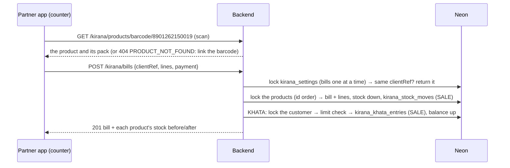

**The tables** (V66; V67 validates the keys to `shops` and `users`):

| Table | What it holds |
| --- | --- |
| `kirana_settings` | One row per kirana: the next bill number, the shop's **UPI ID** (owner only) and when it was set |
| `kirana_products` | The catalogue: name (one active product per name, case aside), unit `PIECE` or `KG`, price per piece or kg in paise, **stock** (NUMERIC(12,3); may go below zero), "running out" alert, `active` (removed products stay for old bills) |
| `kirana_barcodes` | A product's barcodes (up to 10: MRP batches, pack designs, a carton), each with its **pack**: how many pieces (or kg) one scan means (1 for a single pack, 12 for a carton of 12). One active product per barcode in a shop; a removed product keeps its barcodes inactive and gets them back when restored (except any another product has meanwhile) |
| `kirana_stock_moves` | Every stock change with its reason: `SALE`, `VOID` (a cancelled sale), `RETURN` (items brought back), `RESTOCK`, `DAMAGED`, `COUNT` (a count by hand), the stock after it, the bill, a note, who and when |
| `kirana_bills` + `kirana_bill_lines` | Walk-in bills: the shop's running number, the app's `client_ref` (a double tap finds the first bill), subtotal, **discount**, total, payment `CASH`/`UPI`/`KHATA`, the khata customer, what of a khata bill was **paid now** (cash or UPI), what was refunded for returns; lines copy the name, unit and price, so a later price change never changes an old bill (a line without a product is an item not in the list; a loose item sold by amount keeps the amount asked for), with how much of each came back; `voided_at`/`void_reason` when cancelled |
| `kirana_bill_returns` + `kirana_bill_return_lines` | Items brought back: which lines and how much, each line's value, the refund split into what came off the khata and what was handed back (cash or UPI), the app's `client_ref` |
| `kirana_bill_changes` | A bill's payment changed after saving: from what to what (payment, khata customer, paid now), who and when; the day's totals count it on that day |
| `kirana_khata_customers` | The khata book: name, optional phone (for the WhatsApp reminder) and note, credit limit (**₹2,000 for a new customer** unless the owner sets another or none), **balance** (what they owe; below zero it is their advance, used up by their next khata bill) |
| `kirana_khata_entries` | Each sale on khata (+, the part not paid now), payment received (−, cash or UPI, with the app's `client_ref`), cancelled sale (−), return (−), bill moved on or off the khata (`CHANGE`, ±), a payment undone (`REVERSAL`, +, naming the payment) and an advance given back (`REFUND`, +), with the balance after it |

**Who may do what:** the owner and helpers bill, scan, link barcodes, add products and stock, add khata customers and
take their payments. A helper may take up to ₹10 off a bill (a round-off), cancel, take a return on or change the
payment of **a bill he made, within 10 minutes**, and undo **a khata payment he recorded, within 10 minutes** (a
mistake fixed on the spot). Only the owner changes a product (name, price, unit before its first sale, alert, removing
it), unlinks a barcode or corrects its pack, sets a credit limit or none, undoes anyone's khata payment, gives an
advance back, sets the UPI ID, takes more off a bill, and changes any bill at any time (403 `OWNER_ONLY`; the window
ones say a helper can within 10 minutes).

| Call | What it does |
| --- | --- |
| `PUT /kirana/settings/sells-food` | Owner. `{sellsFood: true\|false}` (400 naming `sellsFood` without it): whether the shop sells any food, packed or loose, asked at registration. Yes needs its FSSAI licence before Submit for visit (and, once round 2's food filter is in, before online orders; No then means no food listed online). `GET /kirana/settings` returns it (`sellsFood`, null until answered); the field team sees it on the shop's page (`kirana.sellsFood`). Once verified, a change needs the edit code (403 `EDIT_LOCKED`); after Submit, Yes needs an FSSAI licence being checked or verified and not expired (409 `FSSAI_REQUIRED`); the same answer again changes nothing |
| `GET /kirana/settings` · `PUT /kirana/settings/upi-id` | The shop's name (the QR's payee) and UPI ID; the helper sees it too (he shows the QR). `PUT {upiId}` (owner): spaces removed, lower case, must look like `name@bank` (400 naming `upiId`). Once the shop is verified, a change needs the edit code like every checked detail (403 `EDIT_LOCKED`). The field team sees it (and when it was set) on the shop's page (`kirana` in `GET /admin/shops/{id}`). **A hand-over forgets it**: it was the old owner's account, so the new owner sets his own |
| `GET /kirana/products?q=&cursor=` | The catalogue in name order, 50 a page (`next` for the following page; a broken token is the first page). `q`: a name containing it anywhere ("salt" finds "Tata Salt 1 kg"), or a barcode starting with it (digits typed from a pack that won't scan); `%` and `_` are plain letters |
| `GET /kirana/products/running-out` | Products at or below their alert, or below zero (up to 200) |
| `GET /kirana/products/barcode/{code}` | A scan: `{product, pack}`: the active product with it and how many one scan means (the app adds that many to the bill), or 404 `PRODUCT_NOT_FOUND` (also for a misread code) |
| `GET /kirana/products/{id}` | The product and its latest 50 stock changes (who, why, the bill number) |
| `POST /kirana/products` | `{name, barcode?, pack?, unit, pricePaise, stock?, lowStockAt?}` → 201 (products carry `barcodes: [{code, pack}]`). Pieces whole, kg to the gram (3 decimals), 0 to 9999; price ₹0.01–₹1,00,000; `pack` 1 if left out (400 without a barcode). 409 `NAME_TAKEN`, `BARCODE_TAKEN` (with the product that has it). A first stock is recorded as a count |
| `PATCH /kirana/products/{id}` | Owner. `{version, name?, unit?, pricePaise?, lowStockAt?, noLowStockAlert?, active?}`. `unit` only until it is first sold (409 `PRODUCT_SOLD`; to piece its stock, alert and packs must be whole, 400 naming `unit`). 409 `PRODUCT_CHANGED` (stale version), `NAME_TAKEN` (also when putting a removed product back). Restoring a product brings its barcodes back except any another product has now |
| `POST /kirana/products/{id}/barcodes` · `DELETE /kirana/products/{id}/barcodes/{code}` | Link a barcode `{code, pack?}` (owner or helper; the same code and pack again changes nothing; the owner sending another pack corrects it) → the product. 409 `BARCODE_TAKEN` (another product has it, or a helper sends another pack), `TOO_MANY_BARCODES` (10), `PRODUCT_REMOVED`; 400 naming `code` or `pack` (whole for pieces). Unlink: owner, 404 `BARCODE_NOT_FOUND` |
| `POST /kirana/products/{id}/stock` | `{clientRef, reason: RESTOCK\|DAMAGED\|COUNT, quantity, note?}`: adds (up to 9999 at a time), takes off, or sets the stock to the count (up to 999999). The same `clientRef` again (a retry) changes nothing. A count equal to the stock records nothing. 409 `PRODUCT_REMOVED` |
| `POST /kirana/bills` | `{clientRef, lines (1–100), payment: CASH\|UPI\|KHATA, khataCustomerId?, discountPaise?, paidNowPaise?, paidNowBy?: CASH\|UPI}` → 201 `{bill, stock: [{before, after, runningOut}], khata, upi, repeated: false}`. A line is `{productId, quantity}`, a loose (kg) product by the amount asked for `{productId, amountPaise}` (the weight worked out to the gram), or an item not in the list `{name, amountPaise (each), quantity? (pieces, 1 if left out)}` (no stock kept; 409 `ITEM_IN_LIST` with the `productId` when it is the name of a product in the list, which must be scanned or picked). `discountPaise`: off the whole bill, at most its lines' total; a helper up to ₹10 (403 `OWNER_ONLY` past it). `paidNowPaise`/`paidNowBy`: a KHATA bill part paid at the counter, less than the total; only the rest goes on the khata. `khata` is the customer after a KHATA bill (balance, what is still available), `upi` the QR (`upiId`, `payeeName`, `amountPaise`, `uri` = `upi://pay?pa=…&pn=…&am=…&cu=INR&tn=Bill%20N`, ready to draw) for a UPI bill's total or a khata bill's part paid by UPI; null otherwise or before the UPI ID is set. `upiIdMissing`: true when a QR was needed but the UPI ID isn't set. The same `clientRef` again → 200 with the first bill and its stock changes, `repeated: true`, nothing billed. Listed prices from the catalogue. 400 naming `lines[i]…`, `discountPaise`, `paidNowPaise`, `paidNowBy` or `khataCustomerId`; 409 `PRODUCT_GONE` (`details.productIds`: removed meanwhile or not this shop's); 404 `KHATA_CUSTOMER_NOT_FOUND`; 409 `KHATA_LIMIT` (`details.availablePaise`, `limitPaise`, `balancePaise`). A sale is never refused for the app's stock count |
| `GET /kirana/bills?cursor=` · `GET /kirana/bills/{id}` | Bills newest first, 50 a page (line count, the first three names, cancelled or not, refunded); one bill with its lines (`lineNo`, `returnedQuantity`), who made it (`byName`, and `byId`: the app tells a helper's own bills by it), `subtotalPaise`, `discountPaise`, `paidNowPaise`, `onKhataPaise`, `refundedPaise`, its `returns` and payment `changes` |
| `POST /kirana/bills/{id}/void` | `{reason}` (2–200) → `{bill, stock, khata}`: stock back (`VOID` moves), what it put on a khata comes off, its cash and UPI (a khata bill's part paid now too) counted as handed back on the day of cancelling. A customer taken out of the book meanwhile comes back into it (without their phone if someone else has it now), so their advance stays in sight. 409 `BILL_VOIDED`, `BILL_HAS_RETURNS` (return the rest instead) |
| `POST /kirana/bills/{id}/payment` | `{version, payment, khataCustomerId?, paidNowPaise?, paidNowBy?, advance?}` → `{bill, khata: [customers it touched], upi, upiIdMissing}`: UPI failed and they paid cash, put on khata after all, moved to another customer's khata. Same bill number; the khata moves with `CHANGE` entries; the change is kept in `bill.changes` and counts in the day's totals on the day it was made. The same payment as now changes nothing (also with an old version). The limit is checked only when it puts more on a khata. 409 `BILL_CHANGED` (stale version), `KHATA_LIMIT` (nothing moved), `KHATA_ALREADY_PAID` (the customer's payments already cover it, so they'd be left an advance: `details.advanceAfterPaise`; send `advance: true` to keep it), `BILL_VOIDED`, `BILL_HAS_RETURNS` |
| `POST /kirana/bills/{id}/returns` | `{clientRef, lines: [{lineNo, quantity}], reason?}` → 201 `{bill, returned, stock, khata, repeated}`: listed products back into stock (`RETURN` moves); the refund is each line's share of the bill after its discount, and the last return gives back exactly what is left of the total; it goes back the way the bill was paid: `handBackPaise` in `handBackBy` (`CASH`/`UPI`) for a cash or UPI bill; for a khata bill `offKhataPaise` first (up to what the bill still has on the khata) and the rest, its part paid now, handed back as it was paid. The same `clientRef` → 200, made once. 400 naming `lines[i].lineNo` (no such line, or twice) or `lines[i].quantity` (more than is left); 409 `BILL_VOIDED` |
| `GET /kirana/day?date=` | One India day (today without `date`; 400 more than 2 years away). **Everything counts on the day it happened, so a day's figures never change after its drawer was counted**: bills made that day as they were paid then, cancelled since or not (count, sales after discounts, `discountPaise`; cash and UPI include the part paid now of khata bills; khata is what went on it); **payment changes made that day** (`paymentChanges`, what moved into cash, UPI and khata, ± ); khata payments received less those undone and advances given back that day (cash and UPI apart); **returns made that day** (handed back in cash or UPI, or off the khata); **bills cancelled that day** (their cash and UPI handed back, their khata part taken off); and `cashInPaise` / `upiInPaise`: what the drawer and the shop's UPI should have gained that day |
| `GET /kirana/khata?q=&owing=&cursor=` | The book in name order, 50 a page, with `owedPaise` (everyone together); `owing=true`: only those who owe. `q`: a name or note containing it ("1204" finds "Tower B 1204"), or digits of their phone |
| `GET /kirana/khata/{id}?cursor=` | A customer and their entries, newest first (50 a page), with each sale's bill number |
| `POST /kirana/khata` · `PATCH /kirana/khata/{id}` | `{name, phone?, note?, creditLimitPaise?, noLimit?}` (limit ₹2,000 unless the owner sets another or `noLimit`; the phone as people type or paste it: "+91 98480-12345", "098480 12345"; kept as 10 digits); edits `{version, …, noLimit?, active?}`. 409 `PHONE_TAKEN` (with the customer), `KHATA_CHANGED`, `STILL_OWES` (taking out someone who owes, or is owed) |
| `POST /kirana/khata/{id}/payments` | `{clientRef, amountPaise, method: CASH\|UPI, note?, advance?}` → 201 `{customer, entry, repeated}`; the same `clientRef` → 200, recorded once. Entries carry `byName` and `byId` (who recorded them: a helper may undo his own payment within 10 minutes). Customers carry `owesPaise` and `advancePaise`; the book `advancesPaise` (all advances held). More than they owe: 409 `MORE_THAN_OWED` (`details.balancePaise`, `advancePaise`, `advanceAfterPaise`: "Keep ₹25 as their advance?"); sent again with `advance: true` the extra is kept as their advance (balance below zero) |
| `POST /kirana/khata/{id}/payments/{entryId}/reverse` | The owner, or the helper who recorded it within 10 minutes. `{reason}` → 201 `{customer, entry}`: a payment recorded by mistake (on the wrong customer, ₹500 for ₹50) is undone with a `REVERSAL` entry; the payment stays in the history marked `reversed`. 404 `KHATA_ENTRY_NOT_FOUND` (not one of this customer's payments), 409 `PAYMENT_REVERSED` |
| `POST /kirana/khata/{id}/advance-back` | Owner. `{clientRef, amountPaise, method}` → 201: gives a customer's advance back (all or part; e.g. before taking them out of the book), a `REFUND` entry; counted off the day's khata money. The same `clientRef` → 200. 409 `MORE_THAN_ADVANCE` (`details.advancePaise`) |

**Many at once.** Every bill of a shop first locks its `kirana_settings` row, so a shop's bills are saved one after
the other (a counter does one at a time; two helpers billing together wait milliseconds): each gets the next number,
and a double tap or a retry finds the first bill. Products are locked in id order (bills, cancellations), so two bills
with the same products never wait on each other in a circle; the khata customer is locked last. Different shops never
wait on each other. Lists are pages of 50 read by index (`(shop, lower(name) COLLATE "C", id)` for names;
`(shop, created_at DESC, id DESC)` for bills and entries); "running out" reads
the shop's catalogue (no index mentions `stock`, so a sale updates the product row in place without touching any
index). Searches use `pg_trgm` GIN indexes (a word anywhere in a product's name, or a customer's name and note). One
bill's stock changes are written in one batch. Changes to a saved bill (cancel, return, payment change) lock the bill's
row first, then its products in id order, then khata customers in id order (a payment change between two customers
locks both in that order), so the same return or change sent twice waits for the first and then sees it. Product pages
read their barcodes in one query for the page; a scan is one lookup on the unique `(shop, code)` key, whose `C`
collation also serves the search by a barcode's first digits. Two requests about the same barcode (linking it, restoring
a product that has it) or the same khata phone (adding a customer, changing a phone, putting a customer back in the
book) wait for each other on a transaction-level advisory lock, so their "is it free?" checks never race into an error.
A stock change's `clientRef` sent for another product is a 409 `STOCK_CHANGE_REPEATED`; a stock that would leave its
column's range a 409 `STOCK_OUT_OF_RANGE`. Messages write money as people in India do (₹2,000, ₹1,00,000). Page tokens carry Postgres's own `lower(name)`, so no name is skipped
or shown twice across pages. Times are kept to the microsecond, as Postgres stores them. Quantities go out as plain
JSON numbers (`10`, never `1E+1`). Validation messages are in a shopkeeper's words ("The price can be at most
₹1,00,000").

**Registration.** A kirana needs its UPI ID before Submit for visit (409 `REGISTRATION_INCOMPLETE`, `details.upiId`;
the field team checks it at the visit, on the shop's page). The shops module asks through `KiranaFacts` (common,
implemented by `KiranaFactsService`, which needs only the settings store: anything more would make a constructor loop
with `ShopService`, which the kirana access check needs), so it doesn't depend on
the kirana module. A kirana's GSTIN stays optional (a GST-registered shop shows it on its bills); **no shop is asked
for a Udyam number any more** (2026-11-17): one sent by an older app is ignored, one stored before stays unshown.

**Deploying V66–V67:** new tables only, nothing existing is changed; safe while the old version runs.

## Kirana online orders (V68–V69)

Customers order from a kirana near them in the customer app and pay Clozest by Razorpay (UPI or Pay Later); the shop
packs and delivers; Clozest keeps **₹10 per checkout** and pays each shop its items to its UPI ID by RazorpayX, two
working days after delivery. When the chosen shop lacks something, **shops near it fill in** (see the plans below).
Scenario list: `docs/scenarios-kirana-orders.md`.

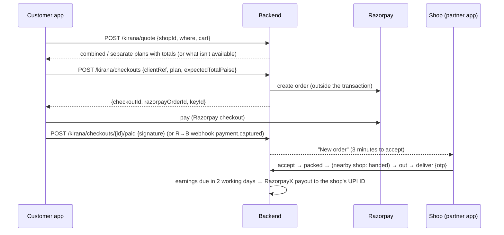

**When a shop takes orders.** All of: approved by the field team, its UPI ID set, its **FSSAI licence verified and
not expired**, and the owner's "Taking orders" switch on. `GET /kirana/online` lists what is `missing`
(`APPROVAL`, `UPI_ID`, `FSSAI`, `SWITCHED_OFF`). The owner adds the 14-digit number and a photo or PDF of the
certificate (a file uploaded as `REG_DOC`); within a minute the AI reads it (`FssaiCheckJob`, at most
`KIRANA_AI_CALLS_PER_DAY` calls a day, 5 tries) and verifies it when it is an FSSAI certificate, its number is the
one typed, it hasn't expired, and the business or operator name shares a word with the shop's or the owner's name
(the usual shop words like "General", "Stores" don't count); otherwise it is refused with the reason in plain words.
**A renewal never takes the shop offline** (V71): when the owner uploads a renewed certificate of the same licence
(the same number) while the verified one is still valid, the earlier licence's last day and certificate are kept
(`fssai.currentValidUntil`; the reason and the refusal notice say so) and the shop takes orders until then, whether the
new one is being checked or refused; once the new one is verified it replaces it. A different number keeps nothing. A
super admin refusing with `endCurrent: true` (the licence was cancelled, or isn't genuine) ends the earlier one too.
**A hand-over forgets the licence** the old owner added (it was issued to him as the food business operator): orders
stop until the new owner adds his own. A licence is only verified with its last day (read by the AI, or typed by the super admin), and stops orders the day
after it. When the AI can't decide (5 tries without an answer) the owner is told "our team will check it" and it waits
on the admin website (`GET /admin/kirana/fssai`); an owner sending the same certificate again after a refusal asks for
a person's look the same way. A corrected number is read afresh, and a read already under way for the old number is
thrown away. **A verified shop changing its UPI ID** (also the first one a new owner sets after a hand-over: the money
still owed may be the old owner's) holds its payouts until the field team checks the new ID with the owner; then any
payout that had failed goes to the new ID.

**The shared catalogue.** The first shop to add a product with a barcode makes a catalogue item (name, brand, size,
unit, MRP, category); every shop that scans that barcode later gets its details filled in, and its product is linked
to the item. That link is how the customer app finds the same item at nearby shops. Super admins correct items.

**Plans.** A cart line is one of the shop's products, or a catalogue item the shop doesn't list (from
`nearby-items`).

- *Quantity short* (the shop has 5, the cart says 7): the rest comes from a shop **within 1 km of the chosen shop**,
  which hands it to the chosen shop: always combined.
- *Whole item missing*: the customer chooses **combined** (the nearby shop hands it over, one delivery) or
  **separate** (another shop within 2 km of the customer delivers it itself, a second order).
- At most 2 other shops in the whole plan (those handing items over and those delivering separately together). The
  shop covering the most of what is missing is chosen first (then the nearest), each item at that shop's lowest price,
  and no shop's stock is promised twice. `nearby-items` shows the lowest price near the shop, so a quote can be a little
  higher when another shop covers more. What nobody can give is listed in `unavailable` (its `line` is the cart
  position from 0, as in error fields). ₹10 is charged once per checkout, on its first order (it comes back when every
  order of the checkout is cancelled). No minimum order, no delivery fee.

**Order states.** Order: `WAITING_PAYMENT → PLACED → ACCEPTED → PACKED → OUT_FOR_DELIVERY → DELIVERED`, or `CANCELLED`.
Each shop's share is a **part**: `OWN` (delivers) or `SUPPLIER` (hands its items to the delivering shop):
`WAITING → ACCEPTED → PACKED | HANDED`, or `REJECTED`, `TIMED_OUT`, `CANCELLED`. Stock goes down when a part is
accepted (`ORDER` move) and comes back for items marked missing or a cancelled part (`ORDER_BACK`). A supplier never
sees the customer.

| Who | Rule |
| --- | --- |
| Shop | 3 minutes to accept (owner or helper); not accepted → the part times out (`accept` answers 409 `TOO_LATE` until the job runs, `WRONG_STATUS` after). The delivering shop's part rejected or timed out cancels the whole order; a supplier's only its items. An order left with nothing to deliver is cancelled, the ₹10 refunded |
| Shop | A shop that stopped taking orders (switched off, licence expired, approval removed) between the checkout and the payment gets no order: its part is dropped and refunded, the whole order when it was to deliver it |
| Shop | The delivering shop sees the customer (name, phone, address, location) only once it accepted; after delivery the name and address only. Shops of one order see each other's phone while it is open, and the customer the shop's |
| Shop | A supplier hands over only once the delivering shop accepted (409 `NOT_ACCEPTED_YET`). An accepted order the shop can't finish (customer unreachable, wrong address, accepted by mistake) is cancelled by it with a reason, refunded in full, every shop's stock back (handed items are collected from it); a supplier can drop its part before handing over |
| Shop | Items marked missing while packing are refunded; all missing cancels the order (₹10 refunded too) |
| Shop | Out for delivery only once every supplier has handed over (409 `WAITING_FOR_SHOP`) |
| Shop | Delivered with the customer's 4-digit code: every 5th wrong code locks it for 15 minutes, the 15th for a day (429 `CODE_LOCKED`) |
| Customer | Pays within 30 minutes (the checkout expires 5 minutes later, so a payment made at the last moment still counts; one after that is refunded in full). Razorpay orders capture on their own. A second payment of the same checkout (paid again from another app) is refunded in full, once |
| Customer | An account can't be deleted while a shop has accepted one of its orders (409 `KIRANA_ORDER_OPEN`); orders not accepted yet are cancelled and refunded with it |
| Customer | Cancels until the shop accepts (409 `CANT_CANCEL` after); rates 1–5 stars within 7 days of delivery |
| Customer | Corrects the address text (flat, tower, landmark) until the order goes out, at most 3 times (`canChangeAddress`); the pin stays, so the shop is still within 2 km; the shop is told once it accepted (409 `CANT_CHANGE_ADDRESS` once it is out or after 3: call the shop) |
| Money | Refunds only before the delivery code is given. Each refund is one Razorpay refund with our id in its notes. A run claims each refund first (two backends never send one together); once asked, a refund is never PENDING again: a lost answer is looked up by our id before asking again, and a failed lookup waits for the next try. Razorpay refusing it makes it FAILED at once (on the admin website) |
| Money | A payout's status only moves forward: SENDING and SENT may become anything, PROCESSED only REVERSED; FAILED and REVERSED stay (a late or out-of-order answer never undoes them) |
| Money | Each shop earns its own items on delivery, due 2 working days later; one payout per shop and run, our id as RazorpayX's idempotency key. Without RazorpayX keys, earnings stay "due" |

| Call | What it does |
| --- | --- |
| `GET /kirana/online` · `PUT /kirana/online/taking-orders` · `PUT /kirana/online/fssai` | The shop's readiness, FSSAI status, rating, money due and recent payouts (amounts for the owner). Switch `{on}` (owner; 409 `NOT_READY` with `details.missing`). Licence `{number, fileId}` (owner; 400 naming `number` or `fileId`) |
| `GET /kirana/online/earnings?cursor=` | The owner (403 `OWNER_ONLY` for helpers): one row per delivered order (the shop's part of it), newest first, 50 a page: order number, amount, delivered, due on, and the payout it went in with its status, UPI ID and why it failed |
| `GET /kirana/catalogue/barcode/{code}` | A scan's catalogue details to prefill a new product (404 `CATALOGUE_NOT_FOUND`) |
| `GET /kirana/nearby?lat=&lng=&cursor=` | Shops taking orders within 2 km, nearest first, 50 a page |
| `GET /kirana/shops/{id}/products?q=&cursor=` · `GET /kirana/shops/{id}/nearby-items?q=&cursor=` | The shop's products (in stock or not); items shops within 1 km of it have and it doesn't, at the lowest price. 409 `SHOP_NOT_TAKING_ORDERS` |
| `POST /kirana/quote` | `{shopId, latitude, longitude, lines: [{productId \| catalogueItemId, quantity}]}` → `{combined, separate, choose, unavailable, separateUnavailable}` (`combined` null when nothing can be given). 409 `TOO_FAR`, `PRODUCT_GONE`, `SHOP_NOT_TAKING_ORDERS` |
| `POST /kirana/checkouts` | `{clientRef, shopId, latitude, longitude, addressLine, lines, plan: COMBINED\|SEPARATE, method: UPI\|PAY_LATER, expectedTotalPaise}` → `{checkoutId, status, razorpayOrderId, keyId, amountPaise, orders}`. The same `clientRef` → the same checkout. 409 `PRICE_CHANGED` / `NOTHING_AVAILABLE` with `details.quote`; 503 `PAYMENTS_OFF` (keys not set) or `PAYMENTS_UNAVAILABLE` (Razorpay didn't answer: sending it again asks again) |
| `GET /kirana/checkouts/{id}` · `POST /kirana/checkouts/{id}/paid` | The checkout with its orders (item counts) and every refund (also a late or second payment's); Razorpay checkout's answer `{razorpayOrderId, razorpayPaymentId, razorpaySignature}` (400 `BAD_SIGNATURE`) |
| `GET /kirana/orders?cursor=` · `GET /kirana/orders/{id}` | The customer's orders; one order with its lines (`fromNearbyShop`, `missing`), refunds, the delivery `otp` (until delivered), `acceptBy` while waiting for the shop, the shop's phone while open, `canCancel`, `canRate`, its rating and comment |
| `PATCH /kirana/orders/{id}/address` | `{addressLine}` (3–200 letters) → the order |
| `POST /kirana/orders/{id}/cancel` · `POST /kirana/orders/{id}/rating` | `{reason?}`; `{stars, comment?}` (409 `CANT_CANCEL`, `CANT_RATE`, `ALREADY_RATED`) |
| `GET /kirana/shop-orders?open=&cursor=` · `GET /kirana/shop-orders/{partId}` | The shop's parts, newest first: `open=true` what it still has to do, `open=false` what is done. Items, `secondsLeft` to accept, the customer (delivering shop, once accepted), what other shops send it and their phones, or for a supplier the shop to hand over to and its phone |
| `POST /kirana/shop-orders/{partId}/accept \| reject \| missing \| packed \| handed \| out \| deliver \| cancel` | The steps above. `reject {reason}`; `missing {lineNos}` (a supplier left with nothing ends its part); `deliver {otp}` (400 `WRONG_CODE` with `details.triesLeft`); `cancel {reason}`. 409 `TOO_LATE`, `NOT_ACCEPTED_YET`, `WAITING_FOR_SHOP`, `WRONG_STATUS` |
| `POST /payments/razorpay/webhook` | The same URL as subscriptions: `payment.authorized` (captured), `payment.captured` / `order.paid` (marks the checkout paid), `refund.processed` / `refund.failed`; each event once (`X-Razorpay-Event-Id`) |
| `POST /payments/razorpayx/webhook` | RazorpayX's own URL and secret: `payout.processed`, `payout.failed`, `payout.reversed` (the owner is told when one fails) |
| `GET /admin/kirana/catalogue?q=&cursor=` · `PATCH /admin/kirana/catalogue/{id}` | Super admins: the catalogue with its barcodes; corrections `{version, name?, brand?, size?, mrpPaise?, category?}` (409 `CATALOGUE_CHANGED`) |
| `GET /admin/kirana/fssai?status=` · `POST /admin/kirana/shops/{id}/fssai` | Super admins: certificates waiting for a person (`CHECKING`, default) or refused (`REJECTED`), with the number and file; a decision `{verified, reason?, validUntil, endCurrent?}` (`validUntil` needed to verify, 400 naming it; `endCurrent` ends a licence kept during a renewal), the owner told; refused renewals show `keptUntil` |
| `GET /admin/kirana/orders/open` · `POST /admin/kirana/orders/{id}/cancel` | The team: paid orders still open 2 hours after they were placed, with the shop's phone; super admins cancel one no one can finish `{reason}` (refunded in full; 409 `WRONG_STATUS`) |
| `GET /admin/kirana/upi-checks` · `POST /admin/kirana/shops/{id}/upi-check` | The team: shops whose UPI ID changed after approval; checked (404 `NOTHING_TO_CHECK`) |
| `GET /admin/kirana/refunds/failed` · `GET /admin/kirana/payouts?status=` · `POST /admin/kirana/payouts/{id}/retry` | Super admins: refunds Razorpay refused; payouts by status; a failed or reversed payout sent again |

**Many at once.** A checkout is unique per customer and `clientRef`, so eight taps make one. Razorpay and RazorpayX
are always called outside database transactions; a checkout, its orders and parts are locked in that order
(checkout → orders by number → parts → products by id), so the shop accepting, the timeout job and the customer
cancelling never cross. Jobs (timeouts every 15 s, expiry every minute, refunds every 30 s, payouts every 10 minutes,
the FSSAI check every minute) each run on one replica at a time (`job_leases`) and take their rows with
`FOR UPDATE SKIP LOCKED` (refunds are claimed one by one, so a run outlasting its lease never sends one twice). The
shop's order screens read `(shop_id, board, updated_at DESC, id DESC)` (`board` is OPEN or DONE, kept with the part and
its order); the timeout job reads a partial index on `accept_by` of waiting parts; the payout run reads earnings by
payout and skips shops that can't be paid (so they never hold other shops' places); shops near a customer come from
the PostGIS `location` index.
Lists are pages read in one query for the page (lines, shops and people fetched in batches).

**Configuration:** `RAZORPAY_*` as for subscriptions (the same webhook URL; add the `payment.*`, `order.paid` and
`refund.*` events); `RAZORPAYX_KEY_ID`, `RAZORPAYX_KEY_SECRET`, `RAZORPAYX_ACCOUNT_NUMBER`,
`RAZORPAYX_WEBHOOK_SECRET` (webhook URL `https://<backend>/api/v1/payments/razorpayx/webhook`, the `payout.*`
events); `KIRANA_AI_KEY` (defaults to `ANTHROPIC_API_KEY`), `KIRANA_AI_MODEL`, `KIRANA_AI_CALLS_PER_DAY` (500).

**Deploying V68–V69:** new tables, a new nullable column on `kirana_products` and `kirana_stock_moves`, the stock
move reasons widened and `created_by` made optional for order moves; keys and checks on the existing tables are added
`NOT VALID` and checked by V69 without blocking writes; V71 adds a nullable column (no rewrite); V70 builds the stock moves' order index `CONCURRENTLY`
(counter bills go on meanwhile). Safe while the old version runs.

## Kirana stock from photos and scans (V72–V73)

Round 3: getting stock in without typing. Everything is under `/api/v1/kirana` for the shop's owner and helpers
(salon people 409 `NOT_A_KIRANA`); the team's parts are under `/api/v1/admin/kirana` (super admins).

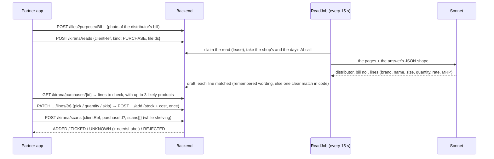

**Bills in any format** (`BillFiles`). A distributor's bill may come as a photo (JPEG, PNG, WEBP), a PDF (up to 20
pages), an Excel file (`.xlsx`, `.xls`), a Word file (`.docx`), a CSV, a GST e-invoice's JSON (signed or not) or plain
text: whatever reached the owner's phone (WhatsApp, email, the distributor's app), he uploads it in the app (or shares
it into the app) with purpose `BILL` (spreadsheets, documents and text at most 2 MB; an iPhone HEIC photo: 400 with
"share it as JPEG"). Before any AI, the reading job reads it in code: an Excel or CSV bill whose columns it finds (item
/ description / particulars, qty, free, rate, amount, MRP; bill no. and date above them) and an e-invoice's item list
become the draft **with no AI call at all**; a PDF made by billing software, a Word file or a sheet it can't place goes
to the AI as **text** (far fewer tokens than pictures); only photos and scanned PDFs go as pictures.

**Photos read by AI** (`kirana_reads`). Upload the file first (`POST /files`, purpose `BILL` for bills, 1–3 files;
`PRODUCT_PHOTO` for packs), then `POST /reads {clientRef, kind: PURCHASE | PAPER_BILL, fileIds}` (201, `READING`;
the same `clientRef` again returns the first). `ReadJob` reads 10 at a time under a lease, each claimed for 5 minutes
(`SKIP LOCKED`), outside any transaction. The photo is downloaded first; then a shop may have 30 reads a day, all
shops together `app.kirana.ai-calls-per-day` (500): over either, the read waits until 00:05 without losing a try. The
AI or storage down, or anything unexpected: tried again after 1, 2, 4, 8, 16 minutes, then `FAILED` with "send it
again later or enter it by hand"; a photo that isn't a bill or can't be read: `FAILED` with why. A thrown-away or
failed bill photo is deleted unless something else uses it.
`GET /reads?kind=`, `GET /reads/{id}`, `POST /reads/{id}/discard` (409 `READ_USED` once it became stock or a bill).
Photos of bills and products have their own 600 uploads a day per shop, apart from the other 100.

**Distributors' bills** (`kirana_purchases`, `kirana_purchase_lines`). Each line's product: this distributor's
wording matched before (`REMEMBERED`, `kirana_wordings`), else one clear match by name (`SURE`); the rest wait for the
shop with up to 3 suggestions (its products, then catalogue items it doesn't have). Names are compared in Java
(`NameMatcher`): flexible about units (500ML, 0.5 L), short forms (TM = toned milk), spellings (Taza/Taaza), word order
and brand; never a match for another size; a different variant (toned/gold) is never one tap. `PATCH
/purchases/{id}/lines/{n} {version, productId?, quantity?, skip?}`; `POST /purchases/{id}/add {version, addAgain?}`:
409 `LINES_TO_CHECK` (naming them), 409 `BILL_ALREADY_ADDED` (the same distributor, number and date added before:
send `addAgain` for another delivery), 409 `PURCHASE_CHANGED` (stale version), 409 `PURCHASE_DONE`, 409
`PRODUCT_REMOVED`. Adding takes a lock on the bill's distributor and number (two copies added at the same moment go one
at a time: the second gets `BILL_ALREADY_ADDED`), locks the products in id order, adds each one's stock in one
`RESTOCK` move (with the bill), sets each product's cost to the rate paid and remembers the wordings. What was paid
(`ratePaise`, `amountPaise`, `totalPaise`, `costPaise`) is the owner's only: null for a helper.
`PATCH /purchases/{id}/lines {version, lines: [...]}` changes many lines at once (accepting suggestions down the bill);
`newProduct {itemId | name, unit, pricePaise}` instead of `productId` makes and picks a product the shop doesn't have;
`ratePaise` (owner) corrects a misread rate; `POST /purchases/{id}/lines` adds a line the reading missed; `PATCH
/purchases/{id} {version, distributor, billNo, billDate}` corrects the bill's top. Once added, `POST
/purchases/{id}/lines/{n}/correct {productId | newProduct}` (owner) moves a wrongly picked line's stock to the right
product (one `MOVE` each), sets its cost and remembers the wording for it. `POST /purchases/{id}/discard` throws a
draft away.

**Scanning while shelving.** The phone reads barcodes (BarcodeDetector, or ZXing compiled to WebAssembly) and sends
them in batches: `POST /scans {clientRef, purchaseId?, scans: [{code, times}]}` (1–200). Each scan: `ADDED` (its pack
times `times` into stock, one `RESTOCK` move per product and barcode), `REJECTED` (a wrong EAN-8/12/13/14 check digit,
or too many at once: scan again) or `UNKNOWN`. With `purchaseId` (a draft) nothing goes into stock by scanning: each
product's scans are **held with the bill** (`kirana_purchase_scans`): `TICKED` when it is on one of its lines (with
`scannedTotal` and the line's `lineQuantity`: "12 of 24"), `HELD` otherwise. Adding the bill adds its lines'
quantities plus what was held of products on none of its lines; throwing the draft away (from the bill or its photo)
puts everything held into stock, since it is on the shelves. So stock is never counted twice, whichever comes first. Shop-printed loose labels (20–23…) carry the weight in grams or the price; the
first 7 digits are linked to the kg product like a barcode. The same `clientRef` again counts nothing (`repeated`).

**Unknown barcodes ("Needs a tap").** `GET /scans/unknown` (20 a page) lists each unknown barcode with its scans, what
the shared catalogue says (`catalogue`, `trusted`), its label as read, the brand other barcodes of the same company
have, and up to 3 likely products with `sure` for one clear match. When nobody knows the barcode (`needsLabel`), the
app sends the scan frame: `POST /scans/unknown/{id}/label {clientRef, fileId}`; Sonnet reads it once for the whole
network (another shop scanning the same pack reuses that read: no photo, no AI call). `POST /scans/unknown/{id}/link
{productId | itemId/name/unit/pricePaise, pack?, oneTap?}` links the barcode (as `POST /products/{id}/barcodes`) and
settles every open entry of it (one per bill it was scanned with): held with a bill still a draft; nothing when the
bill was added with this product on it (the bill brought them); else into stock (`quantity`, `held`, `note` when a
loose label adds nothing or a pack was rounded). `needsPhoto` asks for a front photo when neither the product nor its
catalogue item has one. `POST /scans/unknown/{id}/dismiss` (204) puts one away; `GET /scans/unknown?dismissed=true`
lists them and `POST /scans/unknown/{id}/reopen` brings one back. Another shop's read of a pack is reused, but a shop
may send its own photo over it (that read may have been of the wrong pack).

**The owner's corrections, any time.** `POST /products/{id}/move-barcode {code, toProductId, moveStock?}` (owner):
the barcode moves with its pack; with `moveStock` the stock scanned in with it moves in the same go, else
`suggestedQuantity` (the stock scanned in with it) is offered for `POST /products/{id}/move-stock
{clientRef, toProductId, quantity}` (owner; one `MOVE` on each; same unit only: 409 `UNITS_DIFFER`; at most the
first product's stock: 400 naming quantity). Setting the
count stays `POST /products/{id}/stock` (`COUNT`); names and prices `PATCH /products/{id}` (the unit can't change after
a sale; bills keep what they were). `PUT /products/{id}/photo {clientRef, fileId}` (owner or helper);
`PUT /products/{id}/cost {costPaise}` (owner). Products now carry `photoFileId` (the shop's own, else the catalogue's
shared one), `photoUrl` (a signed link: a shared photo is another shop's file) and `costPaise` (owner only). A file a
product, the catalogue, a paper bill, an FSSAI certificate or a read still points at can't be deleted (409
`FILE_IN_USE`), and a photo the kirana stops using is deleted only when nothing else points at it (uploads of the same
bytes share one file). `NAME_TAKEN` names the product that has the name (`details.productId`).

**The shared catalogue's trust.** A barcode one shop linked is a suggestion until a second shop links it to the same
item (or it came from a product master or the team): then `trusted`. A shop that links it to another item keeps its
own link, and the barcode goes to the team's review list (`CONFLICT`); an owner moving a barcode corrects the
catalogue when the link was only his shop's say, else the team reviews it (`CORRECTION`). A product's photo whose label
shows its catalogue item becomes that item's shared photo (once). Admin: `GET /admin/kirana/catalogue/reviews`,
`POST /admin/kirana/catalogue/reviews/{id} {itemId}` (one of the two, or any item when both are wrong; 204; 409
`REVIEW_DONE`; an item made only for the review that lost goes), `POST /admin/kirana/catalogue/import` (a distributor's
product master: a CSV file, multipart field `file`, up to 5,000 rows / 2 MB: a header naming at least barcode and name;
bad rows listed; a row confirms a shop's link only when the names clearly match, else it is reviewed as `IMPORT`), `GET /admin/kirana/scans/stats?days=30` (scans, the unknown-barcode
rate, one-tap / picked / new links per day).

**Counter suggestions.** `GET /suggestions?khataCustomerId=&with=…`: `now` (sold most around this hour in the last 14
days), `usual` (the khata customer's), `together` (often on the same bill as the last 5 items on it). Each list is
counted at most once per 10 minutes per server and kept in Redis for every server (Redis down: counted in the
database); products removed or out of stock, and those on the bill already, are left out. "This hour" wraps around
midnight.

**Paper bills.** A backup for when the counter couldn't scan: `POST /reads {kind: PAPER_BILL}`, then `GET
/paper-bills/{readId}` (the lines matched to products; `readDate` as read and `writtenOn` when usable, else
`dateProblem`; `failure` when it couldn't be read) and `POST
/paper-bills/{readId}/confirm {writtenOn, lines, payment, …}`: exactly a new bill (every check of `POST /bills`),
plus `writtenOn` (the day on the paper, today or up to 7 days back: 400 otherwise) and the photo kept on the bill
(`paperPhotoFileId`). The bill's `createdAt` is when it was confirmed, so the day's totals count it on that day, like
any money that moves then. Confirming again returns the same bill (`repeated`), even after midnight; 409 `READ_NOT_READY` while reading.

**Under load.** No AI call or file download ever runs inside a transaction or a lock; reads are claimed with `SKIP
LOCKED` and leases, so several servers share the queue. Matching reads the shop's products once per request (at most
8,000) and compares in memory; catalogue candidates come from a trigram index. Locks are always taken in one order:
bills (by id; a photo's bill before its read), then unknown scans (by barcode, then id), then products by id. Two
batches opening the same unknown barcode at once end on one entry (unique key); retries are counted once
(`kirana_scan_batches`, kept a day, derived `clientRef`s). A product master import runs in one transaction (super
admins only, at most 5,000 rows).

**Deploying V72–V73:** new tables; nullable columns on `kirana_products`, `kirana_stock_moves`, `kirana_bills`,
`kirana_catalogue_items` and `kirana_catalogue_barcodes` (the barcodes' `source` and `confirmed` have constant
defaults: no rewrite); keys and checks added `NOT VALID` with `lock_timeout` 3 s, then checked by V73 without blocking
writes. Every barcode shops linked before starts as a `SHOP` link; each shop's existing link is counted as its say, and those
two shops already agree on start trusted. Set `ANTHROPIC_API_KEY` (or
`app.kirana.ai-key`) for the reading; without it reads fail at once with "enter it by hand".

**Deploying V74–V75** (backend PR "kirana ↔ salon while registering; a kirana's video, food answer and documents"):
V74 adds the nullable `kirana_settings.sells_food` (no default: instant, no rewrite) and replaces the PASSED rule on
`shops` (`ck_shops_licence_passed`: a Shops and Establishments certificate may pass with no last day), added `NOT VALID`
with `lock_timeout` 3 s; V75 checks it without blocking writes. Every row the old rule allowed the new one allows.
Safe while the old version runs: it never writes `sells_food`, and its PASSED rows all have a last day.

### A kirana's registration and documents

- **Video:** a kirana records the shop's video like a salon (15–45 s, the same upload); Submit needs it.
- **"Do you sell any food items (packed or loose)?"** (`PUT /kirana/settings/sells-food`): needed before Submit. Yes:
  the FSSAI licence (`PUT /kirana/online/fssai`, checked by the AI within a minute) is needed too, one still being
  checked will do (the field team sees how it went on the shop's page, `kirana.fssai`: status, number, reason, last
  day), a refused or **expired** one won't. No: no FSSAI asked. After Submit (waiting for the visit, or live), No can
  become Yes only with an FSSAI licence that counts (409 `FSSAI_REQUIRED`), so the Submit rule can't be skipped by
  answering No first; the change holds the shop's row, so it can't slip between a Submit's check and its save. Online
  orders still need a verified FSSAI from every kirana until round 2's food filter (No shops then list no food).
- **One upload as two papers:** uploads of the same bytes share one file, so a PDF with both certificates can be the
  shop's document and its FSSAI certificate. Neither side deletes the file while the other still points at it (the
  document dropped by a kind change or replaced; the FSSAI certificate replaced).
- **A kirana that became a salon while registering** keeps its FSSAI row (for if it changes back), but the FSSAI job
  spends no AI read on it meanwhile.
- **Its document, optional:** a municipal trade licence or a Shops and Establishments certificate, checked by the same
  job as a salon's licence (`LicenceCheckJob`, the AI reads both kinds). For a kirana: a trade licence must be for a
  grocery, kirana, provisions or general store (`retailTrade`; else `NOT_A_SHOP_TRADE`); a certificate must be one
  (`NOT_SHOPS_ESTABLISHMENT`), and a nature of business printed on it must be a grocery or general store's; one that
  prints **no last day passes with no end date** (`licenceValidUntil` null, never "expiring"). The name, address,
  editing, number and one-shop-per-licence checks are the salon's. The owner's messages point at `/register/licences`
  while registering, else `/kirana/licences`, and speak of the shop (never "salon"); a kirana's "Licensed" badge is
  promised for when customers can find kiranas, not claimed as shown, and a reminder names the paper (trade licence or
  Shops and Establishments certificate).

**GS1 later.** Once the company is registered, unknown barcodes are to be looked up in GS1 India's product data before
the label is read (see the project's future plans): Sonnet then reads only packs GS1 doesn't know.

## Kirana product setup after Submit (V76–V78)

A kirana is approved only once the field agent has seen that its products are in the app. So after Submit the owner
(and helpers) set up **every product the shop sells, each with a count** of what is on the shelf. Signup itself is
unchanged; the counter works from Submit, so a sale after a product is counted takes it off the stock.

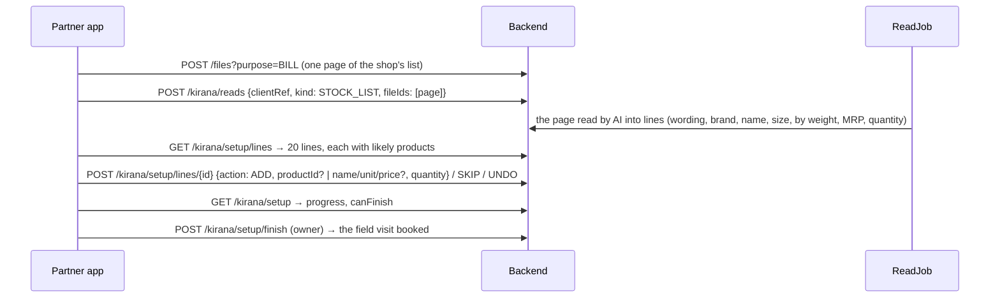

- **`GET /kirana/setup`** (owner or helper): `products`, `uncounted` and up to 20 `uncountedProducts` (`{id, name}`),
  `linesToCheck`, `linesAdded`, `linesSkipped`, `pagesReading`, `pagesFailed`, `pagesLeft` (of 60), `pages` (each kept
  page: `pageNo`, `fileId`, `status`, `failure`, `linesLeftOut` past the 150 one read keeps, its lines' counts),
  `canFinish`, `youCanFinish` (the owner only), `readyAt`.
- **Pages of the list** (`kind: STOCK_LIST`): one BILL photo or file each, at most 60 kept a shop (409
  `TOO_MANY_PAGES`, counted under a per-shop lock; a page deleted or that failed frees its place) and 100 sent a day,
  deleted and failed ones too (409 `TOO_MANY_PAGES_TODAY`: each was an AI read). They don't use the shop's 30 daily AI
  reads for bills. A page that isn't a list, or can't be read, fails with the reason, to retake. Deleting a page takes
  its unchecked lines away (deciding one: 404); products added from it stay.
- **`GET /kirana/setup/lines?status=&cursor=`**: lines to check (`NEW`, the default, with suggestions), `SKIPPED` (to
  bring one back) or `ADDED` (with what was `counted`), 20 a page, in the order the pages were sent, each with `pageNo`.
- **`POST /kirana/setup/lines/{id}`**: `ADD` with `quantity` (400 naming it if missing) either onto a product the shop
  has (`productId`: its stock becomes the count; when another line was already added onto it, 409 `ALREADY_COUNTED`
  with its stock until `addToCount` true adds or false replaces) or as a new one (`itemId` from the catalogue and/or
  `name`, `unit`, `pricePaise`; left out: brand + name + size as read, kg for loose goods else piece, the MRP read if
  a product may have it, else 400 naming `pricePaise`; 409 `NAME_TAKEN`). Sent again: the line as it is. `SKIP` /
  `UNDO` (409 `LINE_ADDED` once added: the product is changed instead). 404 `LINE_NOT_FOUND`.
- **`POST /kirana/setup/finish`** (owner; 403 `OWNER_ONLY`): 409 `NO_PRODUCTS`, `LINES_TO_CHECK` (also while a page
  is reading), `PAGES_FAILED` (retake or delete), `PRODUCTS_NOT_COUNTED` (with `{id, name}`s). Checked under the
  shop's setup lock (lines and pages wait). Then `shops.products_ready_at` is set, a note goes on the shop's timeline
  and, if it was submitted and never approved, the visit is booked with the agent covering its pincode. Again: as it
  is.
- **A picture for every product** before finishing (409 `PHOTOS_NEEDED`: `missing`, `checking`, `refused`): its
  shared catalogue item's, or the shop's own photo once checked. `GET /kirana/setup/photos?cursor=` lists the products
  without one, 20 a page, each with `sizeToShow` and `loose` (for the camera screen's guidance) and its photo's check.
  `PUT /kirana/products/{id}/photo {clientRef, fileId, sizeFileId?}`: the photo is checked by AI before it shows
  (`photoCheck` CHECKING; the old picture stays meanwhile) against the product (`PhotoRules`): the right product and
  variant, the right size (code compares it with the name's), the front of the pack, sharp, one product, no people;
  loose goods only need to be those goods. Refused (`REFUSED` / `NEED_SIZE`: a photo of the side with the size, sent with
  the front's) with `photoCheckReason` in the shop's words. 300 checks a day a shop (409 `TOO_MANY_PHOTOS_TODAY`); they
  don't use the 30 daily reads for bills. Removing the shop's own photo needs a catalogue picture (409 `PHOTO_NEEDED`).
  A checked photo of a pack matching its catalogue item becomes the item's picture where it has none, only while the
  shop is approved (`KiranaFacts.shareCheckedPhotos` at approval, then at each check). Each refusal has a `code`
  (WRONG_SIZE, OTHER_PRODUCT, NEED_SIZE, BLURRY …) and what the photo showed (`seen`) for the app to word in Hindi or
  Telugu. After NEED_SIZE the side alone is sent; `fileId` null lets go of a waiting or refused photo, keeping the
  accepted one. A product renamed or its unit changed has its photo checked again. **AI cost:** each photo check is one
  AI call, from the platform's own daily allowance for photos (`app.kirana.photo-checks-per-day`, 3,000), so bills
  (`app.kirana.ai-calls-per-day`, 500) are never held up; set both to what the budget allows.
- **The field team:** a submitted kirana still setting up is in no review group, not on the dashboard and not assigned
  (nor counted in an agent's load; one held from before is let go when it is submitted); its page shows
  `waitingForVisit` false and `productsReadyAt`; approving it is refused with 409 `PRODUCTS_NOT_READY`. A kirana ever
  approved is never held back. (`ShopAssignmentStore.setUp`, `Shop.visitBookable`.)
- **Counted products** (`kirana_products.counted_at`): set when a product is added with a stock or counted (Count, a
  setup line, or created from a distributor's bill or a scan: it starts at 0 and what came in is added); cleared when a
  sale takes it below zero or it is missing while packing an online order. **Only counted products are offered
  online** (the shop's list and nearby shops' items); each product says `counted`.

**Deploying V76–V78:** V76 adds nullable `shops.products_ready_at`, `kirana_products.counted_at`, the photo-check
columns of `kirana_products` (`photo_shareable` NOT NULL DEFAULT false: no rewrite; its keys and rule `NOT VALID`) and
`kirana_reads.lines_left_out` (no default: no rewrite), marks products with stock above 0 as counted and lets go of
the agent holding a kirana waiting for its first visit (kiranas aren't live yet: few rows; they are booked again when
they finish their setup), widens the read kinds (`NOT VALID`) and creates the empty `kirana_list_lines`; V77
validates; V78 builds the uncounted-products index `CONCURRENTLY`. Safe while the old version runs: it never reads the
new columns. **Deploy with the partner app's setup screens** (its next PR): without them a new kirana can't finish its
setup, so its visit is never booked.

## GS1 DataKart: official pictures and barcodes (V79–V80)

**Off until both `GS1_DATAKART_URL` and `GS1_DATAKART_KEY` are set** (Railway variables; `GS1_IMAGE_HOSTS` optionally
lists other hosts DataKart's pictures may come from). Railway can't keep a variable without a value, so `NULL`, `NONE`
or `OFF` (any case) count as not set: GS1 stays off with those. Then `Gs1Job` runs every minute on one server:

- **By barcode (CODE):** every barcode new to the shared catalogue whose item has no picture is queued. GS1's product
  must be ours (brand, name and size agree) and its picture must pass the AI photo check; it becomes the item's
  picture for every shop selling it (stored as the platform's own file, `CATALOGUE_PHOTO`, no shop's), and the item's
  missing brand and size are filled in.
- **By name (NAME):** a packed product added without a barcode, with its size in its name ("Tata Salt 1 kg"), is
  queued; loose goods and names without a size aren't (they can't be matched clearly). On one clear match (a sure
  score, clearly ahead of any other likely product) its barcode joins the catalogue (source `GS1`, trusted) and the
  product is linked to that item, so its picture follows; the product's own barcode is still set only by the shop: the
  product shows `suggestedBarcode` ("Is this its barcode? Tap to add").
- **The shop's view:** a product shows `pictureFrom` (SHOP, CATALOGUE or null) and `findingPicture` while GS1 may still
  bring a picture. Setup counts those as `photosFinding` (listed last in the photos to take, `findingPicture: true`):
  with only those left, `nextStep` is WAIT, but the shop may photograph them anyway.
- **"Not this product"** (`POST /kirana/products/{id}/not-this-product`, owner): GS1's match by name was wrong; the
  link, picture and suggestion go and it isn't looked for again under that name (409 HAS_BARCODE: matched by its
  barcode; 409 NOT_MATCHED). Renaming a product without a barcode drops what was found and looks again under the new
  name.
- **Admin:** `GET /admin/kirana/gs1?status=REFUSED|NOT_FOUND|WAITING|FOUND&cursor=` (super admins): lookups newest change
  first with their note, shop and product, the counts at each status, and whether GS1 is switched on.
- Not found: looked up again a month later. GS1 or the AI unreachable or busy: 30 minutes later, for a day, then a
  month later; the shop is never kept waiting on it (after 3 failures or a day it's a photo to take). A wrong key
  (401/403) or URL stops the run and gives the lookups back untouched (logged), so fixing the variable is enough. A picture the AI can't make out is skipped. GS1's picture
  checks have their own daily allowance, `GS1_CHECKS_PER_DAY` (1000), apart from shops' photos
  (`KIRANA_PHOTO_CHECKS_PER_DAY`).
- GTIN-14s with leading zeros are read as the EAN-13 (or EAN-8) a pack prints.
- `DataKart` was written before access to DataKart's API documentation (it calls `GET <url>/products/<gtin>` and
  `GET <url>/products?q=<name>` with the key as a bearer token, and reads GS1's core attribute names); when access
  comes, only that class is adjusted to the real API.

**Deploying V79–V80:** V79 widens two `files` rules and the catalogue barcodes' sources (`NOT VALID`) and creates the
empty `kirana_gs1_lookups` and `kirana_gs1_ai_calls`; V80 validates. Safe while the old version runs.

## Recount pages, products added after finishing, failure codes (V81–V82)

- **Recount** (`POST /kirana/reads {kind: STOCK_LIST, recount: true}`): a page of the list sent again to update counts.
  A line clearly naming one of the shop's products, with a count written, takes that count without asking (as the
  shop's Count would); the line is ADDED with `autoCounted`, `countBefore`, `productName` and `stockNow`, the page says
  `linesAutoCounted`; `GET /kirana/setup/lines?status=ADDED&readId=` lists what one page changed. Never guessed, so
  asked as usual: a product named twice on the page, kg against pieces, a product the shop never counted itself, one
  that changed after the photo was sent, one counted from a list in the last 12 hours, a count it can't have.
  `UNDO` on such a line puts the count back as it was, keeping sales since (a newer count stands), and brings the
  line back to check; its answer says `countPutBack` (true, or false when the count was left as it is). `ADD` or
  `SKIP` on it is 409 `AUTO_COUNTED`. A page's `pageNo` is its place among all pages kept (a recount page no longer shown
  included), so it only changes when an earlier page is thrown away; a
  recount page is shown in setup for a week (and however old while read, failed, or with lines to check). Lines'
  `countBefore`, `productName` and `stockNow` are null until the line is added. Throwing the page away puts its counts back first. Recount
  pages aren't among the 60 kept pages (the 100 a day still count them). 400 naming `recount` for another kind.
- **Before the first approval** every product needs its count and picture, those added after
  `POST /kirana/setup/finish` too: setup says `beforeApproval` (`nextStep` COUNT, PHOTOS or WAIT; the visit stays
  booked), the field team's shop page lists them (`kirana.productGaps`, with how many photos are still `checking`)
  and approving answers 409 `PRODUCTS_INCOMPLETE` until none is left (also for a shop with no products at all). A shop ever approved is never held back.
- **`failureCode`** beside every `failure` of a read (reads, list pages, paper bills, scanned labels), from
  `ReadFailure`, for the app to word in the shop's language; `OTHER` for a reason kept from an older version.
- Scenarios: `docs/scenarios-kirana-recount.md`.

**Deploying V81–V82:** V81 adds `kirana_reads.recount` (NOT NULL DEFAULT false: no rewrite) and V82 the nullable
`kirana_list_lines.auto_before`, each under a 3 s lock timeout and in its own migration (one table locked at a time).
Safe while the old version runs. Next migration: V83.

## Run it on your laptop

1. **Install:** JDK 21 (IntelliJ can download it). IntelliJ's bundled Maven is enough.
2. **Settings:** every `${...}` name in `src/main/resources/application.properties` needs a value.
   Put them in IntelliJ: Run → Edit Configurations → `ApniDukanApplication` → Environment variables
   (or in a `.env` file in this folder; it's ignored by Git).
   - `DB_URL`, `DB_URL_DIRECT`, `DB_USER`, `DB_PASSWORD` from Neon (use the `dev` branch).
     The pooled URL has `-pooler` in the host; the direct one doesn't.
   - `R2_ENDPOINT`, `R2_BUCKET`, `R2_ACCESS_KEY`, `R2_SECRET_KEY` from Cloudflare R2.
   - `REDIS_URL` from Redis Cloud, like `rediss://default:<password>@<host>:<port>`
     (`rediss` with two s = TLS; use `redis://` only if your database has TLS off).
   - `JWT_SECRET`: a long random value, at least 32 characters
     (for example the output of `openssl rand -base64 48`). Changing it signs everyone out.
   - `MSG91_AUTH_KEY` and `MSG91_OTP_TEMPLATE_ID`: the same values as in the OMR project. OTPs are sent as
     real SMS through MSG91 with that template until Clozest has its own DLT registration.
     Later: `SMS_ACCOUNT_MOVED_ENABLED=true` with `MSG91_ACCOUNT_MOVED_TEMPLATE_ID`, the template for
     "your account was moved to a new number ending ##ENDING##" (sent to the old phone after account recovery).
     Off by default until that DLT template exists; required on the real server.
     `SMS_PROVIDER=log` prints SMS in the console instead (only if you choose it, e.g. out of MSG91 credit).
   - Email: `RESEND_API_KEY` and `EMAIL_FROM` to send through Resend (see "Email" below). Without a Resend key,
     `MAIL_USERNAME` (your Gmail address) and `MAIL_PASSWORD` (its 16-letter app password), the same as in
     Vidyavriti: email codes then go through Gmail SMTP. `MAIL_ENABLED=false` prints them in the console instead.
   - Optional: `GOOGLE_GEOCODING_KEY`, a Google Maps Platform key restricted to the Geocoding API, for "Find my
     salon on the map" at registration (see "Finding the salon from its address"). Without it that button is hidden
     and owners place the pin with their phone's location, as before.
   - Optional: `ANTHROPIC_API_KEY` (console.anthropic.com), for checking salons' trade licences with AI (see "The
     trade licence, checked automatically"); `LICENCE_AI_MODEL` (default `claude-sonnet-5-5`). Without the key,
     licences wait as "Checking". `LICENCE_AI_BUDGET_USD` (default 100, the Max plan's monthly API credit),
     `LICENCE_AI_BUDGET_DAY` (1–28, default 1: the day of the month the credit arrives, Console > Billing) and
     `LICENCE_AI_INPUT_USD_PER_MTOK` / `LICENCE_AI_OUTPUT_USD_PER_MTOK` (defaults 2 and 10, Sonnet 5.5's prices)
     for the credit alerts (see "Credit alerts for the licence checks").
   - Optional: `CORS_ALLOWED_ORIGINS`
     (default `http://localhost:5173`, the shop app's dev server; separate several with commas).
   - On the real server only: `APP_PRODUCTION=true`. The app then refuses to start unless everything a real
     server needs is set: a real SMS provider (not `SMS_PROVIDER=log`), real email (Resend with a verified
     `EMAIL_FROM`, or SMTP with a WARN), `SMS_ACCOUNT_MOVED_ENABLED=true`, the VAPID keys for Web Push,
     `CLIENT_IP_HEADER` (the caller's real IP), `TURNSTILE_SECRET_KEY` (the robot check), `DB_URL_DIRECT` (Neon's
     direct URL, not `-pooler`, for migrations), and `CORS_ALLOWED_ORIGINS` with the real addresses of all three apps
     (partner/shop app, customer app, admin website), never localhost or `*`. Optional limits and sizes: see "Configuration for scale".
   Never commit real values.
3. **Run:** open this folder in IntelliJ, wait for Maven to download, then press ▶ next to `main` in
   `ApniDukanApplication.java`. On first start, Flyway creates the tables by running every file in
   `src/main/resources/db/migration` in order (`V1__create_files.sql` … `V25__invites_closings_and_message_purges.sql`;
   see "Database changes").
4. **Tests:** `mvn test` (or right-click `src/test/java` → Run tests). They start their own Postgres, Redis and S3
   stand-in in Docker (Testcontainers), so Docker must be running; they never touch Neon, Redis Cloud or R2.
   Without Docker the integration tests are skipped on your laptop (on CI they always run).
   `mvn verify` also runs the code checks (coverage gate, SpotBugs). It needs Docker, because without the integration
   tests the coverage gate fails; use `mvn verify -Djacoco.skip=true` if Docker isn't running.

## Try it

**Sign in** (the code arrives by SMS through MSG91)

```bash
curl -X POST http://localhost:8080/api/v1/auth/otp/send \
  -H "Content-Type: application/json" -d '{"phone":"9876543210"}'

curl -X POST http://localhost:8080/api/v1/auth/otp/verify \
  -H "Content-Type: application/json" -d '{"phone":"9876543210","code":"<code from SMS>"}'
```

Copy `accessToken` from the reply and send it on every other call:

```bash
curl http://localhost:8080/api/v1/auth/me -H "Authorization: Bearer <accessToken>"
```

**Files** need a shop: register one (`POST /api/v1/shops`, see "How shops work"), then refresh your token.
Without a shop, file calls answer `403 SHOP_REQUIRED`.

```bash
# Upload a bill photo: 201 with the file id; the same file again returns 200 and "duplicate": true
curl -X POST http://localhost:8080/api/v1/files -H "Authorization: Bearer <accessToken>" \
  -F "purpose=BILL" -F "file=@/path/to/bill.jpg"

# Link to view it for 5 minutes (add ?download=true to save instead)
curl "http://localhost:8080/api/v1/files/<id>/link" -H "Authorization: Bearer <accessToken>"

# Delete it from Neon and R2: 204, or 409 FILE_IN_USE if attached to a bill, payment or shop record
curl -X DELETE "http://localhost:8080/api/v1/files/<id>" -H "Authorization: Bearer <accessToken>"
```

`purpose` is one of `SHOP_PHOTO`, `OWNER_PHOTO`, `STAFF_PHOTO` (a salon barber), `BILL`, `RECEIPT`. A barber's
sign-in can't use files at all (403). Accepted types: JPEG, PNG, WEBP, PDF (checked from the
file's bytes, not its name), up to 10 MB. Another shop's file returns `404`.

## How salon bookings work

No money moves: customers book a time and pay the salon. One table, `appointments`, holds bookings, walk-ins and
blocks (break, leave, closed day). While a row holds a barber's time (CONFIRMED, IN_SERVICE or BLOCKED), the
database's rule `ex_appointments_no_overlap` stops anything else of that barber overlapping it. That rule, not Java,
decides every race.

```mermaid
sequenceDiagram
    participant C as Customer app
    participant B as Backend
    participant D as Neon
    C->>B: GET /salons?lat&lng, /salons/{id}/services, /salons/{id}/availability?services&date
    B-->>C: free start times (quarter hours)
    C->>B: POST /bookings {salonId, serviceIds, startAt} + Idempotency-Key
    B->>D: lock this customer; same key? strikes? 2 active? window?
    loop free barbers, least booked that day first
        B->>D: INSERT ... ON CONFLICT DO NOTHING
    end
    B->>D: services copied, event BOOKED, messages CONFIRMED (+ REMINDER at start - 60 min)
    B-->>C: 201 booking with start code (or 409 SLOT_TAKEN + 3 nearest times)
```

**Customer (any signed-in person):** `GET /salons?lat=&lng=` (approved, not paused, within 2 km, nearest first, 30
a page; the next page with the last salon's `distanceMetres` and `id` as `afterDistance` and `afterId`; see "Built for
scale"; `&q=` searches them by name or service, see "Salon search"),
`GET /salons/{id}`, `/services`, `/availability?services=a,b&date=YYYY-MM-DD` (these three together at most 60 a
minute per person: then 429 `TOO_MANY_REQUESTS` with `Retry-After`), `POST /bookings` (header
`Idempotency-Key`: a new UUID per attempt, the same one on retry), `GET /me/bookings?when=upcoming|past` (past: 30 a
page, see "Pages" below),
`GET /bookings/{id}`, `POST /bookings/{id}/cancel`, `POST /bookings/{id}/reschedule {startAt}` (not in the last hour:
409 `TOO_LATE_TO_MOVE`, so moving can't dodge a late-cancel strike; `canMove` says when),
`PUT /bookings/{id}/earlier-alert {on}` ("tell me if an earlier slot opens", see "Earlier-slot alerts"),
`PATCH /auth/me {name}`.
The customer picks services and a time; the backend picks the barber. Another person's booking is 404.

**Salon (`/api/v1/salon/...`):**

| Call | Who | What it does |
| --- | --- | --- |
| `GET /day?date=` | owner, helper, and anyone with walk-in access: all barbers; other barbers: their own | A column per barber with his hours and appointments (`notStarted` once its time passed), and `myStaffId` (the caller's own barber profile, null for owner and helpers). Never the start code. Answers carry an `ETag`; send it back as `If-None-Match` and an unchanged board is `304` (see "ETags of the day board and upcoming list"). With `&since=<seq>`: only what changed (see "Day board deltas") |
| `GET /upcoming?afterStart=&afterId=` | owner, helper, anyone with walk-in access: the salon; other barbers: their own | Online bookings still to come today and the next 31 days, soonest first, 100 a page (see "Pages"), including ones running late. `ETag` and `304` as for the day board |
| `GET /history?from=&to=&afterStart=&afterId=` | owner, helper | India dates, at most 31 days: bookings and walk-ins latest first, 100 a page with `next` (see "Pages"); how many ended in each status, and what the completed ones were worth at list price (both over the whole range, on the first page only: later pages carry `counts: null, completedPaise: null`, keep the first page's) |
| `GET /walk-ins/prices` | owner, and people he gave walk-in access | Every active service's price for a walk-in starting now: `[{serviceId, pricePaise, priceIsFrom, listPricePaise, offerUntil}]`, the salon's offer applied where it covers this minute (`listPricePaise` its own price then, else null; `offerUntil` "14:00" when the offer's hours end today, null when none applies or it runs all day) |
| `GET /walk-ins/options?services=` · `POST /walk-ins` | owner, and people he gave walk-in access | Per barber: free now, or when he is next free today (exact minutes, for information). A walk-in always starts now with a barber who is free now (IN_SERVICE at once, no code: the customer is in the chair); there is no booking a walk-in for later. 409 `BARBER_BUSY` with his next free time |
| `GET /members` · `PUT /members/{userId}/walk-in-access {allowed}` | owner | Who may add walk-ins besides the owner (a helper or barber) |
| `POST /appointments/{id}/start` | owner, helper; barber: own | From 15 min before until 10 min after the start (then it is a no-show). A booking needs `{code}` (400 `WRONG_START_CODE` with `triesLeft`; 5 wrong → 429 `START_CODE_LOCKED`) or `{withoutCode: true}` (owner, helper). Started early, it holds the barber from now for its length; if someone (or a break) still holds his chair, 409 `BARBER_BUSY` (`reason: STILL_BUSY`). Started late, it runs its full length from now when he is free for that, else keeps its planned end |
| `POST /appointments/{id}/finish` | owner, helper; barber: own; and whoever added a walk-in that is still in the chair | Done before the planned end: IN_SERVICE → COMPLETED now, and the rest of the barber's time is free |
| `POST /appointments/{id}/no-show` | owner, helper; barber: own | From 10 min after the start (the late allowance). Frees the time; a booking gives the customer a strike. Rarely needed: the job below does it within a minute |
| `POST /appointments/{id}/undo-no-show` | owner, helper | Within 24 h of the start: the strike goes, the booking is closed as cancelled by the salon ("No-show undone"), and the customer is told it no longer counts. Later, only support can remove the strike |
| `POST /appointments/{id}/reassign {staffId}` · `/cancel {reason}` | owner, helper; and whoever added a walk-in that is still in the chair (while he still has walk-in access) | Another barber who does its services: a booking at the same time; a walk-in already in the chair (added to the wrong barber) continues with him from now for the rest of its time; both barbers and an online customer are told · salon cancel of a booking, a walk-in, or a walk-in in the chair within 15 minutes of it being put in a chair, which a move doesn't reset (later: 409 `IN_CHAIR_TOO_LONG`, finish it instead; the owner and that chair's barber are told when someone else cancels one). A booking's customer and barber are told; no strike |
| `GET /staff/{id}/blocks/conflicts` · `POST /staff/{id}/blocks` · `DELETE .../blocks/{blockId}` | break: owner, helper, the barber; leave: owner | 409 `BLOCK_CONFLICTS` listing what's in the way; nothing saved. A barber's own breaks: today or tomorrow, at most 4 hours a day in all (longer time off is leave); he removes only breaks he added (`addedByMe` on each appointment says which; on a walk-in it is set only while the viewer may add walk-ins, so it marks what he may fix) and only before they start (409 `WRONG_STATUS`, `reason: STARTED`) |
| `GET /closures` · `POST /closures {date}` · `DELETE /closures/{id}` | read: anyone in the salon; change: owner | A festival holiday: the salon's own closed day (`salon_closed_days`), set even before any barber exists (during registration), with a CLOSED block for every working barber, all or nothing; barbers added or switched on later get it too. 409 `ALREADY_CLOSED` for a day already closed, 409 `BLOCK_CONFLICTS` listing bookings in the way. Blocks an old copy wrote during a deploy without a day row: closing that day again adopts them, and delete removes them too. The weekly off is the salon's opening hours; leave and breaks stay per barber |
| `GET /pause` · `POST /pause {until?}` · `POST /resume` | read: anyone in the salon; change: owner, helper | Stop new online bookings (default: until midnight) |

On the salon's screens a booking shows the customer's name and, for the owner and helpers only (never barbers),
`customerPhone`, to call someone who is running late.

### The Android apps' notifications (V89, V91; the partner and customer apps' Play Store round)

The partner and customer apps are also published on the Play Store (the same code inside an Android app, see their
READMEs). An Android app can't use Web Push, so the apps get notifications through **Firebase Cloud Messaging (FCM)**,
next to the browsers' Web Push; the website keeps working exactly as before.
- **Devices:** an installed app saves its FCM registration token with `POST /me/push-devices {token}` after the person
  allows notifications (and after every sign-in), and removes it with `DELETE /me/push-devices {token}` on sign-out
  (`PushController` → `AppDevices`). It is a row of `push_subscriptions` like a browser's, with `kind = 'APP'`, the
  token in `endpoint` and no keys (V89 adds `kind`, default `WEB` for every existing row, and lets the keys be empty
  for an app only; V91 checks the rows that were there, in its own transaction, so sign-ins go on meanwhile). So the
  10-devices limit, a token moving to whoever signs in next on the phone, signing out
  everywhere and deleting the account all work for both alike. A token must look like one (letters, digits, `:`, `_`,
  `-`, 20 to 1000 characters): anything else is 400 `VALIDATION_FAILED` on `token`.
- **Is it on?** `GET /push/public-key` answers `{publicKey, appPush}`: `appPush` is true when Firebase is set up on the
  server (`FIREBASE_SERVICE_ACCOUNT`). Off, `POST /me/push-devices` answers 409 `APP_PUSH_OFF` and the app says
  notifications aren't available yet; nothing else changes.
- **Sending:** `NotificationSendJob` sends each message to every device of the person: browsers through `PushSender`
  (Web Push, unchanged), apps through `AppPushSender` (`FcmSender`), the apps' sends limited like one more push service
  (per-host limit, host `fcm-app`). `FcmSender` calls FCM's HTTP v1 API (`/v1/projects/{project}/messages:send`) with
  a Google access token it makes from the service account's key (a JWT signed RS256, exchanged at Google's token
  address) and keeps until 5 minutes before it expires: one sign-in serves every message for about 55 minutes, made by
  one send while the others wait for it. The message: the title and text (Android shows them itself while the app is
  in the background, on the app's "clozest" channel, with the app's small icon) and data `{type, url}` (the screen a
  tap opens). FCM's 404 `UNREGISTERED`, 403 `SENDER_ID_MISMATCH`, or 400 `INVALID_ARGUMENT` saying the registration
  token isn't valid (the app was uninstalled, or the token isn't this project's) delete the device; any other
  `INVALID_ARGUMENT` is about our message itself and never deletes anything; anything else (429, 5xx, no answer, a
  refused sign-in) is tried again like a Web Push failure. The token is never logged.
- **Several devices:** a message that reached some devices (a browser) while others failed (the app, Firebase down)
  is tried again for those only: `notification_jobs.sent_devices` (V89) keeps the ones it reached, so nobody gets it
  twice. It is SENT once every device has it, or after the last try if any did.
- **Setting it up:** in the Firebase console (free; Cloud Messaging costs nothing), Project settings → Service accounts
  → Generate new private key, and put the whole JSON file (or its base64) in Railway's `FIREBASE_SERVICE_ACCOUNT`. A
  file that can't be read stops the server at startup. Without it, the apps simply can't turn notifications on.

### Paying the subscription in the Play Store app (V90; partner app, the Play Store round)

Google Play lets an app take payment for its own service only through Google Play's billing; in India it may offer its
own payment (Razorpay) next to it on Google's choice screen (**user choice billing**), and must report each such
payment to Google, which charges a reduced fee on it. The website is not affected: it opens Razorpay as before, and
its payments are never reported.
- **Is it on, and from when?** `GET /shops/me/subscription` now has `inAppProductId` (the Google Play product the app
  buys; null while `GOOGLE_PLAY_SERVICE_ACCOUNT` or `GOOGLE_PLAY_PRODUCT_ID` isn't set: the app then says paying from
  the app isn't open yet), `inAppPayFrom` (15 minutes before the free or paid time ends: the app offers paying from
  then, never earlier) and `googlePlay` (AutoPay runs through Google Play). Google Play has no free trial (one there
  would repeat the salon's own, once per Google account) and charges at once, so the app's Razorpay checkout does too:
  the same first payment whichever the owner picks. Before `inAppPayFrom` the app's checkout is 409 `PAY_IN_APP_LATER`;
  the website still lets an owner set up AutoPay before the end.
- **Razorpay picked:** the app sends Google's `externalTransactionToken` with the checkout
  (`POST /shops/me/subscription/checkout {externalTransactionToken}`; 503 `IN_APP_PAYMENTS_OFF` while Google Play
  isn't set up, 400 `VALIDATION_FAILED` for something that isn't a token: printable, no spaces, 10 to 1000 characters).
  It is kept with the Razorpay subscription offered (`salon_subscriptions.app_billing_token`,
  `app_billing_subscription_id`), under the salon's row lock. The app and the website never reuse each other's open
  checkout: each gets its own subscription (the other one is cancelled), so a website payment is never reported and an
  app payment always is. Razorpay's webhook then queues, in its own transaction, each charge
  (`subscription.charged`) in `play_external_transactions` (`PlayReports.recordFromApp`; one row per payment, a replay
  adds nothing): the first charge is the first transaction (`s-<subscription>`, its amount, the token), each later one
  `p-<payment>` naming it. Approving AutoPay is not a payment and is not reported. `PlayReports.runOnce` (every minute)
  claims the due rows (their next try moved in the same statement, so two servers never send one twice) and sends
  them to Google (`externaltransactions.createexternaltransaction`): the first before the charges naming it; Google's
  409 counts as done; a refusal that won't change is kept as `REFUSED` and logged as an ERROR (report it by hand in Play
  Console), and so are the later charges naming a refused first; anything else is tried again after 1, 2, 4 ... minutes
  (at most an hour apart), with an ERROR once one is 20 hours old (Google wants them within 24). A round stops after 3
  minutes. The tax address is the salon's state, from its PIN code (`PincodeStates`; the areas that cross a state line
  are split by the full PIN code).
- **Google Play picked:** `POST /shops/me/subscription/google-play {purchaseToken}` (owner; the app also sends any
  purchase on the phone not yet acknowledged when the subscription page opens) asks Google about it
  (`purchases.subscriptionsv2.get`), checks it is our product, bought for this salon (the app sets the salon's id as
  `obfuscatedAccountId`), and not a licence tester's (unless `GOOGLE_PLAY_ALLOW_TEST_PURCHASES`), keeps it
  (`play_purchase_token`, state, end, auto-renewing), marks the salon paid until its end (only time Google has the money
  for: not a free trial, not Google's grace period after a failed renewal; `play_paid_until` notes what Google Play
  gave), cancels any Razorpay subscription still live (approved, retrying, or a checkout that could still be approved:
  it would charge twice), and then acknowledges the purchase (else Google refunds it after 3 days; if Google doesn't
  take it now the owner sees no error and the recheck tries again within minutes). 400 `PLAY_PURCHASE_INVALID`, 409
  `PLAY_PURCHASE_TAKEN` (a purchase the salon dropped, or another salon's), 409 `SUBSCRIPTION_NOT_STARTED`. While it
  renews by itself it counts as AutoPay (no reminders, the website's checkout says 409 `ALREADY_SUBSCRIBED`, and a
  Razorpay approval arriving meanwhile is cancelled without any message about it). One purchase per salon: a newer paid
  one that renews and runs later (another Google account), or any paid one once the salon's stops renewing, replaces
  it, and the older one is dropped (`play_dropped_purchases`) and cancelled at Google; an old cancelled purchase found
  later never replaces a renewing one and is not acknowledged (Google refunds it).
- **Google's notifications:** Real-time developer notifications through Pub/Sub push to
  `POST /api/v1/payments/google-play/notifications?secret=<GOOGLE_PLAY_NOTIFICATION_SECRET>` (403 `BAD_SECRET`
  otherwise). Each one (a subscription's news, or a voided purchase) makes us ask Google again about that purchase (a
  forged one can only make us read Google's own truth); a purchase the app never confirmed is found through the salon
  id it carries; a refund or revoke takes back the paid time Google Play gave (unless something paid for later since);
  a dropped purchase is never attached again. An older answer from Google never overwrites a newer one
  (`play_checked_at`). `PlaySubscriptions.recheck` (every 5 minutes, one server) asks again about purchases not yet
  acknowledged (after 5 minutes) and those near or past their end (after 6 hours), least recently asked first, and
  cancels dropped purchases at Google until that is done.
- **Closing or handing over a salon** drops its Google Play purchase: it stops renewing (`purchases.subscriptions.cancel`
  right after the commit, then by the recheck until Google takes it), and Google's later notices never bring it back.
- **Setting it up** (Railway): `GOOGLE_PLAY_SERVICE_ACCOUNT` (a Google Cloud service account's key file, JSON or its
  base64, invited in Play Console › Users and permissions with "View financial data" and "Manage orders and
  subscriptions"), `GOOGLE_PLAY_PRODUCT_ID` (the subscription product, with a ₹500 monthly base plan and **no**
  free-trial offer), `GOOGLE_PLAY_NOTIFICATION_SECRET` (a long random string, also in the Pub/Sub push address), and
  `GOOGLE_PLAY_PACKAGE_NAME` if not `com.clozest.partner`. `GOOGLE_PLAY_ALLOW_TEST_PURCHASES=true` only while testing
  with licence testers (their purchases are free and renew every few minutes). In Play Console: enrol the app in
  alternative billing for India (user choice billing).
- **Not covered:** a refund given in Razorpay's dashboard for an in-app payment must be reported to Google by hand
  (the subscription's policy is no refunds); a Google Play refund given in Play Console without revoking the purchase
  leaves the paid time (revoke it, and the time goes back).

### Salon search (V85; customer app 0.27.0)

`GET /salons?lat&lng[&afterDistance&afterId]&q=` (`BookingController` → `BookingService.salonsNear` → `SalonSearch` →
`ShopDirectoryService.nearby`): the same list (2 km, nearest first, 30 a page, same cards), only salons whose name, or
an active service that an active barber with weekly hours does, matches `q`.
- **What matches:** part of the words in any case ("raju", "acia"); a service's picture by its name or a common word
  ("facial" finds "Face clean-up" drawn with the facial picture; "color", "mehndi", "mustache", "eyebrow", "dulhan"…);
  small spelling slips (letters and spaces only), **word by word**: every word of `q` must match on its own, in
  any order: a word that is part of the name ("aju"), or, from 4 letters, a near spelling of one of the name's words
  (as long within 1 letter, 2 from 7 letters, and pg_trgm `similarity` of the two words ≥ 0.35: "facal" → Facial,
  "threding" → Threading, "rajoo" → Raju, "mehndi" → Mehendi). One common word shared is never enough: "haircut"
  doesn't find "Raju Hair Salon", "lakme salon" not "Style Salon", "raju hair salon" not "Ravi Hair Salon", "head
  massage" not "Body Massage", "shave" not "Shampoo". `%`, `_` and `\` are taken literally. A switched-off service,
  one no working barber with weekly hours does, a paused or lapsed salon or one outside 2 km is never found.
- **Cleaning:** `q` is tidied as saved names are (`TextCleaner.tidy`: NFKC, any kind of space made one) before the
  length check and lower case, so full-width "Ｒａｊｕ", the one-character "फ़" (U+095E) and a no-break space match.
- **The card:** with `q`, `topServices` names the services the search matched first (same field), then the others
  in the salon's order, so a salon found by its sixth service shows why.
- **Indian scripts and the database locale:** pg_trgm counts letters of other scripts as parts of words only when
  the database's character type (`datctype`) is UTF-8 (`en_US.utf8`, `C.UTF-8`, …); under `C` a Hindi or Telugu
  word has no trigrams, so it is still found in part, but a slip in it is not forgiven. The tests' postgis image
  (`postgis/postgis:16-3.4-alpine`) initialises with `en_US.utf8`; check the live database with `SELECT datctype
  FROM pg_database WHERE datname = current_database()`, and create a new one with a UTF-8 `LC_CTYPE` if it says `C`.
- **Validation:** tidied as above, then 2 to 60 characters (counted as letters, not bytes): else 400
  `VALIDATION_FAILED` with `details.q`. No `q`, or a blank one, is exactly the list as before.
- **Built for many at once:** one statement per page. The map index finds the salons within 2 km first (a few hundred
  at most); each one's services are checked in the same statement through V85's `ix_salon_services_search`
  (`salon_services (shop_id) INCLUDE (name, icon, id) WHERE active`, built `CONCURRENTLY`), an index-only scan (its barbers' hours by `ix_staff_hours_staff`). On 20,000
  salons × 15 services: about 200 candidates, 10–25 ms cold. A trigram index on service names would be slower here
  (common words like "haircut" are in nearly every salon), so there is none; `shops.name` keeps its V13 one. No
  server cache.
- **Limit:** a request with `q` counts towards the person's searches: 30 a minute (`SALON_SEARCHES_PER_MINUTE`,
  `app.salon.searches-per-minute`), then 429 `TOO_MANY_REQUESTS` with `Retry-After` (seconds), as the salon pages'
  60, but counted apart (searching never uses up the salon pages). The app searches when typing pauses: 30 is one
  every 2 seconds for a whole minute, more than anyone types, while a stuck key or a script can't load the
  database. Without `q` (or a blank one, or a refused one) the list is never counted; Redis down: let through.
- **Deploy:** the backend first, then the customer app 0.27.0 (an older app never sends `q`; an older backend ignores it).

### Messages in the reader's language; the field team's fixed reasons (V83–V84; partner app 0.29.0, customer app 0.26.0, admin app 0.19.0)

**Each person's language** (`users.language`, V83: `en`, `hi`, `te`, `mr`, `ta`, `kn`, or null for none chosen, which
reads English; `Language`).
- `PATCH /api/v1/auth/me` takes `name` and/or `language` (only what is sent changes; `"language": null` clears it).
  Anything but the six codes (a wrong case too): 400 `VALIDATION_FAILED` with `details.language`, and a name sent with
  it isn't saved either (the language is checked first: all or nothing). Neither field: 400 with `details.name`, as
  before. It needs no complete profile, so the apps save it right after the first sign-in. `GET /me` and the PATCH's
  answer carry `language`. Deleting the account clears it.
- **A change rewrites what still waits in the old language.** The customer's booking reminders still waiting
  (`BOOKING_REMINDER`, PENDING) are written again in the new one, in the change's transaction, after his row is
  locked and saved (`LanguageChangeListener`, `SalonLanguageChange`): one statement per salon he has such a booking at
  (at most two, the booking limit), the same SQL a salon's move uses. His other messages go out as soon as they are
  queued, so none waits long enough to matter; a reminder already sent stays as it went. The SMS never changes.

**Push and inbox messages in the reader's language.** Every salon and shared message (bookings to the customer and
to the salon, the shop's decisions, address changes, licence checks, the subscription, hand-overs, invitations, help
replies: 50 types) is written in the recipient's language **when it is queued**.
- **The words** are in `src/main/resources/notices/<language>.properties` (UTF-8): `TYPE.title` and `TYPE.body` per
  message, other keys for the pieces put into them (`reason.<CODE>`, `doc.<TYPE>`, `offer.*`, `ago.*`…). `{blanks}`
  are filled by the code: names, numbers, codes, amounts and times as they are (times "6:30 PM" in every language,
  as today), dates with the language's day and month names (`Notifications.Day`, `DayTime`), digits 0-9, lists with
  the language's "and" (`AndList`). English is the source the others are translated from (everyday words, loanwords
  people use, data never translated, each language's own short form for minutes).
- **A code queues a message** with its English title and body, as before, plus the same as a text (`Notice.in(key,
  values)`). `NotificationService` writes it in each reader's language in `queue`, `queueAll`, `replacePending` and
  `replacePendingAll`; **the readers' languages are looked up once per batch** (`UserDirectory.languages`: one
  `SELECT … WHERE id = ANY (?)`, only when some notice in it has a text), never per message. A language that lacks the
  title, the body, a piece or a blank's value: **title and body both in English**, never one of each. The SMS is
  never changed (DLT templates).
- **The English is checked against `en.properties`** only when `app.notifications.strict-texts=true` (the tests turn it
  on in `TestContainers`): a message whose English differs from its text fails, so the translations, made from that
  file, always say what the code says. Production doesn't check (it would render every English text on every
  message). Day formatters are made once per pattern and language.
- **A salon's move or rename** rewrites the waiting reminders in one statement as before, now with one set of words
  per language, joined on each reader's `users.language` (`AppointmentStore.rewriteReminders`, a `ReminderText` per
  language; a language without its own reminder text gets the English).
- Kirana-only messages aren't texts yet: they stay English (so does a kirana's reinstatement while it still adds its
  products).

**Help ticket emails** (`TicketEmails`) are written in the requester's saved language: the subject's words, the
greeting, the acknowledgement, "Your message:", "To add anything…", "We've marked ticket … as resolved", "Reply to
this email…", "You wrote:", the files note and "Clozest Support" (`email.ticket.*` in the same files). `[CLZ-1042]`
stays exactly so in every subject (a reply finds its ticket by it); the support person's reply and the quoted
messages stay as written; someone with no account (they only emailed) gets English. A language missing any of the
email's texts sends the whole email in English.

**What the field team asks the owner to fix** (V84). Send back (`POST /admin/shops/{id}/reject`), ask to fix
(`…/ask-to-fix`) and decline an address change (`…/address-request/decline`) take **`reasonCodes`**, fixed reasons
(`ReviewReason`: `SHOP_FRONT_PHOTO`, `BOARD_NOT_VISIBLE`, `INSIDE_PHOTOS`, `LICENCE_UNREADABLE`, `LICENCE_NAME_MISMATCH`,
`LICENCE_EXPIRED`, `LICENCE_WRONG_TYPE`, `ADDRESS_WRONG`, `PIN_WRONG_PLACE`, `SERVICES_MISSING`, `HOURS_MISSING`,
`VIDEO_UNCLEAR`, `OWNER_NAME`, `OTHER`; stored by name: never rename one, only add), which the apps show in the
owner's language, and the team's own words as an **optional note** (the old `reason` field; on a decline also
`note`, its new name; both are accepted).
- **Rules** (`ShopAdminService.reasons`): each code once, in the order sent (repeats dropped); a name not in the list,
  or more than 14: 400 `VALIDATION_FAILED` `details.reasonCodes`. With codes the words are optional (2–200 when
  given), but needed with `OTHER` (400 naming the words' field). **No codes: the words are required, exactly as
  before**, and the owner's message is the old one word for word, so an older admin app works unchanged. A 400 about
  the words names the field they came in (`note`, or `reason` from an older app). Suspend still takes a required
  `reason` (no codes: a suspension is explained in words). Any reason is accepted on any of the three (the admin app
  offers only address, pin and Other on a decline).
- **Stored:** `shops.status_reason_codes` (and `shops_aud`), `address_change_requests.reason_codes`,
  `shop_events.reason_codes` (`TEXT[]`, null for none). A send back with codes only keeps `status_reason = ''` (never
  null), so "sent back" is still "a draft with a reason" for the lists and `ix_shops_review_sent_back`; every answer
  shows `''` as null. The timeline's note of an address decline holds only the typed words ("Address change declined:
  …", `VARCHAR(500)`): the reasons are in `reason_codes`, so every reason with 200 characters of words always fits.
- **The owner's message** lists the reasons in his language ("the trade licence has expired, the address is wrong."),
  then the words (`review.reasons`, `reason.<CODE>`). A code without its English text never fails the decision: its
  name is used and a WARN logged (`ReviewTextsTest` checks every reason, licence answer and document type has its
  text in every language). `OTHER` is never listed: its words say it.
- **The answers:** the partner's `GET /shops/me` and `GET /shops/me/address-request` give `statusReasonCodes` (empty
  when none) beside `statusReason` / `reason` (now the note: null when only codes were picked). Rows from before V84:
  codes empty, the old words as the note. The admin shop (`AdminShopResponse`) gives `statusReasonCodes` and
  **`ownerLanguage`** (read in the same one query as the owners' phones), its timeline entries `reasonCodes`, the
  address request **`requesterLanguage`**, and a help ticket's detail **`requesterLanguage`**, so the team knows which
  language the person reads.

| Call | Change |
|---|---|
| `GET /auth/me`, `PATCH /auth/me` | `language` in the answer; PATCH takes `language` (name optional now, one of the two needed) |
| `POST /admin/shops/{id}/reject`, `/ask-to-fix` | optional `reasonCodes`; `reason` optional with codes (needed with `OTHER`), required without |
| `POST /admin/shops/{id}/suspend` | unchanged (`reason` required) |
| `POST /admin/shops/{id}/address-request/decline` | `{version, reasonCodes?, note?}`; `reason` still accepted for `note` |
| `GET /shops/me`, `GET /shops/me/address-request` | `statusReasonCodes` (empty when none); `statusReason` / `reason` may be null with codes |
| `GET /admin/shops`, `GET /admin/shops/{id}` | `statusReasonCodes`, `ownerLanguage`; timeline `reasonCodes`; address request `statusReasonCodes`, `requesterLanguage` |
| `GET /admin/tickets/{id}` | `requesterLanguage` |

- **Migrations: V83 and V84, after kirana's V66–V82.** `main` holds the kirana migrations V66–V82 (merged with it), so
  this round takes V83 and V84. V83 adds the nullable `users.language` (no rewrite) with its check `NOT VALID`; V84
  validates it (without blocking writes) and adds the nullable arrays (no rewrite). Both start with
  `SET LOCAL lock_timeout = '3s'`. **A rolling deploy is fine.** Release order: the backend, then the partner app
  0.29.0 and the customer app 0.26.0, then the admin app 0.19.0 (a send back with codes only shows no words in a
  partner app from before 0.29.0, and an older backend refuses codes without words). Apps on an older backend lose
  nothing: the language stays on the phone and reasons stay words.
- **Tests:** `LanguagesIntegrationTest` (the PATCH's rules, a new account, a send back in Hindi and in English, a batch
  in three languages with one lookup, reason codes saved and shown, the old free reason word for word, a fix asked and
  a declined address with their codes, every reason with the longest words fitting the timeline, the field named in
  a 400, the languages on the admin pages), `NoticeTextsTest` (every language has every text with the same blanks;
  English says what the code always said; day names, times and pieces; one formatter per pattern and language),
  `ReadersLanguageTest` (title and body together; the English checked only when strict), `ReviewTextsTest`,
  `TicketEmailsTest`, `HelpdeskIntegrationTest.ourEmailsAreInTheLanguageOfTheirAccount…`,
  `SalonScaleIntegrationTest.aCustomerWhoChoosesAnotherLanguageGetsHisWaitingRemindersInItAndOnlyHis`. The scenarios
  are in `docs/scenarios.md`.

### How the salon subscription works (V65; partner app 0.27.0, customer app 0.25.2, admin app 0.18.0)

- **Price and trial.** A salon pays ₹500 a month (no GST added) after a **30-day free trial** that starts at its
  first approval by the field team (`ShopAdminService.approve` → `SubscriptionService.startTrial`, in the approval's
  transaction; the approval message says until when, and that nothing is due now). Approving it again later keeps the
  trial it had. Kiranas have none.
- **Paying** (owner only, in the partner app): `POST /shops/me/subscription/checkout` creates a Razorpay subscription
  (plan `RAZORPAY_PLAN_ID`, 120 months, `start_at` = the trial's or paid month's end, or at once when it has ended,
  `notes.shop_id`) and returns what the app opens Razorpay's checkout with: Clozest's name, logo
  (`app.subscriptions.logo-url`), navy `#0B0F26`, the owner's details. The key secret never leaves the backend; the
  app gets only the public key id. Razorpay is called **outside any transaction**: a first transaction locks the
  salon's row and marks "creating" (a second tap within 30 s gets 409 `PAYMENT_STARTING`); one made in the last hour
  and not approved is offered again. **A salon never has two live subscriptions**: any other one still able to
  charge (unapproved for an hour, a failed AutoPay being retried, an overdue one) is cancelled at Razorpay first (503
  `PAYMENTS_UNAVAILABLE` and nothing new if that fails). If anything changes while the new one is being made (a payment
  arrives, a later tap, the salon closes or changes owner), the new one is never offered and is cancelled (409
  `SUBSCRIPTION_CHANGED`). After the owner approves, `POST .../confirm` checks Razorpay's
  signature (HMAC-SHA256 of `payment_id|subscription_id` with the key secret; 400 `PAYMENT_NOT_CONFIRMED`) and shows
  AutoPay as on, without a status time of its own, so Razorpay's own events always count after it.
- **Webhooks** (`POST /api/v1/payments/razorpay/webhook`, no sign-in): checked with `RAZORPAY_WEBHOOK_SECRET`
  (403 `BAD_SIGNATURE`; with no secret set every webhook is refused), each event once (`X-Razorpay-Event-Id` kept 30
  days in `razorpay_events`), older events never overwrite newer ones. `subscription.charged` moves "paid until" to
  Razorpay's `current_end` (never backwards; the owner is told only when it moved, so a replay tells nobody twice),
  also for a subscription the salon has since replaced (found by `notes.shop_id`: money taken always counts). Any event
  about a subscription no salon has any more that is still live at Razorpay gets it cancelled, so nothing keeps
  charging unseen.
  authenticated, activated, pending, halted, cancelled update the status; the owners are told about AutoPay starting,
  a failed charge and AutoPay stopping. The salon counts as paid when Razorpay reports the charge, not when Razorpay
  settles the money to the bank days later.
- **AutoPay that goes quiet.** AutoPay counts as on until a day after the period ends (or after it was set up, when
  later) without a charge arriving; then the salon is treated as unpaid (`autoPayFailed`), so the owner is told and
  can pay another way instead of being hidden while the app says "AutoPay on".
- **When it ends.** Access ends at the later of the trial end and paid-until. The salon stays visible until
  **midnight, India time, ending the third day after** (`SubscriptionStore.bookableAfter`), so "pay by 13 Dec" holds
  for the whole of 13 Dec. Then, while `SUBSCRIPTIONS_ENFORCED=true`, it is left out of customer search, new online
  bookings are refused like a paused salon, its page says `notTakingBookings: true`, and customers aren't sent "come
  back" reminders for it. **Bookings already made stay and may still be moved** (and offered earlier times). With the
  flag off (the default, until live payments) nothing is hidden and no reminders are sent.
- **Switching hiding on.** The first server to start with `SUBSCRIPTIONS_ENFORCED=true` (before it takes requests)
  records the moment
  (`subscription_enforcement`, once) and, in the same transaction, counts every salon's trial from then if that is
  later than its own (keeping what it paid), restarts its reminders, and gives live salons without a row (approved by
  an older version) one. Nobody is hidden without the reminders first.
- **Reminders** (`SubscriptionNoticeJob`, hourly 9:00–21:00 India time under the `subscription-notices` lease, 200
  salons a run): 7 days before the end, at the end ("pay by <day>", or "your AutoPay payment didn't go through"), and
  when hidden; never while AutoPay is running.
- **Closing or handing over** a salon cancels the owner's AutoPay at Razorpay (`SubscriptionService.stopAutoPay`,
  in the closing's or hand-over's transaction; Razorpay is called right after the commit and, if it can't be reached,
  `razorpay_cancellations` keeps it for the job, which retries every hour). Days already paid stay with the salon; a
  new owner sets up his own AutoPay. The old owner is told his AutoPay stopped.
- **Endpoints:** `GET /shops/me/subscription` (anyone in the salon: state NONE/TRIAL/PAID/AUTOPAY/GRACE/HIDDEN,
  dates, `canPay`, `paymentsReady`, `testMode`, `autoPayFailed`) · `POST /shops/me/subscription/checkout` ·
  `POST .../confirm` (owner: 403 `OWNER_ONLY`; 409 `ALREADY_SUBSCRIBED`, `SUBSCRIPTION_NOT_STARTED`,
  `PAYMENT_STARTING`, `SUBSCRIPTION_CHANGED`; 503 `SUBSCRIPTIONS_OFF` without keys, `PAYMENTS_UNAVAILABLE` with
  `Retry-After: 30` when Razorpay is down or slow) · admin `GET /admin/shops/{id}/subscription` (also `testSalon`) ·
  super admin `POST /admin/shops/{id}/subscription/end-trial` (only a salon whose owner is an OTP test number, else
  409 `NOT_A_TEST_SALON`: lets Razorpay's reviewer reach the payment screen; a checkout opened before is dropped and
  cancelled at Razorpay;
  noted on the salon's timeline).
- **Deploying V65:** four new tables and a backfill, no change to existing tables; safe while the old version runs.
- **Tests:** the test database now allows 400 connections (`TestContainers`): every test class's cached Spring
  context keeps its own pool, and the default 100 ran out once this suite's context was added.

### Service pictures, second set (V63–V64; partner app 0.25.0, customer app 0.24.0)

- **28 pictures, each checked with a blind recognition test.** Fresh reviewers saw only the numbered, shuffled
  pictures and named the salon service each shows; the ones they couldn't name or mixed up were redrawn or merged.
  The set: haircut, trim (clipper), beard, moustache, shave, hair wash, hair spa, head massage (champi), hair colour,
  blow-dry, straightening, curls, braids, facial, threading, waxing, eyelashes, make-up, bridal/groom (wedding rings),
  mehendi, manicure/nails, pedicure, body massage, body spa, piercing, kids, package, and OTHER: a salon chair, for
  any service none of them shows (saree draping, tattoo, hair extensions…).
- **New:** `TRIM`, `MOUSTACHE`, `HEAD_MASSAGE`, `BRAIDS`. **Retired:** `CLEANUP` (now `FACIAL`) and `NAIL_ART` (now
  `MANICURE`): V63 moves every service and its history to the new name, then checks the new list (NOT VALID, validated
  in V64). A head massage the first set saved as `MASSAGE` (name with head, champi, maalish, oil, सिर; not body, foot, back, leg or hand) gets
  `HEAD_MASSAGE`, a trim saved as `HAIRCUT` (name with trim, not cut) gets `TRIM`. In three steps, so bookings keep
  reading services: the retired names (under row locks), then the check swapped in a moment, then the head massages
  and trims (names only the new check allows). A retired name still sent by an app that hasn't updated is saved as its new picture (`ServiceIcon.parse`),
  so an owner on the old app never sees an error.
- **Deploying V63–V64: with one replica, at a quiet moment.** While the old version still serves next to the new
  one, it can't read a service whose picture is one of the new names (its enum doesn't have them), so a salon's
  services fail to load there for that minute; and it would still save a retired name, which the new check refuses.
  Phones on the partner app before 0.25.0 should reload to the new version: an old one can't open a service whose
  picture is one of the new names (from 0.25.0 an unknown picture is drawn as the one the name fits).
- Nothing else changes in the API: `icon` is taken and given as before. Tested: `MigrationUpgradeIntegrationTest`
  (retired names moved, old head massages and trims get their own, the setups reload, the check validated, a new
  name saved and a retired one refused by the database), `SalonIntegrationTest` (a new one saved, a retired one
  saved as its new picture), `ServiceIconTest` (enum and database list the same).

### Walk-ins at the offer price; a picture for every service (V61–V62; partner app 0.24.0, customer app 0.23.0)

- **Walk-ins get the salon's offer.** A walk-in starting inside an offer's days and hours is priced with it, as a
  booking starting then would be (`SalonOffer.price`, kept on the walk-in as booked). New `GET /salon/walk-ins/prices`
  gives every active service's price now (and when the offer's hours end today), so the walk-in screen shows it and
  the total before adding. Before, walk-ins were always at the service's own price.
  - **The price shown is the price charged.** `POST /salon/walk-ins` takes an optional `expectedPricePaise` (the total
    the screen showed): if the price now differs (an offer started or ended, a price was edited), nothing is added and
    the answer is 409 `PRICE_CHANGED` with `details.pricePaise`, the total now.
  - **Never an offer that just ended.** The add holds the shop's row in shared mode, as a booking does
    (`ShopDirectory.findForBooking`): ending or publishing an offer (`holdAgainstBookings`) waits for a walk-in being
    added, and one added after reads the new setup. Tested with the end held open while a walk-in arrives.
  - **An offer's "bookings" count online bookings only**, not walk-ins priced with it.
- **A picture for every service** (`ServiceIcon`, first set of 26, replaced by the second set above: scissors, moustache, razor, colour, hair dryer, straightener,
  curl, hair spa, hair wash, face, sparkle, massage, eyebrow, eyelashes, wax strip, hand, nail polish, feet, lipstick,
  crown, child, henna cone, lotus, ear, package, and the salon's own). The owner picks it from those that fit the
  service's name (the apps decide which fit; the backend keeps the name, `salon_services.icon`, V61, checked in V62).
  `POST`/`PATCH /salon/services` and the batch take `icon` (any case; 400 `VALIDATION_FAILED` naming `icon`, or
  `services[i].icon` in the batch, for one not in the set; left out on an edit: unchanged; there is no "none" once
  set); `GET /salon/services` and the customer's `GET /salons/{id}/services`
  give it. A service saved before has none (null): the apps draw the one its name fits. The database's list and the
  enum are checked against each other (`ServiceIconTest`).

| Call | Change |
|---|---|
| `GET /salon/walk-ins/prices` | new (owner, walk-in access): prices now, with the offer |
| `POST /salon/walk-ins` | priced with the offer applying at its start; optional `expectedPricePaise`, 409 `PRICE_CHANGED` |
| `GET /salon/offers` | `bookings` counts online bookings only |
| `POST /salon/services`, `/services/batch`, `PATCH /salon/services/{id}` | optional `icon` |
| `GET /salon/services`, `GET /salons/{id}/services` | `icon` (null for a service saved before) |

### Credit alerts for the licence checks (V60; admin app 0.17.0)

The trade licence checks run on the Max plan's monthly API credit ($100, arriving the same day each month). So the
team hears before and when the checks stop, the backend keeps count and emails **every super admin with a verified
email** (`TeamEmails`, through the sign-in codes' email provider):

- **What it costs.** Every answer Anthropic bills (a 200, usable or not) reports its tokens; `AnthropicLicenceReader`
  passes them to `LicenceAiWatch`, which prices them (`LICENCE_AI_INPUT_USD_PER_MTOK`, `LICENCE_AI_OUTPUT_USD_PER_MTOK`,
  Sonnet 5.5's $2 and $10 by default: change them with `LICENCE_AI_MODEL`; a price per million tokens is micro-dollars
  per token) and adds them to the credit period (`licence_ai_spend`, one row per period, starting on
  `LICENCE_AI_BUDGET_DAY` in India). One email at **80%** of `LICENCE_AI_BUDGET_USD` and one at **100%**, each once a
  period. The count is exact for this app's key; anything else spending the same Console organization isn't counted
  (nor an answer billed after our 90-second wait gave up), so the emails point to Console's Billing page for the
  official balance.
- **When Anthropic refuses the account.** `CREDIT`: out of credit or billing (400 naming credit, billing, plan or a
  spend limit; 402 `billing_error`; a 429 without `retry-after`, the usage tier's monthly spend cap). `KEY`: 401/403.
  `MODEL`: 404 (`LICENCE_AI_MODEL` misspelt or retired). An email at once with what to do (links to Console's Billing
  or API keys, the Railway variable to change); again a day later for credit (it may wait for next month's), 6 hours
  for a key or model; a different problem at once. When an answer comes back, every waiting licence is due at once
  (some waited hours between tries) and, only if the problem was emailed, one "working again". A file refused before
  reaching the account (400/413 about the file) says nothing either way. Licences are never failed for this: they
  wait as "Checking".
- **Never twice, never lost.** Each email is claimed by one statement (`licence_ai_alert`, one row; the period's
  `budget_notice`) after its text is built, and handed back when it reached nobody, so the next answer or refusal
  sends it (a "working again" is owed and tried at the job's next round, every 20 seconds, even with nothing
  to read; the dashboard already shows the checks working). While the provider fails for everyone, no
  email is tried for 10 minutes, so checks don't wait on it. Sent from the licence job's thread (one server at a
  time), with no transaction open; a failure in this bookkeeping never stops a check.
- **The admin dashboard** (Businesses, super admins) shows "Licence checks (AI)" on the Salon tab: the period,
  licences read and dollars of the budget; and, on both tabs, in red why the checks stopped and what to do, no
  ANTHROPIC_API_KEY, or no super admin with a verified email (nobody would get these emails).

| Call | Change |
|---|---|
| `GET /admin/shops/licence-ai-usage` | new (super admins; 403 `SUPER_ADMIN_ONLY` for other admins, 404 for anyone else): `{periodStart, periodEnd, reads, spentUsd, budgetUsd, problem (null, CREDIT, KEY, MODEL), problemSince, keySet, alertRecipients}` |

### Fix: the licence reader asks for structured JSON, not a forced tool call (V59)

Sonnet 5.5 refuses forced tool use (`tool_choice` "tool" or "any") with a 400, so every licence read after the key
was set failed as NOT_READ ("we couldn't read it") after three tries. `AnthropicLicenceReader` now asks for the facts
with structured outputs (`output_config.format`, a JSON schema with `additionalProperties: false`; no tools, no
temperature) at low effort, with room in `max_tokens` (4096) for thinking, and reads the JSON from the answer's text
block (an answer that stopped for `refusal` or `max_tokens` is unusable). **V59** checks again every licence that
failed as NOT_READ, from the start (the owner is told the real answer), and makes waiting checks forget the refusals
they counted.

### The trade licence, checked automatically; salons drop GSTIN and Udyam (V55–V58; partner app 0.23.0, customer app 0.22.0, admin app 0.16.0)

**The trade licence check.** A salon's only document is now its municipal trade licence (GHMC, Cyberabad, Malkajgiri or
another municipality), still optional. Nobody marks it as checked by hand any more: LicenceCheckJob (every 20 seconds,
one server at a time) reads each new one with Anthropic's Messages API (`AnthropicLicenceReader`: the photo or PDF, and the
facts asked for as structured JSON output; Sonnet 5.5 by default), and LicenceRules decide in code:

1. it can be read (`UNREADABLE`), is a municipal trade licence (`NOT_TRADE_LICENCE`) and shows no signs of editing
   (`LOOKS_EDITED`);
2. it has a licence number (`NO_NUMBER`), is for a salon, barber shop or beauty parlour (`NOT_A_SALON_TRADE`), and is
   valid today and not more than 10 years ahead, which would be a misreading (`NO_VALIDITY`, `EXPIRED`). A
   provisional licence (issued on payment, before the inspection) passes;
3. the business name or the holder's name matches the salon's name or owner, salon words ("Hair", "Studio", "Unisex"…)
   left out: one name holds the other, or a shared word that isn't a common name ("Sharma", "Lakshmi"), or two shared
   words ("Syed Ali" / "Ali Syed"; "Syed Rafi" doesn't match) (`NAME_MISMATCH`); and its pincode (never taken from a
   plot, road or phone number) is the salon's, or with no pincode on it, its address shares a word that isn't in every
   Hyderabad address ("Hills", "Road", "Colony"…) (`ADDRESS_MISMATCH`);
4. no other salon passed with the same number, compared as letters and digits only ("TR-0934-422-0003" and
   "TR 0934 422 0003" are one licence) (`DUPLICATE`; a unique index stops two at the same moment).

The first that fails is the reason. PASSED: customers see "Licensed" on the card and the salon's page
(`licensedUntil`) until `licence_valid_until` (from India's next midnight, no badge), and the owner gets
`SHOP_LICENCE_PASSED`. FAILED: `SHOP_LICENCE_FAILED` with what to do; the owner's `GET /shops/me` has `licenceRead`
(the name, holder, address read) to compare with his own details. A timeline note in words either way. The model only
reads: text on a document that talks to it can't approve anything, because the rules are code. What the page alone
can't tell (a neighbour's real licence, same pincode, similar name) is left to the field team's visit and Remove.

- **Without `ANTHROPIC_API_KEY`** there is no reader: uploads work and wait as PENDING ("Checking"); the key is read
  at start, so they are read once the service restarts with it (setting a variable on Railway redeploys).
  `LICENCE_AI_MODEL` changes the model. The key goes only in a header and is never logged.
- **When the AI can't answer** (network, 429, 5xx, 529 overloaded; a wrong key or model, or out of credit, both
  logged as errors) the check is tried again after 1, 2, 4… minutes, at most every 6 hours, never the owner's fault;
  after half an hour it shows in the super admins' follow-up list. An answer that isn't the JSON asked for, or a file the API
  refuses (too big, too many pages), is tried 3 times, counted apart, then FAILED `NOT_READ`.
- **The licence or the details change under the check:** the answer is written only for the check it was about (the
  same file, still PENDING, and the try the job took: `licence_check_attempts`, which a new check starts again from
  0), in plain SQL in LicenceCheckStore, which doesn't change the shop's version (the owner's next save isn't refused).
  Starting a check is plain SQL too (the entity, saved with @DynamicUpdate, would leave out a column it thinks
  unchanged). Every owner and admin save of a shop now locks and reads its row fresh, so an answer written a moment
  ago is never undone or broken by a stale copy. A new name, owner, address, area or pincode, by the owner or the field
  team (an approved address request too), checks the licence again; so does the same file sent after it failed. A
  Udyam or Shops and Establishments certificate is never sent to the AI.
- **Limits:** each check is a paid AI read, so a salon starts at most 10 a day: past them a new upload answers 429
  `TOO_MANY_CHECKS`, and a details change is saved and its check waits for the next day.
- **Closing a salon** lets go of its licence (its number never blocks the same business registering again).
- **Its last day:** LicenceExpiryJob (hourly, 9:00–21:00 India time) tells the owner a month before
  (`SHOP_LICENCE_EXPIRING`) and the day after (`SHOP_LICENCE_EXPIRED`), each once.
- **Under load:** uploads never wait for the AI; one licence is read at a time for the whole app, 5 taken per slice,
  a round stops after 10 minutes (its lease lasts 20), so a flood only makes the queue longer. A server that dies
  mid-read gives the check back after 15 minutes. Nothing slow runs inside a transaction. The partner app re-reads the
  shop every 8 seconds only while a screen shows a licence being checked (every 30 after 3 minutes).
- **Data:** V55 adds the licence columns to `shops` (not in `shops_aud`: the timeline keeps each result), checks NOT
  VALID; V56 fills the rows that have a document (a closed salon's goes; trade licences are read again, since the field
  team's check gave no number or last day; a Udyam or Shops and Establishments certificate stays but no longer
  counts: FAILED `NOT_TRADE_LICENCE`); V57 builds `ix_shops_licence_due` (the job's queue), `ux_shops_licence_number`,
  `ix_shops_licence_expiry`, `ix_shops_licence_follow_up` and drops the old to-check index; V58 validates the checks.

| Call | Before | Now |
| --- | --- | --- |
| `PUT /shops/me/registration-document` | any of three types; waited for the field team | `TRADE_LICENCE` only (400 naming `type` otherwise); checked automatically; the same file after a failure is checked again; 429 `TOO_MANY_CHECKS` past 10 a day |
| `GET /shops/me` | `registrationDocCheckedAt` set by the field team | also `licenceCheck`, `licenceCheckReason`, `licenceValidUntil`, `licenceCheckSince`, `licenceRead` (the owner's only); a salon's `gstin`/`udyamNumber` always null |
| `POST /shops`, `PATCH /shops/me` | a salon's GSTIN/Udyam checked; a new one started a re-check | ignored for a salon (a kirana as before); a salon's new name, owner or address checks its licence again |
| `GET /salons` · `GET /salons/{id}` | `registered`: the field team checked a document | `registered`: the licence passed and is valid today (the card says "Licensed") · new `licensedUntil` |
| `GET /admin/shops/documents-to-check`, `POST /admin/shops/{id}/registration-document/check` | the field team's list and "Mark as checked" | gone |
| `POST /admin/shops/{id}/registration-document/recheck` | | new: `{version}` sends the licence for checking again (a field agent for an assigned business, a super admin); 409 `NO_DOCUMENT`, `NOT_TRADE_LICENCE`, `SHOP_CHANGED`, `WRONG_STATUS` |
| `GET /admin/shops/licences-to-follow-up` | | new (super admins): salons whose licence wasn't accepted or has waited over half an hour, longest first, at most 100 |
| `GET /admin/shops/{id}` | `registrationDoc {type, label, url, checkedAt}` | also `check`, `reason`, `licenceNumber`, `validUntil`, `read`, `since`; a salon's `gstin`/`udyamNumber` null; approving a visit no longer marks the document checked |
| messages | | new `SHOP_LICENCE_PASSED`, `SHOP_LICENCE_FAILED`, `SHOP_LICENCE_EXPIRING`, `SHOP_LICENCE_EXPIRED` (salon owner), opening `/setup/document` (`/register/photos` while still registering); `SHOP_DOCUMENT_REMOVED` now says "Trade licence removed" |

Deploy the backend first (an old partner app that sends a Udyam or Shops and Establishments certificate gets 400 naming
`type`; an old admin site's "Mark as checked" and documents list stop working), then the apps, then set
`ANTHROPIC_API_KEY` in Railway.

### Support tickets, round 5: every kind of file, and many people at once (V54; admin app 0.15.0, customer app 0.20.0, partner app 0.21.0)

- **Every kind of file**: besides photos (cleaned JPEG), PDFs and videos, any other file (Word, Excel, zip, an
  iPhone HEIC photo, a forwarded email) is kept on its message, from the apps (`POST /files/ticket`, at most 10 MB)
  and from emails (at most 30 an email, 25 MB in all), stored and served as `application/octet-stream` and linked
  only to download (`downloadUrl`, signed with `response-content-disposition: attachment; filename=…`), so it never
  opens or runs in a browser; a kind that runs when opened (exe, html, js, apk, macro documents…) is saved as
  "name.exe.download". Every file also has a `downloadUrl` (a PDF's "Download"). Only an unreadable part, an image
  pasted in the text that is a logo (under 10 KB, or a GIF/SVG/BMP banner), or past 30 stays only in the support
  Gmail.
- **Files of a ticket nobody resolves** go 6 months after its last message (TicketFileRetentionJob; resolved ones 6
  months after resolving, as before).
- **Many people at once** (thousands of salons and their customers):
  - Writing on one's own request locks only that ticket (and the team lock shared): the helpdesk-wide lock (one
    assignment at a time) is taken only when the ticket must go to a new support person
    (`TicketAssigner.lockTeam`, `tryLockAssigning`, which never waits, so it can't deadlock). A ticket written on at
    the very moment its person went away can stay with them: StrandedTicketJob (every 5 minutes) gives any open
    ticket held by someone away or out of support to whoever is here.
  - Limits that hold when requests arrive together (each counted under the person's own lock): 5 new tickets an
    hour and 20 messages an hour per person, 30 uploads a day; and now 30 emails an hour per sender (more are dropped,
    kept in the support Gmail, their files never stored).
  - Heavy work bounded: photos cleaned a few at a time (PhotoCleaning), two big emails read at a time (InboundMail),
    nothing slow (storage, email) inside a transaction or a lock.
  - Polling: the apps re-read an open request every 30 s (an unchanged one answers 304, ETag), a resolved one and a
    background tab never; the admin site stops re-reading a resolved ticket.
  - Indexes (V54): the kept files by ticket and resolved tickets by when (the hourly retention job, two reads each led
    by its index), a sender's emails by ticket and time (the flood limit).

### Support tickets, round 4b: files that come by email (V52–V53; admin app 0.14.0, customer app 0.19.0, partner app 0.20.0)

- **What is kept**: the photos (JPEG, PNG; stored as a cleaned JPEG), PDFs (at most 10 MB) and videos (MP4, MOV,
  WebM, at most 25 MB: Cloudflare's limit for a whole email) in an email to support@clozest.in, at most 10, become
  ticket files on that email's message, shown on the admin ticket and, when it is from the account (proven), in My
  requests. They are deleted like the app's files (6 months after resolved; with the account). Any other file (Word,
  zip, HEIC, a forwarded email, one that can't be decoded), or past 10, stays only in the support Gmail: the
  message's `attachments` counts those and its text ends "(Only in the email: notes.docx, …)". A file that can't be
  read or kept never loses the email. The same photo again on a ticket (a reply quoting our email resends its pasted
  photos) is kept once (`ticket_message_files.sha256`). Deleting an account deletes every file that came in on its
  tickets, also those emailed unproven.
  Images under 10 KB shown inside the text (signature logos, tracking pixels) are skipped. A file's kind is told
  from its bytes, never from the email's word for it.
- **Big emails**: up to 1 MB the worker posts the whole email, as before. Over 1 MB it parks the whole email in the
  R2 bucket as `inbound/<uuid>.eml` and posts the headers with a line `X-Clozest-Raw: <key>` (signed with the rest;
  a sender's own header of that name is dropped; and only a post of headers alone may name one). The backend
  (InboundMail) reads only keys of that exact form, two big emails at a time (others wait 20 s, then 503
  `INBOX_BUSY`, which the worker tries once more),
  queues each for deletion 30 minutes after reading, and falls back to "read it in the support Gmail" when the key is
  missing or gone.
- **Order**: the files are stored first (outside the helpdesk lock, like an app upload: queued for deletion in a
  day), then `TicketService.receive` saves the message and attaches them; an email saved already (sent twice) stores
  nothing. A file deleted meanwhile is left out (`FileRefs.tryKeep`), never refusing the email.
- **Migrations:** V52 (`files.uploaded_by` may be null for a ticket file: an email from an address with no account;
  the check `NOT VALID`; `ticket_message_files.sha256`), V53 (validates the check).
- **One-time setup in Cloudflare** (after deploying the backend; the worker is deployed from the dashboard, so
  `wrangler.toml` only records the same settings): Workers → `clozest-support-email` → Settings → Bindings → Add →
  R2 bucket, name `INBOX`, the bucket in the backend's `R2_BUCKET` (`apnidukan-files`; if they differ the backend
  can't find a parked email and says to read it in the support inbox); then paste and deploy the new `worker.js`. R2 →
  the bucket → Settings → Object lifecycle rules → Add: prefix `inbound/`, delete after 1 day (should the backend not
  read one).

### Support tickets, round 4a: photos, videos and PDFs (V49–V51; admin app 0.13.0, customer app 0.18.0, partner app 0.19.0)

- **Uploading** (anyone signed in): `POST /api/v1/files/ticket` (multipart `file`): a photo (JPEG or PNG, stored as
  a cleaned JPEG without the phone's hidden details) or a PDF, at most 10 MB → 201 `{id, contentType, sizeBytes,
  name}`. A video (MP4, MOV or WebM, at most 100 MB) goes straight to R2: `POST /api/v1/files/ticket/videos
  {sizeBytes, contentType}` → a one-time upload link (15 minutes), the phone PUTs it, then `POST
  /api/v1/files/ticket/videos/{uploadId}/complete` checks its size and first bytes. At most 30 uploads a person a
  day, a video counting once (429 `TOO_MANY_UPLOADS`). Ticket files belong to a person, not a shop (`files.shop_id`
  is null for them); `POST /api/v1/files` refuses `purpose=TICKET_FILE`. The photo or PDF upload is let past the
  64 KB limit on other requests (RequestSizeLimitFilter), like `/api/v1/files`.
- **Sending**: `fileIds` (at most 5) on a new question (`POST /helpdesk/tickets`), on adding to one (`POST
  /helpdesk/tickets/{id}/messages`, where the words may then be left out) and on support's reply (`POST
  /admin/tickets/{id}/reply`). Each must be this person's and not sent before: 400 `FILE_NOT_FOUND`, 409
  `FILE_ALREADY_SENT` (naming the file; also when two sends race). The same words and files sent again within two
  minutes (the answer was lost) are kept once: the same message, or the same new question. A file never sent is
  deleted after a day (FileDeletionJob, row and bytes). Support's reply email says the files are in the app; to
  someone who only wrote by email (no account, no app) files are refused (400 `FILES_NEED_APP`).
- **Showing**: each message carries `files: [{id, contentType, sizeBytes, name, url, removed}]` in My requests and
  on the admin ticket; `url` opens it for at least 15 minutes (signed R2 link).
- **Deleting**: a ticket's files go 6 months after it was resolved (TicketFileRetentionJob, hourly; the words stay,
  `removed: true`), and a person's files go when they delete their account.
- **Also fixed**: "Close" sends the ticket's version (409 `TICKET_CHANGED` if it was opened again or given to
  someone meanwhile); an email from an address the person gave up (verified by someone else since) is never shown
  as theirs in My requests, nor on the admin ticket ("Someone else (from an email address they no longer use)", not
  proven), nor quoted in our reply to them. The retention job locks the tickets it reads (`SKIP LOCKED`), so one
  opened again at that moment keeps its files.
- **Migrations:** V49 (the columns, the table, the check `NOT VALID`), V50 (the daily-limit index on `files`, built
  concurrently), V51 (validates the check), as V26–V28 did.
- **One-time setup in Cloudflare (before videos can be sent from the customer app or the admin website):** a video
  is PUT straight to R2 from the app's address, so the bucket's CORS rule (see "The salon video") must list the
  customer app's and the admin website's addresses as well as the partner app's. Without it the video says it could
  not be sent; photos and PDFs go through the backend and are not affected.

### Support tickets, round 3 (V48; admin app 0.12.0, customer app 0.17.0, partner app 0.18.0)

- **Away** (leave, sick): `PUT /api/v1/admin/tickets/away/{userId} {away}` by a super admin, or by a support person
  for themselves (anyone else's: 404) → `{away, moved, stayed}`. Away: their open tickets go to the others by the
  usual rule (what nobody else can take stays), no new ticket goes to them, and one of theirs that comes back (they
  wrote again, opened again by someone else) goes to someone here; one they open again themselves stays theirs. A
  ticket is never given by hand to someone away (400 `AWAY`). Back: they take their share of what waits in
  Unassigned (back always works for someone marked, even after becoming a super admin). 400 `NOT_SUPPORT` for anyone
  not in support. `GET /api/v1/admin/tickets/away` → `[{userId, since}]` (a support person:
  only themselves). Table `support_away`; leaving support or deleting the account ends it.
- **"Support replied"**: each reply (and "Send & resolve") also puts a message in the app the question came from
  (`CUSTOMERHELP_REPLIED` / `PARTNERHELP_REPLIED`; an emailed question: the customer app) and a push to their
  phones, opening `/help/requests/{id}`. Each reply is in the list; a push not sent yet is replaced by the newest
  (quick replies make one push). It shows only the ticket number, never the reply's or the subject's words (a
  subject can be the first words of their message). The email still goes. No SMS.

### Support tickets, round 2 (V47; admin app 0.11.0, customer app 0.16.0, partner app 0.17.0)

- **Find a ticket** (admin website): `GET /api/v1/admin/tickets/search?q=` takes a ticket number (`CLZ-1042`,
  `clz 1042`, `1042`, or a pasted email subject such as `Re: [CLZ-1042] My booking`), an email (the address on the
  ticket, any case, or the account whose verified email it is now) or a mobile number (the account with that phone);
  anything else 400 `VALIDATION_FAILED` (`q`). `?requester={userId}` lists every
  ticket of one person ("N other tickets from them"). A support person finds only their own; at most 50.
- **Move someone's open tickets** (super admins): `POST /api/v1/admin/tickets/move {fromUserId, toUserId?}` →
  `{moved, stayed}`. To one support person, or (no `toUserId`) shared out by the usual rule (fewest open). Never to
  the person who asked; `stayed` counts the open ones nobody else could take. 400 `NOT_SUPPORT` for anyone not in
  support (or the same person). Same locks as assignment.
- **Open again without emailing**: `POST /api/v1/admin/tickets/{id}/reopen {version}` → the ticket (OPEN, history
  REOPENED, its activity now, so it is at the top of the lists); nobody is emailed. Resolved by someone no longer in
  support, it goes to the support person with fewest (or Unassigned). 409 `TICKET_CHANGED`. For someone who came
  back by phone. A support person's "other tickets from them" count is of their own only (what their search shows).
- **My requests** in the customer and partner apps: `GET /api/v1/helpdesk/tickets` (the latest 30 of my own,
  newest activity first: id, number, subject, status, createdAt, lastMessageAt, `lastReplyAt`), `GET
  /api/v1/helpdesk/tickets/{id}` (`{ticket, messages}`, the `ticket` with the same fields; messages: each with `fromSupport`, the support person's first name, body, attachments count, time;
  never the internal history, and never an email from an address we couldn't prove; 404 when it isn't mine), `POST
  /api/v1/helpdesk/tickets/{id}/messages {message}` (2–5,000 characters; it goes back to support, reopened if
  resolved; 429 `TOO_MANY_MESSAGES` past 20 messages of theirs an hour, new questions and emails included; the same
  words sent again within two minutes, after a lost answer, are kept once). Support's replies are still emailed as
  before. Migration V47 indexes messages by author for that count.
  `lastReplyAt` (ISO time, or `null`) is when support last wrote on the ticket: a reply that also resolves it counts
  (that ticket is `RESOLVED`, never `WAITING`, so the apps' "answered" dot reads `lastReplyAt` newer than what the
  person last read, not the status); the person's own messages never change it. The list reads it in the same
  statement (each ticket's newest `OUT` message, backwards through `ix_ticket_messages_ticket (ticket_id, seq)`),
  the single ticket from the messages it already reads: no new index or migration.
- Attachments stay in the support Gmail copy (decided): the apps and the admin website show how many there were.

### Support tickets (V46; admin app 0.10.0, customer app 0.15.0, partner app 0.16.0)

Questions to **support@clozest.in** and from **Need help** in the customer and partner apps become tickets
(`CLZ-1001`, `CLZ-1002`, …), answered on the admin website. Module `in.apnidukan.helpdesk`.

- **Support people**: an `ADMIN` with the new designation `SUPPORT` (Team page; no pincodes). They see only the
  tickets given to them; `TeamRole.onTeam()` is now false for them, so every business, dashboard, assignment and
  strikes page answers 404 and the Team and stats pages 403 `SUPER_ADMIN_ONLY`. Super admins see every ticket.
- **Who gets a ticket**: the support person with the fewest open (not resolved) tickets, at random among those tied
  (`TicketAssigner`; the team lock shared, then the helpdesk lock, then rows, so simultaneous tickets spread evenly
  and a team change never deadlocks with it). Nobody in support: **Unassigned** (super admins). Someone joining
  support takes the Unassigned ones; someone leaving it (another designation, removed, account deleted) hands
  their open tickets to the others.
- **From the apps**: `POST /api/v1/helpdesk/tickets {app: CUSTOMER|PARTNER, subject?, message}` → 201
  `{id, number, sentTo}`. Needs a verified email and a name (403 `PROFILE_INCOMPLETE`, `details.missing`); message
  10–5,000 characters; at most `app.helpdesk.new-per-hour` (5) new tickets an hour (429 `TOO_MANY_TICKETS`).
- **By email**: Cloudflare Email Routing hands every email to `support-email-worker/worker.js`, which forwards a copy
  to the support Gmail and posts the raw email (over 1 MB: parked in R2, headers only posted; see round 4b) to
  `POST /api/v1/helpdesk/inbound`, signed
  (`X-Helpdesk-Timestamp`, `X-Helpdesk-Signature` = hex HMAC-SHA256 of `"timestamp.body"` under
  `HELPDESK_INBOUND_SECRET`; 403 `BAD_SIGNATURE` when missing, wrong or 5 minutes off). Auto-replies, bounces,
  newsletters and our own domain's emails are ignored; the same Message-ID from the same sender twice is one email.
  **A forged From is never trusted**: only when Cloudflare's own results header (the topmost
  `ARC-Authentication-Results`/`Authentication-Results` from `mx.cloudflare.net`) says `dmarc=pass` is the sender's
  account found by verified email (profile shown); otherwise the ticket is from an unknown sender, marked
  `senderVerified: false`, and the acknowledgement doesn't quote their words. A reply with `[CLZ-n]` in the subject
  from the ticket's address (or the account's current verified email) goes into that ticket and reopens it; past the
  hourly limit a sender's emails join their latest ticket (reopened). Past `app.helpdesk.emails-per-hour` (300) new
  emailed tickets get no acknowledgement (a flood can't use us to send mail). HTML is read in one pass (at most
  200 KB), NUL and control characters are dropped.
- **Emails we send** (queued in `ticket_emails` with the change, sent by `TicketEmailJob` every 15 s, one at a time,
  each claimed just before sending and with Resend's `Idempotency-Key` = the email's id, so none goes twice; from
  `Clozest Support <support@clozest.in>`, replies to support@clozest.in; tried again after 1, 5, 15 minutes, then
  FAILED and shown on the ticket; logs say "ticket email", never the subject): "We've got your request (CLZ-n)" on
  creation, and each reply (to the account's current verified email, signed with the support person's name only,
  their last message quoted).
- **Admin website** (`/api/v1/admin/tickets`): `GET ?view=ACTIVE|OPEN|WAITING|RESOLVED|UNASSIGNED&assignee=&before=&beforeId=`
  (50 a page, newest activity first), `GET /counts`, `GET /stats` (super admins), `GET /{id}` (conversation, history,
  the person's profile from each module's `ProfileFacts`, logged as PROFILE_VIEWED), `POST /{id}/reply
  {seenSeq, body, resolve}` (409 `NEW_MESSAGE` if they wrote after `seenSeq`, `NOT_YOURS`, `REQUESTER_GONE`),
  `POST /{id}/close {seenSeq}` (no email; 409 `NEW_MESSAGE`), `POST /{id}/assign {version, assigneeId}` (super
  admins; 409 `TICKET_CHANGED`, 400 `NOT_SUPPORT`, 400 `OWN_TICKET`: never to the person who asked). A ticket is
  never given to the person who asked it. The Team page's members carry `openTickets`; a super admin holding tickets
  who is demoted or removed hands them on like a support person.
- Deleting an account forgets its address and name on its tickets (also those emailed from its verified address),
  cancels emails still waiting to go to it, and blanks the address and text of every email to it; deleted people show
  as "Deleted account".
- The push services' contact (VAPID subject) default is now `mailto:support@clozest.in`.

New settings: `HELPDESK_INBOUND_SECRET` (at least 32 characters; the worker's `HELPDESK_SECRET`; empty refuses every
email), `SUPPORT_EMAIL_FROM` (default `Clozest Support <support@clozest.in>`), `SUPPORT_EMAIL` (reply-to, default
`support@clozest.in`), `HELPDESK_EMAILS_PER_HOUR` (default 300). Deploy the backend first, then the apps, then the worker.

### API changes for the edit code per device, closing and handing over (V45; partner app 0.15.0)

- **The edit code works on the device it was entered on.** Each sign-in on a device is a session: its refresh
  tokens keep its id through every swap (`refresh_tokens.session_id`, V45) and the access tokens carry it (`sid`).
  The unlock is kept per session (`edit-unlock:{userId}:{sessionId}`), so another device signed in to the same
  account (a phone left signed in at the salon, another computer) needs its own code; a copied token shares its
  device's sign-in until reuse detection ends every session. A token from before V45 starts its
  session on its next refresh (nobody is signed out); an access token from before the deploy (15 minutes at most)
  shares one key.
- **Closing a verified shop** (`POST /shops/me/close`) and **asking someone to take it over**
  (`POST /shops/me/handover`) need the code on this device too: 403 `EDIT_LOCKED` otherwise (for a hand-over
  before the day's count, so asking without the code doesn't use a request). A draft needs none.
- `EDIT_LOCKED`'s words: "Your shop is verified: confirm it's you with the code we send to your phone first."

| Call | Before | Now | What the apps should do |
| --- | --- | --- | --- |
| `POST /auth/me/edit-unlock`, `GET`, `DELETE` | per person | per device session | none (partner: nothing changes) |
| `POST /shops/me/close`, `POST /shops/me/handover` | no code | 403 `EDIT_LOCKED` on a verified shop without the code | partner app: the code sheet on Close and Hand over |

### API changes for address change requests and the edit code (V44; partner app 0.14.0 and admin app 0.9.0 use them)

**Address change requests.** Once the field team verified the address the owner asks them for a new one in the
partner app: `POST /shops/me/address-request` `{version, addressLine, area, city, pincode, latitude, longitude}` (201,
the request). It waits in `address_change_requests` (one per shop; a new one replaces it); the shop keeps its old
address and stays live and bookable, and a live shop waits in the Re-check list. The field team sees it on the shop's
page (`addressRequest`) and as `addressRequested` in the lists. **Approve** the shop and the request is applied with
it (the address and pin are the shop's, a timeline note, `SHOP_ADDRESS_CHANGED` to the owner, pending booking
messages get the new address); **decline** it with a reason (`SHOP_ADDRESS_DECLINED`, he keeps his address). Changing
the address directly (`PATCH /admin/shops/{id}/address`) answers a waiting request too (CANCELLED). Every request,
cancel and decline gives the shop a new version, so a decision on a page loaded before answers 409 `SHOP_CHANGED`.
A live shop waiting only because of the request (nothing else changed since its last check: GSTIN, Udyam, photos,
video) stops waiting when the request is taken back, declined, or answered by the field team's own change. A waiting
request is cancelled when the shop is suspended, closed or handed over (it was the old owner's). Ending a re-check
that way isn't a check: "What changed" compares with the version the field team last approved
(`shops.checks`, V41), so an unchecked edit made before (a new name) still shows.

**The edit code.** On a verified shop (`addressLocked: true`) the owner's changes to its details (name, owner's name,
GSTIN, Udyam number, photos, video, registration document, an address change request) need a code sent to his own
phone in the last 15 minutes: `POST /auth/me/edit-code` (202), then `POST /auth/me/edit-unlock` `{code}` → `{until}`.
One code unlocks every edit until then; `GET /auth/me/edit-unlock` → `{until}` (null when locked); `DELETE` locks at
once (Done). The answers also carry `secondsLeft` (count down from it: a phone's clock may be off). Only a shop's
owner can ask for the code (403 `OWNER_ONLY`). Without it: 403 `EDIT_LOCKED`. A draft (also one sent back after it
was approved before) or a first visit asks for no code (the owner is registering);
services, hours, barbers and offers don't either. Kept in Redis (`edit-unlock:{userId}`). A test number in OTP test
mode gets no SMS and takes any 6 digits, as at sign-in.

**Barbers see the offers.** `GET /salon/offers/current`: the offers running today or to come, for anyone in the salon
(services and hours were readable already); without the owner's numbers.

**Deploying:** backend, then the admin website, then the partner app, close together: an old partner app can't
change a verified shop's details (it can't ask for the code: the save shows "confirm with the code we send to your
phone first"), and an old admin website doesn't show an address request, which Approve then applies unseen.

| Call | Before | Now | What the apps should do |
| --- | --- | --- | --- |
| `POST /shops/me/address-request` | none | new (owner; the code): 201 the request; 409 `ADDRESS_NOT_LOCKED` (not verified yet: `PATCH /shops/me`), `WRONG_STATUS` (suspended, closed), `SHOP_CHANGED`; 400 `VALIDATION_FAILED` (also the same address) | partner app: Request address change |
| `GET /shops/me/address-request` | none | new (owner): the latest request (`PENDING`, `APPROVED`, `DECLINED` with `reason`, `CANCELLED`); 204 if none | partner app: the waiting or declined card |
| `DELETE /shops/me/address-request?version=` | none | new (owner): takes the waiting one back; 204 | partner app: Cancel request |
| `POST /admin/shops/{id}/address-request/decline` | none | new: `{version, reason}`; 409 `NO_ADDRESS_REQUEST` when none waits | admin app: Decline with a reason |
| `POST /admin/shops/{id}/approve` | | also applies the waiting address request | admin app: say so before approving |
| `GET /admin/shops`, `/admin/shops/{id}` | | each shop adds `addressRequested`; the page adds `addressRequest` (null if none waits) | admin app: the badge and the old-vs-new card |
| `PATCH /shops/me`, `PUT /shops/me/photos`, `PUT /shops/me/video`, `PUT`/`DELETE /shops/me/registration-document` on a verified shop | | 403 `EDIT_LOCKED` without the code (saving what is there already: as before) | partner app: Edit → the code → 15 minutes |
| `POST /auth/me/edit-code`, `POST`/`GET`/`DELETE /auth/me/edit-unlock` | none | new | partner app: the code sheet, the countdown, Done |
| `GET /salon/offers/current` | none | new: running and upcoming offers for anyone in the salon | partner app: the barber's Salon info |
| `PATCH /shops/me` 409 `ADDRESS_LOCKED` | "Ask them to change it for you." | "Ask them with Request address change." | none |
| messages | | new type `SHOP_ADDRESS_DECLINED` (owner; opens `/setup/address`) | partner app: its icon |

### API changes for re-checks while live (V41–V43; partner app 0.14.0 and admin app 0.9.0 use them)

**What changed once the field team has verified a shop** (before: an owner's new address, pin, photo or video sent an
approved shop back to `PENDING_VISIT`, hidden from customers, with its helpers and barbers locked out of the partner
app, so bookings already made couldn't be started):

- **The address and map pin are locked for the owner** (`addressLocked: true` on `GET /shops/me`): `PATCH /shops/me`
  with a new address line, area, city, pincode or pin answers 409 `ADDRESS_LOCKED`. The field team changes it:
  `PATCH /admin/shops/{id}/address` (no re-check: they checked it; a note on the timeline; the owner gets
  `SHOP_ADDRESS_CHANGED`; pending booking messages get the new address). Locked from the first approval on, whatever
  the status (a sent-back or reinstated shop that was approved before too). The owner asks for it in the app (see
  "address change requests" above).
- **A photo, the salon video, the GSTIN or the Udyam number:** the shop stays APPROVED, live and bookable (its team
  works as usual); `recheckSince` (owner only) is set and it waits in the field team's Re-check list.
- **The field team on a re-check:** Approve (`SHOP_RECHECKED` to the owner) or **Ask the owner to fix**
  (`POST /admin/shops/{id}/ask-to-fix`, the same body as reject: it stays as it is and keeps its place in the queue,
  the owner sees the reason in `statusReason` and gets `SHOP_FIX_ASKED`; his next change answers it). Suspend as
  before. **Send back** (to DRAFT) is now only for `PENDING_VISIT`: a live re-check answers 409 `WRONG_STATUS`.
- Approving a re-check no longer marks a registration document added meanwhile as checked (it keeps its own check).

**Deploying:** deploy the backend first, **with one replica** (or at a quiet moment): during a rolling deploy the old
copy doesn't know `recheck_since`, and an owner edit or a decision it saves on a shop the new copy put in a re-check
breaks V41's check (500) until the old copy is gone. Then the apps. Old apps keep working: an old partner app still
offers address editing (the save answers `ADDRESS_LOCKED` with what to do) and shows a re-checked salon as plain live;
an old admin website shows it in the Re-check list with Suspend only.

| Call | Before | Now | What the apps should do |
| --- | --- | --- | --- |
| `PATCH /shops/me` | a live shop's new address or pin: back to `PENDING_VISIT` | 409 `ADDRESS_LOCKED` once approved; a new GSTIN or Udyam number: stays `APPROVED` with `recheckSince` | partner app: the address read-only after approval, the words before saving |
| `PUT /shops/me/photos`, `PUT /shops/me/video` on a live shop | back to `PENDING_VISIT` | stays `APPROVED` with `recheckSince` | partner app: "stays live" |
| `GET /shops/me` and shop answers | | adds `recheckSince` (owner only, else null) and `addressLocked`; `statusReason` also holds a fix asked for | partner app: the waiting card with the reason |
| `GET /admin/shops`, `/admin/shops/{id}` | | each shop adds `waitingForVisit`; `group` `RECHECK` for a live shop waiting (no longer `LIVE`) | admin app: Approve / Ask the owner to fix / Assign by `waitingForVisit` |
| `POST /admin/shops/{id}/approve` | `PENDING_VISIT` only | also a live shop waiting for its re-check | admin app: the words after approving a re-check |
| `POST /admin/shops/{id}/reject` | | `PENDING_VISIT` only (a live re-check: 409 `WRONG_STATUS`) | admin app: not offered for a live re-check |
| `POST /admin/shops/{id}/ask-to-fix` | none | new: `{version, reason, note?, checklist?}` for a live shop waiting for its re-check | admin app: the new decision |
| `PATCH /admin/shops/{id}/address` | none | new: `{version, addressLine, area, city, pincode, latitude, longitude}`; any status but CLOSED; a field agent only for a business assigned to them | admin app: Change address |
| timeline | | new entry `FIX_ASKED` (doesn't move `statusSince`); an address change is a note | admin app: its label |
| messages | | new types `SHOP_RECHECKED`, `SHOP_FIX_ASKED`, `SHOP_ADDRESS_CHANGED` (owner) | partner app: the inbox icons |
| `POST /auth/email/verify` 409 `EMAIL_IN_USE` | "This email is already used by another account" | says what to do: "…already on another Clozest account, which uses a different mobile number. Sign in with that number instead, or use another email." | none: both apps show the message as it comes |

### API changes for changing the phone number (no migration; customer app and partner app use them)

| Call | Before | Now | What the apps should do |
| --- | --- | --- | --- |
| `POST /auth/me/phone/send-code`, `POST /auth/me/phone` | none | new: change the number while signed in | both apps: Profile → Mobile → Change; save the new tokens |

### API changes for saved places (V40; customer app 0.11.0 uses them, old apps are unaffected)

| Call | Before | Now | What the apps should do |
| --- | --- | --- | --- |
| `GET`/`POST /me/places`, `PUT`/`DELETE /me/places/{id}` | none | new: a customer's saved places | customer app: the place list and the address form |
| `POST /me/places/geocode`, `/me/places/reverse-geocode` | none | new: address search for customers | customer app: "Find on map", "Use current location" |
| `POST /shops/geocode`, `/shops/reverse-geocode` | | unchanged (owners now have at least 180 of the day's 280 Google lookups to themselves) | none |

### API changes in this version (deploy the backend first, then the apps)

**Salon offers** (V37–V39; partner app 0.10.0 and customer app 0.10.0 use them; old apps keep working, without offers):

| Call | Before | Now | What the apps should do |
| --- | --- | --- | --- |
| `GET`/`POST /salon/offers`, `POST /salon/offers/preview`, `POST /salon/offers/{id}/end` | none | new | partner app: More → Offers |
| `PUT /salons/{id}/offer-messages` | none | new | customer app: the switch on a visited salon's page |
| `GET`/`PUT /me/salon-preferences` | `{comeBackReminders}`, required | adds `salonOffers`; PUT takes either or both (neither: 400) | customer app: the second switch on Profile |
| `GET /salons` | | cards add `offer` (null if none) | customer app: the badge |
| `GET /salons/{id}`, `/services`, `/availability` | | add `offers` and `offerMessages`; `offerPricePaise`; each start's `pricePaise` and `listPricePaise` | customer app: offer prices, "%" on times, Confirm's price |
| booking answers (customer and salon) | | services add `listPricePaise`; the customer's booking adds `totalListPricePaise`; `totalPricePaise` and `pricePaise` are what is paid | customer app: both prices on the booking |
| `POST /bookings/{id}/reschedule` | kept the booked prices | prices again for the new time (an offer there, or none) | customer app: the move screen shows each time's price |
| messages | | new type `BOOKING_OFFER` (customer list) | customer app: opens `/salons/{id}?offer=` |

### API changes in the previous version

**Salon registration, opening hours, ratings and come-back reminders** (V34–V36; partner app 0.9.0, customer app
0.4.0 and admin website 0.7.0 use them; old apps keep working except where said):

| Call | Before | Now | What the apps should do |
| --- | --- | --- | --- |
| `POST /shops/me/submit` (salons) | 200 once photos and video are set | also 409 `REGISTRATION_INCOMPLETE` until a service and the opening hours are set (the registration document is optional) | partner app: the new registration steps (an old partner app can't register a salon any more) |
| `PUT`/`DELETE /shops/me/registration-document`, `POST /files?purpose=REG_DOC` | none | new; the salon stays live, the card shows "Registered" once checked | partner app: the document card, More → Salon → Registration document |
| shop answers (`GET /shops/me`, …) | | add `registrationDocType`, `registrationDocFileId`, `registrationDocCheckedAt` (the owner's only) | partner app types |
| `DELETE /salon/staff/{id}` | none | new: remove a barber for good | partner app: "Remove barber" |
| `POST /salon/staff/me` | none | new: the owner as a barber | partner app: registration question, "Add me as a barber" |
| `POST /salon/closures` | 409 `NO_ACTIVE_BARBERS` without barbers | the salon's closed day even without barbers; 409 `ALREADY_CLOSED` | partner app: holidays at registration |
| hand-over to a barber | his barber sign-in went | he stays a barber | none |
| `POST /salon/services`, `/services/batch` without `sortOrder` | 0 (lists alphabetical) | after the salon's services, in the order sent | none |
| `GET /admin/shops/documents-to-check`, `POST /admin/shops/{id}/registration-document/check`, `/remove` | none | new | admin website: the document section, Businesses → Salon |
| messages | | new `SHOP_DOCUMENT_REMOVED` (shop owner) | partner app: inbox icon |
| `POST /salon/services/batch`, `GET /salon/service-catalog`, `GET`/`PUT /salon/hours` | none | new | partner app: registration steps, Setup → Opening hours |
| service answers and `POST`/`PATCH /salon/services` | | add `returnAfterDays` (14 when left out) | partner app: the field on the service sheet |
| `PUT /salon/staff/{id}/hours` | any hours | inside the salon's hours once set (400 `VALIDATION_FAILED` `hours`) | partner app shows the reason; "Use the salon's hours" |
| `GET /salons` | `{id, name, area, city, distanceKm, photoUrl, distanceMetres}` | adds `addressLine`, `rating`, `topServices`, `serviceCount`, `today`, `openNow`, `closedToday`, `registered` | customer app: the cards |
| `GET /salons/{id}` | `hours` from the barbers | the salon's own hours; adds `closedDates`, `rating` | customer app |
| booking answers | | add `rating`, `rateUntil` | customer app: the rating card |
| `POST /bookings/{id}/rating`, `GET`/`PUT /me/salon-preferences`, `GET /salon/ratings` | none | new | customer app: rating, the switch on Profile; partner app: Ratings |
| messages | | new types `BOOKING_RATE_VISIT`, `BOOKING_COME_BACK` (customer list) | customer app: open `?rate=1`, and `?services=` on a salon's page |
| `GET /admin/shops/{id}` | `salon {barbers, services}` | `salon` adds `serviceList`, `hours`, `ratings`, `ratingAverage`; adds `registrationDoc {type, label, url, checkedAt}`; a change `registrationDoc` | admin website: the salon's setup and document |

### API changes in an earlier version

**Earlier-slot alerts and the 10-minute late allowance** (V33; the customer app needs this for the switch, old apps
keep working):

| Call | Before | Now | What the apps should do |
| --- | --- | --- | --- |
| `POST /bookings` | `{salonId, serviceIds, startAt}` | also takes `earlierAlert` (optional, default false) | customer app: the switch on the confirm screen |
| every booking answer (`POST /bookings`, `GET /bookings/{id}`, `/me/bookings`, cancel, reschedule) | | adds `earlierAlert` (true only while the booking is waiting; a booking made less than an hour ahead stays false) | customer app: show the switch's state |
| `PUT /bookings/{id}/earlier-alert {on}` | none | new: on only while the booking can still be moved (409 `TOO_LATE_TO_MOVE` within the last hour, 409 `WRONG_STATUS` once it can't change); off any time; returns the booking | customer app: the switch on the booking page |
| messages | | new type `BOOKING_EARLIER_SLOT` (customer list), opening `/bookings/{id}?earlier=<startAt>` | customer app: open Move on that time |
| `heldUntil` (bookings), `noShowFrom` (salon screens), the reminder's "Held until" | start + 15 min | start + 10 min; Start refused (`HELD_OVER`) and the automatic no-show from then | apps: nothing (they show what the backend sends); words like "15 minutes" in the apps change to 10 |

**Field agents and assignment** (V30–V32; the admin website 0.6.0 needs this):

| Call | Before | Now | What the apps should do |
| --- | --- | --- | --- |
| `GET /admin/me` | `{adminRole, …}` | adds `designation` (`FIELD_AGENT` for an admin, null for a super admin) | admin website: "Admin · Field agent" |
| `GET /admin/team`, `POST /admin/team` | members by phone only | members with name, email, role, designation, pincodes, `version`; add takes `{phone, email, name, role, designation, pincodes}` (201) | admin website: the Team page and add form |
| `PUT /admin/team/{id}`, `DELETE /admin/team/{id}`, `GET /admin/team/coverage` | none | new, super admin only: edit with `version` (409 `MEMBER_CHANGED`, `TRY_AGAIN`), remove (409 `CANT_REMOVE_YOURSELF`), pincode → agents | admin website: edit, remove, Coverage tab |
| `GET /admin/shops` | | adds `assignedTo {id, name}`; takes `assignedTo` / `unassigned`; a field agent gets only their own | admin website: "Visit by", All / Unassigned |
| `POST /admin/shops/{id}/assign {adminId}`, `POST /admin/assignments/move {fromAdminId, toAdminId}` | none | new, super admin only (409 `OWN_SHOP`, `WRONG_STATUS`; 400 `NOT_A_FIELD_AGENT`) | admin website: Assign / Reassign, Move waiting visits |
| any `/admin/shops/{id}…` read or decision by a field agent | any business | 404 unless assigned to them | nothing |
| `/admin/salon/strikes…` (Support) | any admin | super admin only (403 `SUPER_ADMIN_ONLY`) | admin website: Support under super admin |

**OTP test mode has a test email list** (replaces the example.com rule):

| Call | Before | Now | What the apps should do |
| --- | --- | --- | --- |
| `GET /admin/test-mode` | `{on, until, turnedOnByName, phones}` | adds `emails: [{email, label, addedAt, inUse}]` | admin website: the "Test emails" list |
| `POST /admin/test-mode/emails {email, label}`, `DELETE /admin/test-mode/emails/{email}` | none | new, super admin only (see the table above) | admin website: add and remove test emails |
| `POST /auth/email/send-code`, `POST /auth/email/verify` | a test account's example.com/.org/.net or `.test` address took any 6 digits | a test account's listed test email takes any 6 digits (no email sent); example.com is no longer special. A real person verifying, with the real code, an email a test account holds takes it from the test account | nothing; testers type any 6 digits |

**Salon video at registration** (needed by the partner app before its owners can submit):

| Call | Before | Now | What the apps should do |
| --- | --- | --- | --- |
| `POST /files/video-uploads`, `.../{id}/complete` | none | new (see "The salon video"): a one-time R2 upload link (`expiresInSeconds` too; `durationSeconds` may be null), then record it; 409 `NOT_A_SALON` for a kirana | partner app: the "Salon video" card on registration step 2 |
| `PUT /shops/me/video {version, fileId}` | none | new: sets the salon video (owner) | partner app: after complete |
| `POST /shops/me/submit` | 409 `PHOTOS_REQUIRED` naming the photos | for a salon also names `shopVideoFileId` (a kirana: unchanged) | partner app: block Submit until the video is set |
| `GET /files/{id}/link`, `DELETE /files/{id}` | | 403 `OWNER_ONLY` for a helper on the salon video | nothing (helpers never see its id) |
| `GET /shops/me` | | adds `shopVideoFileId` (owner only; null for helpers and barbers) | partner app: show the video card's state |
| `GET /admin/shops/{id}` | | adds `videoUrl`; a change `shopVideo` ("Salon video") | admin website: a video player on the business page |

**Address search at registration** (optional for the apps):

| Call | Before | Now | What the apps should do |
| --- | --- | --- | --- |
| `POST /shops/geocode` | none | new: the typed address → `{latitude, longitude, precision, formattedAddress}`; 403 `OWNER_ONLY` (helpers, barbers), 404 `ADDRESS_NOT_FOUND`, 429 `TRY_LATER`, 503 `GEOCODING_OFF` / `GEOCODING_UNAVAILABLE` | partner app: "Find my salon on the map" on registration step 1; hide it on `GEOCODING_OFF` |
| `POST /shops/reverse-geocode` | none | new: a GPS point → `{addressLine, area, city, pincode, formattedAddress}`; the same answers and budget as `/geocode`, 400 outside India | partner app: after "Use my location", fill the empty address fields; ignore failures |

**Final review round** (the apps must follow these):

| Call | Before | Now | What the apps should do |
| --- | --- | --- | --- |
| `GET /salons/{id}` (customer app) | | adds `maxDaysAhead` (1–30, the owner's setting) | draw today plus `maxDaysAhead` day chips (not a fixed number) |
| `POST /shops/me/helpers {phone}` | 200 with the members list; joined at once; 409 `ALREADY_IN_A_SHOP` | **202** `{message, invite: {id, phone, role, staffId, createdAt, expiresAt}}`, the same `message` for any number; nobody joins until they accept. 409 `ALREADY_A_MEMBER`, 409 `TOO_MANY_HELPERS` (helpers + waiting invitations), 429 after 20 invitations a day | shop app: after "Add helper" show "Invitation sent", then reload `GET /shops/me/invites` |
| `PUT /salon/staff/{id}/login {phone}`, `POST /salon/staff {name, phone}` | linked at once (`loginPhone` set); 409 `ALREADY_IN_A_SHOP` | an invitation: `loginPhone` stays `null` and the new `invitedPhone` shows the phone while it waits; 409 `ALREADY_A_MEMBER`, 409 `INVITE_PENDING` (this phone has another invitation here), 429 after 20 a day. `DELETE .../login` also cancels a waiting one | shop app: barber card shows "Invited: <phone>" while `invitedPhone` is set |
| `GET /shops/me/invites`, `DELETE /shops/me/invites/{id}` | none | new: the shop's waiting invitations by phone (no names), cancel one | shop app: a "Waiting" section with Cancel |
| `GET /me/invites`, `POST /me/invites/{id}/accept`, `/decline` | none | new (see "Helpers and barbers join by invitation"): 409 `INVITE_GONE` (`details.status`), 409 `ALREADY_IN_A_SHOP` | both apps: an "Invitations" card with Accept / Decline; after Accept call `POST /auth/refresh` |
| messages | | new types `SHOP_INVITE` (to the invited person), `SHOP_INVITE_ACCEPTED`, `SHOP_INVITE_DECLINED` (to the owner) (partner app list) | show them like other `SHOP_*` messages; `SHOP_INVITE` opens the invitations card (`url: /invites`) |
| `POST /auth/otp/verify`, `/auth/otp/send`, recovery | 429 `LOCKED_FOR_TODAY` also when 50 wrong codes (or 20 codes) came from all networks together | that lock is gone: `LOCKED_FOR_TODAY` now only for the network that made 10 wrong codes; past the all-network numbers, networks that never signed in wait: **429 `TRY_LATER`** with `Retry-After` (60 s to 60 min) | handle `TRY_LATER` like `TOO_MANY_CODES`: "Try again in N minutes" from `Retry-After` |
| `POST /auth/otp/verify` (the number's real holder claiming a test account) | the account kept the testers' email and name | a bare account (no email, no name, no shop: the testers' salon is closed) | the usual "finish sign-up" screens follow (`missing` email and name) |
| `GET /me/notifications/unread-count`, `GET /me/notifications` (first page) | EtagConfig's fingerprint (built from the database each time) | the backend's own `ETag` (`"n1-…"`); `If-None-Match` gives **304 without any database read** while nothing changed | send the last `ETag` as `If-None-Match` on every bell poll (the browser does it for `fetch` only with the header set by hand) |
| `GET /salon/day?since=`, `GET /salon/upcoming?since=` | `seq` "d2…"/"u2…" | `seq` "d3…"/"u3…" (it now holds until when it stays quiet); a "d2" cursor is answered once with `full: true` | nothing: `seq` is opaque, keep sending back the last one |
| `POST /admin/shops/{id}/suspend` | upcoming bookings cancelled in the request | cancelled within seconds by the same background job (SUSPENDED at once); reinstated before it finishes: the rest stay | nothing |
| `POST /shops/me/close` | upcoming bookings cancelled in the request | cancelled within seconds by a background job (the shop is `CLOSED` at once, so no booking can be made meanwhile) | nothing; a customer may see the booking cancelled a few seconds after the close |
| booking messages to the salon | the owner got each new booking, move and cancel by SMS too (when a template was set) | push and in-app only for the owner unless `OWNER_BOOKING_SMS=true`; barbers keep their SMS | nothing |
| salon messages of someone who left a salon | deleted inside the close/removal request | hidden from their list at once, deleted in the background | nothing |
| photo links (`photoUrl` in lists and salon pages) | signed at each server's own moment | the same link on every server for the whole hour, valid at least 60 more minutes | nothing (photos are downloaded once an hour per phone) |

**Earlier in this version:**

Old app versions keep working against this backend; everything new is optional for them, with these differences:

| Call | Before | Now | What the apps should do |
| --- | --- | --- | --- |
| `GET /salons/{id}/availability` | `{date, durationMinutes, starts: [{startAt, time}]}` | adds `freeCancelMinutes` (10) and each start's `lateCancelFrom` | confirm screen: warn when `lateCancelFrom` is less than `freeCancelMinutes` from now |
| booking (`POST /bookings`, `GET /bookings/{id}`, `/me/bookings`, ...) | | adds `lateCancelFrom` | show "free cancel until …" |
| `POST /bookings/{id}/cancel` | late if less than 1 hour before | not late within 10 minutes of booking | nothing |
| `GET /salon/day` | the whole day, ETag | adds `full: true`, `seq`, `setupVersion`, `changed: null`, `removed: null`; `?since=<seq>` gives a delta | partner app: poll with `since` (see "Day board deltas"); old apps unchanged |
| `GET /salon/upcoming` | pages, ETag | unchanged; `?since=<seq>` gives a delta object (see "Upcoming list deltas") | partner app: poll with `since` |
| file calls (`/files/...`) | shop and role from the token | from the database: a token from before a closing, hand-over or removal gets 403 `SHOP_REQUIRED` | nothing |
| `GET /salon/history` | totals on every page | `counts` and `completedPaise` on the first page only (`null` after) | keep the first page's totals |
| `POST /admin/shops/{id}/approve` and the other decisions, `/notes` | | 403 `OWN_SHOP` for an admin working in that shop | admin website: show the message |
| `GET /admin/dashboard`, `GET /admin/shops?group=` | five groups | a sixth, `CLOSED` | admin website: add the group (types: `ReviewGroup`, `ShopStatus` gain `CLOSED`) |
| `GET /shops/me` and shop answers | status DRAFT, PENDING_VISIT, APPROVED, SUSPENDED | also `CLOSED` (seen right after closing) | shop app: add `CLOSED` to the status type |
| `POST /shops/me/close`, `/shops/me/handover` (POST, GET, DELETE), `GET /me/handover`, `POST /me/handover/{id}/accept`, `/decline` | none | new (see "Closing a shop or handing it over") | shop app: Close shop and Hand over screens; a "take over a shop" banner from `GET /me/handover`; after accept or close call `POST /auth/refresh` |
| messages | | new types `SHOP_HANDOVER_REQUEST`, `SHOP_HANDOVER_ACCEPTED`, `SHOP_HANDOVER_DECLINED`, `SHOP_HANDOVER_DONE` (partner app list) | show them like other `SHOP_*` messages |
| `POST /auth/otp/send` (and other code SMS) | 503 `SMS_PAUSED` only at the daily limit | also for numbers without a sign-in in 30 days from 80% of the budget or past the hourly cap | unchanged: show the message, retry after `Retry-After` |

### API changes in an earlier version

Old app versions keep working against this backend, with these differences until they are updated:

| Call | Before | Now |
| --- | --- | --- |
| `GET /salon/upcoming` | up to 200, one list | 100 a page (`afterStart`/`afterId` for the next); an old app shows the first 100 |
| `GET /salon/history` | up to 500, `truncated` | 100 a page with `next`; `truncated` = `next != null`, so an old app shows its "pick fewer days" note above 100 |
| `GET /me/bookings?when=past` | up to 50 | 30 a page (`afterStart`/`afterId`); an old app shows the latest 30 |
| `GET /admin/shops/{id}` | the whole timeline | the first 50 entries + `timelineNext`; the rest from `GET /admin/shops/{id}/timeline` |
| `GET /admin/shops?status=` | the 50 oldest in a status | removed: without `type` and `group`, 400 `VALIDATION_FAILED` (no app used it) |
| `GET /admin/shops?...&q=` | any text | 1–2 letters (not a shop number) is 400 `VALIDATION_FAILED` `{"q": "type at least 3 letters"}` |
| `GET /salon/day`, `/salon/upcoming` | EtagConfig's fingerprint | the backend's own `ETag` (`"s1-…"`); `If-None-Match` and 304 work as before |
| `GET /salons/{id}`, `/services`, `/availability` | no limit | 60 a minute per person, then 429 `TOO_MANY_REQUESTS` with `Retry-After` |
| any request | could run long | a statement past 5 s answers 503 `SERVICE_BUSY` with `Retry-After: 5` |

### Pages (the exact contract)

Long lists come a page at a time (keyset paging: the next page is "everything after the last item", never an offset,
so nothing is skipped or shown twice when items share a time, and a deep page costs the same as the first). The first
page is the same call as before, without the paging values. The cursor values are sent back **exactly as received**
(the same text: the backend reads times back to the microsecond).

| Call | Order | Page | Next page | Last page when |
| --- | --- | --- | --- | --- |
| `GET /api/v1/salon/upcoming` (array of appointments) | `startsAt` ascending, then `id` ascending | 100 | `?afterStart=<last item's startsAt>&afterId=<last item's id>` | fewer than 100 items (exactly 100 left: the next call returns `[]`) |
| `GET /api/v1/salon/history?from=&to=` (object) | `startsAt` descending, then `id` ascending | 100 in `appointments` | `&afterStart=<next.afterStart>&afterId=<next.afterId>` (`next` is the last item's `startsAt` and `id`) | `next` is `null`. `truncated` is still there and equals `next != null` (an older app shows its "pick fewer days" note) |
| `GET /api/v1/me/bookings?when=past` (array of bookings) | `startsAt` descending, then `id` ascending | 30 | `&afterStart=<last item's startsAt>&afterId=<last item's id>` | fewer than 30 items |
| `GET /api/v1/me/bookings?when=upcoming` (array) | `startsAt` ascending | all of them (at most 50; a customer holds 2 waiting bookings) | no pages: `afterStart`/`afterId` with `when=upcoming` is 400 `VALIDATION_FAILED` (`details.afterStart`) | always |
| `GET /api/v1/admin/shops?type=&group=` (array) | `statusSince` ascending, then `id` | 50 | `&afterSince=<last item's statusSince>&afterId=<last item's id>` | fewer than 50 items |
| `GET /api/v1/admin/shops/{id}` `timeline` (newest first, first 50) and `GET /api/v1/admin/shops/{id}/timeline` (object `{items, next}`) | `at` descending, then the order entries were made | 50 | `GET /admin/shops/{id}/timeline?afterAt=<afterAt>&afterSeq=<afterSeq>` from `timelineNext` (shop page) or `next` (timeline call) | `timelineNext` / `next` is `null` |

Errors, the same for every list: only one of the two paging values (e.g. `afterId` without `afterStart`) is 400
`VALIDATION_FAILED` with `details` naming the second one (`{"afterId": "send afterStart and afterId together"}`,
`{"afterSeq": "send afterAt and afterSeq together"}`); a value that can't be read (a time that isn't ISO-8601, an id
that isn't a UUID, a seq that isn't a number) is 400 `BAD_REQUEST`. A cursor from an item that has since changed
(a booking moved or cancelled) still works: paging goes on from that time and id. The upcoming list's pages each have
their own ETag.

### Day board deltas (`GET /salon/day?since=`)

A busy salon (50 barbers, 2,000 bookings a day) changes every few seconds, so the 30-second poll rarely gets a 304
and every phone would download the whole day again. Instead the app asks only for what changed:

1. The first call is as before, `GET /salon/day[?date=]` (no `since`): the whole day, `full: true`, with `seq` (an
   opaque text) and `setupVersion`. Keep `seq`; the ETag and 304 work as before for calls without `since`.
2. Every poll after: `GET /salon/day[?date=]&since=<seq>` with the `seq` of the last answer, **exactly as received**
   (the same `date` as that answer; for "today" leave `date` out on both).
3. The answer is a `DayView` either way. Look at `full`:
   - `full: true`: `barbers` is the whole day again: replace everything you hold.
   - `full: false`: `barbers` is `null`; `changed` lists appointments of this board that are new or changed since `seq`,
     each exactly as in a column (`AppointmentView`, with `staffId`), in the order they were written: replace by `id`, or
     add to the column of its `staffId` (keep each column sorted by `startsAt`). `removed` lists ids no longer on this
     board (moved to another day or another barber, a removed block): drop them if you show them (ids you don't have:
     ignore). A cancelled or finished appointment comes in `changed` with its new status, as the whole day shows it.
     Bookings whose start passed since the last answer come in `changed` with `notStarted: true`.
4. Always keep the new `seq` for the next poll. Nothing changed: `full: false`, both lists empty.

The whole day comes back by itself (`full: true`) when the salon's setup changed since `seq` (barbers, their hours,
their services, services, settings, who works there or may add walk-ins), when `seq` is not one of ours, older than an
hour, ahead of the database, or for another date than the one asked for (the date is in `seq`; for "today", yesterday's
`seq` after midnight), and when more than 300 rows changed. A barber without walk-in access gets deltas of his own
column only: `removed` names only his own rows and rows taken away from him (given to another barber by the salon, or
moved to another barber by the customer: logged as `BARBER_CHANGED`), never another barber's.
No ETag of ours on delta answers (EtagConfig's fingerprint applies as to any GET).

How it can't miss a change: each appointment row records the transaction that last wrote it (V21) and a number from one
sequence (the order of writes). `seq` holds the oldest transaction still running when the answer was read; the next
delta reads every row of the salon written by that transaction or a later one, so a slow write that committed after the
answer, with an earlier number than rows the answer did show, still comes (a few rows the app already has may come
again). When the salon's change counter hasn't moved since `seq`, no row is read at all. A customer renaming
themselves writes their appointment rows again (nothing in them changes), so their new name comes in the next delta.
Polled every 30 s, a quiet board costs **two reads** for the owner (who is asking: the membership with the shop's type,
in one query; then the counters) and three for a helper or barber (their barber profile and walk-in access in one more
query): when the counter is the one in `seq` and no waiting booking's start (for the upcoming list: also no end) has
come since (`seq` carries that moment), the empty answer is made from the counters alone. Otherwise a few small reads
and a few hundred bytes. However old `seq` is, a delta
reads at most 301 rows (in the index's order, then stops): one transaction left open somewhere holds every salon's
cursor back, so the backend logs a WARN "A transaction has been open for ..." when one is older than 10 minutes
(`OLD_TRANSACTION_WARN`, checked every minute, with the process id to end it); point an alert at it.

### Upcoming list deltas (`GET /salon/upcoming?since=`)

The same idea for the upcoming list (polled every 60 s; a busy salon has hundreds of bookings ahead):

1. `GET /salon/upcoming?since=start` (any text that isn't a `seq` of ours) answers `{full: true, seq, setupVersion,
   changed: null, removed: null}`. Keep `seq`, then load the list's pages as before (`GET /salon/upcoming`,
   `afterStart`/`afterId`; these calls are unchanged, with their ETags).
2. Every poll after: `GET /salon/upcoming?since=<seq>` (no paging values with it). The answer is that object:
   - `full: false`: `changed` are bookings now on the list, new or changed, or whose start passed (`notStarted: true`),
     in the order they were written: replace by `id` or insert, keeping the list sorted by `startsAt`, then `id`.
     `removed` are ids no longer on it (cancelled, started, finished, a no-show, moved beyond the 31 days or to
     another barber, or over: its end passed): drop them (ids you don't have: ignore). The list covers all its pages:
     one delta for everything the app has loaded.
   - `full: true`: drop the list and load its pages again, then go on with this `seq`.
3. Always keep the new `seq`.

`full: true` comes for the same reasons as the day board's (setup changed, `seq` unknown, older than an hour, from
another India day: the 31-day window moved at midnight, more than 300 rows changed). A barber without walk-in access
gets his own bookings only, and only his own ids in `removed` (including bookings whose end passed). The two lists'
`seq` are different (`d2.` for the day board, `u2.` for the upcoming list): one sent to the other's call is no cursor
there, and the answer is `full: true`.

### ETags of the day board and upcoming list

The partner app asks for `GET /salon/day` every 30 s and `GET /salon/upcoming` every 60 s. Both answers carry the
backend's own `ETag` (`"s1-…"`); the app keeps the last answer in memory and sends the tag back as `If-None-Match`.
When nothing the answer shows has changed, the answer is **304 with no body**, after a single primary-key read and no
other query. What "changed" covers: any appointment or its services of the salon, barbers, their hours and services,
services, settings, pauses, who works there and who may add walk-ins (a change counter per salon, `salon_versions`,
kept by database triggers), a customer's name, phone or account (shown on the board; the backend moves the counter
when they change), who is asking (a barber sees only his
own column, so his tag is never the owner's), the date or page asked for, and time: the tag says until when time alone
can't change the answer (the next start of a waiting booking, which makes it `notStarted`; the next end, which takes it
off the upcoming list; midnight for "today") and stops matching then. A token without the salon in it (signed in before
joining it and not refreshed) gets EtagConfig's ordinary fingerprint and 304 instead.

**Support (`/api/v1/admin/salon`, admins only):** `POST /strikes/lookup {phone}` lists a customer's strikes (latest
first, with salon and booking number) and `blockedUntil`; `POST /strikes/{appointmentId}/remove {reason}` takes
one back (204; the reason goes into the booking's history as `STRIKE_REMOVED`).

**Lifecycle:** CONFIRMED → IN_SERVICE (Start, with the customer's code) → COMPLETED by itself at its planned end (a
job every minute), or earlier with Finish. CONFIRMED →
CANCELLED_BY_CUSTOMER / CANCELLED_BY_SALON. A booking not started 10 minutes after its start becomes
NO_SHOW by itself (the same job; a customer being served has always been started with their code by then): an online
booking gives the customer a strike and a "missed booking" message. BLOCKED → REMOVED. Every change is a
conditional update ("only if still CONFIRMED") and is logged in `appointment_events` with who did it.

**Refusals say why:** 409 `WRONG_STATUS` carries `details.reason`: `TOO_EARLY` (with `startFrom` or `noShowFrom`),
`HELD_OVER` (with `heldUntil`), `TOO_LATE` (undo after 24 h), `CHANGED` (someone changed it first; with `status`),
`REASSIGNED` (a barber's appointment that was just given to another barber), `IN_CHAIR_TOO_LONG` (a walk-in cancelled
more than 15 minutes into its visit), `STARTED` (a barber removing his own break once it began).

**Rules:** 30 minutes' notice and up to 7 days ahead (the salon's settings); quarter hours only (400
`OUTSIDE_WINDOW`); at most 2 upcoming bookings per customer (409 `TOO_MANY_BOOKINGS`); a cancel less than 1 hour
before, or a no-show, is a strike, except a cancel within 10 minutes of booking, which never is (someone who booked
for 40 minutes from now and at once sees the wrong time can put it right). The free times say from when a cancel would
count (`freeCancelMinutes: 10` on the answer, `lateCancelFrom` = 1 hour before each start), so the confirm screen warns
when `lateCancelFrom` is less than 10 minutes away ("you can cancel without a strike for the next 10 minutes only");
each booking carries its own `lateCancelFrom` (the later of 1 hour before the start and 10 minutes after booking:
cancelling after it is a strike, at it is not); 3 strikes within 60 days block online booking until 30 days after the latest
(403 `BOOKING_BLOCKED`, walking in still works). At most 10 new bookings and moves per customer per 24 hours (429
`TOO_MANY_CHANGES`): each one messages the salon, so a book-and-cancel loop can't flood it or use up the SMS
budget. Only changes that happened count; a refused attempt (a taken time, a closed day) never uses one up. One
person can't hold two bookings at the same time (409 `OVERLAPS_YOUR_BOOKING`), booking or moving. The free times
for a move (`GET /salons/{id}/availability?...&moving={bookingId}`, the customer's own booking at that salon only, else 404)
count that booking's own time as free, so it can move by a few minutes, and are for the services and lengths it was
booked with (what the move keeps), not the salon's current ones: a haircut booked at 30 minutes and since made 45
still moves as 30 (`durationMinutes` says 30), and a service switched off since doesn't stop its free times showing.
A booking that can't move any more (cancelled, done, started) gets 409 `WRONG_STATUS` there, as reschedule would
answer (no extra read: the booking is already read). Times that overlap the customer's own other booking are left
out by the customer app from the bookings it already holds, not here: a read here would add a statement to every
free-time check (see "Built for scale"); booking one is still refused 409 `OVERLAPS_YOUR_BOOKING`. One person's bookings run one after the other (an advisory lock),
so tapping twice can't pass these limits.

**Messages:** written to `notification_jobs` in the same transaction as the change; a job every 2 s sends what is
due (in batches, in parallel; see "Built for scale") to each of the person's devices: Web Push to browsers
(`POST /me/push-subscriptions`, the key from `GET /push/public-key`) and FCM to the Android apps
(`POST /me/push-devices`, see "The Android apps' notifications"), retrying after 1, 5 and 15 minutes. Confirmation now; reminder 60 minutes before (only for
bookings made more than 75 minutes ahead) with the address, map link, start code and "held until"; rescheduled;
cancelled. Moving or cancelling a booking cancels its pending messages. The salon is told too: when a customer
books, moves or cancels online (or deletes their account), the owner, the helpers (in the app only, never SMS) and the
barber it's with (if he has a sign-in) get a message; these are never cancelled by a later change, which sends its
own. When the owner or a helper gives a booking to another barber or cancels it, the barbers concerned are told (not
the person who did it). Someone who leaves a salon, is removed, or loses their barber sign-in loses its messages
(`SALON_*`) too: its customers' names aren't theirs to keep. The server only sends to the browsers' real
push services (Google, Mozilla, Apple, Microsoft), so a device address can't point it anywhere else.

### Earlier-slot alerts

A customer can ask to be told when an earlier time opens the same day ("Tell me if an earlier slot opens": the
`earlierAlert` switch when booking, or `PUT /bookings/{id}/earlier-alert {on}` later, while the booking can still be
moved; a booking made for less than an hour ahead stays off, since it can't move). Switching it off also withdraws
an offer still waiting to go out. A booking shows `earlierAlert: true` only while it is waiting (CONFIRMED). When a
**customer cancels or moves** a booking, its time is offered, once that change commits, by `EarlierSlotAlerts` on a
small worker of its own (2 at a time, each in its own transaction): the customer's answer never waits for the offers
or holds a second database connection for them, and a failure there never undoes the cancel or move (it is logged;
so is a burst of over 1,000 freed times waiting, whose extra offers are dropped; offers still waiting when a copy of
the backend stops are lost):

- to that salon's bookings with the switch on, still waiting, starting after the freed time **on the same day** and
  at least **1 hour** from now (a booking can't be moved later than that), soonest first: the first 10 the time suits
  (of the 50 soonest);
- each is offered the earliest quarter-hour start inside the freed time (from the salon's notice, e.g. 30 minutes from
  now), before its own, where **that barber** does all its services and is free for its whole length (its own time
  counts as free), **no other barber who does them was free already** (a time anyone could have booked is no news),
  and that doesn't clash with the customer's other bookings (switched on or not); never to the customer who gave the
  time up;
- the same time is never sent to a booking twice in a row (`earlier_slot_alerts.offered_start`), and such a repeat
  doesn't use up one of the 10 places; another time is sent (the one before may have gone to whoever moved first).
  Moving the booking clears it. A booking moved, cancelled or started between being read and its offer being recorded
  is left out (the offer is recorded only against the start it was read with, still CONFIRMED);
- nothing for a freed time outside the salon's booking window (too soon for its notice, or beyond its last bookable
  day after it was shortened).

The message (`BOOKING_EARLIER_SLOT`, in the app and by push, no SMS): "Tue 10 Nov, 5:00 PM with Raju just opened up.
You're booked for 7:00 PM. Tap to move your booking; the first to move gets it." It opens
`/bookings/{id}?earlier=<startAt>`; the move is the usual `POST /bookings/{id}/reschedule` with all its checks, so
whoever is second gets 409 `SLOT_TAKEN` with the nearest free times. Nobody is ever moved without tapping.

Nothing is offered for a **salon's** cancel (a barber who can't come has his bookings cancelled before his leave can
be added, so his time would be offered just before it disappears), a no-show (its time is already too close to book
online), removed breaks, leave or closed days, or while the salon is paused or not approved. Two cancels of the same
time on two barbers at the same moment may offer it once or not at all (each sees the other barber free).

Cost: one read of `ix_earlier_slot_alerts_shop_start` (that salon's alerts that day), which ends it when nobody asked
(most cancels); otherwise the barbers' busy time that day (kept in memory while the salon is unchanged), the
candidates' services and other bookings, one statement for the offers and one batch of messages. The switch lives in
its own table, not on `appointments`, so flipping it never moves the salon's change counter or its day-board deltas.
Rows are deleted a day after their booking's start (the automatic-end round, every minute, in batches).

**In-app message list:** every message is also kept for the app's own list (its PUSH row in `notification_jobs`,
`read_at` = opened), so people who blocked notifications or missed one can read it in the app. Kept 90 days (the
message cleanup; the SMS rows, never listed, 7 days). Each app sees only its own messages: `app=customer` (default) the `BOOKING_*` ones, `app=partner`
the `SALON_*` and `SHOP_*` ones. A message not due yet, or cancelled before it was due (a reminder for a booking
that was moved), isn't listed; one cancelled after it was due stays (it may already have been read). A reminder
whose text is rewritten (the salon moved) is unread again. Messages that name a customer to the salon carry
`about_user_id`, so deleting that customer's account blanks them too.

**Reminder after a cancel (a known window of one message).** A cancel cancels the booking's reminder while it is still
waiting. A reminder the sender had already taken (claimed and being sent in that same moment) still goes out, once: the
sender checks it is still ours just before sending, so this is at most one message, sent in the second the two
crossed; it is never retried.

**The bell's ETag.** `unread-count` and the list's first page carry an `ETag` of their own (`"n1-…"`): the person's
inbox version in Redis (`inbox-v:{user}`, moved after every write that changes their list: a message queued, read,
hidden or emptied), the app, and until when time alone can't change it (the next message of theirs waiting for its time,
at most 15 minutes ahead). Sent back as `If-None-Match` while that holds: 304 after one Redis read, **no database read**.
If Redis doesn't answer, no tag: the answer is built from the database as before.

| Endpoint | Does |
| --- | --- |
| `GET /api/v1/me/notifications?app=&cursor=` | Newest first, 30 a page: `{items:[{id,type,title,body,url,sentAt,read}], unread, next}`; pass `next` as `cursor` for the next page (400 `BAD_CURSOR` if it's not one) |
| `GET /api/v1/me/notifications/unread-count?app=` | `{unread}`, for the bell. Counted up to 100 (the same in the list's `unread`): the apps show "99+" from 100 on. Still a plain number |
| `POST /api/v1/me/notifications/read?app=` `{ids}` | Marks those read (only your own, at most 100); with no body or no ids, everything in that app's list (204) |

**SMS (optional, per message type, no code change):** create the template on DLT and in MSG91 with the variables
below, then set its id on the server (Railway) and restart. From then on every new message of that type also goes
out as one SMS to the customer's phone (its own row, retried on its own). Remove the setting again to switch that
type's SMS off. Each variable is at most 30 characters (DLT's limit). Spending guards: at most 10 booking SMS per
customer per day; for salon owners and barbers (the `SALON_*`/`SHOP_*` messages, one per booking) a separate
`SMS_STAFF_PER_PERSON_DAILY_LIMIT` (default 1000) per person per day; and `SMS_BOOKING_DAILY_LIMIT` (default 100,000)
in total per day, counted separately from sign-in codes. Over a limit the SMS is dropped (the Web Push still goes
out) and logged (the total limit once a day). At 80% of the total a WARN "80% of the daily booking-SMS limit used" is
logged once a day. The limits are checked for a whole batch before it is sent, counting the batch's own SMS, so
parallel sends can't pass them together (two servers at the same moment still can, by a few). The limits
run for 24 hours from the first SMS counted. They guard spending, they aren't exact counts: in rare cases (MSG91
accepts but its answer times out, or Redis fails right after a send) one SMS can go out twice.

| Message | Setting | MSG91 variables |
| --- | --- | --- |
| Booking confirmed | `SMS_TEMPLATE_BOOKING_CONFIRMED` | `##SALON##`, `##WHEN##` (Tue 10 Nov, 6:30 PM), `##BOOKING##` |
| Reminder, 60 min before | `SMS_TEMPLATE_BOOKING_REMINDER` | `##SALON##`, `##TIME##` (6:30 PM), `##AREA##`, `##CODE##`, `##UNTIL##` (6:45 PM) |
| Rescheduled | `SMS_TEMPLATE_BOOKING_RESCHEDULED` | `##SALON##`, `##WHEN##`, `##BOOKING##` |
| Missed (became a no-show) | `SMS_TEMPLATE_BOOKING_NO_SHOW` | `##SALON##`, `##WHEN##` |
| Cancelled by the customer | `SMS_TEMPLATE_BOOKING_CANCELLED` | `##SALON##`, `##WHEN##` |
| Cancelled by the salon | `SMS_TEMPLATE_BOOKING_CANCELLED_BY_SALON` | `##SALON##`, `##WHEN##`, `##REASON##` |
| To the salon: new booking | `SMS_TEMPLATE_SALON_NEW_BOOKING` | `##CUSTOMER##`, `##WHEN##`, `##BARBER##`, `##BOOKING##` |
| To the salon: moved | `SMS_TEMPLATE_SALON_BOOKING_MOVED` | `##CUSTOMER##`, `##WHEN##` (the new time), `##BARBER##`, `##BOOKING##` |
| To the salon: cancelled | `SMS_TEMPLATE_SALON_BOOKING_CANCELLED` | `##CUSTOMER##`, `##WHEN##`, `##BARBER##`, `##BOOKING##` |

In the app only (no SMS): `BOOKING_BARBER_CHANGED`, `BOOKING_NO_SHOW_UNDONE`, `BOOKING_EARLIER_SLOT`,
`SALON_BOOKING_REASSIGNED`, `SALON_CANCELLED_BY_SALON`, `SALON_WALK_IN_CANCELLED` (to the owner).

Example DLT text for the reminder: "Reminder: {#var#} at {#var#} today, {#var#}. Show code {#var#} at the counter.
Held till {#var#}. - Clozest". The SMS uses the same MSG91 account as the sign-in OTP.

The product is now called Clozest. SMS text is fixed by the approved DLT templates, so the code doesn't change it:
every DLT template (OTP, account moved, bookings) should be registered (or re-registered) to say Clozest, not Apni Dukan.
Repo, package (`in.apnidukan`), env var, database, Redis key and API path names stay as they are.

## Before going live (checklist)

- **Real caller IPs:** set `CLIENT_IP_HEADER` on Railway: `X-Forwarded-For` (the backend takes its last entry,
  the one Railway adds), or `CF-Connecting-IP` if Cloudflare's proxy (orange cloud) sits in front; then also make
  the Railway address reachable only through Cloudflare, or anyone calling it directly can send a made-up
  `CF-Connecting-IP`. Then check one request's IP against your phone's. The real server refuses to start without it.
- **Robot check:** create a Cloudflare Turnstile widget for the app's domain; the app shows it on the sign-in and
  recovery screens and sends its token as `captchaToken`; set `TURNSTILE_SECRET_KEY` on Railway (required by the
  real server). Point an alert at the log line "80% of the daily SMS limit used".
- **Redis Cloud:** set the eviction policy to `noeviction`, so limits and session numbers are never dropped
  under memory pressure. If Redis stops answering, signed-in calls keep working; sign-in codes and start codes
  answer 503 `SERVICE_BUSY` until it is back (`Retry-After: 5`).
- `APP_PRODUCTION=true`, own DLT templates, `SMS_ACCOUNT_MOVED_ENABLED=true`.
- **Salon video:** the R2 bucket's CORS rule for the partner app's address (see "The salon video"); without it the
  phone's upload is refused by the browser and owners can't submit.
- **Address search (optional):** `GOOGLE_GEOCODING_KEY` on Railway, a key restricted to the Geocoding API, with
  the API's daily quota set in Google Cloud (300 a day: v3 requests per day; the v4 ones at 0) and a budget alert.
- **Trade licence check:** `ANTHROPIC_API_KEY` on Railway (and a monthly spend limit in the Anthropic console); one
  licence is read at a time. Without it salons' licences wait as "Checking".
- **Email:** Resend recommended (`RESEND_API_KEY`); with Gmail the real server starts but logs a WARN, since Gmail
  carries a few hundred emails a day. With Resend, `EMAIL_FROM` must be set to an address on your verified domain
  (the real server refuses Resend's test address).
- **Database extensions:** the migrations create `postgis` (V12) and `pg_trgm` (V13), which needs the CREATE
  privilege on the database. On Neon the default owner role (the one in `DB_USER`) has it; a restricted role must have
  them created by the owner first.
- **Salon subscription (Razorpay):** create the ₹500 monthly plan, then set `RAZORPAY_KEY_ID`,
  `RAZORPAY_KEY_SECRET`, `RAZORPAY_PLAN_ID` and `RAZORPAY_WEBHOOK_SECRET` on Railway, and a webhook in Razorpay to
  `https://<backend>/api/v1/payments/razorpay/webhook` for the `subscription.*` events. Test keys (`rzp_test_…`) first;
  live keys once the website is approved. Only then `SUBSCRIPTIONS_ENFORCED=true` (hides unpaid salons).
- **Kirana stays off:** leave `KIRANA_ENABLED` unset (or `false`) until kirana launches (see "Kirana switch"); salons
  don't need it.
- **Alerts:** on the log lines "80% of the daily SMS limit used", "SMS for new numbers paused", "Daily SMS limit",
  "80% of the daily booking-SMS limit used", "Daily booking-SMS limit" and "A transaction has been open for".
- **Database users:** the backend as `clozest_app`, migrations by GitHub's Migrate job as the owner (see "Database
  users"). Until then:
- **Migrations through the direct URL:** set `DB_URL_DIRECT` to Neon's direct connection string (no `-pooler` in
  the host). The real server refuses to start without it (missing, the same as `DB_URL`, or a `-pooler` address):
  through the pooler, Flyway's own settings may not stay with its connection.
- **Statement limit on Neon's pooled URL:** the backend sets `statement_timeout` on each connection it opens, but
  through Neon's pooler (PgBouncer) a session setting doesn't stay with the app's connection. Once **every** running
  copy of the backend is on this version (older copies' jobs don't raise the limit for themselves and would be cut at
  5 s), run once, in Neon's SQL editor, with the role in `DB_USER`:
  `ALTER ROLE <DB_USER> SET statement_timeout = '5s';`. This is safe for
  migrations: Flyway opens its own connection (`DB_URL_DIRECT`, required above) and runs `SET statement_timeout = 0`
  on it before any migration (`spring.flyway.init-sqls`; a test checks a fresh connection under such a role default ends up with no
  limit). The background jobs raise it for their own transactions with `SET LOCAL`, which works through the pooler:
  each slice is one transaction, and a transaction stays on one server connection, with every statement of the slice
  (also those of the services it calls) inside it. Anything else using that role in Neon (your own SQL editor
  sessions) gets the 5 s limit too; run `SET statement_timeout = 0;` first for a long manual query.
- **Web Push keys:** run `npx web-push generate-vapid-keys` once and set `VAPID_PUBLIC_KEY`, `VAPID_PRIVATE_KEY` (and
  `VAPID_SUBJECT`, e.g. `mailto:` your support address) on Railway. The real server refuses to start without them.
  Keep the pair: a new one silences every saved device until it subscribes again.
- **Google Play (paying in the Play Store app):** see "Paying the subscription in the Play Store app" for
  `GOOGLE_PLAY_SERVICE_ACCOUNT`, `GOOGLE_PLAY_PRODUCT_ID` and `GOOGLE_PLAY_NOTIFICATION_SECRET`. Optional: without them
  the app says paying from the app isn't open yet (the website is unaffected).
- **Firebase (the Android apps' notifications):** set `FIREBASE_SERVICE_ACCOUNT` to the Firebase project's
  service-account key file (Project settings → Service accounts → Generate new private key). Optional: without it the
  website is unaffected and the apps can't turn notifications on.

## Uploads: limits and photos

- The **salon video**: 15–45 s, up to 100 MB, MP4/MOV/WebM, 5 upload links a shop a day (see "The salon video").
- At most **100 uploads per shop per day** (India day), then 429 `TOO_MANY_UPLOADS`. A duplicate of an earlier upload
  doesn't count.
- **Shop, owner and barber photos** must be JPEG or PNG. They are drawn again as a JPEG of at most 1280 px on the
  longest side: the phone's hidden details (EXIF: GPS position, phone model) are gone and the file is small. A file
  that only looks like a photo is 400 `UNREADABLE_PHOTO`. Bills and receipts are stored exactly as uploaded.

## Housekeeping

- **Health check:** `GET /actuator/health` answers `{"status":"UP"}` (no details; nothing else of the actuator is
  open). Set it as Railway's Healthcheck Path. It checks the database only: the app keeps serving while Redis is down.
- **Cleanup, every night (India time)**, on one server at a time (`job_leases`). Sign-ins and messages have weekly
  parts (below): an old week goes whole; rows still deleted one by one go in slices of 10,000 (each its own short
  transaction, allowed 60 s per statement instead of a request's 5 s):
  - 03:30, sign-ins that ended (expired, signed out, swapped) more than 30 days ago: a week once all of its have
    (about 60 days after it: 30 days' lifetime, then 30 kept). Swapped (rotated) tokens stay the whole 30 days on
    purpose: if a thief copied a token and keeps refreshing (r1 → r2 → r3), only the owner's phone presenting r1,
    maybe days later, reveals it and ends every session.
  - 03:40, messages: SMS rows 7 days after they finished (`SMS_MESSAGES_KEEP_DAYS`, one by one), every other row
    once its week goes: when every message of that week finished 90 days ago. A reminder for a booking a month
    ahead keeps its week about a month longer (four months in all); the apps' lists and the bell show only the last
    90 days anyway (`NotificationStore`'s list reads hide older ones).
- **Weekly parts (V88)** of `refresh_tokens` and `notification_jobs`, the two tables that grow fastest: one part per
  week of `created_at` (weeks start Monday 00:00 UTC, named `refresh_tokens_w20261123` after their first day), plus
  a default part (`refresh_tokens_default`). Dropping a week is instant and leaves Postgres nothing to clean up,
  where deleting millions of rows a night would. The nightly cleanups (`WeeklyParts`) make this week and the next 4,
  and drop old weeks with no row they would still keep, one week per transaction (the table is locked only for that
  drop; at most 20 a night). The database does both through two functions that run as the owner
  (`partitions_prepare`, `partitions_drop_old`): the backend's user (`clozest_app`) can call them but still can't
  create or drop any table itself, and they take no table but these two. A week that is busy (a lock not got within
  1 s) is left for the next night (a WARN). Rows of before V88 are in the default part. If the job ever missed a
  month, that week's rows went to the default part too and the week can't get a part any more (Postgres refuses):
  it is skipped with a WARN and the following weeks get theirs, so the parts carry on. The cleanup deletes the
  default part's old rows one by one, so nothing piles up either way. A week still holding a kept row 60 days after it could have gone is a WARN (a
  message stuck waiting?). Keys are `(id, created_at)` (a partitioned table's key must hold `created_at`); ids are
  random UUIDs and `token_hash` a SHA-256 of 32 random bytes, so both stay unique in practice, `token_hash` through
  a plain index.
- **Earlier-slot alert rows** (`earlier_slot_alerts`): deleted a day after their booking's start, by the every-minute
  automatic-end round (`AutoEndJob`), in batches.
- **R2 objects of deleted files**: every 5 minutes, `FileDeletionJob` deletes the objects still queued in
  `file_deletions` (see "Delete" under file handling).
  - Bookings, strikes, events and the `*_aud` history stay.

## Errors

Every error looks like `{"code": "UNSUPPORTED_FILE_TYPE", "message": "...", "details": {}}`.
Sign-in errors use the same shape: `401 NOT_SIGNED_IN`, `401 TOKEN_EXPIRED`, `401 INVALID_TOKEN`, `403 FORBIDDEN`.
`409 TRY_AGAIN` means two requests changed the same thing at the same moment and the database undid this one:
nothing was saved, and sending it again works. `503 SERVICE_BUSY` (with `Retry-After`) means Redis or the database
didn't answer in time (or a statement ran past `DB_STATEMENT_TIMEOUT`); nothing was done, try again in a few seconds.
`429 TOO_MANY_REQUESTS` (with `Retry-After`) means too many salon pages or free-time checks in a minute.

## Built for scale

Written for tens of thousands of shops, lakhs of customers and several copies of the backend at once.

- **Nearby salons (PostGIS, V12).** Each shop's pin is also a PostGIS `geography` point (`shops.location`, computed
  by the database), with a map index on approved shops. One query finds the salons within 2 km
  (`ST_DWithin`), measures each in metres (`ST_Distance`, on a sphere: within 0.3%), leaves out paused ones, sorts
  nearest first and returns one page of 30. The next page starts after the last one's (distance, id) (keyset
  paging), so a dense city with hundreds of salons costs the same as a quiet one. Photos' links come from one read
  for the whole page.
- **Indexes (V13)** for every query that runs all the time: bookings waiting to start (the no-show job), a salon's
  day (overlap on `time_range`, so it reads that day only), a salon's upcoming bookings, finished messages and
  refresh tokens (cleanup), a person's messages (account deletion), shop name search (trigram), and foreign-key
  lookups.
- **Busy time** of barbers is read barber by barber with an overlap test, so the no-overlap index answers it from
  the few rows around that time.
- **Background jobs in batches, one server at a time.** The automatic end and no-show round closes 500 rows per
  short transaction until none are left, skipping rows another server or request holds (`FOR UPDATE SKIP LOCKED`).
  Each round takes a lease in `job_leases` (V14), so with several servers only one does it; a server that dies
  frees it when the lease runs out.
- **Sending messages.** Every 2 s a round claims up to 500 due messages (`FOR UPDATE SKIP LOCKED`; no more than fit
  in 80% of the 3-minute batch deadline at the expected 1 s each) and keeps claiming while batches come back full,
  so a burst of reminders goes out in one round. A batch is sent 64 at a time on virtual threads
  (`NOTIFY_SEND_CONCURRENCY`), at most 32 at once to one push service (FCM, Mozilla, Apple, Microsoft, by host) or to
  MSG91 (`NOTIFY_PER_HOST_CONCURRENCY`), so a slow provider can't take every slot; every device of the batch is read in
  one query (`= ANY(?)`), every phone in one. The sends themselves never touch the database: the batch's thread renews
  the leases of the next group (a quarter of the concurrency) in one statement just before handing them out, and
  outcomes are written together, one statement per 50 (`NOTIFY_RECORD_EVERY`) or at least every quarter second, by one
  thread at a time, and all of them before the round ends or the server stops. So the sender uses at most two
  connections whatever the concurrency (it no longer has to stay under half the pool). Web Push goes through one
  shared HTTP/2 client: the messages to one push service share a few kept-alive connections as parallel streams,
  instead of a TLS handshake each. This job takes no lease: every server runs it, SKIP LOCKED gives each
  different messages, so more servers send more. A send that started is never interrupted (it is bounded: at most
  10 devices, no new device after 60 s, each call with its own timeouts); messages not started by the deadline, or
  when the server is stopping, are given back untried (their attempt isn't counted) and the round ends. Duplicates:
  a message's lease is renewed just before sending only if it is still this server's, and its outcome only counts
  under that lease, so normally it goes out once; a server dying between the provider accepting messages and their
  outcomes being written (at most that quarter second) can send those twice.
- **Batch picks are `MATERIALIZED` CTEs** (`WITH pick AS MATERIALIZED (SELECT id … LIMIT n) UPDATE/DELETE … WHERE id IN
  (SELECT id FROM pick)`): as a plain `IN (SELECT … LIMIT n)` Postgres may run the sub-select again and touch more
  than n rows.
- **Unread count** stops at 100 (`count(*)` over a `LIMIT 100` sub-select), so a busy salon's bell never counts
  thousands of rows.
- **Connections and threads:** 20 database connections per server (`DB_POOL_SIZE`), 4 scheduler threads
  (`SCHEDULER_THREADS`), so a long cleanup can't hold up the no-show job. Servers × `DB_POOL_SIZE` must stay under
  the database's connection limit (use Neon's pooled URL).
- **Field-team search** (admin visit lists) looks up shop name, owner name, shop code and owner phone with one
  indexed lookup each (trigram indexes, V13), joined with `UNION`, instead of one `OR` that reads every shop.
- **Suspending a salon** cancels all its upcoming bookings in one statement (with their history rows), then queues
  each customer's message: a salon with hundreds of bookings is still one short transaction.
- **Job leases use the database's clock**, so servers whose clocks differ can't both think a lease has run out. The
  automatic-end batch size is `app.jobs.auto-end-batch` (default 500; the tests use 1 to exercise the loop).
- **Salon paging**: `afterDistance` must be a number of metres from 0 to 1,000,000 and comes with `afterId`, else
  400 `VALIDATION_FAILED`. The cursor isn't tied to the point: an app that moves the pin must start again from page 1
  (the customer app does).
- **Migrations V12 and V13** build their indexes with plain `CREATE INDEX`, which blocks writes to that table while it
  builds: a few seconds at today's size. On a much larger database, build such indexes `CONCURRENTLY` in a separate
  migration.
- **The field team's lists** come 50 a page, longest waiting first: `GET /api/v1/admin/shops?type&group[&q]` and
  the next page with `afterSince` and `afterId` (the last shop's `statusSince` and `id`; both or neither, else 400
  `VALIDATION_FAILED`). When a shop entered its status and whether it was ever approved are columns (V16, kept by a
  trigger on `shop_events`, so a copy of the backend still on the old version keeps them too), so every page of every
  group is one index range and the dashboard counts read no history. The older `?status=` form is gone (no app used
  it; without `type` and `group`, 400 `VALIDATION_FAILED`).
- **Many messages at once are written together**: a suspended salon's cancellations, a no-show round's strikes,
  history rows and messages, and a salon's moved-location reminders are batched statements, not one per booking
  (`Notifications.queueAll`, `cancelPendingAll`, `replacePendingAll`).
- **Photo links in lists stay the same for most of an hour** (`app.files.photo-link-minutes`, default 60, was 5; a
  link is given again while 15 minutes are left; up to 20,000 per server in memory). A copied link, the owner photos
  in the field team's lists included, so works for up to an hour. The phone shows photos it already has
  instead of downloading them again; stored files say `Cache-Control: private, max-age=3600`.
- **Unchanged answers cost no data**: every `GET /api/v1/**` answer has an `ETag`; the apps send it back as
  `If-None-Match` when they refresh and get `304` with no body if nothing changed (`EtagConfig`). Answers are still
  `Cache-Control: no-store` (a shared phone keeps nothing after sign-out): the apps keep the last answer in memory.
  CORS allows `If-None-Match` and exposes `ETag`. EtagConfig still builds the answer and fingerprints it, so it saves
  the phone's data and redraw, not the server's work; it stays for every other GET (the bell, the field team's pages,
  salon lists), and is skipped for the two answers below, which set their own tag.
- **The day board and upcoming list without database work when nothing changed** (V17). Each salon has a change
  counter (`salon_versions`): database triggers on every table those answers read (appointments and their services,
  barbers, hours, barbers' services, services, settings, pauses, members, walk-in access) move it, so every writer
  does, even a copy of the backend still on the previous version. A customer's name, phone or account deletion writes
  their appointment rows again (nothing in them changes, in id order, before the person's row is locked:
  `PersonDetailsListener`, and the salon's account-deletion step), so their salons' counters move at that commit and
  the rows come in the day boards' deltas with the new name. Every writer takes its locks in one order: the
  customer's booking lock, then booking rows (by id), then the person's row (a message to them checks it), and the
  counters at commit; so they can wait for each other but never deadlock. A rename or phone move that changes nothing
  writes nothing. The
  two endpoints read the counter first (one primary-key read) and answer `304` before any other query when the app's
  `If-None-Match` still matches (see "ETags of the day board and upcoming list"). The counter is moved once per
  transaction, at its commit (V21): the statement triggers (`FOR EACH STATEMENT`, with transition tables) only note
  which salons changed, in a setting that lives as long as the transaction, and one deferred trigger moves each of
  them once when it commits, in shop id order. A round of the automatic end closing 500 appointments in 100 salons
  moves 100 counters once each. The row is locked only for the moment between that update and the commit, so two
  writes in one salon (two barbers' bookings, a walk-in and a cancel) no longer wait for each other on it (until V21
  they did, for the whole of the first one's transaction). A writer takes the counters last of all its locks and
  then waits for nothing else, so it can't deadlock. The counter still becomes visible with the change it reports
  (the boards read it first and the rows after, so an answer can only be newer than its tag, never older). Numbers
  come from one sequence for all salons, so a number is never given out twice. A second number, `setup_version`,
  moves only with the setup (barbers, hours, their services, services, settings, and since V21 who works there and
  who may add walk-ins).
- **Free times, bookings, moves and walk-ins read the setup from memory.** Each server keeps the setup of the salons
  asked about most recently (`SALON_SETUP_CACHE_WEIGHT`, default 2,000,000 units, in a Caffeine cache bounded by size:
  an entry weighs 1 + its barbers, their services and hour blocks, and the salon's services, so the default holds about
  50,000 typical salons in about 100 MB; without one lock for the whole map): active barbers with their names, what they do, their weeks, the active services and the booking
  settings, used only while `setup_version` is the one they were read under (safe on several servers: the number is
  in the database). The pause is read in the same query as the counters. A free-time check is then three reads (the
  salon, its counters with its pause, that day's busy time) instead of seven; booking, moving a booking, walk-in
  suggestions, adding a walk-in and reassigning use the same setup with the same checks (the barber chosen is still
  checked in the database when his row is locked: that he is active, and, if the setup changed meanwhile, that he still
works at that time and does those services: `SalonCalendar.stillFits`). Bookings coming in don't throw the setup away. Salon pages, service lists and free-time checks together are limited
  to 60 a minute per person (`SALON_READS_PER_MINUTE`; then 429 `TOO_MANY_REQUESTS` with `Retry-After`; if Redis
  doesn't answer, they go ahead).
  **The barbers' busy time of a day** is kept in memory too, per salon and day, used only while the salon's change
  counter is the one it was read under (`SALON_BUSY_CACHE_ROWS`, 500,000 rows, Caffeine): customers checking free times
  all day cost two reads (the salon, its counters) until the next booking, cancel or walk-in. The busy-time read itself
  takes 4 columns per row instead of 20.
- **Hours or services saved while a booking is on its way.** Saving a barber's hours or services locks his row; booking,
  moving (his own barber too), reassigning and walk-ins lock it (shared) before writing and then read `setup_version`
  again: changed, the barber is checked against the setup as it is now (else the next barber, or 409 `TRY_AGAIN` for
  the salon's own screens), so nothing lands outside the new hours or services.
- **Pausing online bookings** locks the shop's row against bookings (`FOR NO KEY UPDATE`): a booking in progress
  finishes before the pause, one after it sees it.
- **A booking's messages** are three statements: the customer's name, the salon's members, and every message in one
  batch (names and the barber's sign-in come from the setup in memory). The owner gets them by push and in the app
  only; `OWNER_BOOKING_SMS=true` adds the SMS (barbers keep theirs when the template is set).
- **Closing or suspending a busy salon** marks it CLOSED / SUSPENDED (and, closing, ends memberships) in one short
  request; `SalonClosingJob` (every 10 s, 500 a slice, `FOR UPDATE SKIP LOCKED`, under a job lease) cancels its
  bookings and tells customers. A suspended salon reinstated before the job is done: the job stops and drops it, the
  bookings not cancelled yet stay (the field team reinstated it, so they are wanted).
- **Someone leaving a salon:** their salon messages are hidden from their list at once (the inbox reads their
  `salon_message_purges` row) and deleted by `SalonMessagePurgeJob` every minute, 1,000 rows a statement, at most
  100,000 a minute, walking their rows in id order (a salon owner can have lakhs). Their waiting salon messages are
  cancelled at once.
- **Photo links** are signed with the time rounded down to the hour, valid until 60 minutes after the hour ends
  (`PHOTO_LINK_MINUTES`): every copy gives the same link all hour, so phones keep their downloaded photos and list
  ETags hold; each copy keeps 20,000 links (Caffeine).
- **Sign-in refresh** is 6 round trips (the token's owner with the database's clock, the person's lock, the token with
  the clock, the swap in one UPDATE, the membership with the shop's type in one query, a plain INSERT). The table still
  gets a row per refresh: see "Refresh tokens at scale" below.
- **Refresh tokens at scale (not changed in this version).** `refresh_tokens` gets one row per refresh (a swapped
  token is kept 30 days so a copied one coming back after a chain of rotations still raises "signed out everywhere").
  Keeping that rule with one row per sign-in needs a new token format (sign-in id + generation + MAC, recent swap times,
  per-generation alarm flags, old-format rows side by side for 30 days): a protocol change for its own reviewed PR. Until
  then the nightly cleanup deletes ended rows in slices; at 50 lakh customers expect tens of lakhs of rows a day.
- **No statement runs for minutes.** Every connection gets `statement_timeout` = `DB_STATEMENT_TIMEOUT` (5 s): a
  request's statement that takes longer (a missing index, a lock held too long) is stopped by Postgres and the request
  answers 503 `SERVICE_BUSY` with `Retry-After: 5`, instead of holding a connection and the person. The background
  jobs (automatic end and no-shows, message cleanup, sign-in cleanup, account wipes) run each slice in its own
  transaction with `SET LOCAL statement_timeout` = `DB_JOB_STATEMENT_TIMEOUT` (60 s) (`LongStatements`); the
  notification sender keeps 5 s (its statements are already small: at most 500 rows, a lease renewal, an outcome).
  Flyway runs on its own connection with no limit, so a migration is never cut. On Neon's pooled URL see the
  checklist (a session setting doesn't stay with the app's connection there).
- **R2 calls are bounded** (5 s a try, 15 s in all; uploads 60 s a try, 120 s in all), and deleting a file deletes
  its bytes only after the row's transaction committed and its connection went back to the pool. The key is queued in
  that transaction (`file_deletions`, V19), so a failed R2 delete is retried by `FileDeletionJob` until it works,
  never an error for the person and never forgotten.
- **Lists come in pages, never cut short** (see "Pages"): the salon's upcoming list (100 a page; was a silent 200),
  the history (100 a page with `next`; was 500 with a "pick fewer days" note), a customer's past bookings (30 a page;
  was 50) and a shop's timeline for the field team (50 a page; was all of it). Every page is one index range. A
  customer's list reads the salons and their pauses of the whole page in one query each, not once per salon.
- **A salon that moves** rewrites the pending reminders of all its bookings still to come in one SQL statement: the
  database puts in each booking's time, start code and held-until time (India time) and the backend the salon's new
  name and address, cut to the message sizes exactly as every other message (`MessageText`). Thousands of bookings
  ahead are never loaded into memory. Only reminders still waiting change, as before.
- **Closed days** are listed grouped in the database (one row per day, not one per barber, through a new index on the
  salon's CLOSED rows), and a barber added or switched back on joins all of them with one query for the days, one for
  what of his is in the way, and one statement each to remove his breaks inside them and to add his CLOSED rows.
- **Mark all read** goes 5,000 messages per statement until none is left (each slice its own short statement), so a
  salon owner with lakhs of unread messages never makes one huge update; the API is unchanged.
- **Smaller reads**: a barber's own day board reads only his own appointments (filtered in SQL); switched-off barbers
  are left out in SQL wherever only active ones count (the free times, salon page, services, walk-ins, day board; the
  day board still shows a switched-off barber who had appointments that day, and history and upcoming lists keep their
  names); support's strike lookup reads all the salons it names in one query.
- **Indexes (V18)**: a barber's photo (deleting a file checks it isn't one), the admins among users, every barber's
  hours by barber (the no-overlap rule's index can't answer `staff_id IN (...)`), and a salon's closed days. The
  migration lists every foreign key checked and why the others need nothing.
- **The field team's search** needs 3 letters (a shop number or phone digits work at any length): one or two letters
  would match most shops by name. The dashboard counts are kept 30 seconds in Redis for every server, and cleared by a
  field-team decision.
- **Photos are cleaned a few at a time per server** (`app.files.photo-cleaning-at-once`, default 4, about 30 MB
  each): more wait up to 10 seconds, then get `503 PHOTOS_BUSY` with `Retry-After: 60`.
- **Deleting an account** empties the messages others got about the person at once, and queues their own messages
  (`account_wipes`, V16): `AccountWipeJob` empties them every minute in slices of 1,000, at most 100,000 rows a run,
  carrying on next run from the last message it emptied,
  so a salon owner with lakhs of messages never makes one huge update inside the delete request.
- **Tests** run on the PostGIS image of Postgres 16 (`postgis/postgis:16-3.4-alpine`), the same extensions as Neon.
- **The day board in deltas** (V21, see "Day board deltas"): a busy salon's phones poll with `since` and get only
  what changed, found through `(shop_id, change_xid)`, one index range per salon.
- **A booking number already taken** (they are random) no longer fails the booking: the insert runs in a savepoint and
  is tried again with a new number, up to 5 times, in the same transaction.
- **The history's totals** (counts per status, completed amount) are worked out for the first page only: each is a
  scan of the whole range (a 50-barber salon has 60,000 appointments in 31 days), and they are the same on every page.
- **Migrations V21 to V24 never block reads or writes for long**: V21 and V22 only add nullable columns without a
  default, triggers, a new empty table and checks marked `NOT VALID` (no row is read or rewritten: each table's lock
  lasts a moment); V23 checks the existing shop rows against the new checks under a lock that lets reads and writes
  go on; V24 builds the indexes on `appointments`, `shops` and `shop_events` `CONCURRENTLY`. Existing appointment rows
  need no filling in (see V21).
- **Known vulnerabilities in our libraries** are checked on every pull request (CI job `dependencies`: Trivy reads
  `pom.xml` and everything it pulls in, and fails on a High or Critical finding that has a fixed version). A finding
  looked at and accepted goes into `.trivyignore` with the reason and when to look again.

## Email

Codes (email verification, account recovery) and notices (email changed, account moved) go through **Resend**
(resend.com) once `RESEND_API_KEY` is set; until then through Gmail SMTP as before, so nothing breaks before the
account exists. A code email is sent while the request waits (3 s to connect, 5 s for Resend's answer, usually well
under a second): `send-code` answers 202 only after Resend accepted it, so the code arrives within seconds, and
`503 EMAIL_FAILED` if Resend didn't answer or failed (5xx, our key or domain refused), so the app asks the person to
try again. Too many at once (429) is tried once more after Resend's `Retry-After` (at most 2 s). An address Resend
can't send to (422 `validation_error`) answers `400 INVALID_EMAIL`; Resend's other 422s are our request's fault (503). Only the HTTP status and Resend's error name are logged, never the
address, the text or the key. Codes are never written to the database or the log (a queue in Postgres would keep
live codes in plain text in every backup). The recovery code email goes out just after the reply (so the reply
doesn't reveal whether the email has an account); if the in-memory line is full it is dropped (the person asks
again). The security notices (email changed, account moved: SMS and email) are never dropped: with the line full,
the request sends them itself. Queued jobs still run on a normal stop; only a crash in that second loses one.

Setting up Resend:
1. Create an account at resend.com and an API key (Sending access is enough).
2. For testing, send from `onboarding@resend.dev` (the default `EMAIL_FROM`): it only delivers to the email address
   of your own Resend account. For real customers, add your domain under Domains, put the DNS records Resend shows
   (SPF, DKIM) at your DNS provider, wait until it says Verified, and set `EMAIL_FROM`, e.g.
   `Clozest <no-reply@clozest.in>`. Production must set `EMAIL_FROM`: the real server (`APP_PRODUCTION=true`)
   refuses to start with the test address.
3. On Railway: Variables → add `RESEND_API_KEY` (the key, starting `re_`) and `EMAIL_FROM`, then redeploy. The Gmail
   variables can be removed afterwards. Never commit the key.

## Configuration for scale

All optional (environment variables on Railway; defaults in `application.properties`):

| Variable | Default | What |
| --- | --- | --- |
| `RESEND_API_KEY` | (empty: Gmail SMTP) | Resend API key; email goes through Resend when set |
| `EMAIL_FROM` | `Clozest <onboarding@resend.dev>` | Sender for Resend (a verified domain in production) |
| `DB_POOL_SIZE` | 20 | Database connections per server (`DB_POOL_MIN_IDLE` 5, `DB_CONNECTION_TIMEOUT_MS` 10000) |
| `SCHEDULER_THREADS` | 4 | Threads for the background jobs |
| `SMS_DAILY_LIMIT` | 50000 | Code SMS per day, everyone together (the budget; raise it as sign-ins grow). New numbers wait from 80% |
| `SMS_HOURLY_LIMIT` | 10000 | Code SMS per hour, everyone together; past it only people who signed in within 30 days get codes |
| `SMS_BOOKING_DAILY_LIMIT` | 100000 | Booking SMS per day, everyone together |
| `IP_SENDS_PER_HOUR` / `IPV6_SENDS_PER_HOUR` | 200 / 20 | Codes requested per hour per IPv4 address / IPv6 /64 |
| `IP_VERIFIES_PER_HOUR` / `IPV6_VERIFIES_PER_HOUR` | 600 / 60 | Codes tried per hour per IPv4 address / IPv6 /64 |
| `SMS_STAFF_PER_PERSON_DAILY_LIMIT` | 1000 | Booking SMS per salon owner or barber per day (customers: 10) |
| `NOTIFY_BATCH_SIZE` / `NOTIFY_SEND_CONCURRENCY` / `NOTIFY_SEND_DELAY_MS` | 500 / 64 / 2000 | Message sender (sends at once, on virtual threads; independent of `DB_POOL_SIZE` now) |
| `NOTIFY_PER_HOST_CONCURRENCY` | 32 | Sends at once to one push service (by host) or to MSG91 |
| `NOTIFY_RECORD_EVERY` | 50 | Outcomes written per statement (at least every 0.25 s anyway) |
| `SMS_MESSAGES_KEEP_DAYS` | 7 | Finished SMS rows kept |
| `REFRESH_GRACE_SECONDS` | 30 | A swapped refresh token still gets a new pair this long, while its successor is unused (0 = off) |
| `ADMIN_CODE_HOURS` | 12 | How long an admin's device keeps admin access after the email step (1 to 24) |
| `MIGRATE_ON_START` | true | The server runs the migrations when it starts; `false` once GitHub's Migrate job does (see "Database users") |
| `DB_MIGRATION_USER` / `DB_MIGRATION_PASSWORD` | (`DB_USER` / `DB_PASSWORD`) | Who runs the migrations when the server does them itself (GitHub's job has its own secrets) |
| `DB_STATEMENT_TIMEOUT` | `5s` | Longest a request's statement may run (Postgres `statement_timeout`, set on each connection); then 503 `SERVICE_BUSY` |
| `DB_JOB_STATEMENT_TIMEOUT` | `60s` | The same for the background jobs' slices (`SET LOCAL` in their own transactions) |
| `R2_ATTEMPT_TIMEOUT` / `R2_CALL_TIMEOUT` | `5s` / `15s` | One try of an R2 call / the whole call with retries (links are signed locally; deletes) |
| `R2_UPLOAD_TIMEOUT` | `60s` | One try of an upload to R2 (up to 10 MB); the whole upload with retries at most twice that |
| `SALON_READS_PER_MINUTE` | 60 | Salon pages, service lists and free-time checks per person per minute (then 429) |
| `SALON_SETUP_CACHE_WEIGHT` | 2000000 | Salons' setups each server keeps for free-time checks, by size (1 unit per salon, barber, service and hour block; about 50,000 salons, 100 MB). Replaces `SALON_SETUP_CACHE_SIZE` |
| `SALON_BUSY_CACHE_ROWS` | 500000 | Rows of salons' busy time per day each server keeps (about 100 bytes a row) |
| `OWNER_BOOKING_SMS` | false | The owner also gets an SMS per booking, move and cancel (barbers keep theirs) |
| `PHOTO_LINK_MINUTES` | 60 | Minutes a photo link stays valid after the hour it was signed in ends |
| `SIGN_OUT_CHECK_CACHE_SECONDS` | 5 | How long each server remembers a person's sign-out number (0 to 60; 0 = Redis every request) |
| `READ_DB_URL` / `READ_DB_POOL_SIZE` | (empty: off) / 10 | A read copy for the salon list (see "Read copy") |
| `OLD_TRANSACTION_WARN` | `10m` | A transaction open longer than this (holding back the oldest snapshot) is logged as a WARN, checked every minute |

## Read copy

Off unless `READ_DB_URL` is set. Then the customer's salon list and its search (the nearby page, PostGIS, and its
cards' ratings, services, hours and offers) are read from that address, through a pool of its own
(`READ_DB_POOL_SIZE`, 10; read-only: a write by mistake fails; the same 5 s limit per statement; the same `DB_USER`
and `DB_PASSWORD`). Everything else, every booking and change included, stays on `DB_URL`. A copy is usually under a
second behind, so a salon that just paused or was renamed may show the old way in the list that long, never in a
booking (a booking reads the main database). The list holds no connection of the main database meanwhile.
If the copy can't answer (down, no connection within 2 s, or a query cancelled by the copy's replay), that read is
done again on the main database, with a WARN at most once a minute: the list keeps working (after a failed
connection, the next 30 s skip the copy, so lists don't each wait its 2 s). A statement that ran
out of its 5 s is not repeated (that would double the load when things are slow). The cards' photo links are
still read from the main database.

To turn it on, on Neon: the project's branch, **Add a read replica** (a compute of its own, billed by the hour it
runs, like the main one), then set `READ_DB_URL` on Railway to its **pooled** connection string (host with
`-pooler`), in JDBC form like `DB_URL`. A copy that is down when the backend starts doesn't stop it (the main
database answers the list meanwhile). Worth it once the main database's CPU is
mostly the salon list (Neon's Monitoring page).

## Database users

The backend has **two** database users, so a leak of the server's variables (Railway's October 2026 breach) can't
change or drop tables:

| User | Who uses it | May |
| --- | --- | --- |
| The owner (`neondb_owner` on Neon) | GitHub's **Migrate** job only (`.github/workflows/migrate.yml` → `MigrateOnly`), its password in GitHub's secrets | everything: migrations |
| `clozest_app` (V87) | the backend on Railway (`DB_USER`) | read, add, change and delete rows; use sequences. **Not** create, change, drop or empty tables, nor change Flyway's history |

V87 makes `clozest_app` (without a password), gives it those rights on every table, and makes every table a later
migration creates get them by itself (`ALTER DEFAULT PRIVILEGES`), so no migration has to remember a `GRANT`. It also
sets its 5 s statement limit as the user's own default (it holds on Neon's pooled URL too). A test
(`AppDatabaseRoleIntegrationTest`) migrates a new database as GitHub's job does, starts the whole app as
`clozest_app`, signs in, and checks it can't change a table.

How it runs on every merge to main: the **Migrate** job runs the migrations as the owner, and Railway's **Wait for CI**
holds the deploy until it (and CI) finished, so the new version starts on a database that already has its tables.
Until the three secrets below are set, the job only says so and passes, and the server keeps migrating itself
(`MIGRATE_ON_START`, default true): nothing changes until you switch over.

**Switching over (owner steps, once):**
1. Merge and deploy this version (V86–V87 run as today, as the owner).
2. Neon → SQL editor, as `neondb_owner`: `ALTER ROLE clozest_app WITH LOGIN PASSWORD '<a new long random password>';`
   (in SQL, not Neon's Roles page: a role made there joins `neon_superuser` and could change tables).
3. GitHub → apni-dukan-backend → Settings → Secrets and variables → Actions → New repository secret, three times:
   `DB_MIGRATION_URL` (Neon's **direct** connection string, jdbc form, no `-pooler`), `DB_MIGRATION_USER`
   (`neondb_owner`: the same user that ran V87 on deploy, since V87's default rights cover the tables *that user*
   makes; on Neon it is the only owner, so this holds), `DB_MIGRATION_PASSWORD` (the owner's password: reset it in Neon first, the old one may have
   leaked). Then Actions → Migrate → Run workflow: it should say "Database at version 87".
4. Railway → backend → Settings → Source: turn on **Wait for CI**.
5. Railway → backend → Variables: `DB_USER=clozest_app`, `DB_PASSWORD=<step 2's password>`, `DB_URL` = Neon's pooled
   URL for `clozest_app`, `MIGRATE_ON_START=false`; **delete** `DB_URL_DIRECT` (only migrations used it). Deploy.
6. Check: the backend starts (Hibernate checks the tables as `clozest_app`), sign-in works.

From then on `ALTER ROLE neondb_owner SET statement_timeout` is no longer needed (the app doesn't use that user).
`OldSnapshotWatch` sees only `clozest_app`'s own transactions (Postgres shows other users' only to privileged users);
a long migration of the owner isn't reported, which is fine.

## Database changes

Only through new Flyway files in `src/main/resources/db/migration` (next: `V89__...`; V66–V82 are
kirana's, merged into `main` with it, so a salon change after them takes the next number too, as V83–V84 did). `users.admin` (replaced
by `admin_role` in V9) is no longer read and can be dropped in a later migration.
A table whose entity has `@Audited` also needs its `*_aud` history table in the same migration (Envers doesn't
create tables, because Hibernate only validates).
Never edit a migration that has already run. Hibernate is set to `validate`.

Migrations from V17 on start with `SET LOCAL lock_timeout = '3s'`: on the live database a copy of the backend still
running keeps writing to the tables a migration changes (adding a trigger or an index locks the table). Instead of
waiting behind those writes, and making every write after it wait too (bookings answering 503), the migration gives up
after 3 s and the new version doesn't start; the old one keeps serving. **If a deploy fails with "canceling statement
due to lock timeout", just deploy again** (at a quieter moment if it keeps happening). Nothing of the failed migration
stays (it is one transaction).

**Indexes on large tables** go in a migration of their own with `CREATE INDEX CONCURRENTLY` (V24 is the example):
reads and writes go on while it builds. Postgres can't build one inside a transaction, so Flyway runs such a file
without one (`spring.flyway.mixed=true` lets it start with `SET lock_timeout = 0;`, plain `SET`, not `SET LOCAL`:
no limit, because a concurrent build blocks nobody but waits for every older transaction to end, such as a job's 60 s
slice, and a timeout there would leave a failed migration;
Flyway's own lock is a session lock, `spring.flyway.postgresql.transactional-lock=false`, or the build would wait for
it forever;
a test checks this, and that such a file builds nothing without `CONCURRENTLY`). Each `CREATE` comes after a
`DROP INDEX CONCURRENTLY IF EXISTS` of the same index. **If such a migration fails** (the deploy stopped mid-build), Postgres keeps a half-built (INVALID) index and Flyway records the migration as failed, and
the next start refuses with "Detected failed migration". **Repair (no Flyway CLI needed):** in Neon's SQL editor run
`DELETE FROM flyway_schema_history WHERE success = false;` and deploy again; the file drops the half-built index and builds it again. A new check
on a large table is added `NOT VALID` and validated in the next migration, as V22 and V23 do.

**V29** (test emails) adds the empty `test_emails` table and widens the `admin_events` event check (a few rows): quick.

**V30–V32** (field agents): V30 adds nullable columns to `users` and `shops` (no rewrite), turns every `ADMIN` into a
field agent, drops the one-super-admin index, and adds the empty `admin_pincodes` and `shop_assignments` tables; its
checks and the new foreign key are `NOT VALID`. V31 builds the two `shops` indexes CONCURRENTLY (see above if it
fails). V32 validates V30's checks and key. **After deploying:** add each field agent's pincodes on the Team page;
that picks up the businesses already waiting there, and until then every new business is Unassigned. During the
rolling deploy a copy still on the old version can't add or remove an admin (V30's designation check refuses its
write: 500) until every copy runs this version; deploy at a quiet moment.

**V34–V36** (salon registration, opening hours, ratings, follow-ups): V34 adds `return_after_days` to
`salon_services` (a constant default: no rewrite; its check `NOT VALID`), the nullable `registration_doc_type` and
`registration_doc_file_id` to `shops` (their check and foreign key `NOT VALID`), and the new tables `salon_hours` (with
its history table), `salon_ratings`, `salon_rating_totals`, `visit_follow_ups` and `salon_customer_prefs` (their indexes
built in the migration: new, empty). It fills `salon_hours` for salons registered before: each weekday from the
earliest start to the latest end of their working barbers' hours, so every working barber's hours are inside the
salon's, as the new rule wants, and customers don't see days open that nobody works (a switched-off barber's hours are
cut to the salon's when he is switched on again); a salon whose working barbers have no hours gets none (the partner
app asks for them). It creates `salon_closed_days` and fills it from the closed days already there (one row per
closure id of the barbers' CLOSED blocks; a second id for the same salon and day is merged into the first). It also adds `shops.registration_doc_checked_at` and `salon_staff.removed_at` (nullable; their
checks `NOT VALID`). The new tables and the backfill come first, and everything that locks a busy existing table
(`shops`, `salon_services`, `salon_staff`, and `revinfo` through the new tables' keys) last, so those locks are held
only until the commit right after. V35 builds the `shops` indexes for the document CONCURRENTLY (see above if it
fails) and drops `ix_appointments_shop_closures` (V18) CONCURRENTLY, no longer read now that closed days have their own table; V36 validates V34's checks and key.

**V37–V39** (salon offers): V37 adds the empty `salon_offers`, `salon_offer_services` and `salon_offer_mutes` (their
keys to shops, users and services added NOT VALID at the end, as in V34), the setup_version triggers on
`salon_offers`, `salon_customer_prefs.salon_offers` (a constant default: no rewrite), and `appointment_services.offer_id`
and `list_price_paise` (nullable, with a check and a key NOT VALID), the keys before the two busy tables so nothing
waits on them while their locks are held; V38 builds `ix_appointment_services_offer` and
`ix_appointments_completed_customers` CONCURRENTLY (see above if it fails); V39 validates V37's checks and keys. **Deploying V37–V39:** a rolling deploy is
fine. While an old copy serves next to a new one, bookings made through it are at the normal price even inside an
offer, its moves keep the booked price, and its `PUT /me/salon-preferences` still needs `comeBackReminders`.

**Deploying V34–V36: one copy at a time is not enough, run a single instance for the switch-over.** While an old copy
and a new one run side by side: an old copy completes bookings without follow-up rows (those visits get no rating
request or reminder; they can still be rated from the booking's page), accepts barber hours outside the salon's
hours, and writes `shops_aud` rows without the document columns (the field team's "what changed" may then show a
document change that didn't happen, history only), and closes days with blocks only and no `salon_closed_days` row
(the day then isn't listed or shown to customers, though nobody can book it; it can still be opened again by its id). An old partner app can't submit a salon (it has no screens for
services and hours).

**V40** (customers' saved places) only creates the empty `customer_places` table with its two indexes and a key to
`users` (a short lock on `users`, nothing to check). A rolling deploy is fine. It comes after V37–V39 (salon offers):
merge and deploy that first.

**V33** (earlier-slot alerts, 10-minute late allowance) adds the empty `earlier_slot_alerts` table with its two
indexes (built in the migration: the table is new and empty) and no foreign key (appointments are never deleted, and
one would lock `appointments`). It also rewrites the "Held until" time of every reminder still waiting (in the text
and the SMS variables) to start + 10 minutes, in one statement. Only the time changes; for a 12:45 start the new time
is one character longer ("12:55 PM" for "1:00 PM"), so a text already at the column's 500 characters is cut back to
500 ending in "…", as every cut message is. **Deploy it when no booking starts within the next 75 minutes** (late at
night): a reminder already sent (60 minutes before) said "Held until" start + 15, and the customer would be marked a
no-show at + 10; and during the rolling deploy an old copy still writes 15-minute reminders for bookings made through
it. A booking moved through an old copy keeps its alert's old start (it is skipped until the customer switches the
alert on again, which puts it right).

**Deploying this version.** Run the migrations with **one copy** first (scale Railway to 1 replica for the deploy, then
back up): V24 builds indexes CONCURRENTLY and can take minutes on a big `appointments`. A second copy starting meanwhile
waits for Flyway's lock (`spring.flyway.lock-retry-count=900`: up to 15 minutes) instead of crash-looping. V25 only adds
three empty tables. V21 takes the strongest lock on the busiest table first, while holding nothing else, and the
commit-time triggers on the busiest tables last, so its locks are held for milliseconds.
**Don't close a shop until every copy runs this version:** an older copy can't read status `CLOSED` (its `ShopStatus`
doesn't know it) and would answer 500 for that shop's pages; and only new copies run `SalonClosingJob` and
`SalonMessagePurgeJob` (queued rows simply wait for them).

**During a rolling deploy** (old copies still serving next to new ones): a customer renaming themselves through an old
copy moves their salons' counters but doesn't write their appointment rows again, so a day board polling with `since`
shows the old name until its next whole-day answer (a setup change, a cursor older than an hour, midnight). Acceptable
for those minutes; once every copy runs this version, renames reach the deltas.
