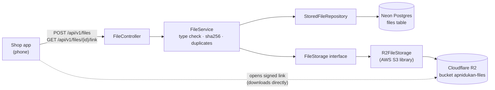
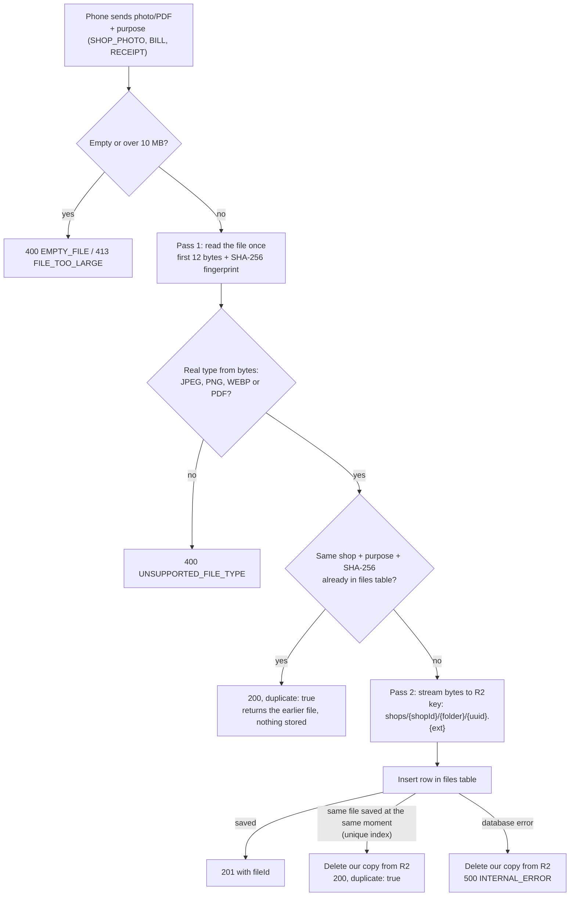
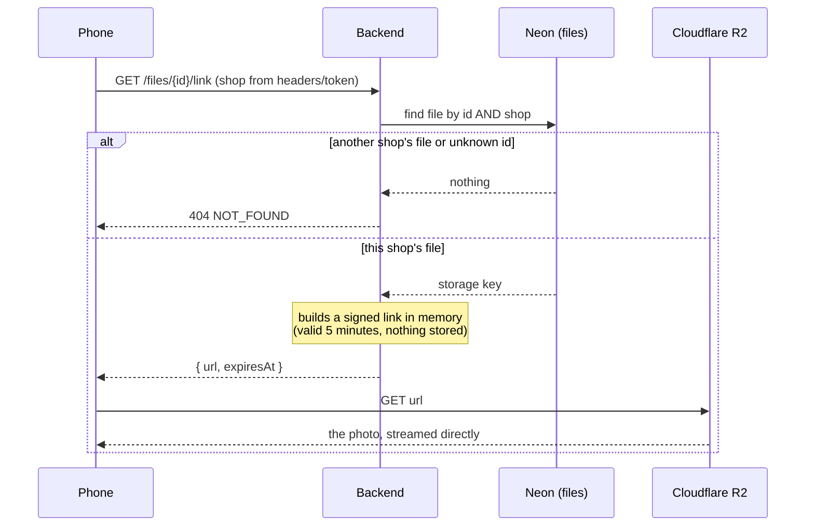

# Apni Dukan – backend

All the backend functionality of Apni Dukan: Spring Boot 4.1 · Java 21 · Neon Postgres · Flyway · Cloudflare R2

Design: see the "Apni Dukan – Low-Level Design (Shop App MVP)" doc.

## What's built so far

| Module | Status |
| --- | --- |
| `common` | Error format, current user/shop (development headers for now), clock |
| `files` | Upload photos and PDFs to R2, duplicate detection, 5-minute signed links |

## How file handling works

Photos and PDFs live in **Cloudflare R2**. **Neon Postgres** keeps one small row per file (`files` table).
The phone never gets the R2 keys: it receives short-lived signed links instead.

### Where things live



### Upload: `POST /api/v1/files`



### View or download: `GET /api/v1/files/{id}/link`



## Run it on your laptop

1. **Install:** JDK 21 (IntelliJ can download it). IntelliJ's bundled Maven is enough.
2. **Settings:** every `${...}` name in `src/main/resources/application.properties` needs a value.
   Put them in IntelliJ: Run → Edit Configurations → `ApniDukanApplication` → Environment variables
   (or in a `.env` file in this folder; it's ignored by Git).
   - `DB_URL`, `DB_URL_DIRECT`, `DB_USER`, `DB_PASSWORD` from Neon (use the `dev` branch).
     The pooled URL has `-pooler` in the host; the direct one doesn't.
   - `R2_ENDPOINT`, `R2_BUCKET`, `R2_ACCESS_KEY`, `R2_SECRET_KEY` from Cloudflare R2.
   - `DEV_AUTH_ENABLED=true`
   Never commit real values.
3. **Run:** open this folder in IntelliJ, wait for Maven to download, then press ▶ next to `main` in
   `ApniDukanApplication.java`. On first start, Flyway creates the `files` table (`V1__create_files.sql`).
4. **Tests:** `mvn test` (or right-click `src/test/java` → Run tests). They don't need the database or R2.

## Try the files API

Until sign-in exists (milestone 2), every call needs two made-up IDs as headers.
Use the same values every time so you see your own files:

```
X-Dev-Shop-Id: 11111111-1111-1111-1111-111111111111
X-Dev-User-Id: 22222222-2222-2222-2222-222222222222
```

**Upload a bill photo**

```bash
curl -X POST http://localhost:8080/api/v1/files \
  -H "X-Dev-Shop-Id: 11111111-1111-1111-1111-111111111111" \
  -H "X-Dev-User-Id: 22222222-2222-2222-2222-222222222222" \
  -F "purpose=BILL" \
  -F "file=@/path/to/bill.jpg"
```

Returns `201` with the file's `id`. Uploading the exact same file again returns `200` and `"duplicate": true`.
`purpose` is one of `SHOP_PHOTO`, `BILL`, `RECEIPT`. Accepted types: JPEG, PNG, WEBP, PDF (checked from the
file's bytes, not its name), up to 10 MB.

**Get a link to view it** (works for 5 minutes)

```bash
curl "http://localhost:8080/api/v1/files/<id>/link" \
  -H "X-Dev-Shop-Id: 11111111-1111-1111-1111-111111111111" \
  -H "X-Dev-User-Id: 22222222-2222-2222-2222-222222222222"
```

Open the returned `url` in a browser. Add `?download=true` to get a link that saves the file instead.
A different `X-Dev-Shop-Id` gets `404`: shops can't see each other's files.

## Errors

Every error looks like `{"code": "UNSUPPORTED_FILE_TYPE", "message": "...", "details": {}}`.

## Database changes

Only through new Flyway files in `src/main/resources/db/migration` (`V2__...`, `V3__...`).
Never edit a migration that has already run. Hibernate is set to `validate`.
