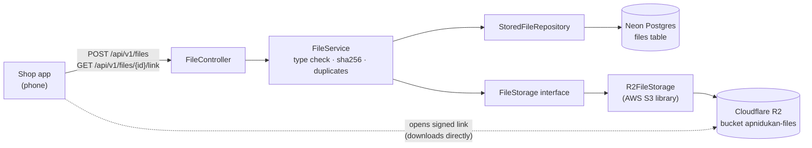
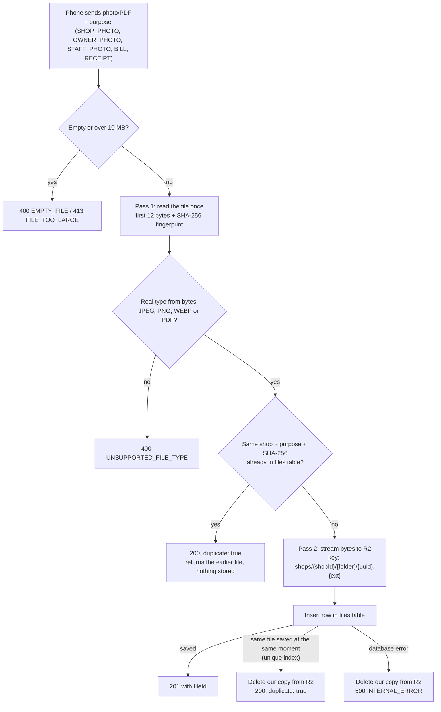
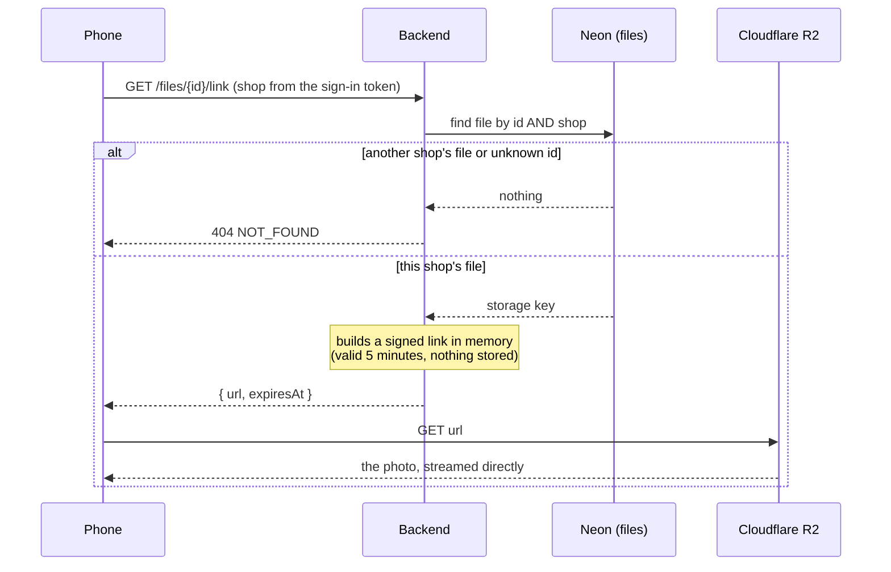
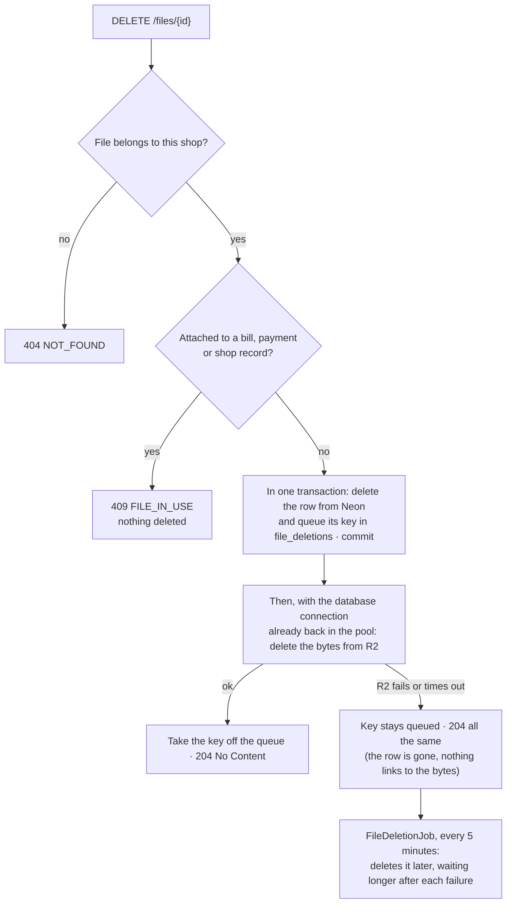
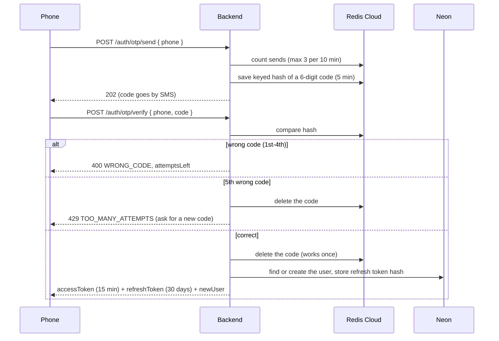
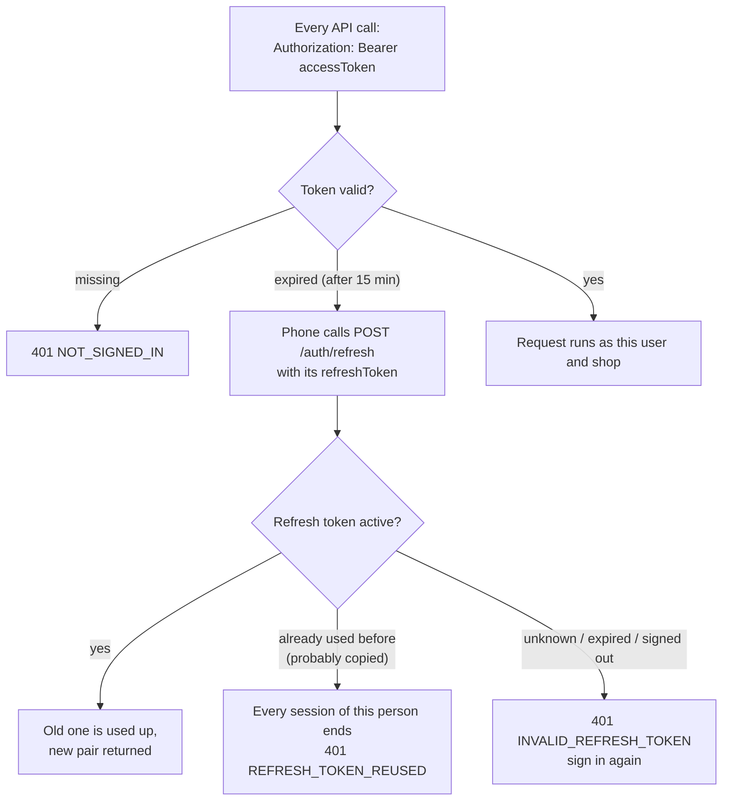

# Apni Dukan – backend

All the backend functionality of Apni Dukan: Spring Boot 4.1 · Java 21 · Neon Postgres · Flyway · Cloudflare R2 · Redis Cloud

Design: see the "Apni Dukan – Low-Level Design (Shop App MVP)" doc.

## What's built so far

| Module | Status |
| --- | --- |
| `common` | Error format, security (JWT check, CORS), current user/shop, clock |
| `auth` | Sign-in with phone OTP, tokens (refresh, sign-out), email verification, account recovery; admin roles (one super admin, admins) and OTP test mode |
| `files` | Upload photos and PDFs to R2, duplicate detection, 5-minute signed links, delete (Neon + R2) |
| `shops` | Registration (details, GPS pin, GSTIN/Udyam, kirana or salon, owner and shop photos, Submit for visit), field-team pages (dashboard, lists, what changed since approval, decisions with a checklist and notes, timeline), My shop, owner/helper/barber roles, history of every change |
| `salon` | Salon setup (services, barbers with optional sign-in and photo, weekly hours, booking settings), online booking, walk-ins, start code, no-show and strikes, breaks, leave, closed days, pause, the automatic end |
| `notifications` | Messages queued with the change they report, sent by a job with retries as Web Push (browser notifications), and as SMS for each message type whose template id is set; an in-app message list per app with unread counts |

## How file handling works

Photos and PDFs live in **Cloudflare R2**. **Neon Postgres** keeps one small row per file (`files` table).
The phone never gets the R2 keys: it receives short-lived signed links instead.

### Where things live



### Upload: `POST /api/v1/files`



### View or download: `GET /api/v1/files/{id}/link`



### Delete: `DELETE /api/v1/files/{id}`



No object is ever left behind for good: its key is queued (`file_deletions`, V19) in the same transaction as its row
goes, and taken off only when R2 confirms. Bytes stored for an upload whose row then couldn't be saved are queued the
same way. `FileDeletionJob` (one server at a time) retries queued keys 100 at a time, at most 2,000 a run, waiting 1,
2, 4 ... minutes after each failure (at most 6 hours) and never giving up; from the 5th failure each one is logged as an
ERROR "R2 still refuses to delete ..." with its key (point an alert at it). Every R2 call is bounded: 5 s per try
(`R2_ATTEMPT_TIMEOUT`), 15 s in all with the library's retries (`R2_CALL_TIMEOUT`); an upload (up to 10 MB) has its
own limit, 60 s per try and 120 s in all (`R2_UPLOAD_TIMEOUT`).

## How sign-in works

No passwords and no Google sign-in. The phone number is the account; an email is optional and only used for recovery.
One-time codes live in **Redis Cloud** (never in Postgres); accounts and refresh tokens live in **Neon**.

### Sign in with phone OTP



### Staying signed in

"Sign out everywhere" and account recovery also forget every browser registered for notifications, so a lost
phone stops getting booking messages (with their start codes) too. If Redis is down: new tokens are still issued
(signing in and refreshing keep working), and a sign-out everywhere still answers 204 (done in the database;
access tokens in use run out within 15 minutes).

Codes: when SMS is paused (daily cap), asking for a new code is refused before anything changes, so the code
already sent keeps working. Recovery checks both codes before using either up, so a typo in one keeps the other.



`POST /auth/logout` ends one session. Admin pages (`/api/v1/admin/**`) need an admin account.

### Limits (against guessing and SMS abuse)

| What | Limit |
| --- | --- |
| Tries per code | 5 (the 5th wrong one destroys the code). Every try is counted before checking, so parallel guesses don't get extra tries |
| Codes per phone or email, per network | 3 per 10 minutes, 10 per day (20 per day from all networks together) |
| Wrong codes per phone or email, per network | 10 per day (50 from all networks together), then `429 LOCKED_FOR_TODAY` |
| Per network (IP; IPv6 counted per /64) | IPv4 address: 200 code requests and 600 code checks per hour (`IP_SENDS_PER_HOUR`, `IP_VERIFIES_PER_HOUR`); high, because mobile operators put thousands of phones behind one IPv4 address. IPv6 /64 (one phone or home): 20 and 60 (`IPV6_SENDS_PER_HOUR`, `IPV6_VERIFIES_PER_HOUR`). The IP is the caller's real one, from the header set in `CLIENT_IP_HEADER` (see the checklist); a header value that is not an IP address is ignored and the connection's own address used |
| Robot check | Sign-in and recovery codes need a Cloudflare Turnstile token (`captchaToken`) once `TURNSTILE_SECRET_KEY` is set (400 `CAPTCHA_REQUIRED` / `CAPTCHA_FAILED`). If Cloudflare doesn't answer, the code is sent anyway; the limits still hold |
| Email codes per account | 10 per day |
| All SMS together | `SMS_DAILY_LIMIT` per day (default 50,000), then `503 SMS_PAUSED`. At 80% a WARN "80% of the daily SMS limit used" is logged once a day, so an alert can fire before codes stop |
| JSON request body | 64 KB (only `POST /api/v1/files` may be larger, up to 10 MB) |

Limits count per phone **and** network, so a stranger guessing your number from their own network locks only
themselves. Every 429 carries a `Retry-After` header (seconds to wait).

"Signed out everywhere" (recovery, or a copied refresh token) takes effect at once: every access token carries a
session number, and older numbers are refused on their next call.

**Refresh grace.** A swapped refresh token coming back within 30 seconds of its swap
(`app.auth.refresh-grace-seconds` / `REFRESH_GRACE_SECONDS`; 0 = off), while the token it was swapped for has never
been used, gets a new pair, and that unused token stops working ("sign in again" if it ever turns up, never an
alarm): the app reloaded or lost the reply while its refresh was on the way and never saved the new pair. Otherwise
the rule is as before: a swapped token coming back within 60 seconds (after its successor was used, or 30 to 60 s
after the swap) counts as the app retrying and gets 401 `INVALID_REFRESH_TOKEN` ("sign in again" on that device only);
later than 60 seconds it counts as copied: every session ends (401 `REFRESH_TOKEN_REUSED`). An expired token, or a
test account whose test mode ended, never gets a grace pair. The grace may be set from 0 to 60 seconds (the app
refuses to start otherwise), and swap times are the database's clock, so servers with different clocks agree.

The trade-off, precisely: someone who stole the old token can swap it for a pair of their own only within those 30
seconds after the real phone's swap, and only while the real phone hasn't used its new token since. The token they
replace is marked `GRACE_REPLACED`: a phone that really reloaded never saved it, so it never sends it; if the real
phone sends it after the grace (it did save it, so the old token was someone else's), every session is signed out,
the thief's too (once per token, like any copy). Within the grace it is only "sign in again". Two refreshes
with the same token at the same moment (from two devices, or two tabs without the apps' shared lock) run one after
the other on the person's row: the first gets the pair, the second 409 `TRY_AGAIN` (the apps keep the session and use
the token saved by the first); the chain never forks into two live tokens. The apps need no change: they already
refresh one at a time across tabs, save the new pair, sign out only on 401/403/400, and keep the session on 409.
Swapped tokens are kept 30 days (the refresh lifetime), so a copy is caught even if a thief kept refreshing along a
chain of tokens and the owner's phone comes back days later (see Housekeeping). Session numbers in Redis
(`session-gen:{user}`) expire 31 days after their last change, so Redis doesn't keep one key per person forever.
They never go back: ending all sessions sets the number to the larger of "current + 1" and Redis's clock in
milliseconds, so a key that expired and starts again can't leave an older token alive.
Only a refresh token that was already swapped
coming back counts as copied; an old device retrying a signed-out token just gets "sign in again".

### Endpoints (`/api/v1/auth`)

| Call | What it does |
| --- | --- |
| `POST /otp/send` `{phone, captchaToken}` | Sends a code. `+91` and a leading `0` are fine. 429 after 3 codes in 10 minutes |
| `POST /otp/verify` `{phone, code}` | Signs in (creates the account the first time) |
| `POST /refresh` `{refreshToken}` | New token pair |
| `POST /logout` `{refreshToken}` | Ends this session, 204 |
| `POST /logout-all` | Signs out every device at once, this one too (204) |
| `GET /me` · `PATCH /me {name}` | The signed-in person · set your name (salons see it on bookings) |
| `POST /me/delete-code` · `POST /me/delete {code}` | Delete your account: a code to your own phone, then 204. 409 `SHOP_OWNER` for a shop owner (close or hand over the shop first). See below |
| `POST /email/send-code` `{email, phoneCode?}` | Sends a 6-digit code to the email (10 min). Replacing an already verified email also needs `phoneCode` |
| `POST /email/change-phone-code` | Sends a code to your own phone, needed to replace a verified email. The old email is told after the change |
| `POST /email/verify` `{email, code}` | Marks the email verified |
| `POST /recover/start` `{email, newPhone, captchaToken}` | Lost phone: a code to the verified email and one to the new phone |
| `POST /recover/complete` | Both codes right: moves the account to the new phone and ends every old session |

### Finishing sign-up

The app asks, in this order: phone → OTP (`otp/verify`, `newUser: true` the first time) → email → its code
(`/email/send-code`, `/email/verify`; the email is how a lost phone number is recovered) → "What should we call you?"
(`PATCH /me {name}`). `GET /me` shows `emailVerified` and `name`, so the app can resume where the person stopped.
Until the email is verified and the name set, booking a salon and registering a shop answer
**403 `PROFILE_INCOMPLETE`** with `details.missing` (`["email", "name"]`, `["name"]`, ...); browsing works without
them. A barber linked by the owner needs nothing: his account is the owner's doing, and he signs in with the phone.

### Deleting an account

Refused with 409 while online booking is blocked (`BOOKING_BLOCKED`, `details.until`) or when a booking starts
within the hour or is in progress (`BOOKING_SOON`): deleting and signing up again with the same phone must not be a
way round a block or a late-cancel strike.

One account works across every part of the app (kirana, salon, ...), so deleting it never deletes rows other
records point at. Instead, in one transaction: each module closes what is still open for the person
(`AccountDeletionListener`: upcoming salon bookings are cancelled with no strike and the salon is told "a customer
deleted their account", a barber's sign-in is unlinked, walk-in access goes,
waiting messages are cancelled and the text of all their messages emptied, devices forgotten), a helper or
barber leaves their shop, every device is signed out and its device label cleared, and the `users` row loses its
phone, name and email (`deleted_at` is set). Past bookings, strikes and shop records stay, showing no name. A
booking or move waiting behind the deletion, or a token from before it, is refused (401). Messages to a salon about earlier
bookings (sent, or still waiting to go out) keep the name the salon saw then. The same phone can later sign up as a new
account. A module added later (kirana orders) plugs in its own `AccountDeletionListener` to cancel its open items.

## How shops work

A person registers one shop (for now) and becomes its **OWNER**; the owner adds helpers by phone.
Every shop gets a plain number as its code (1001, 1002, ...), given out by the database.

```mermaid
sequenceDiagram
    participant P as Phone
    participant B as Backend
    participant D as Neon
    P->>B: POST /shops {name, owner, address, pincode, lat/lng, GSTIN?, Udyam?}
    B->>D: shop (DRAFT, next code) + membership (OWNER)
    B-->>P: 201 shop
    P->>B: POST /auth/refresh
    B-->>P: new access token carrying shop + role
    P->>B: PATCH /shops/me {version, changed fields}
    alt version matches
        B->>D: save; Envers adds this new version to shops_aud, with who changed it
        B-->>P: 200 shop (version + 1)
    else someone saved in between
        B-->>P: 409 SHOP_CHANGED (reload and retry)
    end
```

| Call | What it does |
| --- | --- |
| `POST /api/v1/shops` | Registers your shop as `DRAFT`, you as owner. 409 `ALREADY_HAS_SHOP` if you have one. Then refresh your token |
| `GET /api/v1/shops/me` | Your shop, its status and your role (`myRole`). 404 `NO_SHOP` if none |
| `PATCH /api/v1/shops/me` | Owner only (403 `OWNER_ONLY`). Send `version` and only the fields to change; `""` removes GSTIN/Udyam |
| `PUT /api/v1/shops/me/photos` | Owner. `{version, ownerPhotoFileId?, shopPhotoFileId?}`: ids of photos uploaded to `POST /files` with purpose `OWNER_PHOTO` / `SHOP_PHOTO` |
| `GET /api/v1/shops/me/members` | Owner. Everyone in the shop: name, phone, role (OWNER, HELPER, BARBER), joined |
| `POST /api/v1/shops/me/helpers` · `DELETE /api/v1/shops/me/helpers/{userId}` | Owner. `{phone}`: adds a helper (an account is made if that phone has none; they sign in with OTP and find the shop). 409 `ALREADY_IN_A_SHOP`. Remove: membership and walk-in access go, their sessions end at once. A salon's helper sees every barber, starts (also without code), cancels, reassigns and adds breaks; in a kirana the helper's billing and stock rights come with the kirana work |
| `POST /api/v1/shops/me/leave` | A helper or barber leaves the shop (204), e.g. a phone added without asking. A barber's profile, hours and bookings stay with the salon; only his sign-in goes. 409 `OWNER_CANT_LEAVE` |
| `POST /api/v1/shops/me/submit` | Owner. `{version}`: DRAFT → PENDING_VISIT. 409 `PHOTOS_REQUIRED` until both photos are set |
| `GET /api/v1/admin/shops?type=&group=` | Field team (admins) only, else 403. A group's shops with links to both photos (see "The admin website"). The older `?status=` form is gone: without `type` and `group`, 400 `VALIDATION_FAILED` |
| `POST /api/v1/admin/shops/{id}/approve` | Field team. `{version, note?}` from the page they checked: PENDING_VISIT → APPROVED after the visit. 409 `SHOP_CHANGED` if the owner changed something since (reload, check, approve), 409 `WRONG_STATUS` from another status. Customers can find it from now on |
| `POST /api/v1/admin/shops/{id}/reject` | Field team. `{version, reason, note?, checklist?}`: the visit didn't pass but can be fixed, PENDING_VISIT → DRAFT. The owner sees `statusReason`, fixes it and submits again. Bookings already made stay (suspend to cancel them) |
| `POST /api/v1/admin/shops/{id}/suspend` | Field team. `{version, reason, note?, checklist?}`: APPROVED or PENDING_VISIT (e.g. found shut at its visit) → SUSPENDED, off the app. A salon's upcoming online bookings are cancelled and each customer is told ("isn't taking online bookings for now"; the field team's reason goes only to the owner). The salon can still run its own day (walk-ins) |
| `POST /api/v1/admin/shops/{id}/reinstate` | Field team. `{version, note?}`: SUSPENDED → PENDING_VISIT, back in the visit list; live again only once approved after a new check (so nothing changed while suspended goes live unchecked). Cancelled bookings stay cancelled |

The owner gets a message for each field-team decision (approved, sent back, suspended, reinstated).

Rules: the GPS pin is required and must be inside India; pincode is 6 digits; GSTIN and Udyam are optional, checked,
and stored in capitals; text is trimmed. Unknown fields are refused with 400 `UNKNOWN_FIELD`, so nobody can send
`"status": "APPROVED"` for their own shop. Status moves DRAFT → (both photos, Submit) → PENDING_VISIT → (field team
visits and approves) → APPROVED. Changing the photos or the address (address line, area, city, pincode, map pin)
of an APPROVED shop sends it back to PENDING_VISIT for another check: customers can't find it until the field team
approves it again. Bookings already made stay and can be cancelled; moving one to a new time answers 409
`SALON_NOT_BOOKABLE` until the approval (`canMove` is false meanwhile). A new address rewrites the pending booking
reminders, so customers are sent to the new place. A photo that a shop or barber uses can't be deleted
(409 `FILE_IN_USE`).

A shop is a **kirana** or a **salon**: send `"type": "SALON"` when registering (left out = `KIRANA`). The type can't
be changed later; `GET /shops/me` returns it.

## The admin website (`/api/v1/admin`)

For Apni Dukan's own team. Everything here needs an admin's sign-in (the normal phone OTP); anyone else gets 403.
Who is an admin is read from the database on every call, so someone removed is refused at once even with a token
issued before.

**Roles** (`users.admin_role`): `ADMIN` (field team: visits and support) and `SUPER_ADMIN` (also the team and OTP
test mode). There is at most one super admin (the database refuses a second). It is set by hand, once, in Neon:

```sql
UPDATE users SET admin_role = 'SUPER_ADMIN', admin = true WHERE phone = '9xxxxxxxxx';
```

(Sign in once first, so the account exists. `admin` is the old column, kept in step for a version still running
during a deploy.) The super admin is never changed from the website and can't delete their account (409
`SUPER_ADMIN`): without them nobody could manage admins or switch test mode off.

| Endpoint | Notes |
| --- | --- |
| `GET /admin/me` | Who is signed in: `{userId, name, phone, adminRole, testMode: {on, until}}` (the website shows a red banner while test mode is on) |
| `GET /admin/dashboard` | For `KIRANA` and `SALON`, how many shops are in each group: `FIRST_VISIT` (waiting, never approved), `RECHECK` (waiting, approved before: the owner moved the pin or changed a photo, or it was reinstated), `SENT_BACK` (a draft sent back with a reason), `LIVE`, `SUSPENDED`. A draft never submitted is in no group. Counted at most every 30 seconds (kept in Redis); a field-team decision shows at once, an owner's own step (submitting, a moved pin) within 30 seconds |
| `GET /admin/shops?type=&group=&q=` | A group's shops, longest in it first (`statusSince`: its latest timeline entry other than a note, so an owner fixing a typo doesn't move it), 50 a page (see "Pages" below), each with `group` and `ownerPhone`. `type` and `group` are required (400 `VALIDATION_FAILED`, `details` naming each missing one: `{"type": "is required"}`, `{"group": "is required"}`). `q`: the shop number exactly (`1042` or `#1042`, any length), the owner's phone in part (spaces, `+91` and dashes ignored; at least 3 digits), or the name or owner's name in part. A `q` of 1 or 2 characters that isn't a shop number is 400 `VALIDATION_FAILED` with `details: {"q": "type at least 3 letters"}`; a blank `q` is no search |
| `GET /admin/shops/{id}` | The shop; a salon's barbers and services; `changes` since the moment it was last approved (name, owner, address, area, city, pincode, pin with `pinMovedMetres`, GSTIN, Udyam, photos with the old photo links), so edits a live shop made without needing a visit show up too; the `timeline`, newest first, its first 50 entries, and `timelineNext` (`{afterAt, afterSeq}`, or null when there are no more) |
| `GET /admin/shops/{id}/timeline?afterAt=&afterSeq=` | The rest of the timeline, 50 a page: `{items: [...], next}` with the same entries as `timeline` and `next` like `timelineNext`. See "Pages" below |
| `POST /admin/shops/{id}/notes {note}` | A note only admins see (2–500 characters), 201 |
| decisions | approve, reject (send back), suspend, reinstate as in "How shops work". The status is checked before the version: when another admin decided first, the answer is 409 `WRONG_STATUS` with `details.status`, not `SHOP_CHANGED`. Now with an optional `note` (admins only, up to 500 characters) and, for send back and suspend, an optional `checklist`: `NAME_BOARD_NOT_VISIBLE`, `OWNER_PHOTO_UNCLEAR`, `PIN_WRONG`, `ADDRESS_MISMATCH`, `GST_UDYAM_MISMATCH`, `SHOP_SHUT`, `OTHER`. The owner sees only the `reason` |
| `GET /admin/team` · `POST /admin/team {phone}` · `DELETE /admin/team/{userId}` | Super admin only (403 `SUPER_ADMIN_ONLY` for an admin). `since` is when they became an admin. Add makes that phone an admin (the account is made if it has none) and ends any session already open on it; 409 `ALREADY_ADMIN`, 409 `TEST_PHONE` (a test number, or an account made in test mode). Remove: their sessions end at once; 409 `CANT_REMOVE_SUPER_ADMIN` |
| `GET` · `PUT {hours}` · `DELETE /admin/test-mode` | Super admin only. OTP test mode on for 1–8 hours (it switches itself off), or off now |
| `POST /admin/test-mode/phones {phone, label}` · `DELETE /admin/test-mode/phones/{phone}` | Super admin only. The test numbers. 409 `ADMIN_PHONE` (an admin's number), 409 `REAL_ACCOUNT` (a number that already has a real account), 409 `ALREADY_TEST_PHONE`. Removing one signs its test account out |

**OTP test mode.** While it is on, the test numbers sign in with any 6 digits and no SMS is sent to them. Only a
number nobody has signed in with can be added; the account its first test sign-in makes is a test account
(`users.test_account`), and only such an account ever takes any code, never a real customer's, a shop's or an
admin's. A test account stays signed in only while test mode is on for its number: switching it off, the time
running out, or removing the number ends its sessions (refresh answers 401 `TEST_MODE_OFF`). If the number's real holder
later signs in with the SMS code (or the account is recovered onto a real phone), it becomes a normal account for
good and every tester still signed in to it is signed out. Email codes, recovery
and account deletion always need the real code (otherwise a test account could claim someone's email). For testing
on the real deployment without SMS credit; like the OMR project's per-student OTP bypass, but switched on for a few
hours at a time. Every change (admins, test numbers, test mode on and off) is logged in `admin_events`.

**Timeline** (`shop_events`): sent for a visit (owner), changed after approval (owner), approved, sent back,
suspended, reinstated, note. Shops registered before it existed have an empty timeline and count their waiting time
from registration. The photos a shop had when last approved can't be deleted while it waits for its re-check (409
`FILE_IN_USE`): the field team compares them with the new ones.

## How salon setup works

A salon lists its services, its barbers, which services each barber does and when each one works. Online bookings
are worked out from exactly these. Anyone in the salon can read the setup; only the owner can change it.

| Call | What it does |
| --- | --- |
| `GET` / `POST /api/v1/salon/services` | List (by `sortOrder`, then name) / add: `name`, `durationMinutes` (5–480, steps of 5), `pricePaise`, `priceIsFrom`, `sortOrder` |
| `PATCH /api/v1/salon/services/{id}` | Edit, or `"active": false` to switch off (kept for old bookings). Send `version`; 409 `SERVICE_CHANGED` if stale |
| `GET` / `POST /api/v1/salon/staff` | Barbers with their `serviceIds`, `hours`, `loginPhone`, `photoFileId` / add one: `name`, and optionally `phone` to give him his own sign-in |
| `PATCH /api/v1/salon/staff/{id}` | Rename, or `"active": false` when a barber leaves (409 `STAFF_HAS_BOOKINGS` while he has upcoming ones; his sign-in is removed). Switching back on: 409
`BLOCK_CONFLICTS` if a leave of his runs into a closed day (remove it, switch him on, add it again around that day). Send `version`; 409 `STAFF_CHANGED` if stale |
| `PUT` / `DELETE /api/v1/salon/staff/{id}/login` | `{phone}`: his sign-in becomes a BARBER member of the salon (409 `ALREADY_IN_A_SHOP` if that phone works in a shop). Delete: membership and walk-in access go, his sessions end at once |
| `PUT /api/v1/salon/staff/{id}/photo` | Optional photo: `{fileId}` of a `STAFF_PHOTO` upload, or `{"fileId": null}` to remove |
| `PUT /api/v1/salon/staff/{id}/services` | `{"version": 3, "serviceIds": [...]}` replaces what he does; newly added ones must be active services of this salon. 409 `BOOKINGS_IN_THE_WAY` (listing them) if an upcoming booking of his uses a service he'd drop |
| `PUT /api/v1/salon/staff/{id}/hours` | `{"version": 3, "hours": [{"weekday": 1, "start": "10:00", "end": "14:00"}, ...]}` replaces his week. 409 `BOOKINGS_IN_THE_WAY` (listing them) if an upcoming booking of his would fall outside the new hours: reassign or cancel it first |
| `GET` / `PATCH /api/v1/salon/settings` | Earliest booking (`minLeadMinutes`, default 30) and latest (`maxDaysAhead`, default 7). `version` is null until the first save |

**Database:** V4 runs `CREATE EXTENSION IF NOT EXISTS btree_gist` (needed by the no-overlap rule). Neon and the
Docker image used by the tests have it; on your own Postgres, the role running Flyway must be allowed to create it.

**Time:** every salon is in India (`Asia/Kolkata`, no daylight saving). Hours are `"HH:mm"` in salon time on
15-minute steps, `weekday` 1 = Monday ... 7 = Sunday, up to `"24:00"`; two blocks on one day make a split shift. They
are stored as minutes after midnight (10:00 = 600), so the database itself refuses overlapping blocks
(`ex_staff_hours_no_overlap`). Exact moments are stored in UTC and returned with their offset.

**Safety:** every call checks in the database that you belong to a salon (404 `NO_SHOP`, 409 `NOT_A_SALON`) and,
for changes, that you are its owner (403 `OWNER_ONLY`). Services and barbers are always looked up together with your
salon, so another salon's ids give 404; the database's keys also refuse linking a barber to another salon's service.
Changing a barber's services or hours raises his `version`, and both calls need the version you last read: two edits
from the same old screen run one after the other (row lock) and the second gets 409 `STAFF_CHANGED` instead of
silently replacing the first.

**Limits and errors:** up to 100 active services and 50 active barbers per salon (switched-off ones don't count):
409 `TOO_MANY_SERVICES` / `TOO_MANY_STAFF`, also when switching one back on. Two active services can't share a name,
capitals ignored: 409 `SERVICE_NAME_TAKEN`. Another salon's ids: 404 `SERVICE_NOT_FOUND` / `STAFF_NOT_FOUND`; in
`serviceIds` of `PUT .../services`, another salon's or a switched-off service is 400 `VALIDATION_FAILED` naming
`serviceIds`. A stale settings save is 409 `SETTINGS_CHANGED`. The limits are a guard against runaway lists, not
exact: two adds at the very same moment could both pass at 99.
Separately, one request carries at most 200 `serviceIds` and 50 blocks of `hours` (more is 400 `VALIDATION_FAILED`).

## Run it on your laptop

1. **Install:** JDK 21 (IntelliJ can download it). IntelliJ's bundled Maven is enough.
2. **Settings:** every `${...}` name in `src/main/resources/application.properties` needs a value.
   Put them in IntelliJ: Run → Edit Configurations → `ApniDukanApplication` → Environment variables
   (or in a `.env` file in this folder; it's ignored by Git).
   - `DB_URL`, `DB_URL_DIRECT`, `DB_USER`, `DB_PASSWORD` from Neon (use the `dev` branch).
     The pooled URL has `-pooler` in the host; the direct one doesn't.
   - `R2_ENDPOINT`, `R2_BUCKET`, `R2_ACCESS_KEY`, `R2_SECRET_KEY` from Cloudflare R2.
   - `REDIS_URL` from Redis Cloud, like `rediss://default:<password>@<host>:<port>`
     (`rediss` with two s = TLS; use `redis://` only if your database has TLS off).
   - `JWT_SECRET`: a long random value, at least 32 characters
     (for example the output of `openssl rand -base64 48`). Changing it signs everyone out.
   - `MSG91_AUTH_KEY` and `MSG91_OTP_TEMPLATE_ID`: the same values as in the OMR project. OTPs are sent as
     real SMS through MSG91 with that template until Apni Dukan has its own DLT registration.
     Later: `SMS_ACCOUNT_MOVED_ENABLED=true` with `MSG91_ACCOUNT_MOVED_TEMPLATE_ID`, the template for
     "your account was moved to a new number ending ##ENDING##" (sent to the old phone after account recovery).
     Off by default until that DLT template exists; required on the real server.
     `SMS_PROVIDER=log` prints SMS in the console instead (only if you choose it, e.g. out of MSG91 credit).
   - Email: `RESEND_API_KEY` and `EMAIL_FROM` to send through Resend (see "Email" below). Without a Resend key,
     `MAIL_USERNAME` (your Gmail address) and `MAIL_PASSWORD` (its 16-letter app password), the same as in
     Vidyavriti: email codes then go through Gmail SMTP. `MAIL_ENABLED=false` prints them in the console instead.
   - Optional: `CORS_ALLOWED_ORIGINS`
     (default `http://localhost:5173`, the shop app's dev server; separate several with commas).
   - On the real server only: `APP_PRODUCTION=true`. The app then refuses to start if codes would be printed in
     the log or CORS allows localhost. Optional limits and sizes: see "Configuration for scale".
   Never commit real values.
3. **Run:** open this folder in IntelliJ, wait for Maven to download, then press ▶ next to `main` in
   `ApniDukanApplication.java`. On first start, Flyway creates the tables (`V1__create_files.sql`, `V2__create_users_and_refresh_tokens.sql`).
4. **Tests:** `mvn test` (or right-click `src/test/java` → Run tests). They start their own Postgres, Redis and S3
   stand-in in Docker (Testcontainers), so Docker must be running; they never touch Neon, Redis Cloud or R2.
   Without Docker the integration tests are skipped on your laptop (on CI they always run).
   `mvn verify` also runs the code checks (coverage gate, SpotBugs). It needs Docker, because without the integration
   tests the coverage gate fails; use `mvn verify -Djacoco.skip=true` if Docker isn't running.

## Try it

**Sign in** (the code arrives by SMS through MSG91)

```bash
curl -X POST http://localhost:8080/api/v1/auth/otp/send \
  -H "Content-Type: application/json" -d '{"phone":"9876543210"}'

curl -X POST http://localhost:8080/api/v1/auth/otp/verify \
  -H "Content-Type: application/json" -d '{"phone":"9876543210","code":"<code from SMS>"}'
```

Copy `accessToken` from the reply and send it on every other call:

```bash
curl http://localhost:8080/api/v1/auth/me -H "Authorization: Bearer <accessToken>"
```

**Files** need a shop: register one (`POST /api/v1/shops`, see "How shops work"), then refresh your token.
Without a shop, file calls answer `403 SHOP_REQUIRED`.

```bash
# Upload a bill photo: 201 with the file id; the same file again returns 200 and "duplicate": true
curl -X POST http://localhost:8080/api/v1/files -H "Authorization: Bearer <accessToken>" \
  -F "purpose=BILL" -F "file=@/path/to/bill.jpg"

# Link to view it for 5 minutes (add ?download=true to save instead)
curl "http://localhost:8080/api/v1/files/<id>/link" -H "Authorization: Bearer <accessToken>"

# Delete it from Neon and R2: 204, or 409 FILE_IN_USE if attached to a bill, payment or shop record
curl -X DELETE "http://localhost:8080/api/v1/files/<id>" -H "Authorization: Bearer <accessToken>"
```

`purpose` is one of `SHOP_PHOTO`, `OWNER_PHOTO`, `STAFF_PHOTO` (a salon barber), `BILL`, `RECEIPT`. A barber's
sign-in can't use files at all (403). Accepted types: JPEG, PNG, WEBP, PDF (checked from the
file's bytes, not its name), up to 10 MB. Another shop's file returns `404`.

## How salon bookings work

No money moves: customers book a time and pay the salon. One table, `appointments`, holds bookings, walk-ins and
blocks (break, leave, closed day). While a row holds a barber's time (CONFIRMED, IN_SERVICE or BLOCKED), the
database's rule `ex_appointments_no_overlap` stops anything else of that barber overlapping it. That rule, not Java,
decides every race.

```mermaid
sequenceDiagram
    participant C as Customer app
    participant B as Backend
    participant D as Neon
    C->>B: GET /salons?lat&lng, /salons/{id}/services, /salons/{id}/availability?services&date
    B-->>C: free start times (quarter hours)
    C->>B: POST /bookings {salonId, serviceIds, startAt} + Idempotency-Key
    B->>D: lock this customer; same key? strikes? 2 active? window?
    loop free barbers, least booked that day first
        B->>D: INSERT ... ON CONFLICT DO NOTHING
    end
    B->>D: services copied, event BOOKED, messages CONFIRMED (+ REMINDER at start - 60 min)
    B-->>C: 201 booking with start code (or 409 SLOT_TAKEN + 3 nearest times)
```

**Customer (any signed-in person):** `GET /salons?lat=&lng=` (approved, not paused, within 2 km, nearest first, 30
a page; the next page with the last salon's `distanceMetres` and `id` as `afterDistance` and `afterId`; see "Built for
scale"),
`GET /salons/{id}`, `/services`, `/availability?services=a,b&date=YYYY-MM-DD` (these three together at most 60 a
minute per person: then 429 `TOO_MANY_REQUESTS` with `Retry-After`), `POST /bookings` (header
`Idempotency-Key`: a new UUID per attempt, the same one on retry), `GET /me/bookings?when=upcoming|past` (past: 30 a
page, see "Pages" below),
`GET /bookings/{id}`, `POST /bookings/{id}/cancel`, `POST /bookings/{id}/reschedule {startAt}` (not in the last hour:
409 `TOO_LATE_TO_MOVE`, so moving can't dodge a late-cancel strike; `canMove` says when), `PATCH /auth/me {name}`.
The customer picks services and a time; the backend picks the barber. Another person's booking is 404.

**Salon (`/api/v1/salon/...`):**

| Call | Who | What it does |
| --- | --- | --- |
| `GET /day?date=` | owner, helper, and anyone with walk-in access: all barbers; other barbers: their own | A column per barber with his hours and appointments (`notStarted` once its time passed), and `myStaffId` (the caller's own barber profile, null for owner and helpers). Never the start code. Answers carry an `ETag`; send it back as `If-None-Match` and an unchanged board is `304` (see "ETags of the day board and upcoming list") |
| `GET /upcoming?afterStart=&afterId=` | owner, helper, anyone with walk-in access: the salon; other barbers: their own | Online bookings still to come today and the next 31 days, soonest first, 100 a page (see "Pages"), including ones running late. `ETag` and `304` as for the day board |
| `GET /history?from=&to=&afterStart=&afterId=` | owner, helper | India dates, at most 31 days: bookings and walk-ins latest first, 100 a page with `next` (see "Pages"); how many ended in each status, and what the completed ones were worth at list price (both over the whole range, on every page) |
| `GET /walk-ins/options?services=` · `POST /walk-ins` | owner, and people he gave walk-in access | Per barber: free now, or when he is next free today (exact minutes, for information). A walk-in always starts now with a barber who is free now (IN_SERVICE at once, no code: the customer is in the chair); there is no booking a walk-in for later. 409 `BARBER_BUSY` with his next free time |
| `GET /members` · `PUT /members/{userId}/walk-in-access {allowed}` | owner | Who may add walk-ins besides the owner (a helper or barber) |
| `POST /appointments/{id}/start` | owner, helper; barber: own | From 15 min before until 15 min after the start (then it is a no-show). A booking needs `{code}` (400 `WRONG_START_CODE` with `triesLeft`; 5 wrong → 429 `START_CODE_LOCKED`) or `{withoutCode: true}` (owner, helper). Started early, it holds the barber from now for its length; if someone (or a break) still holds his chair, 409 `BARBER_BUSY` (`reason: STILL_BUSY`). Started late, it runs its full length from now when he is free for that, else keeps its planned end |
| `POST /appointments/{id}/finish` | owner, helper; barber: own; and whoever added a walk-in that is still in the chair | Done before the planned end: IN_SERVICE → COMPLETED now, and the rest of the barber's time is free |
| `POST /appointments/{id}/no-show` | owner, helper; barber: own | From 15 min after the start (the late allowance). Frees the time; a booking gives the customer a strike. Rarely needed: the job below does it within a minute |
| `POST /appointments/{id}/undo-no-show` | owner, helper | Within 24 h of the start: the strike goes, the booking is closed as cancelled by the salon ("No-show undone"), and the customer is told it no longer counts. Later, only support can remove the strike |
| `POST /appointments/{id}/reassign {staffId}` · `/cancel {reason}` | owner, helper; and whoever added a walk-in that is still in the chair (while he still has walk-in access) | Another barber who does its services: a booking at the same time; a walk-in already in the chair (added to the wrong barber) continues with him from now for the rest of its time; both barbers and an online customer are told · salon cancel of a booking, a walk-in, or a walk-in in the chair within 15 minutes of it being put in a chair, which a move doesn't reset (later: 409 `IN_CHAIR_TOO_LONG`, finish it instead; the owner and that chair's barber are told when someone else cancels one). A booking's customer and barber are told; no strike |
| `GET /staff/{id}/blocks/conflicts` · `POST /staff/{id}/blocks` · `DELETE .../blocks/{blockId}` | break: owner, helper, the barber; leave: owner | 409 `BLOCK_CONFLICTS` listing what's in the way; nothing saved. A barber's own breaks: today or tomorrow, at most 4 hours a day in all (longer time off is leave); he removes only breaks he added (`addedByMe` on each appointment says which; on a walk-in it is set only while the viewer may add walk-ins, so it marks what he may fix) and only before they start (409 `WRONG_STATUS`, `reason: STARTED`) |
| `GET /closures` · `POST /closures {date}` · `DELETE /closures/{id}` | read: anyone in the salon; change: owner | A whole day closed for every barber, all or nothing; barbers added or switched on later get it too |
| `GET /pause` · `POST /pause {until?}` · `POST /resume` | read: anyone in the salon; change: owner, helper | Stop new online bookings (default: until midnight) |

On the salon's screens a booking shows the customer's name and, for the owner and helpers only (never barbers),
`customerPhone`, to call someone who is running late.

### API changes in this version (deploy the backend first, then the apps)

Old app versions keep working against this backend, with these differences until they are updated:

| Call | Before | Now |
| --- | --- | --- |
| `GET /salon/upcoming` | up to 200, one list | 100 a page (`afterStart`/`afterId` for the next); an old app shows the first 100 |
| `GET /salon/history` | up to 500, `truncated` | 100 a page with `next`; `truncated` = `next != null`, so an old app shows its "pick fewer days" note above 100 |
| `GET /me/bookings?when=past` | up to 50 | 30 a page (`afterStart`/`afterId`); an old app shows the latest 30 |
| `GET /admin/shops/{id}` | the whole timeline | the first 50 entries + `timelineNext`; the rest from `GET /admin/shops/{id}/timeline` |
| `GET /admin/shops?status=` | the 50 oldest in a status | removed: without `type` and `group`, 400 `VALIDATION_FAILED` (no app used it) |
| `GET /admin/shops?...&q=` | any text | 1–2 letters (not a shop number) is 400 `VALIDATION_FAILED` `{"q": "type at least 3 letters"}` |
| `GET /salon/day`, `/salon/upcoming` | EtagConfig's fingerprint | the backend's own `ETag` (`"s1-…"`); `If-None-Match` and 304 work as before |
| `GET /salons/{id}`, `/services`, `/availability` | no limit | 60 a minute per person, then 429 `TOO_MANY_REQUESTS` with `Retry-After` |
| any request | could run long | a statement past 5 s answers 503 `SERVICE_BUSY` with `Retry-After: 5` |

### Pages (the exact contract)

Long lists come a page at a time (keyset paging: the next page is "everything after the last item", never an offset,
so nothing is skipped or shown twice when items share a time, and a deep page costs the same as the first). The first
page is the same call as before, without the paging values. The cursor values are sent back **exactly as received**
(the same text: the backend reads times back to the microsecond).

| Call | Order | Page | Next page | Last page when |
| --- | --- | --- | --- | --- |
| `GET /api/v1/salon/upcoming` (array of appointments) | `startsAt` ascending, then `id` ascending | 100 | `?afterStart=<last item's startsAt>&afterId=<last item's id>` | fewer than 100 items (exactly 100 left: the next call returns `[]`) |
| `GET /api/v1/salon/history?from=&to=` (object) | `startsAt` descending, then `id` ascending | 100 in `appointments` | `&afterStart=<next.afterStart>&afterId=<next.afterId>` (`next` is the last item's `startsAt` and `id`) | `next` is `null`. `truncated` is still there and equals `next != null` (an older app shows its "pick fewer days" note) |
| `GET /api/v1/me/bookings?when=past` (array of bookings) | `startsAt` descending, then `id` ascending | 30 | `&afterStart=<last item's startsAt>&afterId=<last item's id>` | fewer than 30 items |
| `GET /api/v1/me/bookings?when=upcoming` (array) | `startsAt` ascending | all of them (at most 50; a customer holds 2 waiting bookings) | no pages: `afterStart`/`afterId` with `when=upcoming` is 400 `VALIDATION_FAILED` (`details.afterStart`) | always |
| `GET /api/v1/admin/shops?type=&group=` (array) | `statusSince` ascending, then `id` | 50 | `&afterSince=<last item's statusSince>&afterId=<last item's id>` | fewer than 50 items |
| `GET /api/v1/admin/shops/{id}` `timeline` (newest first, first 50) and `GET /api/v1/admin/shops/{id}/timeline` (object `{items, next}`) | `at` descending, then the order entries were made | 50 | `GET /admin/shops/{id}/timeline?afterAt=<afterAt>&afterSeq=<afterSeq>` from `timelineNext` (shop page) or `next` (timeline call) | `timelineNext` / `next` is `null` |

Errors, the same for every list: only one of the two paging values (e.g. `afterId` without `afterStart`) is 400
`VALIDATION_FAILED` with `details` naming the second one (`{"afterId": "send afterStart and afterId together"}`,
`{"afterSeq": "send afterAt and afterSeq together"}`); a value that can't be read (a time that isn't ISO-8601, an id
that isn't a UUID, a seq that isn't a number) is 400 `BAD_REQUEST`. A cursor from an item that has since changed
(a booking moved or cancelled) still works: paging goes on from that time and id. The upcoming list's pages each have
their own ETag.

### ETags of the day board and upcoming list

The partner app asks for `GET /salon/day` every 30 s and `GET /salon/upcoming` every 60 s. Both answers carry the
backend's own `ETag` (`"s1-…"`); the app keeps the last answer in memory and sends the tag back as `If-None-Match`.
When nothing the answer shows has changed, the answer is **304 with no body**, after a single primary-key read and no
other query. What "changed" covers: any appointment or its services of the salon, barbers, their hours and services,
services, settings, pauses, who works there and who may add walk-ins (a change counter per salon, `salon_versions`,
kept by database triggers), a customer's name, phone or account (shown on the board; the backend moves the counter
when they change), who is asking (a barber sees only his
own column, so his tag is never the owner's), the date or page asked for, and time: the tag says until when time alone
can't change the answer (the next start of a waiting booking, which makes it `notStarted`; the next end, which takes it
off the upcoming list; midnight for "today") and stops matching then. A token without the salon in it (signed in before
joining it and not refreshed) gets EtagConfig's ordinary fingerprint and 304 instead.

**Support (`/api/v1/admin/salon`, admins only):** `POST /strikes/lookup {phone}` lists a customer's strikes (latest
first, with salon and booking number) and `blockedUntil`; `POST /strikes/{appointmentId}/remove {reason}` takes
one back (204; the reason goes into the booking's history as `STRIKE_REMOVED`).

**Lifecycle:** CONFIRMED → IN_SERVICE (Start, with the customer's code) → COMPLETED by itself at its planned end (a
job every minute), or earlier with Finish. CONFIRMED →
CANCELLED_BY_CUSTOMER / CANCELLED_BY_SALON. A booking not started 15 minutes after its start becomes
NO_SHOW by itself (the same job; a customer being served has always been started with their code by then): an online
booking gives the customer a strike and a "missed booking" message. BLOCKED → REMOVED. Every change is a
conditional update ("only if still CONFIRMED") and is logged in `appointment_events` with who did it.

**Refusals say why:** 409 `WRONG_STATUS` carries `details.reason`: `TOO_EARLY` (with `startFrom` or `noShowFrom`),
`HELD_OVER` (with `heldUntil`), `TOO_LATE` (undo after 24 h), `CHANGED` (someone changed it first; with `status`),
`REASSIGNED` (a barber's appointment that was just given to another barber), `IN_CHAIR_TOO_LONG` (a walk-in cancelled
more than 15 minutes into its visit), `STARTED` (a barber removing his own break once it began).

**Rules:** 30 minutes' notice and up to 7 days ahead (the salon's settings); quarter hours only (400
`OUTSIDE_WINDOW`); at most 2 upcoming bookings per customer (409 `TOO_MANY_BOOKINGS`); a cancel less than 1 hour
before, or a no-show, is a strike; 3 strikes within 60 days block online booking until 30 days after the latest
(403 `BOOKING_BLOCKED`, walking in still works). At most 10 new bookings and moves per customer per 24 hours (429
`TOO_MANY_CHANGES`): each one messages the salon, so a book-and-cancel loop can't flood it or use up the SMS
budget. Only changes that happened count; a refused attempt (a taken time, a closed day) never uses one up. One
person can't hold two bookings at the same time (409 `OVERLAPS_YOUR_BOOKING`), booking or moving. The free times
for a move (`GET /salons/{id}/availability?...&moving={bookingId}`, the customer's own booking only, else 404)
count that booking's own time as free, so it can move by a few minutes. One person's bookings run one after the other (an advisory lock),
so tapping twice can't pass these limits.

**Messages:** written to `notification_jobs` in the same transaction as the change; a job every 2 s sends what is
due (in batches, in parallel; see "Built for scale") as Web Push to each of the person's devices (`POST /me/push-subscriptions`, the key from
`GET /push/public-key`), retrying after 1, 5 and 15 minutes. Confirmation now; reminder 60 minutes before (only for
bookings made more than 75 minutes ahead) with the address, map link, start code and "held until"; rescheduled;
cancelled. Moving or cancelling a booking cancels its pending messages. The salon is told too: when a customer
books, moves or cancels online (or deletes their account), the owner, the helpers (in the app only, never SMS) and the
barber it's with (if he has a sign-in) get a message; these are never cancelled by a later change, which sends its
own. When the owner or a helper gives a booking to another barber or cancels it, the barbers concerned are told (not
the person who did it). Someone who leaves a salon, is removed, or loses their barber sign-in loses its messages
(`SALON_*`) too: its customers' names aren't theirs to keep. The server only sends to the browsers' real
push services (Google, Mozilla, Apple, Microsoft), so a device address can't point it anywhere else.

**In-app message list:** every message is also kept for the app's own list (its PUSH row in `notification_jobs`,
`read_at` = opened), so people who blocked notifications or missed one can read it in the app. Kept 90 days (the
message cleanup; the SMS rows, never listed, 7 days). Each app sees only its own messages: `app=customer` (default) the `BOOKING_*` ones, `app=partner`
the `SALON_*` and `SHOP_*` ones. A message not due yet, or cancelled before it was due (a reminder for a booking
that was moved), isn't listed; one cancelled after it was due stays (it may already have been read). A reminder
whose text is rewritten (the salon moved) is unread again. Messages that name a customer to the salon carry
`about_user_id`, so deleting that customer's account blanks them too.

| Endpoint | Does |
| --- | --- |
| `GET /api/v1/me/notifications?app=&cursor=` | Newest first, 30 a page: `{items:[{id,type,title,body,url,sentAt,read}], unread, next}`; pass `next` as `cursor` for the next page (400 `BAD_CURSOR` if it's not one) |
| `GET /api/v1/me/notifications/unread-count?app=` | `{unread}`, for the bell. Counted up to 100 (the same in the list's `unread`): the apps show "99+" from 100 on. Still a plain number |
| `POST /api/v1/me/notifications/read?app=` `{ids}` | Marks those read (only your own, at most 100); with no body or no ids, everything in that app's list (204) |

**SMS (optional, per message type, no code change):** create the template on DLT and in MSG91 with the variables
below, then set its id on the server (Railway) and restart. From then on every new message of that type also goes
out as one SMS to the customer's phone (its own row, retried on its own). Remove the setting again to switch that
type's SMS off. Each variable is at most 30 characters (DLT's limit). Spending guards: at most 10 booking SMS per
customer per day; for salon owners and barbers (the `SALON_*`/`SHOP_*` messages, one per booking) a separate
`SMS_STAFF_PER_PERSON_DAILY_LIMIT` (default 1000) per person per day; and `SMS_BOOKING_DAILY_LIMIT` (default 100,000)
in total per day, counted separately from sign-in codes. Over a limit the SMS is dropped (the Web Push still goes
out) and logged (the total limit once a day). At 80% of the total a WARN "80% of the daily booking-SMS limit used" is
logged once a day. The limits are checked for a whole batch before it is sent, counting the batch's own SMS, so
parallel sends can't pass them together (two servers at the same moment still can, by a few). The limits
run for 24 hours from the first SMS counted. They guard spending, they aren't exact counts: in rare cases (MSG91
accepts but its answer times out, or Redis fails right after a send) one SMS can go out twice.

| Message | Setting | MSG91 variables |
| --- | --- | --- |
| Booking confirmed | `SMS_TEMPLATE_BOOKING_CONFIRMED` | `##SALON##`, `##WHEN##` (Tue 10 Nov, 6:30 PM), `##BOOKING##` |
| Reminder, 60 min before | `SMS_TEMPLATE_BOOKING_REMINDER` | `##SALON##`, `##TIME##` (6:30 PM), `##AREA##`, `##CODE##`, `##UNTIL##` (6:45 PM) |
| Rescheduled | `SMS_TEMPLATE_BOOKING_RESCHEDULED` | `##SALON##`, `##WHEN##`, `##BOOKING##` |
| Missed (became a no-show) | `SMS_TEMPLATE_BOOKING_NO_SHOW` | `##SALON##`, `##WHEN##` |
| Cancelled by the customer | `SMS_TEMPLATE_BOOKING_CANCELLED` | `##SALON##`, `##WHEN##` |
| Cancelled by the salon | `SMS_TEMPLATE_BOOKING_CANCELLED_BY_SALON` | `##SALON##`, `##WHEN##`, `##REASON##` |
| To the salon: new booking | `SMS_TEMPLATE_SALON_NEW_BOOKING` | `##CUSTOMER##`, `##WHEN##`, `##BARBER##`, `##BOOKING##` |
| To the salon: moved | `SMS_TEMPLATE_SALON_BOOKING_MOVED` | `##CUSTOMER##`, `##WHEN##` (the new time), `##BARBER##`, `##BOOKING##` |
| To the salon: cancelled | `SMS_TEMPLATE_SALON_BOOKING_CANCELLED` | `##CUSTOMER##`, `##WHEN##`, `##BARBER##`, `##BOOKING##` |

In the app only (no SMS): `BOOKING_BARBER_CHANGED`, `BOOKING_NO_SHOW_UNDONE`, `SALON_BOOKING_REASSIGNED`,
`SALON_CANCELLED_BY_SALON`, `SALON_WALK_IN_CANCELLED` (to the owner).

Example DLT text for the reminder: "Reminder: {#var#} at {#var#} today, {#var#}. Show code {#var#} at the counter.
Held till {#var#}. - Apni Dukan". The SMS uses the same MSG91 account as the sign-in OTP.

## Before going live (checklist)

- **Real caller IPs:** set `CLIENT_IP_HEADER` on Railway: `X-Forwarded-For` (the backend takes its last entry,
  the one Railway adds), or `CF-Connecting-IP` if Cloudflare's proxy (orange cloud) sits in front; then also make
  the Railway address reachable only through Cloudflare, or anyone calling it directly can send a made-up
  `CF-Connecting-IP`. Then check one request's IP against your phone's. The real server refuses to start without it.
- **Robot check:** create a Cloudflare Turnstile widget for the app's domain; the app shows it on the sign-in and
  recovery screens and sends its token as `captchaToken`; set `TURNSTILE_SECRET_KEY` on Railway (required by the
  real server). Point an alert at the log line "80% of the daily SMS limit used".
- **Redis Cloud:** set the eviction policy to `noeviction`, so limits and session numbers are never dropped
  under memory pressure. If Redis stops answering, signed-in calls keep working; sign-in codes and start codes
  answer 503 `SERVICE_BUSY` until it is back (`Retry-After: 5`).
- `APP_PRODUCTION=true`, own DLT templates, `SMS_ACCOUNT_MOVED_ENABLED=true`.
- **Email:** Resend recommended (`RESEND_API_KEY`); with Gmail the real server starts but logs a WARN, since Gmail
  carries a few hundred emails a day. With Resend, `EMAIL_FROM` must be set to an address on your verified domain
  (the real server refuses Resend's test address).
- **Database extensions:** the migrations create `postgis` (V12) and `pg_trgm` (V13), which needs the CREATE
  privilege on the database. On Neon the default owner role (the one in `DB_USER`) has it; a restricted role must have
  them created by the owner first.
- **Alerts:** on the log lines "80% of the daily SMS limit used" and "80% of the daily booking-SMS limit used".
- **Migrations through the direct URL:** set `DB_URL_DIRECT` to Neon's direct connection string (no `-pooler` in
  the host). The real server refuses to start without it (missing, the same as `DB_URL`, or a `-pooler` address):
  through the pooler, Flyway's own settings may not stay with its connection.
- **Statement limit on Neon's pooled URL:** the backend sets `statement_timeout` on each connection it opens, but
  through Neon's pooler (PgBouncer) a session setting doesn't stay with the app's connection. Once **every** running
  copy of the backend is on this version (older copies' jobs don't raise the limit for themselves and would be cut at
  5 s), run once, in Neon's SQL editor, with the role in `DB_USER`:
  `ALTER ROLE <DB_USER> SET statement_timeout = '5s';`. This is safe for
  migrations: Flyway opens its own connection (`DB_URL_DIRECT`, required above) and runs `SET statement_timeout = 0`
  on it before any migration (`spring.flyway.init-sqls`; a test checks a fresh connection under such a role default ends up with no
  limit). The background jobs raise it for their own transactions with `SET LOCAL`, which works through the pooler:
  each slice is one transaction, and a transaction stays on one server connection, with every statement of the slice
  (also those of the services it calls) inside it. Anything else using that role in Neon (your own SQL editor
  sessions) gets the 5 s limit too; run `SET statement_timeout = 0;` first for a long manual query.
- **Web Push keys:** run `npx web-push generate-vapid-keys` once and set `VAPID_PUBLIC_KEY`, `VAPID_PRIVATE_KEY` (and
  `VAPID_SUBJECT`, e.g. `mailto:` your support address) on Railway. The real server refuses to start without them.
  Keep the pair: a new one silences every saved device until it subscribes again.

## Uploads: limits and photos

- At most **100 uploads per shop per day** (India day), then 429 `TOO_MANY_UPLOADS`. A duplicate of an earlier upload
  doesn't count.
- **Shop, owner and barber photos** must be JPEG or PNG. They are drawn again as a JPEG of at most 1280 px on the
  longest side: the phone's hidden details (EXIF: GPS position, phone model) are gone and the file is small. A file
  that only looks like a photo is 400 `UNREADABLE_PHOTO`. Bills and receipts are stored exactly as uploaded.

## Housekeeping

- **Health check:** `GET /actuator/health` answers `{"status":"UP"}` (no details; nothing else of the actuator is
  open). Set it as Railway's Healthcheck Path. It checks the database only: the app keeps serving while Redis is down.
- **Cleanup, every night (India time)**, in slices of 10,000 rows (each its own short transaction, allowed 60 s per
  statement instead of a request's 5 s), on one server at a time (`job_leases`):
  - 03:30, sign-ins that ended (expired, signed out, swapped) more than 30 days ago. Swapped (rotated) tokens stay
    the whole 30 days on purpose: if a thief copied a token and keeps refreshing (r1 → r2 → r3), only the owner's
    phone presenting r1, maybe days later, reveals it and ends every session.
  - 03:40, messages: SMS rows 7 days after they finished (`SMS_MESSAGES_KEEP_DAYS`), every other row after 90 days.
- **R2 objects of deleted files**: every 5 minutes, `FileDeletionJob` deletes the objects still queued in
  `file_deletions` (see "Delete" under file handling).
  - Bookings, strikes, events and the `*_aud` history stay.

## Errors

Every error looks like `{"code": "UNSUPPORTED_FILE_TYPE", "message": "...", "details": {}}`.
Sign-in errors use the same shape: `401 NOT_SIGNED_IN`, `401 TOKEN_EXPIRED`, `401 INVALID_TOKEN`, `403 FORBIDDEN`.
`409 TRY_AGAIN` means two requests changed the same thing at the same moment and the database undid this one:
nothing was saved, and sending it again works. `503 SERVICE_BUSY` (with `Retry-After`) means Redis or the database
didn't answer in time (or a statement ran past `DB_STATEMENT_TIMEOUT`); nothing was done, try again in a few seconds.
`429 TOO_MANY_REQUESTS` (with `Retry-After`) means too many salon pages or free-time checks in a minute.

## Built for scale

Written for tens of thousands of shops, lakhs of customers and several copies of the backend at once.

- **Nearby salons (PostGIS, V12).** Each shop's pin is also a PostGIS `geography` point (`shops.location`, computed
  by the database), with a map index on approved shops. One query finds the salons within 2 km
  (`ST_DWithin`), measures each in metres (`ST_Distance`, on a sphere: within 0.3%), leaves out paused ones, sorts
  nearest first and returns one page of 30. The next page starts after the last one's (distance, id) (keyset
  paging), so a dense city with hundreds of salons costs the same as a quiet one. Photos' links come from one read
  for the whole page.
- **Indexes (V13)** for every query that runs all the time: bookings waiting to start (the no-show job), a salon's
  day (overlap on `time_range`, so it reads that day only), a salon's upcoming bookings, finished messages and
  refresh tokens (cleanup), a person's messages (account deletion), shop name search (trigram), and foreign-key
  lookups.
- **Busy time** of barbers is read barber by barber with an overlap test, so the no-overlap index answers it from
  the few rows around that time.
- **Background jobs in batches, one server at a time.** The automatic end and no-show round closes 500 rows per
  short transaction until none are left, skipping rows another server or request holds (`FOR UPDATE SKIP LOCKED`).
  Each round takes a lease in `job_leases` (V14), so with several servers only one does it; a server that dies
  frees it when the lease runs out.
- **Sending messages.** Every 2 s a round claims up to 500 due messages (`FOR UPDATE SKIP LOCKED`; no more than fit
  in 80% of the 3-minute batch deadline at the expected 1 s each) and keeps claiming while batches come back full,
  so a burst of reminders goes out in one round. A batch is sent 8 at a time on virtual threads
  (`NOTIFY_SEND_CONCURRENCY`, kept at most half of `DB_POOL_SIZE`, lowered with a WARN otherwise); every device of
  the batch is read in one query (`= ANY(?)`), every phone in one. A send holds a database connection only for two
  single statements (renewing its lease, recording its outcome), never while waiting on the push service or MSG91,
  so web requests always find connections. Each outcome is recorded the moment it is known, so a crash or redeploy
  mid-batch doesn't forget what was sent. This job takes no lease: every server runs it, SKIP LOCKED gives each
  different messages, so more servers send more. A send that started is never interrupted (it is bounded: at most
  10 devices, no new device after 60 s, each call with its own timeouts); messages not started by the deadline, or
  when the server is stopping, are given back untried (their attempt isn't counted) and the round ends. Duplicates:
  a message's lease is renewed just before sending only if it is still this server's, and its outcome only counts
  under that lease, so normally it goes out once; a server dying in the instant between the provider accepting it
  and the outcome being written can send that one message twice.
- **Batch picks are `MATERIALIZED` CTEs** (`WITH pick AS MATERIALIZED (SELECT id … LIMIT n) UPDATE/DELETE … WHERE id IN
  (SELECT id FROM pick)`): as a plain `IN (SELECT … LIMIT n)` Postgres may run the sub-select again and touch more
  than n rows.
- **Unread count** stops at 100 (`count(*)` over a `LIMIT 100` sub-select), so a busy salon's bell never counts
  thousands of rows.
- **Connections and threads:** 20 database connections per server (`DB_POOL_SIZE`), 4 scheduler threads
  (`SCHEDULER_THREADS`), so a long cleanup can't hold up the no-show job. Servers × `DB_POOL_SIZE` must stay under
  the database's connection limit (use Neon's pooled URL).
- **Field-team search** (admin visit lists) looks up shop name, owner name, shop code and owner phone with one
  indexed lookup each (trigram indexes, V13), joined with `UNION`, instead of one `OR` that reads every shop.
- **Suspending a salon** cancels all its upcoming bookings in one statement (with their history rows), then queues
  each customer's message: a salon with hundreds of bookings is still one short transaction.
- **Job leases use the database's clock**, so servers whose clocks differ can't both think a lease has run out. The
  automatic-end batch size is `app.jobs.auto-end-batch` (default 500; the tests use 1 to exercise the loop).
- **Salon paging**: `afterDistance` must be a number of metres from 0 to 1,000,000 and comes with `afterId`, else
  400 `VALIDATION_FAILED`. The cursor isn't tied to the point: an app that moves the pin must start again from page 1
  (the customer app does).
- **Migrations V12 and V13** build their indexes with plain `CREATE INDEX`, which blocks writes to that table while it
  builds: a few seconds at today's size. On a much larger database, build such indexes `CONCURRENTLY` in a separate
  migration.
- **The field team's lists** come 50 a page, longest waiting first: `GET /api/v1/admin/shops?type&group[&q]` and
  the next page with `afterSince` and `afterId` (the last shop's `statusSince` and `id`; both or neither, else 400
  `VALIDATION_FAILED`). When a shop entered its status and whether it was ever approved are columns (V16, kept by a
  trigger on `shop_events`, so a copy of the backend still on the old version keeps them too), so every page of every
  group is one index range and the dashboard counts read no history. The older `?status=` form is gone (no app used
  it; without `type` and `group`, 400 `VALIDATION_FAILED`).
- **Many messages at once are written together**: a suspended salon's cancellations, a no-show round's strikes,
  history rows and messages, and a salon's moved-location reminders are batched statements, not one per booking
  (`Notifications.queueAll`, `cancelPendingAll`, `replacePendingAll`).
- **Photo links in lists stay the same for most of an hour** (`app.files.photo-link-minutes`, default 60, was 5; a
  link is given again while 15 minutes are left; up to 20,000 per server in memory). A copied link, the owner photos
  in the field team's lists included, so works for up to an hour. The phone shows photos it already has
  instead of downloading them again; stored files say `Cache-Control: private, max-age=3600`.
- **Unchanged answers cost no data**: every `GET /api/v1/**` answer has an `ETag`; the apps send it back as
  `If-None-Match` when they refresh and get `304` with no body if nothing changed (`EtagConfig`). Answers are still
  `Cache-Control: no-store` (a shared phone keeps nothing after sign-out): the apps keep the last answer in memory.
  CORS allows `If-None-Match` and exposes `ETag`. EtagConfig still builds the answer and fingerprints it, so it saves
  the phone's data and redraw, not the server's work; it stays for every other GET (the bell, the field team's pages,
  salon lists), and is skipped for the two answers below, which set their own tag.
- **The day board and upcoming list without database work when nothing changed** (V17). Each salon has a change
  counter (`salon_versions`): database triggers on every table those answers read (appointments and their services,
  barbers, hours, barbers' services, services, settings, pauses, members, walk-in access) move it, so every writer
  does, even a copy of the backend still on the previous version. A customer's name, phone or account deletion moves
  the counters of their salons too, but from the backend (`PersonDetailsListener`, and the salon's account-deletion
  step), all at once in shop id order and before the person's row is locked. Every writer takes its locks in one
  order: the customer's booking lock, then booking rows (deletion locks their open bookings, by id), then counters (in
  shop id order), then the person's row (a message to them checks it); so they can wait for each other but never
  deadlock (a trigger on `users` would take the counters after the row). A rename or phone move that changes nothing
  moves no counter. The
  two endpoints read the counter first (one primary-key read) and answer `304` before any other query when the app's
  `If-None-Match` still matches (see "ETags of the day board and upcoming list"). The counter is moved once per
  statement (`FOR EACH STATEMENT` triggers with transition tables), not per row: a round of the automatic end closing
  500 appointments in 100 salons moves 100 counters once each, in shop id order (two statements touching several
  salons can't deadlock on them). The row stays locked until the writer commits, so two writes in one salon wait for
  each other those few milliseconds; most already queue on the same barber or shop row. Numbers come from one
  sequence for all salons, so a number is never given out twice. A second number, `setup_version`, moves only with
  the setup (barbers, hours, their services, services, settings).
- **Customers' free times read the setup from memory.** Each server keeps the setup of the salons asked about most
  recently (`SALON_SETUP_CACHE_SIZE`, default 2,000): active barbers, what they do, their weeks and the active
  services, used only while `setup_version` is the one they were read under (safe on several servers: the number is
  in the database). A free-time check is then one primary-key read plus that day's busy time, instead of five queries;
  bookings coming in don't throw the setup away. Salon pages, service lists and free-time checks together are limited
  to 60 a minute per person (`SALON_READS_PER_MINUTE`; then 429 `TOO_MANY_REQUESTS` with `Retry-After`; if Redis
  doesn't answer, they go ahead).
- **No statement runs for minutes.** Every connection gets `statement_timeout` = `DB_STATEMENT_TIMEOUT` (5 s): a
  request's statement that takes longer (a missing index, a lock held too long) is stopped by Postgres and the request
  answers 503 `SERVICE_BUSY` with `Retry-After: 5`, instead of holding a connection and the person. The background
  jobs (automatic end and no-shows, message cleanup, sign-in cleanup, account wipes) run each slice in its own
  transaction with `SET LOCAL statement_timeout` = `DB_JOB_STATEMENT_TIMEOUT` (60 s) (`LongStatements`); the
  notification sender keeps 5 s (its statements are already small: at most 500 rows, a lease renewal, an outcome).
  Flyway runs on its own connection with no limit, so a migration is never cut. On Neon's pooled URL see the
  checklist (a session setting doesn't stay with the app's connection there).
- **R2 calls are bounded** (5 s a try, 15 s in all; uploads 60 s a try, 120 s in all), and deleting a file deletes
  its bytes only after the row's transaction committed and its connection went back to the pool. The key is queued in
  that transaction (`file_deletions`, V19), so a failed R2 delete is retried by `FileDeletionJob` until it works,
  never an error for the person and never forgotten.
- **Lists come in pages, never cut short** (see "Pages"): the salon's upcoming list (100 a page; was a silent 200),
  the history (100 a page with `next`; was 500 with a "pick fewer days" note), a customer's past bookings (30 a page;
  was 50) and a shop's timeline for the field team (50 a page; was all of it). Every page is one index range. A
  customer's list reads the salons and their pauses of the whole page in one query each, not once per salon.
- **A salon that moves** rewrites the pending reminders of all its bookings still to come in one SQL statement: the
  database puts in each booking's time, start code and held-until time (India time) and the backend the salon's new
  name and address, cut to the message sizes exactly as every other message (`MessageText`). Thousands of bookings
  ahead are never loaded into memory. Only reminders still waiting change, as before.
- **Closed days** are listed grouped in the database (one row per day, not one per barber, through a new index on the
  salon's CLOSED rows), and a barber added or switched back on joins all of them with one query for the days, one for
  what of his is in the way, and one statement each to remove his breaks inside them and to add his CLOSED rows.
- **Mark all read** goes 5,000 messages per statement until none is left (each slice its own short statement), so a
  salon owner with lakhs of unread messages never makes one huge update; the API is unchanged.
- **Smaller reads**: a barber's own day board reads only his own appointments (filtered in SQL); switched-off barbers
  are left out in SQL wherever only active ones count (the free times, salon page, services, walk-ins, day board; the
  day board still shows a switched-off barber who had appointments that day, and history and upcoming lists keep their
  names); support's strike lookup reads all the salons it names in one query.
- **Indexes (V18)**: a barber's photo (deleting a file checks it isn't one), the admins among users, every barber's
  hours by barber (the no-overlap rule's index can't answer `staff_id IN (...)`), and a salon's closed days. The
  migration lists every foreign key checked and why the others need nothing.
- **The field team's search** needs 3 letters (a shop number or phone digits work at any length): one or two letters
  would match most shops by name. The dashboard counts are kept 30 seconds in Redis for every server, and cleared by a
  field-team decision.
- **Photos are cleaned a few at a time per server** (`app.files.photo-cleaning-at-once`, default 4, about 30 MB
  each): more wait up to 10 seconds, then get `503 PHOTOS_BUSY` with `Retry-After: 60`.
- **Deleting an account** empties the messages others got about the person at once, and queues their own messages
  (`account_wipes`, V16): `AccountWipeJob` empties them every minute in slices of 1,000, at most 100,000 rows a run,
  carrying on next run from the last message it emptied,
  so a salon owner with lakhs of messages never makes one huge update inside the delete request.
- **Tests** run on the PostGIS image of Postgres 16 (`postgis/postgis:16-3.4-alpine`), the same extensions as Neon.

## Email

Codes (email verification, account recovery) and notices (email changed, account moved) go through **Resend**
(resend.com) once `RESEND_API_KEY` is set; until then through Gmail SMTP as before, so nothing breaks before the
account exists. A code email is sent while the request waits (3 s to connect, 5 s for Resend's answer, usually well
under a second): `send-code` answers 202 only after Resend accepted it, so the code arrives within seconds, and
`503 EMAIL_FAILED` if Resend didn't answer or failed (5xx, our key or domain refused), so the app asks the person to
try again. Too many at once (429) is tried once more after Resend's `Retry-After` (at most 2 s). An address Resend
can't send to (422 `validation_error`) answers `400 INVALID_EMAIL`; Resend's other 422s are our request's fault (503). Only the HTTP status and Resend's error name are logged, never the
address, the text or the key. Codes are never written to the database or the log (a queue in Postgres would keep
live codes in plain text in every backup). The recovery code email goes out just after the reply (so the reply
doesn't reveal whether the email has an account); if the in-memory line is full it is dropped (the person asks
again). The security notices (email changed, account moved: SMS and email) are never dropped: with the line full,
the request sends them itself. Queued jobs still run on a normal stop; only a crash in that second loses one.

Setting up Resend:
1. Create an account at resend.com and an API key (Sending access is enough).
2. For testing, send from `onboarding@resend.dev` (the default `EMAIL_FROM`): it only delivers to the email address
   of your own Resend account. For real customers, add your domain under Domains, put the DNS records Resend shows
   (SPF, DKIM) at your DNS provider, wait until it says Verified, and set `EMAIL_FROM`, e.g.
   `Apni Dukan <no-reply@apnidukan.in>`. Production must set `EMAIL_FROM`: the real server (`APP_PRODUCTION=true`)
   refuses to start with the test address.
3. On Railway: Variables → add `RESEND_API_KEY` (the key, starting `re_`) and `EMAIL_FROM`, then redeploy. The Gmail
   variables can be removed afterwards. Never commit the key.

## Configuration for scale

All optional (environment variables on Railway; defaults in `application.properties`):

| Variable | Default | What |
| --- | --- | --- |
| `RESEND_API_KEY` | (empty: Gmail SMTP) | Resend API key; email goes through Resend when set |
| `EMAIL_FROM` | `Apni Dukan <onboarding@resend.dev>` | Sender for Resend (a verified domain in production) |
| `DB_POOL_SIZE` | 20 | Database connections per server (`DB_POOL_MIN_IDLE` 5, `DB_CONNECTION_TIMEOUT_MS` 10000) |
| `SCHEDULER_THREADS` | 4 | Threads for the background jobs |
| `SMS_DAILY_LIMIT` | 50000 | Sign-in SMS per day, everyone together |
| `SMS_BOOKING_DAILY_LIMIT` | 100000 | Booking SMS per day, everyone together |
| `IP_SENDS_PER_HOUR` / `IPV6_SENDS_PER_HOUR` | 200 / 20 | Codes requested per hour per IPv4 address / IPv6 /64 |
| `IP_VERIFIES_PER_HOUR` / `IPV6_VERIFIES_PER_HOUR` | 600 / 60 | Codes tried per hour per IPv4 address / IPv6 /64 |
| `SMS_STAFF_PER_PERSON_DAILY_LIMIT` | 1000 | Booking SMS per salon owner or barber per day (customers: 10) |
| `NOTIFY_BATCH_SIZE` / `NOTIFY_SEND_CONCURRENCY` / `NOTIFY_SEND_DELAY_MS` | 500 / 8 / 2000 | Message sender (concurrency at most `DB_POOL_SIZE` / 2) |
| `SMS_MESSAGES_KEEP_DAYS` | 7 | Finished SMS rows kept |
| `REFRESH_GRACE_SECONDS` | 30 | A swapped refresh token still gets a new pair this long, while its successor is unused (0 = off) |
| `DB_STATEMENT_TIMEOUT` | `5s` | Longest a request's statement may run (Postgres `statement_timeout`, set on each connection); then 503 `SERVICE_BUSY` |
| `DB_JOB_STATEMENT_TIMEOUT` | `60s` | The same for the background jobs' slices (`SET LOCAL` in their own transactions) |
| `R2_ATTEMPT_TIMEOUT` / `R2_CALL_TIMEOUT` | `5s` / `15s` | One try of an R2 call / the whole call with retries (links are signed locally; deletes) |
| `R2_UPLOAD_TIMEOUT` | `60s` | One try of an upload to R2 (up to 10 MB); the whole upload with retries at most twice that |
| `SALON_READS_PER_MINUTE` | 60 | Salon pages, service lists and free-time checks per person per minute (then 429) |
| `SALON_SETUP_CACHE_SIZE` | 2000 | Salons whose setup each server keeps in memory for free-time checks |

## Database changes

Only through new Flyway files in `src/main/resources/db/migration` (next: `V21__...`). `users.admin` (replaced
by `admin_role` in V9) is no longer read and can be dropped in a later migration.
A table whose entity has `@Audited` also needs its `*_aud` history table in the same migration (Envers doesn't
create tables, because Hibernate only validates).
Never edit a migration that has already run. Hibernate is set to `validate`.

Migrations from V17 on start with `SET LOCAL lock_timeout = '3s'`: on the live database a copy of the backend still
running keeps writing to the tables a migration changes (adding a trigger or an index locks the table). Instead of
waiting behind those writes, and making every write after it wait too (bookings answering 503), the migration gives up
after 3 s and the new version doesn't start; the old one keeps serving. **If a deploy fails with "canceling statement
due to lock timeout", just deploy again** (at a quieter moment if it keeps happening). Nothing of the failed migration
stays (it is one transaction).
