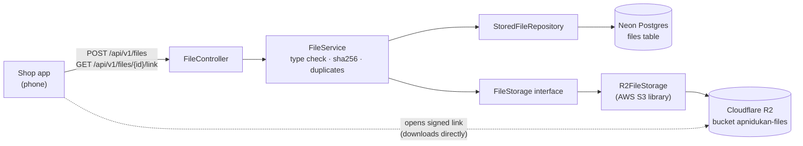
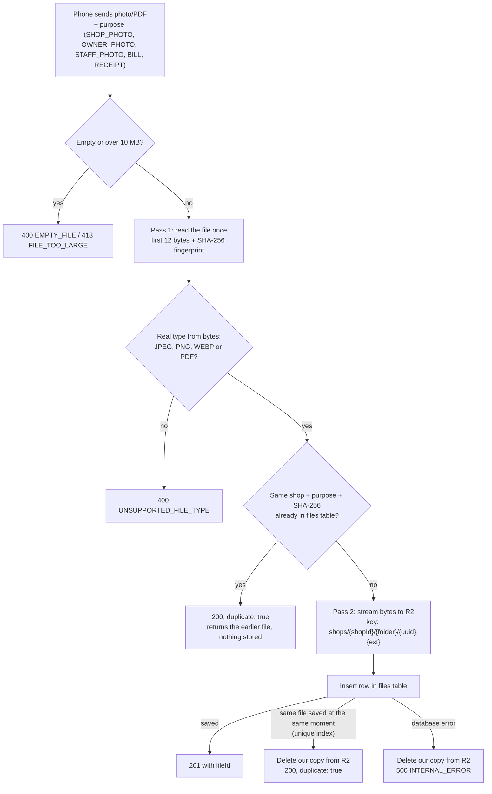
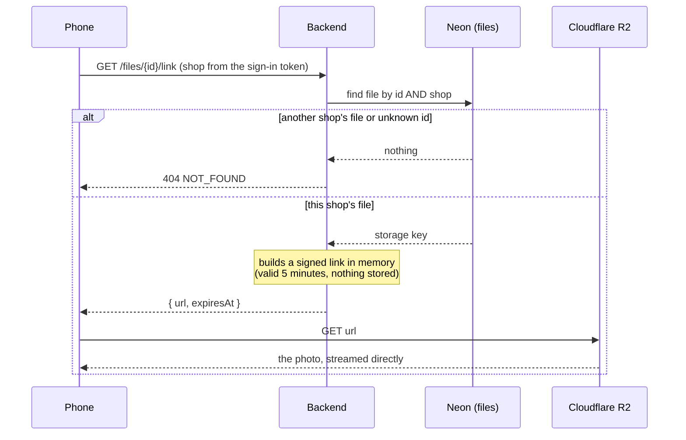
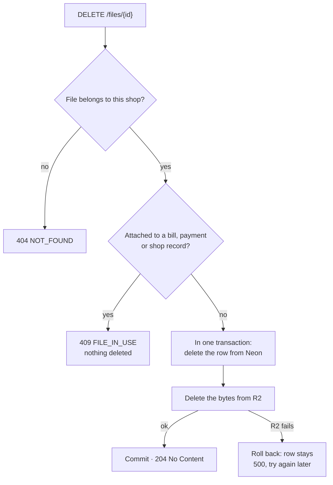
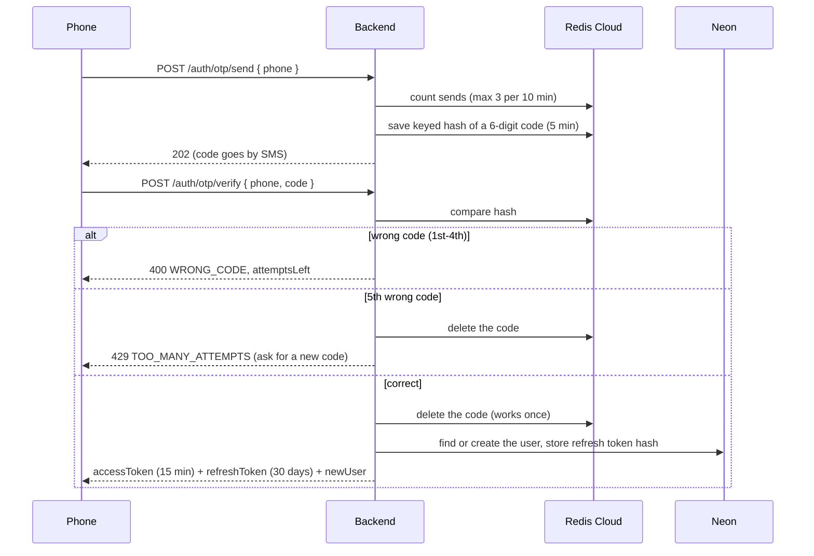
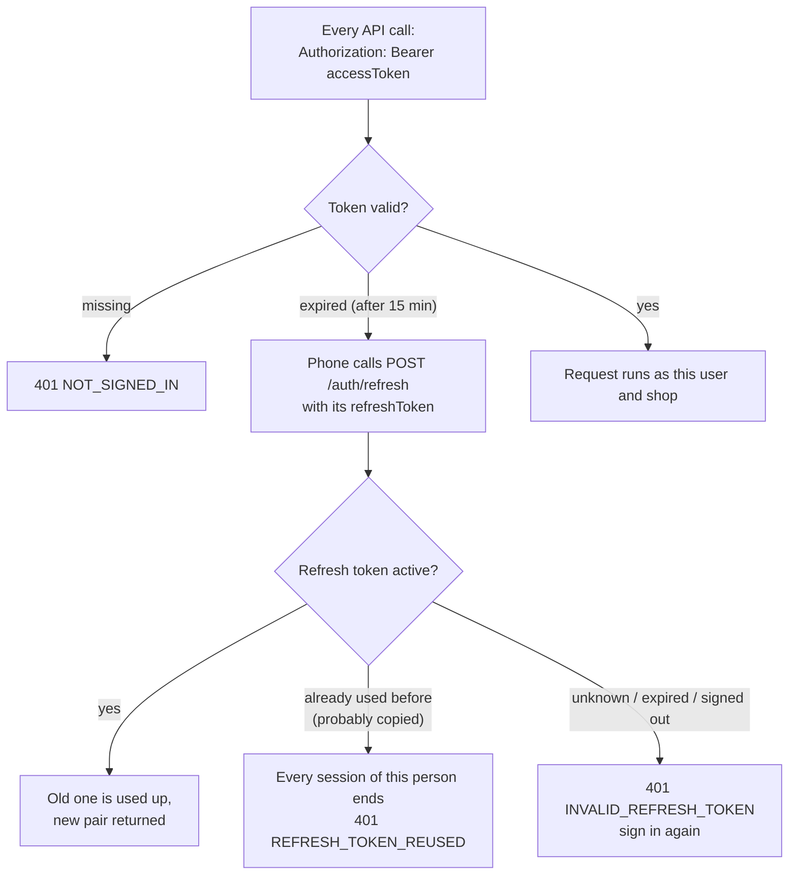

# Apni Dukan – backend

All the backend functionality of Apni Dukan: Spring Boot 4.1 · Java 21 · Neon Postgres · Flyway · Cloudflare R2 · Redis Cloud

Design: see the "Apni Dukan – Low-Level Design (Shop App MVP)" doc.

## What's built so far

| Module | Status |
| --- | --- |
| `common` | Error format, security (JWT check, CORS), current user/shop, clock |
| `auth` | Sign-in with phone OTP, tokens (refresh, sign-out), email verification, account recovery |
| `files` | Upload photos and PDFs to R2, duplicate detection, 5-minute signed links, delete (Neon + R2) |
| `shops` | Registration (details, GPS pin, GSTIN/Udyam, kirana or salon, owner and shop photos, Submit for visit), field-team approval, My shop, owner/helper/barber roles, history of every change |
| `salon` | Salon setup (services, barbers with optional sign-in and photo, weekly hours, booking settings), online booking, walk-ins, start code, no-show and strikes, breaks, leave, closed days, pause, the automatic end |
| `notifications` | Messages queued with the change they report, sent by a job with retries as Web Push (browser notifications), and as SMS for each message type whose template id is set |

## How file handling works

Photos and PDFs live in **Cloudflare R2**. **Neon Postgres** keeps one small row per file (`files` table).
The phone never gets the R2 keys: it receives short-lived signed links instead.

### Where things live



### Upload: `POST /api/v1/files`



### View or download: `GET /api/v1/files/{id}/link`



### Delete: `DELETE /api/v1/files/{id}`



## How sign-in works

No passwords and no Google sign-in. The phone number is the account; an email is optional and only used for recovery.
One-time codes live in **Redis Cloud** (never in Postgres); accounts and refresh tokens live in **Neon**.

### Sign in with phone OTP



### Staying signed in



`POST /auth/logout` ends one session. Admin pages (`/api/v1/admin/**`) need an admin account.

### Limits (against guessing and SMS abuse)

| What | Limit |
| --- | --- |
| Tries per code | 5 (the 5th wrong one destroys the code). Every try is counted before checking, so parallel guesses don't get extra tries |
| Codes per phone or email, per network | 3 per 10 minutes, 10 per day (20 per day from all networks together) |
| Wrong codes per phone or email, per network | 10 per day (50 from all networks together), then `429 LOCKED_FOR_TODAY` |
| Per network (IP; IPv6 counted per /64) | 10 code requests and 30 code checks per hour. The IP is the caller's real one, from the header set in `CLIENT_IP_HEADER` (see the checklist) |
| Robot check | Sign-in and recovery codes need a Cloudflare Turnstile token (`captchaToken`) once `TURNSTILE_SECRET_KEY` is set (400 `CAPTCHA_REQUIRED` / `CAPTCHA_FAILED`). If Cloudflare doesn't answer, the code is sent anyway; the limits still hold |
| Email codes per account | 10 per day |
| All SMS together | `SMS_DAILY_LIMIT` per day (default 500), then `503 SMS_PAUSED`. At 80% an error is logged, so an alert can fire before codes stop |
| JSON request body | 64 KB (only `POST /api/v1/files` may be larger, up to 10 MB) |

Limits count per phone **and** network, so a stranger guessing your number from their own network locks only
themselves. Every 429 carries a `Retry-After` header (seconds to wait).

"Signed out everywhere" (recovery, or a copied refresh token) takes effect at once: every access token carries a
session number, and older numbers are refused on their next call. A swapped refresh token coming back within
60 seconds counts as the app retrying (a reply lost on a weak network); later than that it counts as copied.
Only a refresh token that was already swapped
coming back counts as copied; an old device retrying a signed-out token just gets "sign in again".

### Endpoints (`/api/v1/auth`)

| Call | What it does |
| --- | --- |
| `POST /otp/send` `{phone, captchaToken}` | Sends a code. `+91` and a leading `0` are fine. 429 after 3 codes in 10 minutes |
| `POST /otp/verify` `{phone, code}` | Signs in (creates the account the first time) |
| `POST /refresh` `{refreshToken}` | New token pair |
| `POST /logout` `{refreshToken}` | Ends this session, 204 |
| `GET /me` · `PATCH /me {name}` | The signed-in person · set your name (salons see it on bookings) |
| `POST /me/delete-code` · `POST /me/delete {code}` | Delete your account: a code to your own phone, then 204. 409 `SHOP_OWNER` for a shop owner (close or hand over the shop first). See below |
| `POST /email/send-code` `{email, phoneCode?}` | Sends a 6-digit code to the email (10 min). Replacing an already verified email also needs `phoneCode` |
| `POST /email/change-phone-code` | Sends a code to your own phone, needed to replace a verified email. The old email is told after the change |
| `POST /email/verify` `{email, code}` | Marks the email verified |
| `POST /recover/start` `{email, newPhone, captchaToken}` | Lost phone: a code to the verified email and one to the new phone |
| `POST /recover/complete` | Both codes right: moves the account to the new phone and ends every old session |

### Deleting an account

One account works across every part of the app (kirana, salon, ...), so deleting it never deletes rows other
records point at. Instead, in one transaction: each module closes what is still open for the person
(`AccountDeletionListener`: upcoming salon bookings are cancelled with no strike and the salon is told "a customer
deleted their account", a barber's sign-in is unlinked, walk-in access goes, the "for" names on their bookings are
cleared, waiting messages are cancelled and the text of all their messages emptied, devices forgotten), a helper or
barber leaves their shop, every device is signed out and its device label cleared, and the `users` row loses its
phone, name and email (`deleted_at` is set). Past bookings, strikes and shop records stay, showing no name. A
booking or move waiting behind the deletion, or a token from before it, is refused (401). Messages to a salon about earlier
bookings (sent, or still waiting to go out) keep the name the salon saw then. The same phone can later sign up as a new
account. A module added later (kirana orders) plugs in its own `AccountDeletionListener` to cancel its open items.

## How shops work

A person registers one shop (for now) and becomes its **OWNER**; helpers will be added by the owner later.
Every shop gets a plain number as its code (1001, 1002, ...), given out by the database.

```mermaid
sequenceDiagram
    participant P as Phone
    participant B as Backend
    participant D as Neon
    P->>B: POST /shops {name, owner, address, pincode, lat/lng, GSTIN?, Udyam?}
    B->>D: shop (DRAFT, next code) + membership (OWNER)
    B-->>P: 201 shop
    P->>B: POST /auth/refresh
    B-->>P: new access token carrying shop + role
    P->>B: PATCH /shops/me {version, changed fields}
    alt version matches
        B->>D: save; Envers adds this new version to shops_aud, with who changed it
        B-->>P: 200 shop (version + 1)
    else someone saved in between
        B-->>P: 409 SHOP_CHANGED (reload and retry)
    end
```

| Call | What it does |
| --- | --- |
| `POST /api/v1/shops` | Registers your shop as `DRAFT`, you as owner. 409 `ALREADY_HAS_SHOP` if you have one. Then refresh your token |
| `GET /api/v1/shops/me` | Your shop, its status and your role (`myRole`). 404 `NO_SHOP` if none |
| `PATCH /api/v1/shops/me` | Owner only (403 `OWNER_ONLY`). Send `version` and only the fields to change; `""` removes GSTIN/Udyam |
| `PUT /api/v1/shops/me/photos` | Owner. `{version, ownerPhotoFileId?, shopPhotoFileId?}`: ids of photos uploaded to `POST /files` with purpose `OWNER_PHOTO` / `SHOP_PHOTO` |
| `POST /api/v1/shops/me/submit` | Owner. `{version}`: DRAFT → PENDING_VISIT. 409 `PHOTOS_REQUIRED` until both photos are set |
| `GET /api/v1/admin/shops?status=` | Field team (`users.admin`) only, else 403. Shops in a status (default `PENDING_VISIT`) with links to both photos |
| `POST /api/v1/admin/shops/{id}/approve` | Field team. `{version}` from the list they checked: PENDING_VISIT → APPROVED after the visit. 409 `SHOP_CHANGED` if the owner changed something since (reload, check, approve), 409 `WRONG_STATUS` from another status. Customers can find it from now on |
| `POST /api/v1/admin/shops/{id}/reject` | Field team. `{version, reason}`: the visit didn't pass but can be fixed, PENDING_VISIT → DRAFT. The owner sees `statusReason`, fixes it and submits again. Bookings already made stay (suspend to cancel them) |
| `POST /api/v1/admin/shops/{id}/suspend` | Field team. `{version, reason}`: APPROVED or PENDING_VISIT (e.g. found shut at its visit) → SUSPENDED, off the app. A salon's upcoming online bookings are cancelled and each customer is told ("isn't taking online bookings for now"; the field team's reason goes only to the owner). The salon can still run its own day (walk-ins) |
| `POST /api/v1/admin/shops/{id}/reinstate` | Field team. `{version}`: SUSPENDED → PENDING_VISIT, back in the visit list; live again only once approved after a new check (so nothing changed while suspended goes live unchecked). Cancelled bookings stay cancelled |

The owner gets a message for each field-team decision (approved, sent back, suspended, reinstated).

Rules: the GPS pin is required and must be inside India; pincode is 6 digits; GSTIN and Udyam are optional, checked,
and stored in capitals; text is trimmed. Unknown fields are refused with 400 `UNKNOWN_FIELD`, so nobody can send
`"status": "APPROVED"` for their own shop. Status moves DRAFT → (both photos, Submit) → PENDING_VISIT → (field team
visits and approves) → APPROVED. Changing the photos or the address (address line, area, city, pincode, map pin)
of an APPROVED shop sends it back to PENDING_VISIT for another check: customers can't find it until the field team
approves it again. Bookings already made stay and can be cancelled; moving one to a new time answers 409
`SALON_NOT_BOOKABLE` until the approval (`canMove` is false meanwhile). A new address rewrites the pending booking
reminders, so customers are sent to the new place. A photo that a shop or barber uses can't be deleted
(409 `FILE_IN_USE`).

A shop is a **kirana** or a **salon**: send `"type": "SALON"` when registering (left out = `KIRANA`). The type can't
be changed later; `GET /shops/me` returns it.

## How salon setup works

A salon lists its services, its barbers, which services each barber does and when each one works. Online bookings
are worked out from exactly these. Anyone in the salon can read the setup; only the owner can change it.

| Call | What it does |
| --- | --- |
| `GET` / `POST /api/v1/salon/services` | List (by `sortOrder`, then name) / add: `name`, `durationMinutes` (5–480, steps of 5), `pricePaise`, `priceIsFrom`, `sortOrder` |
| `PATCH /api/v1/salon/services/{id}` | Edit, or `"active": false` to switch off (kept for old bookings). Send `version`; 409 `SERVICE_CHANGED` if stale |
| `GET` / `POST /api/v1/salon/staff` | Barbers with their `serviceIds`, `hours`, `loginPhone`, `photoFileId` / add one: `name`, and optionally `phone` to give him his own sign-in |
| `PATCH /api/v1/salon/staff/{id}` | Rename, or `"active": false` when a barber leaves (409 `STAFF_HAS_BOOKINGS` while he has upcoming ones; his sign-in is removed). Switching back on: 409
`BLOCK_CONFLICTS` if a leave of his runs into a closed day (remove it, switch him on, add it again around that day). Send `version`; 409 `STAFF_CHANGED` if stale |
| `PUT` / `DELETE /api/v1/salon/staff/{id}/login` | `{phone}`: his sign-in becomes a BARBER member of the salon (409 `ALREADY_IN_A_SHOP` if that phone works in a shop). Delete: membership and walk-in access go, his sessions end at once |
| `PUT /api/v1/salon/staff/{id}/photo` | Optional photo: `{fileId}` of a `STAFF_PHOTO` upload, or `{"fileId": null}` to remove |
| `PUT /api/v1/salon/staff/{id}/services` | `{"version": 3, "serviceIds": [...]}` replaces what he does; newly added ones must be active services of this salon |
| `PUT /api/v1/salon/staff/{id}/hours` | `{"version": 3, "hours": [{"weekday": 1, "start": "10:00", "end": "14:00"}, ...]}` replaces his week |
| `GET` / `PATCH /api/v1/salon/settings` | Earliest booking (`minLeadMinutes`, default 30) and latest (`maxDaysAhead`, default 7). `version` is null until the first save |

**Database:** V4 runs `CREATE EXTENSION IF NOT EXISTS btree_gist` (needed by the no-overlap rule). Neon and the
Docker image used by the tests have it; on your own Postgres, the role running Flyway must be allowed to create it.

**Time:** every salon is in India (`Asia/Kolkata`, no daylight saving). Hours are `"HH:mm"` in salon time on
15-minute steps, `weekday` 1 = Monday ... 7 = Sunday, up to `"24:00"`; two blocks on one day make a split shift. They
are stored as minutes after midnight (10:00 = 600), so the database itself refuses overlapping blocks
(`ex_staff_hours_no_overlap`). Exact moments are stored in UTC and returned with their offset.

**Safety:** every call checks in the database that you belong to a salon (404 `NO_SHOP`, 409 `NOT_A_SALON`) and,
for changes, that you are its owner (403 `OWNER_ONLY`). Services and barbers are always looked up together with your
salon, so another salon's ids give 404; the database's keys also refuse linking a barber to another salon's service.
Changing a barber's services or hours raises his `version`, and both calls need the version you last read: two edits
from the same old screen run one after the other (row lock) and the second gets 409 `STAFF_CHANGED` instead of
silently replacing the first.

**Limits and errors:** up to 100 active services and 50 active barbers per salon (switched-off ones don't count):
409 `TOO_MANY_SERVICES` / `TOO_MANY_STAFF`, also when switching one back on. Two active services can't share a name,
capitals ignored: 409 `SERVICE_NAME_TAKEN`. Another salon's ids: 404 `SERVICE_NOT_FOUND` / `STAFF_NOT_FOUND`; in
`serviceIds` of `PUT .../services`, another salon's or a switched-off service is 400 `VALIDATION_FAILED` naming
`serviceIds`. A stale settings save is 409 `SETTINGS_CHANGED`. The limits are a guard against runaway lists, not
exact: two adds at the very same moment could both pass at 99.
Separately, one request carries at most 200 `serviceIds` and 50 blocks of `hours` (more is 400 `VALIDATION_FAILED`).

## Run it on your laptop

1. **Install:** JDK 21 (IntelliJ can download it). IntelliJ's bundled Maven is enough.
2. **Settings:** every `${...}` name in `src/main/resources/application.properties` needs a value.
   Put them in IntelliJ: Run → Edit Configurations → `ApniDukanApplication` → Environment variables
   (or in a `.env` file in this folder; it's ignored by Git).
   - `DB_URL`, `DB_URL_DIRECT`, `DB_USER`, `DB_PASSWORD` from Neon (use the `dev` branch).
     The pooled URL has `-pooler` in the host; the direct one doesn't.
   - `R2_ENDPOINT`, `R2_BUCKET`, `R2_ACCESS_KEY`, `R2_SECRET_KEY` from Cloudflare R2.
   - `REDIS_URL` from Redis Cloud, like `rediss://default:<password>@<host>:<port>`
     (`rediss` with two s = TLS; use `redis://` only if your database has TLS off).
   - `JWT_SECRET`: a long random value, at least 32 characters
     (for example the output of `openssl rand -base64 48`). Changing it signs everyone out.
   - `MSG91_AUTH_KEY` and `MSG91_OTP_TEMPLATE_ID`: the same values as in the OMR project. OTPs are sent as
     real SMS through MSG91 with that template until Apni Dukan has its own DLT registration.
     Later: `SMS_ACCOUNT_MOVED_ENABLED=true` with `MSG91_ACCOUNT_MOVED_TEMPLATE_ID`, the template for
     "your account was moved to a new number ending ##ENDING##" (sent to the old phone after account recovery).
     Off by default until that DLT template exists; required on the real server.
     `SMS_PROVIDER=log` prints SMS in the console instead (only if you choose it, e.g. out of MSG91 credit).
   - `MAIL_USERNAME` (your Gmail address) and `MAIL_PASSWORD` (its 16-letter app password), the same as in
     Vidyavriti. Email codes are sent through Gmail SMTP. `MAIL_ENABLED=false` prints them in the console instead.
   - Optional: `CORS_ALLOWED_ORIGINS`
     (default `http://localhost:5173`, the shop app's dev server; separate several with commas).
   - On the real server only: `APP_PRODUCTION=true`. The app then refuses to start if codes would be printed in
     the log or CORS allows localhost. Optional `SMS_DAILY_LIMIT` (default 500).
   Never commit real values.
3. **Run:** open this folder in IntelliJ, wait for Maven to download, then press ▶ next to `main` in
   `ApniDukanApplication.java`. On first start, Flyway creates the tables (`V1__create_files.sql`, `V2__create_users_and_refresh_tokens.sql`).
4. **Tests:** `mvn test` (or right-click `src/test/java` → Run tests). They start their own Postgres, Redis and S3
   stand-in in Docker (Testcontainers), so Docker must be running; they never touch Neon, Redis Cloud or R2.
   Without Docker the integration tests are skipped on your laptop (on CI they always run).
   `mvn verify` also runs the code checks (coverage gate, SpotBugs). It needs Docker, because without the integration
   tests the coverage gate fails; use `mvn verify -Djacoco.skip=true` if Docker isn't running.

## Try it

**Sign in** (the code arrives by SMS through MSG91)

```bash
curl -X POST http://localhost:8080/api/v1/auth/otp/send \
  -H "Content-Type: application/json" -d '{"phone":"9876543210"}'

curl -X POST http://localhost:8080/api/v1/auth/otp/verify \
  -H "Content-Type: application/json" -d '{"phone":"9876543210","code":"<code from SMS>"}'
```

Copy `accessToken` from the reply and send it on every other call:

```bash
curl http://localhost:8080/api/v1/auth/me -H "Authorization: Bearer <accessToken>"
```

**Files** need a shop: register one (`POST /api/v1/shops`, see "How shops work"), then refresh your token.
Without a shop, file calls answer `403 SHOP_REQUIRED`.

```bash
# Upload a bill photo: 201 with the file id; the same file again returns 200 and "duplicate": true
curl -X POST http://localhost:8080/api/v1/files -H "Authorization: Bearer <accessToken>" \
  -F "purpose=BILL" -F "file=@/path/to/bill.jpg"

# Link to view it for 5 minutes (add ?download=true to save instead)
curl "http://localhost:8080/api/v1/files/<id>/link" -H "Authorization: Bearer <accessToken>"

# Delete it from Neon and R2: 204, or 409 FILE_IN_USE if attached to a bill, payment or shop record
curl -X DELETE "http://localhost:8080/api/v1/files/<id>" -H "Authorization: Bearer <accessToken>"
```

`purpose` is one of `SHOP_PHOTO`, `OWNER_PHOTO`, `STAFF_PHOTO` (a salon barber), `BILL`, `RECEIPT`. A barber's
sign-in can't use files at all (403). Accepted types: JPEG, PNG, WEBP, PDF (checked from the
file's bytes, not its name), up to 10 MB. Another shop's file returns `404`.

## How salon bookings work

No money moves: customers book a time and pay the salon. One table, `appointments`, holds bookings, walk-ins and
blocks (break, leave, closed day). While a row holds a barber's time (CONFIRMED, IN_SERVICE or BLOCKED), the
database's rule `ex_appointments_no_overlap` stops anything else of that barber overlapping it. That rule, not Java,
decides every race.

```mermaid
sequenceDiagram
    participant C as Customer app
    participant B as Backend
    participant D as Neon
    C->>B: GET /salons?lat&lng, /salons/{id}/services, /salons/{id}/availability?services&date
    B-->>C: free start times (quarter hours)
    C->>B: POST /bookings {salonId, serviceIds, startAt} + Idempotency-Key
    B->>D: lock this customer; same key? strikes? 2 active? window?
    loop free barbers, least booked that day first
        B->>D: INSERT ... ON CONFLICT DO NOTHING
    end
    B->>D: services copied, event BOOKED, messages CONFIRMED (+ REMINDER at start - 60 min)
    B-->>C: 201 booking with start code (or 409 SLOT_TAKEN + 3 nearest times)
```

**Customer (any signed-in person):** `GET /salons?lat=&lng=` (approved, not paused, within 5 km),
`GET /salons/{id}`, `/services`, `/availability?services=a,b&date=YYYY-MM-DD`, `POST /bookings` (header
`Idempotency-Key`: a new UUID per attempt, the same one on retry), `GET /me/bookings?when=upcoming|past`,
`GET /bookings/{id}`, `POST /bookings/{id}/cancel`, `POST /bookings/{id}/reschedule {startAt}`, `PATCH /auth/me {name}`.
The customer picks services and a time; the backend picks the barber. Another person's booking is 404.

**Salon (`/api/v1/salon/...`):**

| Call | Who | What it does |
| --- | --- | --- |
| `GET /day?date=` | owner, helper, and anyone with walk-in access: all barbers; other barbers: their own | A column per barber with his hours and appointments (`notStarted` once its time passed). Never the start code |
| `GET /upcoming` | owner, helper, anyone with walk-in access: the salon; other barbers: their own | Bookings and held walk-ins still to come across the next 31 days, soonest first (up to 200), including ones running late |
| `GET /walk-ins/options?services=` · `POST /walk-ins` | owner, and people he gave walk-in access | Per barber: free now, or his earliest start today (exact minutes). Add with `startAt` null = start now (IN_SERVICE) or a later time today (held). 409 `BARBER_BUSY` with his next free time |
| `GET /members` · `PUT /members/{userId}/walk-in-access {allowed}` | owner | Who may add walk-ins besides the owner (a helper or barber) |
| `POST /appointments/{id}/start` | owner, helper; barber: own | From 15 min before until 15 min after the start (then it is a no-show). A booking needs `{code}` (400 `WRONG_START_CODE` with `triesLeft`; 5 wrong → 429 `START_CODE_LOCKED`) or `{withoutCode: true}` (owner, helper) |
| `POST /appointments/{id}/no-show` | owner, helper; barber: own | From 15 min after the start (the late allowance). Frees the time; a booking gives the customer a strike. Rarely needed: the job below does it within a minute |
| `POST /appointments/{id}/undo-no-show` | owner, helper | Within 24 h of the start: the strike goes and the booking is closed as cancelled by the salon ("No-show undone"), with no message to the customer. Later, only support can remove the strike |
| `POST /appointments/{id}/reassign {staffId}` · `/cancel {reason}` | owner, helper | Same time, another barber who does its services · salon cancel (customer told, no strike) |
| `GET /staff/{id}/blocks/conflicts` · `POST /staff/{id}/blocks` · `DELETE .../blocks/{blockId}` | break: owner, helper, the barber; leave: owner | 409 `BLOCK_CONFLICTS` listing what's in the way; nothing saved |
| `GET /closures` · `POST /closures {date}` · `DELETE /closures/{id}` | read: anyone in the salon; change: owner | A whole day closed for every barber, all or nothing; barbers added or switched on later get it too |
| `GET /pause` · `POST /pause {until?}` · `POST /resume` | read: anyone in the salon; change: owner, helper | Stop new online bookings (default: until midnight) |

On the salon's screens a booking shows the customer's name and, for the owner and helpers only (never barbers),
`customerPhone`, to call someone who is running late.

**Support (`/api/v1/admin/salon`, `users.admin` only):** `POST /strikes/lookup {phone}` lists a customer's strikes (latest
first, with salon and booking number) and `blockedUntil`; `POST /strikes/{appointmentId}/remove {reason}` takes
one back (204; the reason goes into the booking's history as `STRIKE_REMOVED`).

**Lifecycle:** CONFIRMED → IN_SERVICE (Start, with the customer's code) → COMPLETED by itself at its planned end (a
job every minute; there is no Done button, so a long service makes the next customer wait). CONFIRMED →
CANCELLED_BY_CUSTOMER / CANCELLED_BY_SALON. A booking or held walk-in not started 15 minutes after its start becomes
NO_SHOW by itself (the same job; a customer being served has always been started with their code by then): an online
booking gives the customer a strike and a "missed booking" message. BLOCKED → REMOVED. Every change is a
conditional update ("only if still CONFIRMED") and is logged in `appointment_events` with who did it.

**Rules:** 30 minutes' notice and up to 7 days ahead (the salon's settings); quarter hours only (400
`OUTSIDE_WINDOW`); at most 2 upcoming bookings per customer (409 `TOO_MANY_BOOKINGS`); a cancel less than 1 hour
before, or a no-show, is a strike; 3 strikes within 60 days block online booking until 30 days after the latest
(403 `BOOKING_BLOCKED`, walking in still works). One person's bookings run one after the other (an advisory lock),
so tapping twice can't pass these limits.

**Messages:** written to `notification_jobs` in the same transaction as the change; a job every 30 s sends what is
due as Web Push to each of the person's devices (`POST /me/push-subscriptions`, the key from
`GET /push/public-key`), retrying after 1, 5 and 15 minutes. Confirmation now; reminder 60 minutes before (only for
bookings made more than 75 minutes ahead) with the address, map link, start code and "held until"; rescheduled;
cancelled. Moving or cancelling a booking cancels its pending messages. The salon is told too: when a customer
books, moves or cancels online (or deletes their account), the owner and the barber it's with (if he has a sign-in)
get a message; these are never cancelled by a later change, which sends its own. The server only sends to the browsers' real
push services (Google, Mozilla, Apple, Microsoft), so a device address can't point it anywhere else.

**SMS (optional, per message type, no code change):** create the template on DLT and in MSG91 with the variables
below, then set its id on the server (Railway) and restart. From then on every new message of that type also goes
out as one SMS to the customer's phone (its own row, retried on its own). Remove the setting again to switch that
type's SMS off. Each variable is at most 30 characters (DLT's limit). Spending guards: at most 10 booking SMS per
person per day and `SMS_BOOKING_DAILY_LIMIT` (default 300) in total per day, counted separately from sign-in codes;
over a limit the SMS is dropped (the Web Push still goes out) and logged (the total limit once a day). Both limits
run for 24 hours from the first SMS counted. They guard spending, they aren't exact counts: in rare cases (MSG91
accepts but its answer times out, or Redis fails right after a send) one SMS can go out twice.

| Message | Setting | MSG91 variables |
| --- | --- | --- |
| Booking confirmed | `SMS_TEMPLATE_BOOKING_CONFIRMED` | `##SALON##`, `##WHEN##` (Tue 10 Nov, 6:30 PM), `##BOOKING##` |
| Reminder, 60 min before | `SMS_TEMPLATE_BOOKING_REMINDER` | `##SALON##`, `##TIME##` (6:30 PM), `##AREA##`, `##CODE##`, `##UNTIL##` (6:45 PM) |
| Rescheduled | `SMS_TEMPLATE_BOOKING_RESCHEDULED` | `##SALON##`, `##WHEN##`, `##BOOKING##` |
| Missed (became a no-show) | `SMS_TEMPLATE_BOOKING_NO_SHOW` | `##SALON##`, `##WHEN##` |
| Cancelled by the customer | `SMS_TEMPLATE_BOOKING_CANCELLED` | `##SALON##`, `##WHEN##` |
| Cancelled by the salon | `SMS_TEMPLATE_BOOKING_CANCELLED_BY_SALON` | `##SALON##`, `##WHEN##`, `##REASON##` |
| To the salon: new booking | `SMS_TEMPLATE_SALON_NEW_BOOKING` | `##CUSTOMER##`, `##WHEN##`, `##BARBER##`, `##BOOKING##` |
| To the salon: moved | `SMS_TEMPLATE_SALON_BOOKING_MOVED` | `##CUSTOMER##`, `##WHEN##` (the new time), `##BARBER##`, `##BOOKING##` |
| To the salon: cancelled | `SMS_TEMPLATE_SALON_BOOKING_CANCELLED` | `##CUSTOMER##`, `##WHEN##`, `##BARBER##`, `##BOOKING##` |

Example DLT text for the reminder: "Reminder: {#var#} at {#var#} today, {#var#}. Show code {#var#} at the counter.
Held till {#var#}. - Apni Dukan". The SMS uses the same MSG91 account as the sign-in OTP.

## Before going live (checklist)

- **Real caller IPs:** set `CLIENT_IP_HEADER` on Railway: `X-Forwarded-For` (the backend takes its last entry,
  the one Railway adds), or `CF-Connecting-IP` if Cloudflare's proxy (orange cloud) sits in front; then also make
  the Railway address reachable only through Cloudflare, or anyone calling it directly can send a made-up
  `CF-Connecting-IP`. Then check one request's IP against your phone's. The real server refuses to start without it.
- **Robot check:** create a Cloudflare Turnstile widget for the app's domain; the app shows it on the sign-in and
  recovery screens and sends its token as `captchaToken`; set `TURNSTILE_SECRET_KEY` on Railway (required by the
  real server). Point an alert at the log line "80% of the daily SMS limit used".
- **Redis Cloud:** set the eviction policy to `noeviction`, so limits and session numbers are never dropped
  under memory pressure. If Redis stops answering, signed-in calls keep working; sign-in codes and start codes
  answer 503 `SERVICE_BUSY` until it is back (`Retry-After: 5`).
- `APP_PRODUCTION=true`, own DLT templates, `SMS_ACCOUNT_MOVED_ENABLED=true`, a mail provider with `MAIL_FROM`.
- **Web Push keys:** run `npx web-push generate-vapid-keys` once and set `VAPID_PUBLIC_KEY`, `VAPID_PRIVATE_KEY` (and
  `VAPID_SUBJECT`, e.g. `mailto:` your support address) on Railway. The real server refuses to start without them.
  Keep the pair: a new one silences every saved device until it subscribes again.

## Errors

Every error looks like `{"code": "UNSUPPORTED_FILE_TYPE", "message": "...", "details": {}}`.
Sign-in errors use the same shape: `401 NOT_SIGNED_IN`, `401 TOKEN_EXPIRED`, `401 INVALID_TOKEN`, `403 FORBIDDEN`.
`409 TRY_AGAIN` means two requests changed the same thing at the same moment and the database undid this one:
nothing was saved, and sending it again works. `503 SERVICE_BUSY` (with `Retry-After`) means Redis or the database
didn't answer in time; nothing was done, try again in a few seconds.

## Database changes

Only through new Flyway files in `src/main/resources/db/migration` (`V7__...`, `V8__...`).
A table whose entity has `@Audited` also needs its `*_aud` history table in the same migration (Envers doesn't
create tables, because Hibernate only validates).
Never edit a migration that has already run. Hibernate is set to `validate`.
